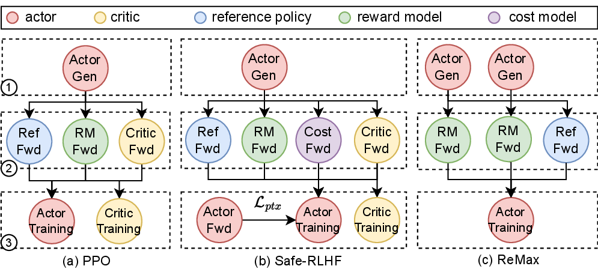

# verl 代码流程：从配置到一次 RL 更新

本页按用户更正后的仓库 [verl-project/verl](https://github.com/verl-project/verl) 展开。verl 是大模型强化学习后训练框架，论文背景是 [HybridFlow: A Flexible and Efficient RLHF Framework](https://arxiv.org/abs/2409.19256)。这里不复述安装命令，而是讲清代码流：配置如何进入 trainer，rollout/reward/critic/actor 如何组成一次 RL 更新。

!!! note "初学者先抓住"
    verl 的核心不是“实现了一个 PPO 公式”，而是把 RLHF/RLVR 的控制流和大模型训练/推理的分布式计算拆开。单进程 controller 负责算法步骤，远端 worker 负责 actor、rollout、critic、reference 和 reward 的大模型计算。

## 1. HybridFlow 的架构视角

{ width="920" }

<small>图源：[HybridFlow: A Flexible and Efficient RLHF Framework](https://arxiv.org/abs/2409.19256)，原论文图题：Architecture of HybridFlow。原论文图意：用户输入 RLHF dataflow、模型配置和设备配置；框架通过 ParallelWorker、Transfer Protocol、3D-HybridEngine、Auto Mapping 和 Resource Pool 把算法映射到物理设备。</small>

!!! note "图解：为什么 RLHF 框架要比 SFT 框架复杂"
    读这张图可以从左到右看：用户先给出 RLHF dataflow、模型配置和设备配置；中间的 ParallelWorker、Transfer Protocol、Auto Mapping 决定逻辑节点如何落到 worker；右侧的 3D-HybridEngine 负责在训练形态和生成形态之间切换。SFT 主要是一次前向、loss、反向和 optimizer step。RLHF/GRPO 多了 rollout 生成、reward 评分、reference log prob、value/advantage、actor update、critic update 和权重同步，每个节点本身又可能是 FSDP、Megatron-LM、vLLM 或 SGLang 的分布式程序。

## 2. RLHF dataflow：PPO、Safe-RLHF、ReMax 为什么不同

{ width="920" }

<small>图源：[HybridFlow: A Flexible and Efficient RLHF Framework](https://arxiv.org/abs/2409.19256)，原论文图题：Dataflow graph of 3 RLHF algorithms。原论文图意：比较 PPO、Safe-RLHF 和 ReMax 的 actor、critic、reference policy、reward model 与 cost model 数据流。</small>

!!! note "图解：算法差异就是 dataflow 差异"
    这张图不要逐个箭头硬背，先看多出来的模块。PPO 需要 actor generation、reference/reward/critic forward，再更新 actor 和 critic。Safe-RLHF 多了 cost model 和额外约束。ReMax 不训练 critic，而是用额外 generation 构造 variance reduction baseline。verl 这类框架要支持多算法，就必须让用户能重组这些节点，而不是把 PPO 写死在一个巨大训练循环里。

## 3. verl 的关键源码入口

| 入口 | 作用 |
| --- | --- |
| `verl/trainer/main_ppo.py` | Hydra 配置入口，初始化 Ray，构造 TaskRunner、数据集、资源池和 trainer |
| `verl/trainer/ppo/ray_trainer.py` | `RayPPOTrainer` 主训练循环，组织 rollout、reward、log prob、advantage 和更新 |
| `verl/trainer/ppo/core_algos.py` | PPO/GRPO/RLOO/ReMax 等 advantage estimator、policy loss、KL penalty |
| `verl/workers/engine_workers.py` | 统一的 ActorRolloutRefWorker 与 TrainingWorker |
| `verl/workers/rollout/` | vLLM、SGLang、HF、TensorRT-LLM 等 rollout backend |
| `verl/workers/reward_manager/` 与 `verl/utils/reward_score/` | reward 管理与函数式奖励实现 |
| `examples/ppo_trainer/`、`examples/grpo_trainer/` | 可运行示例脚本，展示配置怎么落到训练 |

!!! tip "怎么读源码更顺"
    先读 `examples/grpo_trainer/run_qwen3_8b_fsdp.sh` 或 `examples/ppo_trainer/run_qwen3_8b_fsdp.sh` 看配置，再读 `main_ppo.py` 看配置如何构造 trainer，最后读 `ray_trainer.py::fit` 看一次训练 step 的真实顺序。不要从 worker backend 细节开始，否则很容易被 FSDP/vLLM/SGLang 细节淹没。

## 4. 从命令行配置到 Trainer

典型 PPO/GRPO 示例最后都会进入：

```bash
python3 -m verl.trainer.main_ppo \
  algorithm.adv_estimator=grpo \
  actor_rollout_ref.model.path=Qwen/Qwen3-8B \
  actor_rollout_ref.rollout.name=vllm \
  actor_rollout_ref.rollout.n=5 \
  trainer.n_gpus_per_node=8
```

`main_ppo.py` 的主线是：

```text
Hydra 读取配置
  -> auto_set_device 与配置迁移
  -> 初始化 Ray
  -> TaskRunner.run(config)
  -> 构造 actor/rollout/ref worker、critic worker、资源池
  -> 加载 tokenizer / processor
  -> create_rl_dataset / create_rl_sampler
  -> RayPPOTrainer(...)
  -> trainer.init_workers()
  -> trainer.fit()
```

| 配置块 | 决定什么 |
| --- | --- |
| `data.*` | 训练/验证 parquet、prompt 长度、response 长度、batch size |
| `actor_rollout_ref.model.*` | actor/ref/rollout 共享或加载的模型路径与模型配置 |
| `actor_rollout_ref.actor.*` | actor 学习率、PPO minibatch、KL loss、动态 batch、FSDP 配置 |
| `actor_rollout_ref.rollout.*` | rollout backend、采样数量、tensor parallel、显存利用率 |
| `critic.*` | PPO critic/value model 配置；GRPO 通常不需要 critic 更新 |
| `reward.*` | reward model、函数式 reward 或远端 reward 服务 |
| `algorithm.*` | advantage estimator、gamma、lambda、KL penalty、GRPO 归一化等 |

## 5. 一次训练 step 的数据流

`RayPPOTrainer.fit()` 中，一次核心 step 可以简化成：

```text
batch prompts
  -> actor/rollout 生成 responses
  -> reward manager / reward model 计算 token_level_scores
  -> actor 重新算 old_log_probs
  -> reference policy 算 ref_log_prob
  -> critic 算 values（PPO 需要）
  -> KL penalty 或 KL loss 约束策略漂移
  -> compute_advantage
  -> update_critic（PPO 需要）
  -> update_actor
  -> update rollout weights
  -> checkpoint / metrics / validation
```

对应到代码中的关键函数：

| 步骤 | 代码位置 |
| --- | --- |
| 生成回答 | `async_rollout_manager.generate_sequences(...)` |
| 计算旧策略 log prob | `_compute_old_log_prob(...)` |
| 计算 reference log prob | `_compute_ref_log_prob(...)` |
| 计算 critic value | `_compute_values(...)` |
| 应用 KL reward penalty | `apply_kl_penalty(...)` |
| 计算 advantage | `compute_advantage(...)` |
| 更新 critic | `_update_critic(...)` |
| 更新 actor | `_update_actor(...)` |
| 同步 rollout 权重 | `checkpoint_manager.update_weights(...)` |

!!! note "难点解释：old_log_probs、ref_log_prob 和 rollout_log_probs"
    `old_log_probs` 是这批样本在更新前 actor 下的概率锚点，PPO 的 ratio 依赖它。`ref_log_prob` 来自 reference policy，用于 KL 约束，防止模型离 SFT/reference 太远。`rollout_log_probs` 可能来自生成 backend，本质上记录采样策略的概率；在异步或 off-policy 变体里，它和训练时重新计算的 old log prob 可能不同。

## 6. 把前面知识点对应到 verl 变量

初学者读 `verl` 时最容易迷路，因为同一个概念会在算法、数据、worker 和配置里出现不同名字。可以按下面这张表对齐：

| 前面学过的概念 | verl 里看哪里 | 怎么理解 |
| --- | --- | --- |
| state / prompt | `data.train_files`、`create_rl_dataset(...)`、`prompt` 字段 | LLM 场景里，prompt 就是当前状态；VLM 场景里还会带图片或视频 |
| action / response | `async_rollout_manager.generate_sequences(...)`、`responses` | 一段生成回答就是 trajectory；下一个 token 是最细粒度 action |
| policy / actor | `ActorRolloutRefWorker`、`_update_actor(...)`、`actor_rollout_ref.actor.*` | actor 负责生成，也负责被梯度更新 |
| reference policy | `_compute_ref_log_prob(...)`、`actor_rollout_ref.ref.*` | reference 像安全绳，用 KL 限制新策略偏离底座太远 |
| reward | `reward_manager`、`extract_reward(...)`、`token_level_scores` | reward 可以来自规则、模型、工具执行或外部服务 |
| KL penalty | `apply_kl_penalty(...)`、`algorithm.use_kl_in_reward` | 把偏离 reference 的代价从 reward 里扣掉 |
| value / critic | `_compute_values(...)`、`_update_critic(...)`、`critic.*` | PPO 用 critic 估计未来回报；GRPO 通常不训练 critic |
| advantage | `compute_advantage(...)`、`algorithm.adv_estimator` | 把 reward/value 变成“这次回答比预期好多少” |
| rollout backend | `actor_rollout_ref.rollout.name=vllm/sglang/trtllm` | 对应推理章节里的高吞吐生成、KV cache 和 batching |
| distributed training | `actor.strategy`、`fsdp_config`、`megatron`、`trainer.n_gpus_per_node` | 对应训练章节里的 FSDP、Megatron-LM、offload 和资源池 |
| VLM/VLA 输入 | `processor`、`data.image_key`、`multi_modal_inputs`、`images_seqlens` | 对应 VLM/VLA 章节里的视觉 token、processor 和 padding |
| world model RLVR | `rollout.n`、GRPO group、可验证 `reward` | 同一状态动作输入采样多个未来，再按指标比较谁更好 |

!!! note "难点解释：为什么同一个 actor 要在训练和推理形态之间切换"
    rollout 时，actor 像推理服务：重点是 decode 吞吐、KV cache、tensor parallel 和显存利用率。update_actor 时，actor 像训练模型：重点是梯度、optimizer state、FSDP/Megatron 切分和动态 batch。`verl` 的复杂性来自这两种形态都必须高效，而且每轮 RL 更新都要在二者之间来回切换。

一个具体 GRPO 示例可以这样读：

```bash
algorithm.adv_estimator=grpo
actor_rollout_ref.rollout.n=5
actor_rollout_ref.rollout.name=vllm
actor_rollout_ref.actor.use_kl_loss=True
data.image_key=images
```

| 配置 | 读法 |
| --- | --- |
| `algorithm.adv_estimator=grpo` | 不训练 critic，用同一 prompt 的多次采样做组内相对 advantage |
| `rollout.n=5` | 每个 prompt 生成 5 个候选回答，给 GRPO 形成比较组 |
| `rollout.name=vllm` | 生成阶段走推理后端，重点是吞吐和 KV cache |
| `actor.use_kl_loss=True` | actor loss 里直接加 KL，防止 reward 诱导模型跑偏 |
| `data.image_key=images` | VLM 数据里的图片列会进入 processor 和 `multi_modal_inputs` |

!!! example "有趣例子：把一道数学题看成 RL"
    prompt 是题目，response 是模型写出的解法，reward 是答案是否正确或格式是否通过，reference policy 是原来的 SFT 模型。GRPO 对同一道题采样多个解法：正确且格式好的解法 advantage 更高，错误或绕格式漏洞的解法 advantage 更低。`verl` 做的事情，就是把这些步骤批量化、分布式化，并让它能在 vLLM/SGLang 生成和 FSDP/Megatron 训练之间稳定切换。

## 7. PPO 和 GRPO 在 verl 里的差别

| 配置/组件 | PPO | GRPO |
| --- | --- | --- |
| `algorithm.adv_estimator` | `gae` | `grpo` |
| rollout 数量 | 常可为 1 | 通常对同一 prompt 采样多个回答 |
| critic/value model | 需要 | 通常不需要 |
| advantage 来源 | reward + value + GAE | 组内 reward 均值/方差归一化 |
| KL 约束 | 可用 KL reward penalty 或 KL loss | 常用 actor 侧 KL loss |

`core_algos.py` 里 GRPO 的核心就是按 `uid` 把同一 prompt 的多次采样分组，然后对 group reward 做相对归一化。这和 RLVR-World 的世界模型后训练很贴近：同一状态动作输入，采样多种下一状态预测，再看哪一个 decoded prediction 指标更好。

## 8. 3D-HybridEngine：为什么生成和训练要切换形态

{ width="920" }

<small>图源：[HybridFlow: A Flexible and Efficient RLHF Framework](https://arxiv.org/abs/2409.19256)，原论文图题：3D-HybridEngine workflow in one RLHF iteration。原论文图意：展示 actor 在训练和生成之间切换并行形态，包含权重 all-gather、prompt 加载、response 生成、权重重新切分和模型更新。</small>

!!! note "图解：actor 同时是训练模型和生成模型"
    读这张图时先抓住颜色和阶段：生成前要把训练切分下的权重转换成推理可用形态，生成 response 后又要回到训练切分来算 log prob、advantage 和梯度。RLHF 里 actor 既要像训练模型一样做反向传播，又要像推理服务一样高吞吐生成 response。训练更关心参数、梯度和 optimizer sharding；生成更关心 KV cache、tensor parallel 和 decode 吞吐。3D-HybridEngine 的核心就是减少 actor 在这两种形态之间切换时的权重搬运和显存冗余。

## 9. 把 verl 思路迁移到世界模型

verl 本身主要面向 LLM/VLM RL 后训练，但它的 dataflow 思路可以迁移到世界模型：

| verl 组件 | 世界模型 RLVR 类比 |
| --- | --- |
| prompt | 当前状态 \(s\)、动作 \(a\)、任务上下文 |
| response | 预测的下一状态、未来轨迹或视频 token |
| reward function | decoded prediction 与 ground truth 的 Accuracy/F1/MSE/LPIPS/SSIM |
| rollout.n | 对同一状态动作采样多种未来 |
| GRPO group | 同一输入下的候选未来集合 |
| actor update | 更新 world model，使高指标预测更可能 |

!!! warning "工程边界：视频世界模型不只是把文本换成图像"
    如果输出是视频或机器人轨迹，还需要 tokenizer/decoder、动作量化、时序 mask、视觉指标、显存更大的 rollout 和更严格的闭环评测。verl 的控制流有参考价值，但具体 worker、reward 和数据管线需要按 world model 任务改造。

## 10. 调试时先看什么

| 现象 | 优先检查 |
| --- | --- |
| reward 很快升高但评测不涨 | reward 漏洞、格式投机、验证集是否同分布 |
| KL 快速爆掉 | 学习率、KL 系数、reference 配置、采样温度 |
| 训练吞吐很低 | rollout backend、tensor parallel、动态 batch、权重同步 |
| GRPO 不稳定 | group size、reward 方差、响应长度偏置、KL loss |
| VLM/VLA 样本报错 | processor、multi_modal_inputs、图像 token 长度和 batch padding |

读 verl 源码时，把算法循环和系统后端分开：算法循环回答“这一步为什么发生”，系统后端回答“这一步如何在多卡上跑得动”。
