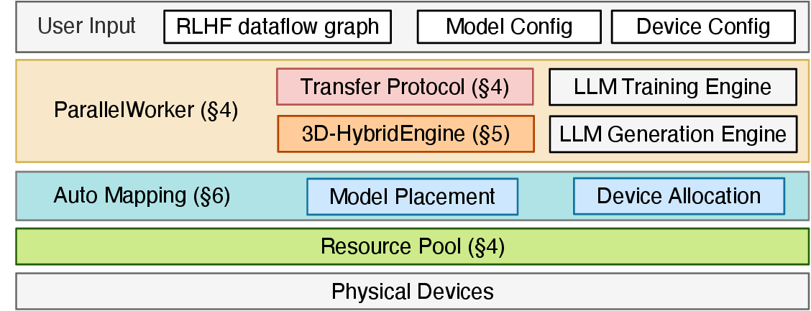
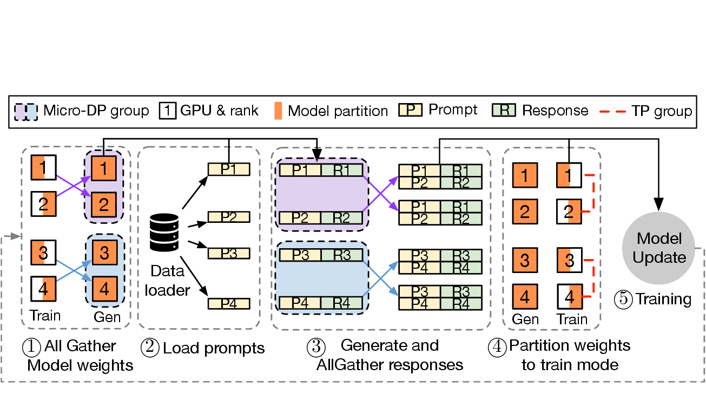

# verl 训练流程：一次 RL 更新到底发生了什么

`verl` 是一个面向大模型 RL 后训练的工程框架，官方定位是 `verl/HybridFlow: A Flexible and Efficient RL Post-Training Framework`。这篇不复述安装命令，也不把源码入口列成清单；它只回答一个问题：**为什么 RLHF/GRPO 训练不像 SFT 那样一轮前向、一个 loss、一次反向就结束？**

答案是：RL 后训练必须先让模型生成，再给生成结果打分，再把分数变成 policy gradient 的训练信号。也就是说，同一个 actor 既是“推理服务”，又是“训练模型”。`verl` 的复杂性几乎都来自这个切换。

## 先用 SFT 对比 RL 后训练

SFT 的一个 batch 可以这样读：

```text
prompt + target response
  -> policy forward
  -> cross entropy loss
  -> backward
  -> optimizer step
```

这里 target 已经在数据里，模型只需要拟合它。RLHF、RLVR、GRPO 的 batch 不一样：

```text
prompt
  -> actor rollout 生成 response
  -> reward / verifier 给 response 打分
  -> reference policy 计算 KL 约束
  -> critic 或 group baseline 估计 advantage
  -> actor 根据 advantage 更新
```

核心差异是：训练目标不是数据集里固定的 token，而是模型自己刚生成的 response。生成阶段越慢，reward 越噪，KL 越不稳，整个训练循环就越难跑。

## 数学变量怎样落到 batch 字段

读 `verl` 时，先把 RL 公式翻译成工程字段。

| RL 概念 | 公式里常见写法 | `verl` 里常见名字 | 怎么读 |
| --- | --- | --- | --- |
| 状态 | \(s_t\) | `prompts`、`input_ids`、多模态 `inputs` | 对 LLM 来说，prompt 和已生成前缀就是当前局面 |
| 动作 | \(a_t\) | 下一个 token | 最细粒度动作是 token choice |
| 轨迹 | \(\tau\) | `responses`、`sequences` | 一整段回答是 token 动作序列 |
| 奖励 | \(R\) 或 \(r_t\) | `token_level_scores`、`reward_tensor` | reward model、规则函数或 verifier 的分数 |
| reference policy | \(\pi_{\mathrm{ref}}\) | `ref_log_prob` | 用来限制 actor 偏离底座模型 |
| 旧策略 | \(\pi_{\theta_{\mathrm{old}}}\) | `old_log_probs` | PPO ratio 的分母，来自采样时的 actor |
| 价值函数 | \(V(s_t)\) | `values`、`returns` | PPO critic 的估计和训练目标 |
| 优势 | \(A_t\) | `advantages` | “这个 response/token 比预期好多少” |
| 组内样本 | \(\{o_i\}_{i=1}^G\) | `uid`、`rollout.n` | 同一道题的多条采样回答 |

这张表的重点不是背字段名，而是看出数据流：`response` 先被生成出来，`reward` 和 `ref_log_prob` 再被算出来，最后 `advantages` 才能出现。actor update 之前，很多张量都必须补齐。

## PPO 的 loss 为什么需要 old log prob

PPO 常用的 clipped objective 可以简化写成：

\[
L_{\mathrm{PPO}}(\theta)=\mathbb{E}_t\left[\min\left(r_t(\theta)A_t,\ \mathrm{clip}(r_t(\theta),1-\epsilon,1+\epsilon)A_t\right)\right]
\]

其中 ratio 是：

\[
r_t(\theta)=\frac{\pi_\theta(a_t\mid s_t)}{\pi_{\theta_{\mathrm{old}}}(a_t\mid s_t)}
\]

这里 \(A_t\) 表示优势，\(\epsilon\) 是裁剪范围，\(\pi_{\theta_{\mathrm{old}}}\) 是生成这批样本时的旧 actor。读这两行公式时抓住一个事实：PPO 不是随便提高高分答案概率，它还要知道“当前策略相对采样时策略改变了多少”。这就是 `old_log_probs` 必须保存或重算的原因。如果 ratio 失控，actor 会对一批旧样本过度更新，训练看似 reward 上升，实际策略可能漂移。

RLHF 还常加 reference KL。直觉上，reward 告诉模型“往哪里走”，KL 告诉模型“别离底座太远”。在 `verl` 里，这可能表现为 reward 里扣 KL penalty，也可能表现为 actor loss 里加 KL loss。

## GRPO 为什么用 `uid` 分组

GRPO 常见在数学推理和 RLVR 里，因为它通常不训练 critic，而是对同一 prompt 采样多个回答做组内比较。一个简化优势可以写成：

\[
A_i=\frac{R_i-\mu_G}{\sigma_G+\epsilon}
\]

其中 \(R_i\) 是同一题第 \(i\) 个 response 的奖励，\(\mu_G\) 和 \(\sigma_G\) 是这一组 response 的均值和标准差。这里的变量含义很关键：比较只发生在同一道题内部。一个很难的问题整体低分，不应该直接输给一个很容易的问题；GRPO 关心的是同一 prompt 下哪个回答更好。

工程上，`uid` 就是题号。假设 64 个 prompt，每个 prompt 采样 `rollout.n=5` 个 response，那么 batch 里会有 320 条 response。`uid` 告诉 advantage estimator 哪 5 条属于同一组。`rollout.n` 太小，组内比较噪声大；太大，生成成本和显存压力上升。GRPO 省掉 critic，并不等于系统更简单，它把难点从 value model 转移到了 rollout 吞吐、reward 方差和长度偏置上。

## HybridFlow 的核心：把算法图映射到 worker 图

{ width="920" }

<small>图源：[HybridFlow: A Flexible and Efficient RLHF Framework](https://arxiv.org/abs/2409.19256)，原论文图题：Architecture of HybridFlow。原图表达：用户提供 RLHF dataflow、模型配置和设备配置，框架用 ParallelWorker、Transfer Protocol、3D-HybridEngine、Auto Mapping 和 Resource Pool 把算法节点映射到物理设备。本站读法：左侧是“算法要做什么”，右侧是“多卡上怎么放得下、跑得动”。</small>

SFT 框架通常只需要处理训练形态：参数切分、梯度、optimizer state、checkpoint。RLHF 框架多了一条生成形态：KV cache、decode batching、tensor parallel、采样配置、权重同步。HybridFlow 的价值不是发明 PPO，而是把 PPO、GRPO、ReMax、Safe-RLHF 这类算法拆成可重组的数据流节点，再把节点映射到 Ray worker、FSDP/Megatron 训练后端和 vLLM/SGLang rollout 后端。

## 一次 `RayPPOTrainer.fit()` 可以这样读

不同版本的 `verl` 细节会变，但主循环的语义稳定：

```text
读取 prompt batch
  -> rollout backend 生成 responses
  -> reward manager / reward model / verifier 计算分数
  -> actor 计算 old_log_probs 或 rollout_log_probs
  -> reference policy 计算 ref_log_prob
  -> critic 计算 values（PPO/GAE 需要）
  -> 应用 KL penalty 或准备 KL loss
  -> compute_advantage
  -> update_critic（如果有 critic）
  -> update_actor
  -> 同步 rollout 权重
  -> 记录 metrics、validation、checkpoint
```

这段流程里最容易混的地方是 `actor` 的两种身份。生成 response 时，actor 像推理服务，关心 decode 吞吐、KV cache、采样温度、tensor parallel 和显存利用率。更新参数时，actor 像训练模型，关心 loss、反向传播、FSDP/Megatron、optimizer state、gradient accumulation 和 checkpoint。`verl` 把这两件事放进同一个 worker 体系里协调。

## 配置不是零散开关，而是在决定数据流

一个 GRPO 命令片段可以这样读：

```bash
python -m verl.trainer.main_ppo \
  algorithm.adv_estimator=grpo \
  actor_rollout_ref.model.path=Qwen/Qwen3-8B \
  actor_rollout_ref.rollout.name=vllm \
  actor_rollout_ref.rollout.n=5 \
  actor_rollout_ref.actor.use_kl_loss=True \
  trainer.n_gpus_per_node=8
```

`algorithm.adv_estimator=grpo` 决定 advantage 从组内 reward 来，不从 critic value 来。`rollout.n=5` 决定每个 prompt 生成 5 个候选，给组内比较提供样本。`rollout.name=vllm` 说明生成阶段走推理后端。`actor.use_kl_loss=True` 说明 actor update 时会显式压 reference KL。`trainer.n_gpus_per_node` 决定资源池容量，但真正吞吐还要看 rollout backend、sequence length、tensor parallel、FSDP/offload 和 reward 服务速度。

常见配置块可以按“谁生产哪个张量”来理解：

| 配置块 | 主要决定 | 对应张量或步骤 |
| --- | --- | --- |
| `data.*` | prompt 来源、长度、batch size、多模态字段 | `prompts`、`input_ids`、`attention_mask` |
| `actor_rollout_ref.model.*` | actor/reference/rollout 加载哪个模型 | policy 和 reference 的基础参数 |
| `actor_rollout_ref.rollout.*` | 生成后端、采样数量、TP、显存利用率 | `responses`、rollout log probs |
| `actor_rollout_ref.actor.*` | actor 学习率、mini-batch、KL loss、FSDP | `update_actor` |
| `critic.*` | value model 配置 | `values`、`returns`、`update_critic` |
| `reward.*` | reward model、规则、远端服务 | `token_level_scores` |
| `algorithm.*` | GAE/GRPO/RLOO/ReMax、KL、归一化 | `advantages`、KL penalty |

## 为什么权重同步会成为系统瓶颈

{ width="920" }

<small>图源：[HybridFlow: A Flexible and Efficient RLHF Framework](https://arxiv.org/abs/2409.19256)，原论文图题：3D-HybridEngine workflow in one RLHF iteration。原图表达：一次 RLHF iteration 中，actor 在训练并行形态和生成并行形态之间切换，包括权重 all-gather、prompt 加载、response 生成、权重重新切分和模型更新。本站读法：这张图解释了为什么 RLHF 的系统成本不只在 backward，也在“生成前后怎么搬权重”。</small>

训练并行和推理并行的最优形态不同。训练希望把参数、梯度、optimizer state 切开；推理希望快速 decode，常常需要适合 KV cache 和 tensor parallel 的布局。每轮 RL 更新都要在这两种形态之间来回走。如果权重同步慢，GPU 会等；如果 rollout 慢，trainer 会等；如果 reward 服务慢，生成好的 response 也只能排队。

所以调 `verl` 不能只看 loss。吞吐问题通常要同时看 `tokens/s`、rollout latency、reward latency、actor update time、weight sync time、GPU memory、KL、response length 和 invalid sample rate。

## 三个常见故障的真正原因

| 现象 | 表面解释 | 更可能的机制 |
| --- | --- | --- |
| reward 很快涨，验证不涨 | 模型学会了任务 | reward 函数有漏洞、格式投机、训练验证分布不一致 |
| KL 突然爆掉 | KL 系数太小 | 学习率、采样温度、ratio drift、reference 配置或 advantage 尺度一起失衡 |
| GRPO 不稳定 | group size 不够 | reward 方差、长度偏置、同组样本相关性、`norm_adv_by_std` 和 loss aggregation 共同影响 |
| 吞吐远低于预期 | GPU 不够 | rollout backend、权重同步、reward 服务、动态 batch、长 response 或 offload 路径卡住 |
| VLM/VLA 样本报错 | 数据坏了 | processor、image/video token 长度、padding、`multi_modal_inputs` 和 batch 拼接假设不一致 |

调试顺序也应该顺着数据流走：先确认 prompt batch 正确，再看 response 是否有效，再看 reward 是否可信，再看 KL 和 advantage 分布，最后看 actor/critic update。否则很容易在分布式 backend 里追半天，结果根因只是 reward 字段或 `uid` 分组错了。

## 迁移到世界模型时，能借鉴什么

`verl` 主要面向 LLM/VLM 后训练，但它的 dataflow 思想可以迁移到世界模型 RLVR：

| `verl` 组件 | 世界模型类比 |
| --- | --- |
| prompt | 当前状态、动作、任务上下文 |
| response | 预测的下一状态、未来轨迹、视频 token 或 latent |
| reward / verifier | decoded prediction 与 ground truth 的指标，或闭环任务分数 |
| `rollout.n` | 对同一状态动作采样多个未来 |
| GRPO group | 同一输入下候选未来的相对比较 |
| actor update | 提高高质量预测或高回报 rollout 的概率 |

但视频世界模型不能简单把文本 token 换成图像 token。它还需要 tokenizer/decoder、动作表示、时序 mask、视觉质量指标、长 horizon drift 检测和闭环评测。`verl` 给的是“多节点 RL 数据流怎么组织”的答案，不是“所有模态都已经开箱即用”的答案。

## 外部精读

- [verl GitHub](https://github.com/verl-project/verl)：看当前项目结构、示例和最新支持的 rollout / trainer 后端。
- [verl PPO Ray Trainer docs](https://verl.readthedocs.io/en/latest/workers/ray_trainer.html)：理解 trainer 的数据准备、WorkerGroup 初始化和训练循环。
- [HybridFlow 论文](https://arxiv.org/abs/2409.19256)：理解为什么 RLHF 框架要把 dataflow 和 resource mapping 拆开。
- [Hugging Face RLHF with PPO implementation details](https://huggingface.co/blog/the_n_implementation_details_of_rlhf_with_ppo)：理解 PPO/RLHF 中那些容易被忽略的工程细节。

## 本页结论

读 `verl` 的关键不是记住每个 worker 名字，而是把一次 RL 更新拆成三件事：生成 response，评价 response，把评价变成 policy gradient。PPO 需要 old log prob 和 critic，是为了控制旧样本上的更新幅度和降低方差；GRPO 用 `uid` 做组内比较，是为了不用 critic 也能构造相对 advantage；HybridFlow/3D-HybridEngine 解决的是 actor 在训练形态和推理形态之间来回切换的系统成本。把这条链看清，源码入口、配置字段和日志指标才会连成一个整体。
