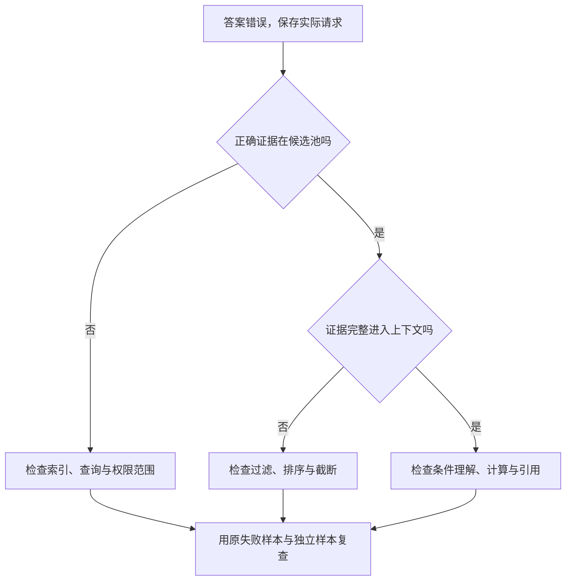

# 从失败现象选择技术方案

一种方法可能有效，却没有作用在当前瓶颈上。文档问答引用错了规则，换成更快的 GPU 不会修复答案；生成速度慢，继续优化离线准确率也不能说明请求何时返回。技术选择需要先定位错误或耗时发生在哪一步。

## 用同一条文档问答请求定位问题

用户问签收9天的普通商品能否退款。系统应读取当前7天规则，却引用了旧版14天规则并回答可以。先保留问题、候选文档、进入上下文的片段和最终答案，就能区分三种故障。

| 观察到的记录 | 当前有证据支持的诊断 | 最小修改与验证 |
| --- | --- | --- |
| 候选池没有当前规则 | 召回或索引覆盖不足 | 补索引与版本字段，检查同一问题能否召回 |
| 候选池有当前规则，上下文只有旧版 | 排序、过滤或截断有问题 | 固定候选池，单独检查版本过滤与排序 |
| 上下文明确写7天，仍判9天可退 | 条件理解、计算或输出绑定错误 | 结构化抽取条件，对比确定性规则计算 |

三种故障可能同时存在，修好一项后还要重新跑完整请求。扩大模型可能影响某些环节，但现有记录已经提供了更具体、成本更低的排查入口。详细流程见[RAG 基础](../foundations/prompt-engineering-cot-and-rag-basics.md)。

## 正确以后，再把耗时分段

假设同一类请求平均耗时1000 ms，其中检索100、prefill 300、decode 600。这些数是算例，不是本站测量。把 decode 加速到两倍，总耗时变为700 ms，整体加速约1.43倍；即使 decode 耗时降到零，其他400 ms仍然存在。

\[
S=\frac{1}{(1-f)+f/s},\qquad f=0.6,\quad s=2.
\]

这只是固定工作量、分段可加的估算。线上有排队与并发，优化一个阶段还可能改变队列，因此最终应在相同输入输出长度和负载下测 TTFT、输出间隔与尾延迟。[服务系统](../inference/serving-systems.md)解释这些状态怎样相互作用。

## 量化、缓存与蒸馏各改变什么

| 选择 | 直接改变的对象 | 前提 | 需要重测什么 |
| --- | --- | --- | --- |
| 权重量化 | 参数的存储和参与运算的数值 | runtime 存在适配的实际算子 | 质量、峰值显存、解量化和端到端耗时 |
| KV量化或压缩 | 每请求保存的历史状态 | 精度与位置语义得到处理 | 长上下文行为、KV占用、decode时间 |
| 前缀缓存 | 重复前缀的 prefill 工作 | token、模型及影响KV的条件一致 | 命中率、缓存容量与首token时间 |
| 投机解码 | 每次目标验证推进的token数 | 草稿成本和接受长度适合当前负载 | 验证语义、吞吐、接受长度与尾延迟 |
| 蒸馏 | 学生的参数或生成路径 | 有教师信号、训练预算与任务数据 | 同结构学生基线、质量与运行成本 |

权重占用不是全部显存。若7B模型的BF16权重约14 GB，四条长请求的KV共16 GiB，把权重压小也不会自动压小这16 GiB。应先区分资源对象，再选择[压缩方式](../foundations/model-compression-pruning-and-nas-basics.md)。

## 视频少步生成，要先确定删掉的是哪种工作

一次生成的网络调用数、每次调用的 token 数和每个 token 的计算成本都影响时间。换求解器主要改变数值积分方式；蒸馏改变训练目标，让学生承担更少步的生成；缓存尝试复用某些状态。这些变化可以组合，但必须分别验证。

同一初始噪声和条件下，先比较完整基线与单项改动的输出。如果只减少步数，细节可能变化；如果复用缓存，须确认被复用的状态是否仍对应相同噪声时间和条件。视频还需观察后续帧漂移、运动和跨段一致性，单张首帧不足以评价。具体例子见[视频训练与采样](../diffusion/video-training-and-sampling-1029-1246.md)。

## 机器人失败时，先区分状态、动作与执行

假设模型给出正确抓取位置，机械臂却总在物体移动后抓空。先检查图像的采集时间、推理延迟、动作队列和执行时间。若0.2 m/s运动中的物体对应观测已陈旧0.3 s，仅时间差就可能造成约6 cm位置差；这时增加模型参数并未直接处理旧观测。

相反，如果时间和坐标都正确，策略仍反复在同一种接触状态失败，就需要检查动作表示、训练覆盖与反馈。世界模型能在候选动作间提供预测，但预测误差也会进入决策。应先用受控动作对照检查模型是否响应动作，再评估加入规划是否提高独立任务成功率，参见[不确定性与风险规划](../world-models/uncertainty-and-risk-aware-planning.md)。

## 一次选择需要留下什么依据

写明观察到的现象、当前证据、准备改变的机制，以及能够推翻判断的结果。例如“若当前规则已正确进入上下文，改索引仍不能修复条件比较”，就是一个清楚的边界。比较方案时固定任务和资源约束，保留失败样本与独立评价，不用方法的新旧或名字替代证据。

[评测与消融](../training/evaluation-and-ablation-methodology.md)帮助区分组合收益和单项收益，[技术对照表](comparison-tables.md)则用接口和状态区分容易混在一起的方法。

## 把方案选择写成一条可回看的记录

每次换模型、runtime 或 kernel 时，保留四行就够开始：观察到的现象、被怀疑的机制、最小改动、能推翻判断的结果。比如“TTFT 变长，怀疑排队；固定输入长度后分别比较 queue time 和 prefill；若 queue time 不变而 prefill 变长，假设被推翻”。这比把方案名字和最终分数放在同一张表里更能帮助下一次排查。

记录还应标出哪些条件没有比较。换量化格式时若同时换了 batch、输出长度和 kernel，得到的速度差异只能说明整套配置不同。把未控制因素写出来，读者就知道这条结论只能用于哪一段工作负载。

**来源与改编说明**：本文的决策例子来自站内推理、量化、扩散和具身页面的实验边界；Amdahl 估算、RAG 排查和部署接口分别链接到对应的原始教程、论文和源码。这里的表格用于组织证据，不是对某个方案的通用排名。
