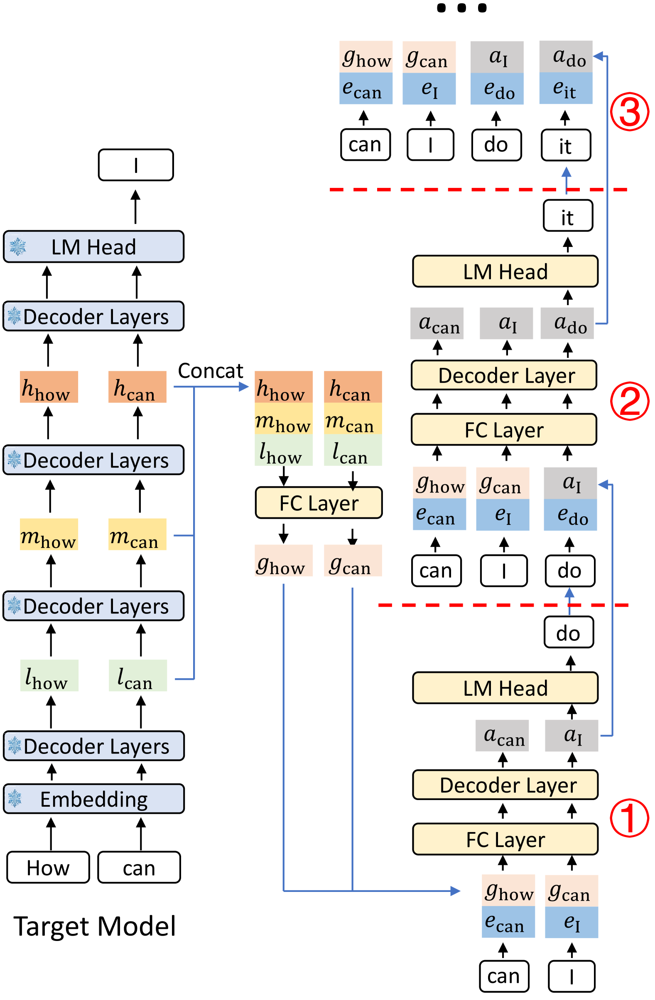
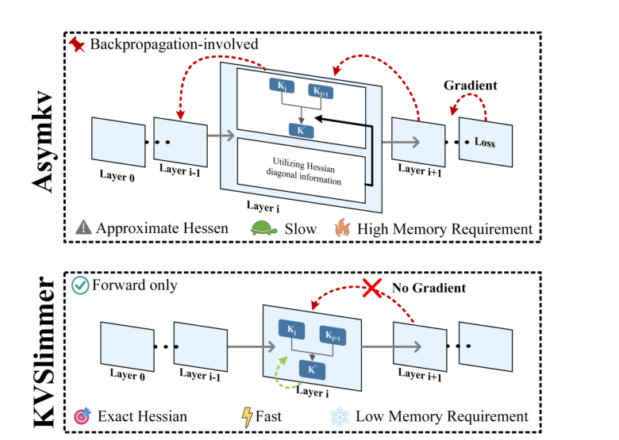
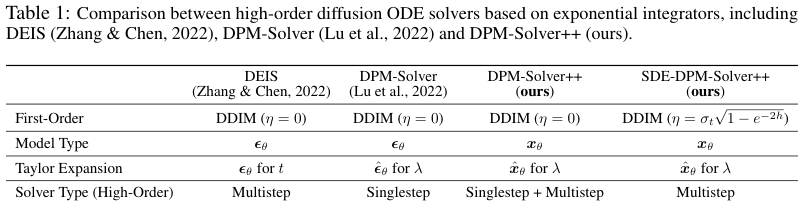
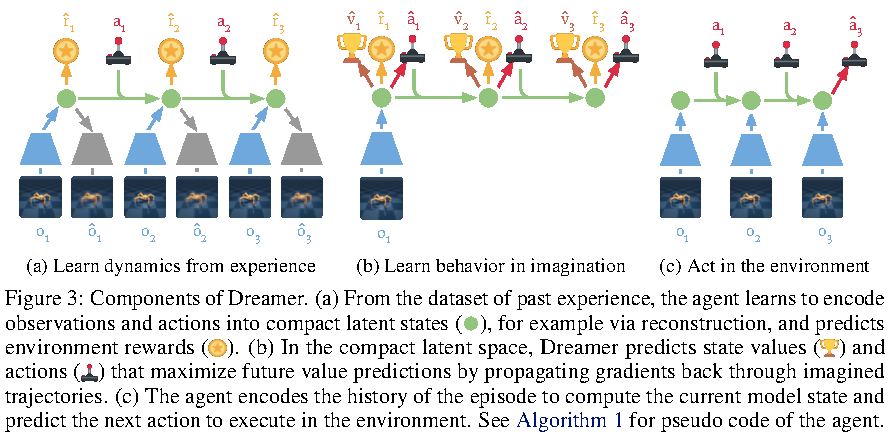
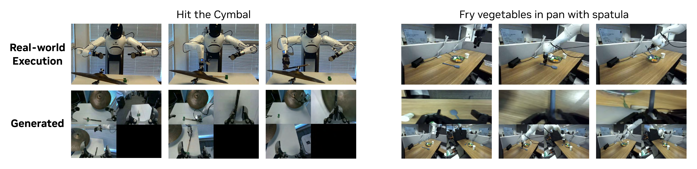
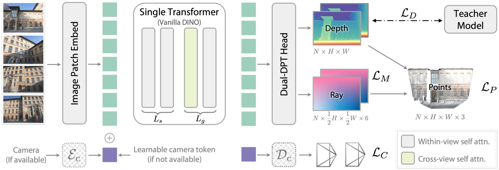
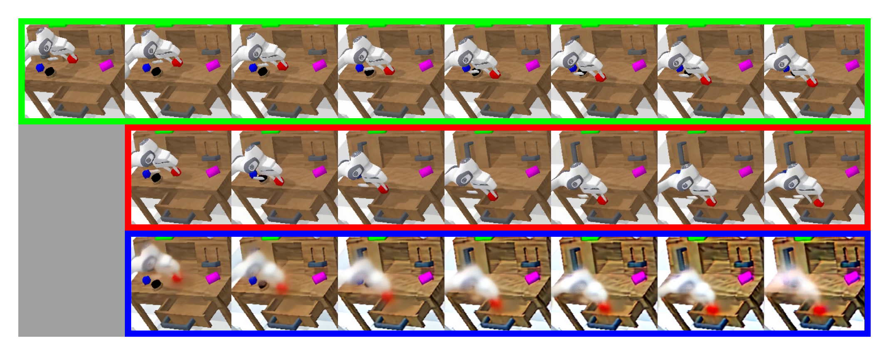

# 按接口比较技术方法

两个方法都写“更快”或“更准确”，并不代表它们解决同一问题。先比较输入、输出、训练目标和运行状态，再看相同协议下的结果。下面的表用于定位差异，具体性能应回到来源的实验设置。

## 同一条模型链上的不同改动

| 方法 | 直接改动 | 主要保存的状态 | 比较时要固定什么 |
| --- | --- | --- | --- |
| Attention | 当前 query 如何读取其他位置 | 自回归推理的历史 KV | 序列长度、head配置、mask与精度 |
| Mamba/SSM | 历史如何进入递推记忆 | SSM与短卷积状态 | 模型宽度、任务、序列长度与版本 |
| MoE | 每token由哪些专家处理 | 专家参数、路由与通信缓冲 | 总/激活参数、路由、负载与设备拓扑 |
| LoRA | 权重更新的参数化 | 低秩增量及优化器状态 | 基座、数据、目标与rank |
| 量化 | 数值表示及对应计算路径 | 低比特值、scale、元数据 | 格式、分组、kernel与任务质量 |
| 蒸馏 | 学生接收的监督信号 | 教师或离线目标、学生参数 | 学生结构、数据量与训练预算 |

这些行处在不同层。MoE 可以配合 attention 或 SSM，LoRA 可以用于其中某些权重，量化又可以作用于部署路径。把它们排成一张统一“先进程度”榜没有明确意义。

## 同样是预测，随机变量却不同

| 任务 | 条件 | 预测对象 | 训练时需要的目标 | 推理时的依赖 |
| --- | --- | --- | --- | --- |
| 自回归文本 | 已知或已生成前缀 | 下一个token分布 | 移位标签 | 新token成为后续输入 |
| 扩散/flow | 带噪状态、时间及条件 | 噪声、数据或速度等 | 由数据与噪声构造的标签 | 多次网络预测组成采样轨迹 |
| VLM问答 | 图像或视频与文本 | 答案token或结构化输出 | 配对、问答或其他多模态目标 | 视觉信息受编码与上下文限制 |
| VLA策略 | 观测历史与任务 | 动作或动作段分布 | 示范或交互反馈 | 执行会改变后续观测 |
| 动作条件世界模型 | 状态/历史与候选动作 | 未来状态、观测、奖励等 | 时间对齐的后续记录 | 可预测多步，但误差会积累 |

扩散时间描述噪声过程，环境时间描述实际演化，动作段索引描述控制序列。这些维度都可能出现在同一个视频动作模型中，比较结构前先给每根轴命名。

## 一组小数字说明为什么不能混用指标

假设模型A在100条固定请求上答对85条，B答对87条，这是任务正确率。另有测试显示A平均输出100 token用1 s，B输出50 token用0.8 s，仅由这两个时间无法认定B的逐token速度更快；输出量已经不同。真实比较还要区分prefill、decode和排队。

同样，视频生成的网络调用数不能直接替代首帧延迟，世界模型的像素误差不能直接替代控制成功率，量化后的文件大小不能直接替代GPU峰值显存。每个指标都应写出测量对象、分母和协议。

## 比较资料时怎样回到正文

[模型结构](../model-architectures/index.md)解释算子和状态，[训练](../training/index.md)解释目标与更新，[推理](../inference/index.md)解释请求和缓存。下面保留方法图与具体论文入口，用于核查每一种变化实际发生在哪一层。图中报告的性能属于对应原文，本站没有把它们当成本地复现实测。

## 推理加速与 KV 成本

这组方法都容易被归到“推理更快”，但省的成本不一样：有的减少 decode 步数，有的让 draft 更准，有的压 KV，有的把训练目标改成可服务投机解码。

{ width="860" }

<small>图源：`EAGLE-3`，Figure 5。原论文图意：展示 EAGLE-3 在推理时由 draft model 递归生成候选，再由 target LLM 执行 verification 的 pipeline。本站读法：投机解码的收益取决于 draft 时间、verification 并行效率、接受长度、KV 分支和 runtime batching，而不是单独看 draft loss。</small>

| 方法 | 主要省什么 | 改了哪一层 | 关键证据 | 不能直接外推 |
| --- | --- | --- | --- | --- |
| [EAGLE](../paper-deep-dives/inference/eagle.md) | decode step / target forward 次数 | feature-level draft + tree attention + lossless verification | speedup、draft 输入消融、tree attention 实验 | 不能证明所有 runtime / batch 形态都有同等收益 |
| [EAGLE-2](../paper-deep-dives/inference/eagle-2.md) | draft tree 候选预算 | confidence calibration + dynamic draft tree | average acceptance length、静态/动态树对比 | confidence 在新任务桶上可能失准 |
| [EAGLE-3](../paper-deep-dives/inference/eagle-3.md) | draft 训练分布和递归接受率 | training-time test + direct token prediction + 多层 feature fusion | acceptance depth、SGLang/vLLM throughput | 离线接受率不等价于 P99 降低 |
| [MTP](../training/mtp-and-speculative-decoding.md) | 训练信号密度 / 可选 draft 能力 | 多 token prediction objective | DeepSeek-V3 / Nemotron 等技术报告的 ablation 和吞吐说明 | MTP 训练有效不等于上线必然用作 speculative draft |
| [KVSlimmer](../paper-deep-dives/inference/kvslimmer.md) | KV memory / decoder latency | 非对称 KV 合并，重点压 Key | KV memory、decoder efficiency、head alignment | 压 KV 后仍需检查长时一致性和候选排序 |

{ width="820" }

<small>图源：`KVSlimmer`，Figure 1。原论文图意：对比 AsymKV 和 KVSlimmer 的 KV 合并方式。本站读法：KV 优化要问“压的是哪个 cache、压缩后 attention 语义是否保持、长上下文 decode 是否真的变快”。</small>

## 少步生成与流式视频

这些生成方法处理数值求解、学生训练、因果化或训练与推理条件差异。用于世界模型时，还需要动作接口和任务评估，生成效率本身不能证明规划效果。

{ width="820" }

<small>表源：`DPM-Solver++`，Table 1。原表保留英文算法字段。本站读法：DPM-Solver++ 是“不重训模型、换采样器”的加速路线，和 DMD/DMD2 这类重新训练学生的路线不是同一层。</small>

| 方法 | 解决哪一环 | 训练是否改变 | 推理路径 | 证据等级 | 世界模型读法 |
| --- | --- | --- | --- | --- | --- |
| [DPM-Solver++](../paper-deep-dives/diffusion/dpm-solver-plus-plus.md) | guided sampling 少步稳定性 | 不改变模型训练 | 换 ODE solver、data prediction、thresholding | benchmark + ablation | 比较固定模型下的采样成本；不直接检验动作因果 |
| [DMD](../paper-deep-dives/diffusion/dmd.md) | 一步分布匹配蒸馏 | 训练学生 | real/fake score 差分 + regression | benchmark + qualitative | 把推理成本转移到离线训练 |
| [DMD2](../paper-deep-dives/diffusion/dmd2.md) | DMD 稳定性和质量 | 训练学生和 fake critic | TTUR、GAN 监督、backward simulation | benchmark + ablation | 适合少步生成 baseline，但仍需动作敏感评测 |
| [CausVid](../paper-deep-dives/diffusion/causvid.md) | 双向视频扩散转流式 AR | causal student 后训练 | ODE init + asymmetric DMD + KV cache | system latency + benchmark | 解决 streaming rollout，但要看长期漂移 |
| [Self Forcing](../paper-deep-dives/world-models/self-forcing.md) | train-test gap / self-rollout 漂移 | 训练中执行 AR self-rollout | rolling KV cache + distribution matching | ablation + system efficiency | 训练使用自身生成历史；实际动作控制效果需另外验证 |

## 世界模型的输出由谁使用

这组路线回答的是“世界模型到底被谁消费”。Dreamer 被 actor/value 消费，Genie 被交互 latent action 消费，LingBot-World 被实时世界模拟消费，DreamZero 则直接把未来视频和动作放进同一模型。

{ width="820" }

<small>图源：[Dreamer](../paper-deep-dives/world-models/dreamer.md)，Figure 3。原论文图意：Dreamer 学习 latent world model，并在 imagined trajectories 上训练 action model 和 value model。本站读法：世界模型最硬的证据不是视频好看，而是 imagined rollout 是否改善策略学习。</small>

| 方法 | 核心接口 | 训练信号 | 被谁消费 | 强证据 | 边界 |
| --- | --- | --- | --- | --- | --- |
| [Dreamer](../paper-deep-dives/world-models/dreamer.md) | RSSM latent dynamics | 观测与奖励预测、actor/value目标；继续概率等细节随版本区分 | policy / value | control benchmark、ablation | 不证明高清视频世界模拟自然有效 |
| [Genie](../paper-deep-dives/world-models/genie.md) | latent action + video tokens | 大规模视频、自监督 latent action | 交互式 dynamics | scaling、latent action 可控性 | latent action 不等于真实机器人动作 |
| [LingBot-World](../paper-deep-dives/world-models/lingbot-world.md) | 视频生成底座 + action conditioning | 多阶段视频/交互训练 | 实时世界模拟器 | system pipeline、实时化、benchmark | demo 和世界一致性仍需闭环评测 |
| [DreamZero](../paper-deep-dives/embodied-ai/dreamzero.md) | joint video-action WAM | 视频动作联合去噪、post-training | policy / robot execution | real robot task progress、ablation、failure case | 视频预测错时，动作会跟着错 |

{ width="860" }

<small>图源：`World Action Models are Zero-shot Policies`，Figure 2。原论文图意：DreamZero 同时生成未来视频和动作。本站读法：联合目标使视频与动作在同一训练流程中建模；两者是否正确协调，需要动作与真实执行结果验证。</small>

## 几何状态与动作表示

这组方法都和具身状态有关，但层级不同：DA3、VGGT 和 MapAnything 更偏几何状态，SpatialVLA 把 3D 表征接入动作接口，VPP 用视频预测表征直接改善 policy。

{ width="860" }

<small>图源：`Depth Anything 3`，Figure 2。原论文图意：DA3 使用跨视角 self-attention 和 Dual-DPT head 输出 depth 与 ray。本站读法：几何状态不是漂亮点云，而是相机、深度、ray、点云能否稳定进入 episode schema 和 world-model state。</small>

| 方法 | 提供什么状态 | 和动作的关系 | 证据类型 | 接到哪里 |
| --- | --- | --- | --- | --- |
| [DA3](../paper-deep-dives/embodied-ai/depth-anything-3.md) | depth、ray、camera、点云/3DGS | 给 world model 和 VLA 提供多视角几何状态 | benchmark、ablation、demo、teacher 训练说明 | 相机/深度、episode schema、几何状态 |
| [VGGT](../paper-deep-dives/embodied-ai/vggt.md) | camera、depth、point map、track | 给动态场景和多视角状态提供 feed-forward 3D 表征 | benchmark、runtime、ablation | 多相机状态、点云、轨迹回放 |
| [MapAnything](../paper-deep-dives/embodied-ai/mapanything.md) | ray directions、ray depths、poses、metric scale | 把 calibration、poses、depth 等已有几何输入融合成 metric reconstruction | benchmark、input ablation、training recipe、speed/memory profiling | 机器人几何状态融合、metric map、depth completion |
| [SpatialVLA](../paper-deep-dives/embodied-ai/spatialvla.md) | Ego3D position encoding、adaptive action grids | 把 3D 空间直接接到动作 token | simulation + real robot success | VLA 动作接口、空间泛化 |
| [VPP](../paper-deep-dives/embodied-ai/video-prediction-policy.md) | video prediction intermediate features | 用预测表征训练机器人 policy | CALVIN/MetaWorld/真实机器人 | 视觉 tokenizer、policy 表征、失败 replay |

{ width="860" }

<small>图源：`Video Prediction Policy`，Figure 12。原论文图意：绿色是真实未来，红色是预测未来，蓝色是 predictive representations。本站读法：预测表征不必生成清晰像素，但必须保留会影响动作的未来变化。</small>
