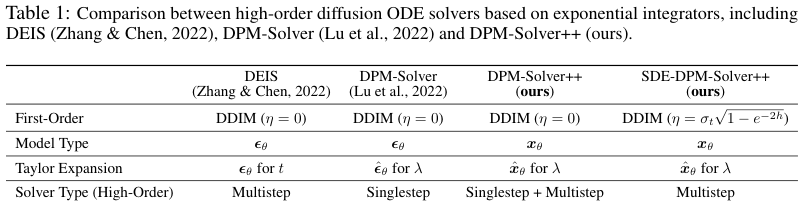

# 快速对照表

这一页把全站几个核心主题放到同一张地图里，目的不是做百科式罗列，而是帮助你形成一个更稳定的判断框架：这个方向究竟解决什么问题，输入和输出是什么，瓶颈发生在训练、推理、部署还是现实世界交互，学习时哪些数学对象必须看懂、哪些工程对象必须跟住。

如果把整站内容看成一个 AI 系统谱系，可以先用一句话概括：

```text
表征
 -> 生成
 -> 决策
 -> 训练
 -> 推理
 -> 压缩
 -> 世界交互
```

这几个主题不是平行孤岛，而是不断互相渗透。

!!! note "初学者先抓住"

    这页适合当全站“坐标轴”。先看每个主题的输入、输出、核心问题和瓶颈，再进入具体章节；这样读论文或工程方案时，能更快判断它到底改了系统的哪一层。

!!! note "难点解释：为什么同一套方法不能横扫所有方向"

    扩散关心采样轨迹，VLM 关心跨模态证据，VLA 关心动作闭环，推理关心队列和缓存，量化关心数值误差和 kernel。不同主题的核心对象不同，学习路径也必须不同。

## 1. 主题总对照

| 主题 | 主要输入 | 主要输出 | 核心问题 | 典型瓶颈 |
| --- | --- | --- | --- | --- |
| 扩散模型 | 噪声、条件 | 图像/视频样本 | 怎样稳定生成高质量样本 | 采样步数、推理成本 |
| VLM | 图像/视频 + 文本 | 回答、框、工具调用 | 怎样把视觉证据和语言推理连起来 | 视觉细节丢失、评测幻觉 |
| VLA | 观测 + 指令 | 连续或离散动作 | 怎样从感知走到控制 | 延迟、安全、分布偏移 |
| 强化学习 | 状态、动作、奖励、轨迹 | policy、value、world model update | 怎样根据结果改进行为 | reward hacking、分布偏移、闭环失效 |
| 世界模型 | 观测 + 动作 | 潜状态、未来预测 | 怎样内部模拟环境演化 | rollout 漂移、动力学错误 |
| 量化 | 权重/激活/cache | 低比特表示 | 怎样以更低成本保住能力 | 误差控制、kernel 兼容 |
| 训练 | 数据 + 模型 + 算力 | 学得出的参数 | 怎样把能力和行为训出来 | 数据系统、优化稳定性 |
| 推理 | 在线请求 | 在线响应 | 怎样平衡延迟、吞吐和成本 | cache、scheduling、tail latency |
| 具身智能 | 多模态观测 | 物理行动 | 怎样在真实世界可靠执行 | sim2real、安全、闭环 |

## 2. 各方向最应该理解的“数学对象”不同

很多初学者的困惑不是因为内容太难，而是因为不同主题依赖的数学对象根本不同。

| 主题 | 关键数学对象 | 为什么重要 |
| --- | --- | --- |
| 扩散模型 | 随机变量、SDE/ODE、score、变分目标 | 决定训练和采样如何统一 |
| 强化学习 | policy、value、advantage、Bellman、return | 决定行为如何根据未来回报更新 |
| VLM | 条件概率、交叉注意力、token 压缩 | 决定视觉和语言如何融合 |
| VLA | 策略、动作分布、时序 credit assignment | 决定模型如何输出可执行动作 |
| 世界模型 | 潜变量状态空间、序列预测、规划目标 | 决定内部模拟如何帮助决策 |
| 量化 | 量化误差、缩放、数值范围、误差传播 | 决定压缩是否可控 |
| 推理 | 队列、吞吐、缓存复杂度、内存模型 | 决定线上系统能否稳定 |

一个实用建议是：不要试图用一套“统一数学武器”解决所有方向。不同方向的核心抽象不同，阅读和建模方式也应该不同。

## 3. 如果按“会不会”和“能不能”来分，全站大致可拆成三层

### 3.1 第一层：模型会不会

这层关注能力上限，例如模型会不会生成图像、看图说话、学出稳定表征或预测未来状态。对应主题主要是扩散、强化学习、VLM 和世界模型。

### 3.2 第二层：模型按不按要求做

这层关注行为塑形，包括指令遵循、偏好对齐、工具调用和动作安全。对应主题主要是训练、VLM 工具使用、VLA 和具身智能。

### 3.3 第三层：模型能不能稳定上线

这层关注系统可用性：延迟是否稳定、成本是否可接受、量化后是否仍可控、故障能否回退。对应主题主要是推理、量化和工程 playbooks。

## 4. 一张“训练、推理、部署”三层对照

| 层次 | 关注点 | 典型指标 | 常见误判 |
| --- | --- | --- | --- |
| 训练层 | loss、收敛、泛化、数据混合 | loss、accuracy、FID、pass@k | loss 降了就等于能上线 |
| 推理层 | 延迟、吞吐、显存、调度 | TTFT、TPOT、QPS、memory | 平均延迟好看就代表系统稳 |
| 部署层 | 稳定性、安全、事故回退、观察性 | P95/P99、成功率、事故率、人工接管率 | 模型强就不需要系统治理 |

## 5. 用三个例子理解这些方向如何互相连接

### 例子 A：图文检索系统升级成多模态问答系统

项目起点可能只是用 CLIP/InfoNCE 做静态图文对齐，再离线建立图像索引。当业务升级成多模态问答后，就会自然引入 VLM 做问答和解释、推理系统做缓存与调度、量化降低服务成本。这说明静态图文对齐没有消失，而是被吸收到 VLM/VLA 的表示层里。

### 例子 B：文生图模型做成可交互创作产品

研究上重点可能是扩散建模、少步采样和蒸馏；产品上很快会新增推理调度、控制模块、成本优化和部署监控。于是扩散、推理和量化会自然连在一起。

### 例子 C：机器人拾取任务从 imitation 学习走向闭环系统

模型层面可能涉及 VLA 学动作、世界模型做预演、具身智能做安全与反馈闭环；系统层面又会遇到延迟预算、多传感器同步、故障复盘和数据回流。这说明 VLA 和世界模型不是“另一个多模态方向”，而是往真实世界交互继续深入。

## 6. 一张“最容易掉坑”的对照表

| 主题 | 最常见误判 | 为什么危险 |
| --- | --- | --- |
| 扩散 | 只看采样步数，不看局部质量和条件一致性 | 会把研究上的快误认成产品上的好 |
| VLM | 只看答案流畅，不看视觉证据 | 容易被语言先验骗过 |
| VLA | 只看离线成功率，不看真实控制延迟 | 实机一跑就崩 |
| 强化学习 | 只看 reward 曲线，不看闭环任务 | policy 可能学会投机奖励而非真实能力 |
| 世界模型 | 只看生成视频逼真度 | 画面真不代表动力学真 |
| 量化 | 只看模型大小，不看真实 kernel 和延迟 | 可能压了文件却没提速 |
| 训练 | 只讨论算法，不看数据系统 | 很多失败其实不是算法失败 |
| 推理 | 只看平均延迟，不看尾延迟和回退链路 | 线上会不稳定 |
| 具身智能 | 只看 demo，不看安全和恢复 | 风险极高 |

## 7. 如果按学习顺序来排，建议这样读

### 路线一：从模型能力出发

可以从 VLM/VLA、扩散模型、VLM、世界模型依次进入，适合想先建立“模型怎么学出能力”的全局认识。

### 路线二：从系统落地出发

可以从训练、推理、量化和 Playbooks 依次进入，适合已经接近上线、想把研究方法变成稳定系统的读者。

### 路线三：从现实交互出发

可以从 VLM、VLA、世界模型和具身智能依次进入，适合关注代理、机器人和长期闭环任务的读者。

## 8. 一张“研究价值”和“工程价值”对照

| 主题 | 研究价值最强的关注点 | 工程价值最强的关注点 |
| --- | --- | --- |
| 扩散 | 建模与一步生成 | 采样器、蒸馏、部署速度 |
| VLM | 跨模态推理与统一表示 | OCR、文档、工具使用、成本 |
| VLA | 通用动作建模 | 延迟、安全和实机鲁棒性 |
| 强化学习 | 奖励建模、策略优化、world model planning | 后训练、agent、VLA 和闭环数据引擎 |
| 世界模型 | 潜状态与想象规划 | 预测可靠性和可控 rollout |
| 量化 | 低比特误差建模 | 可部署 kernel 和质量稳定性 |
| 训练 | 优化目标与 scaling | 数据生产线和对齐流程 |
| 推理 | 新解码和缓存策略 | 容量规划和服务可用性 |
| 具身智能 | 统一智能体范式 | 真机安全、回退、维护成本 |

## 9. 为什么这些方向最终会汇成一个系统问题

可以把真实 AI 产品粗略看成下面这个复合映射：

\[
\text{Input}
\xrightarrow{\text{representation}}
\text{Model state}
\xrightarrow{\text{generation / reasoning / control}}
\text{Action or output}
\xrightarrow{\text{system constraints}}
\text{deployed behavior}.
\]

这里，CLIP/InfoNCE 和预训练塑造表示，扩散和世界模型塑造生成与预测，VLM 和 VLA 塑造多模态决策接口，训练塑造行为，推理和量化决定系统是否能跑，具身智能则把这一切放回真实世界闭环。

所以全站真正想建立的不是“十几个技术名词”，而是一个连续的系统视角。

## 10. 一份阅读建议

如果你希望后面扩写到大体量时仍然不乱，建议把每一篇文档都放回三个问题里：它主要是在提升能力、塑造行为还是降低系统成本；它最依赖的数据对象、数学对象和工程对象分别是什么；它和相邻主题之间的接口在哪里。

只要持续这样读，目录越来越大时反而会更清晰。

## 11. 推荐跳转

- 看总路线：[路线图总览](index.md)
- 看论文入口：[论文专题讲解](../paper-deep-dives/index.md)
- 看扩散主线：[扩散模型](../diffusion/index.md)
- 看多模态主线：[VLM](../vlm/index.md)
- 看系统层主线：[推理](../inference/index.md)

## 12. 横向比较：推理加速与 KV 成本

这组方法都容易被归到“推理更快”，但省的成本不一样：有的减少 decode 步数，有的让 draft 更准，有的压 KV，有的把训练目标改成可服务投机解码。

{ width="860" }

<small>图源：`EAGLE-3`，Figure 5。原论文图意：展示 EAGLE-3 在推理时由 draft model 递归生成候选，再由 target LLM 执行 verification 的 pipeline。本站读法：投机解码的收益取决于 draft 时间、verification 并行效率、接受长度、KV 分支和 runtime batching，而不是单独看 draft loss。</small>

| 方法 | 主要省什么 | 改了哪一层 | 关键证据 | 不能直接外推 |
| --- | --- | --- | --- | --- |
| [EAGLE](../paper-deep-dives/inference/eagle.md) | decode step / target forward 次数 | feature-level draft + tree attention + lossless verification | speedup、draft 输入消融、tree attention 实验 | 不能证明所有 runtime / batch 形态都有同等收益 |
| [EAGLE-2](../paper-deep-dives/inference/eagle-2.md) | draft tree 候选预算 | confidence calibration + dynamic draft tree | average acceptance length、静态/动态树对比 | confidence 在新任务桶上可能失准 |
| [EAGLE-3](../paper-deep-dives/inference/eagle-3.md) | draft 训练分布和递归接受率 | training-time test + direct token prediction + 多层 feature fusion | acceptance depth、SGLang/vLLM throughput | 离线接受率不等价于 P99 降低 |
| [MTP](../training/mtp-and-speculative-decoding.md) | 训练信号密度 / 可选 draft 能力 | 多 token prediction objective | DeepSeek-V3 / Nemotron 等技术报告的 ablation 和吞吐说明 | MTP 训练有效不等于上线必然用作 speculative draft |
| [KVSlimmer](../paper-deep-dives/inference/kvslimmer.md) | KV memory / decoder latency | 非对称 KV 合并，重点压 Key | KV memory、decoder efficiency、head alignment | 压 KV 后仍需检查长时一致性和候选排序 |

{ width="820" }

<small>图源：`KVSlimmer`，Figure 1。原论文图意：对比 AsymKV 和 KVSlimmer 的 KV 合并方式。本站读法：KV 优化要问“压的是哪个 cache、压缩后 attention 语义是否保持、长上下文 decode 是否真的变快”。</small>

## 13. 横向比较：少步生成、流式视频与 train-test gap

这组方法共同服务世界模型的 rollout 效率，但它们处理的是不同环节：solver、蒸馏、分布匹配、因果化和训练/推理分布一致性。

{ width="820" }

<small>表源：`DPM-Solver++`，Table 1。原表保留英文算法字段。本站读法：DPM-Solver++ 是“不重训模型、换采样器”的加速路线，和 DMD/DMD2 这类重新训练学生的路线不是同一层。</small>

| 方法 | 解决哪一环 | 训练是否改变 | 推理路径 | 证据等级 | 世界模型读法 |
| --- | --- | --- | --- | --- | --- |
| [DPM-Solver++](../paper-deep-dives/diffusion/dpm-solver-plus-plus.md) | guided sampling 少步稳定性 | 不改变模型训练 | 换 ODE solver、data prediction、thresholding | benchmark + ablation | 适合先降采样步数，但不能解决动作因果 |
| [DMD](../paper-deep-dives/diffusion/dmd.md) | 一步分布匹配蒸馏 | 训练学生 | real/fake score 差分 + regression | benchmark + qualitative | 把推理成本转移到离线训练 |
| [DMD2](../paper-deep-dives/diffusion/dmd2.md) | DMD 稳定性和质量 | 训练学生和 fake critic | TTUR、GAN 监督、backward simulation | benchmark + ablation | 适合少步生成 baseline，但仍需动作敏感评测 |
| [CausVid](../paper-deep-dives/diffusion/causvid.md) | 双向视频扩散转流式 AR | causal student 后训练 | ODE init + asymmetric DMD + KV cache | system latency + benchmark | 解决 streaming rollout，但要看长期漂移 |
| [Self Forcing](../paper-deep-dives/world-models/self-forcing.md) | train-test gap / self-rollout 漂移 | 训练中执行 AR self-rollout | rolling KV cache + distribution matching | ablation + system efficiency | 最接近“训练时就暴露推理分布”的世界模型需求 |

## 14. 横向比较：Dreamer、Genie、LingBot-World、DreamZero

这组路线回答的是“世界模型到底被谁消费”。Dreamer 被 actor/value 消费，Genie 被交互 latent action 消费，LingBot-World 被实时世界模拟消费，DreamZero 则直接把未来视频和动作放进同一模型。

{ width="820" }

<small>图源：`Dreamer`，Figure 3。原论文图意：Dreamer 学习 latent world model，并在 imagined trajectories 上训练 action model 和 value model。本站读法：世界模型最硬的证据不是视频好看，而是 imagined rollout 是否改善策略学习。</small>

| 方法 | 核心接口 | 训练信号 | 被谁消费 | 强证据 | 边界 |
| --- | --- | --- | --- | --- | --- |
| [Dreamer](../paper-deep-dives/world-models/dreamer.md) | RSSM latent dynamics | observation、reward、continue、actor/value | policy / value | control benchmark、ablation | 不证明高清视频世界模拟自然有效 |
| [Genie](../paper-deep-dives/world-models/genie.md) | latent action + video tokens | 大规模视频、自监督 latent action | 交互式 dynamics | scaling、latent action 可控性 | latent action 不等于真实机器人动作 |
| [LingBot-World](../paper-deep-dives/world-models/lingbot-world.md) | 视频生成底座 + action conditioning | 多阶段视频/交互训练 | 实时世界模拟器 | system pipeline、实时化、benchmark | demo 和世界一致性仍需闭环评测 |
| [DreamZero](../paper-deep-dives/embodied-ai/dreamzero.md) | joint video-action WAM | 视频动作联合去噪、post-training | policy / robot execution | real robot task progress、ablation、failure case | 视频预测错时，动作会跟着错 |

{ width="860" }

<small>图源：`World Action Models are Zero-shot Policies`，Figure 2。原论文图意：DreamZero 同时生成未来视频和动作。本站读法：WAM 的优势是动作和未来视觉被迫对齐，风险也是错误视频计划会牵引错误动作。</small>

## 15. 横向比较：DA3、VGGT、SpatialVLA、VPP

这组方法都和具身状态有关，但层级不同：DA3 和 VGGT 更偏几何状态，SpatialVLA 把 3D 表征接入动作接口，VPP 用视频预测表征直接改善 policy。

{ width="860" }

<small>图源：`Depth Anything 3`，Figure 2。原论文图意：DA3 使用跨视角 self-attention 和 Dual-DPT head 输出 depth 与 ray。本站读法：几何状态不是漂亮点云，而是相机、深度、ray、点云能否稳定进入 episode schema 和 world-model state。</small>

| 方法 | 提供什么状态 | 和动作的关系 | 证据类型 | 接到哪里 |
| --- | --- | --- | --- | --- |
| [DA3](../paper-deep-dives/embodied-ai/depth-anything-3.md) | depth、ray、camera、点云/3DGS | 给 world model 和 VLA 提供多视角几何状态 | benchmark、ablation、demo、teacher 训练说明 | 相机/深度、episode schema、几何状态 |
| [VGGT](../paper-deep-dives/embodied-ai/vggt.md) | camera、depth、point map、track | 给动态场景和多视角状态提供 feed-forward 3D 表征 | benchmark、runtime、ablation | 多相机状态、点云、轨迹回放 |
| [SpatialVLA](../paper-deep-dives/embodied-ai/spatialvla.md) | Ego3D position encoding、adaptive action grids | 把 3D 空间直接接到动作 token | simulation + real robot success | VLA 动作接口、空间泛化 |
| [VPP](../paper-deep-dives/embodied-ai/video-prediction-policy.md) | video prediction intermediate features | 用预测表征训练机器人 policy | CALVIN/MetaWorld/真实机器人 | 视觉 tokenizer、policy 表征、失败 replay |

{ width="860" }

<small>图源：`Video Prediction Policy`，Figure 12。原论文图意：绿色是真实未来，红色是预测未来，蓝色是 predictive representations。本站读法：预测表征不必生成清晰像素，但必须保留会影响动作的未来变化。</small>
