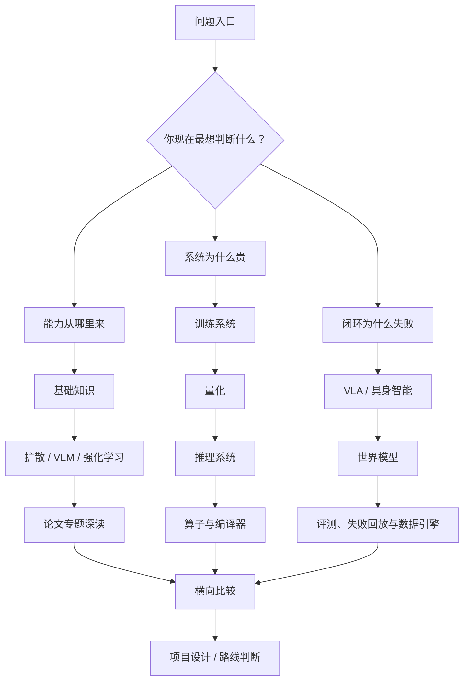

# 路线图

这套文档站的目标不是做百科式罗列，而是建立一张能持续扩写、反复复用、长期维护的 AI 知识地图。读它时，最好不要按目录逐页硬扫，而是先选一条问题链：你到底想理解生成模型、训练系统，还是规划与具身闭环。

<!-- [补充] -->
| 读者 | 建议读法 | 工程落点 |
| --- | --- | --- |
| 初学者 | 先抓“路线图”要解决的问题、关键术语和最小例子；公式只看变量方向。 | 能说清输入、输出和常见失败信号。 |
| 工程师 | 直接对照结构、指标、成本和边界条件，必要时回到前置页补概念。 | 落到数据、算力、延迟、显存、评测和回滚检查。 |


!!! note "初学者先抓住"
    路线图不是目录复述。它的作用是帮你决定先读什么、暂时跳过什么，以及遇到真实工程问题时该回到哪个专题下钻。

## 三条主线

| 主线 | 适合读者 | 推荐入口 |
| --- | --- | --- |
| 生成与多模态 | 想从扩散模型走到 VLM/VLA，理解视觉、语言和生成的连接 | [扩散模型](../diffusion/index.md) -> [VLM/VLA](../vlm/index.md) -> [世界模型](../world-models/index.md) |
| 训练与系统 | 更关心训练、量化、推理成本和上线稳定性 | [训练](../training/index.md) -> [量化](../quantization/index.md) -> [推理](../inference/index.md) |
| 规划与具身 | 想理解 agent、世界模型、机器人和真实闭环 | [强化学习](../reinforcement-learning/index.md) -> [世界模型](../world-models/index.md) -> [具身智能](../embodied-ai/index.md) |

这三条线不是互斥的。比如 VLA 既需要多模态表征，也需要训练数据 recipe、推理延迟、世界模型前瞻和具身安全。路线图只负责给第一遍阅读定方向，真正做项目时需要跨专题回跳。

## 按目标选择读法

如果你想做文档问答、多模态助手或屏幕代理，先读 VLM/VLA 和推理系统，再补量化与服务栈。这里的核心问题不是“模型会不会看图”，而是视觉证据如何进入上下文、请求如何路由、成本和延迟能不能被控制。

如果你想做文生图、视频生成或一步生成研究，先读扩散模型的训练、采样、蒸馏和整流路线，再回看论文专题中的 DMD、DMD2、Phased DMD、CausVid、WAN 等页面。不要一开始就陷进方法名，先分清训练目标、采样路径和少步生成各自解决什么。

如果你想做机器人、VLA 或具身项目，先读具身智能路线图，再接 VLA 数据与动作接口、世界模型开发路线、规划控制与安全。这里最容易误判的是把“能输出动作”当成“能闭环部署”；真实系统还要处理传感器、标定、控制器、失败恢复和安全边界。

## 一张全站阅读地图



这张图的意思是：不要把本站当成从上到下的线性书。更好的读法是先选问题入口，再沿主线下钻，最后回到横向比较。比如你要判断“FP8 对 VLA 有没有价值”，就不该只读量化页，还要回到视觉 connector、动作头、risk head、runtime 和闭环评测。

## 三种典型读者路径

| 读者目标 | 第一遍要读 | 第二遍要补 | 最后要能做的判断 |
| --- | --- | --- | --- |
| 多模态应用工程 | VLM、推理、量化 | 评测、RAG、算子 | 哪些请求桶最贵，哪些视觉能力最脆弱 |
| 训练系统工程 | 训练、数据、分布式 | 低精度、算子、推理成本 | 一个训练 recipe 的瓶颈在数据、显存、通信还是数值 |
| 世界模型 / VLA | VLA、世界模型、具身智能 | 强化学习、视频模型、量化 | 动作接口、失败回放和 risk head 是否足以支撑闭环 |

### 路径示例：从“读懂论文”到“会做方案”

如果读到一篇新 VLA 或世界模型论文，可以按下面顺序拆：

1. 先在 [VLA 路线图](../vla/index.md) 判断它解决的是数据、动作接口、评测还是安全。
2. 再到 [世界模型路线图](../world-models/index.md) 判断它是 latent dynamics、视频模拟、动作条件还是风险规划。
3. 接着到 [训练](../training/index.md) 和 [推理](../inference/index.md) 估计数据、显存、rollout 和服务成本。
4. 如果它宣称低成本或高吞吐，再到 [量化](../quantization/index.md) 和 [算子](../operators/index.md) 检查收益是否能兑现。
5. 最后回到评测页，问它的指标能不能解释真实失败。

这样读一篇论文，得到的不是“这篇很强”或“这篇一般”，而是一张工程判断表：它适合哪里、贵在哪里、风险在哪里、下一步怎么验证。

## 内容维护原则

后续扩写优先加厚现有专题，而不是不断开新一级栏目。一个页面只有在承担了清晰的新问题时才值得拆出来；如果只是多了几篇相邻论文，通常更适合并入已有页面的“方法谱系”或“论文回填”部分。

每次新增内容都要尽量回答三个问题：它解决什么旧问题，和相邻页面的边界在哪里，读者看完下一步该跳到哪里。公式、表格和列表都应服务这三个问题；如果只是为了把信息摆满页面，就应该改成短段落或删掉。

## 扩写方向

当前站点已经形成主干，后续重点是把专题内部写出层次。总览页负责给路线，方法页负责讲清公式和直觉，工程页负责讲部署约束，评测页负责讲失败模式和验收方式。术语表和参考文献则作为底座，不需要变成新的正文专题。

最值得继续加厚的主干仍然是训练、推理、扩散、VLM/VLA、世界模型和具身智能。它们之间的连接方式比单页字数更重要：训练解释能力从哪里来，推理解释能力如何被调用，世界模型解释未来如何被想象，具身智能解释这些能力能否在真实闭环里站住。

## 判断内容是否该保留

一个段落、表格或列表如果不能帮助读者做判断，就应该压缩。更具体地说：能形成路线选择、概念区分、工程取舍或失败诊断的内容值得保留；只是在罗列“还有哪些方向、还能怎么扩写、有哪些文件名”的内容，应该移到具体专题页，或者直接删掉。

## 深度一致性标准

为了避免有些页面像白皮书、有些页面像知识卡片，后续扩写可以用同一把尺检查：

| 模块 | 最低要求 | 深度页要求 |
| --- | --- | --- |
| 概念页 | 讲清是什么、解决什么问题、和相邻概念的边界 | 增加公式/数据流、失败案例、工程取舍 |
| 系统页 | 画出链路和核心组件 | 增加容量账、trace 观察、上线门禁 |
| 评测页 | 列出指标和常见失败 | 增加分桶、回放 schema、灰度和回滚标准 |
| 论文页 | 说明贡献和方法 | 增加复现口径、和本站主线的接口、局限 |
| 索引页 | 给出阅读顺序 | 增加决策图、角色路径、跳转理由 |

一个页面如果只回答“是什么”，读者会记住名词；如果还能回答“为什么失败、怎么验收、下一步读哪里”，读者才会真正获得判断力。本站后续更应追求后一种密度。

## 页面深度巡检清单

以后新增或复查页面，可以用下面这张表做快速巡检：

| 检查项 | 合格表现 | 不合格表现 |
| --- | --- | --- |
| 主线定位 | 开头能说明它在训练、推理、量化、VLA 或世界模型中的位置 | 只解释名词，不说明为什么值得读 |
| 图解 | 至少有一张论文图、流程图、系统图或 Mermaid 图 | 全文只有段落和列表 |
| 工程例子 | 有数字账、trace、schema、失败 replay 或上线案例 | 只给原则，没有可复算细节 |
| 边界 | 明确什么时候适用、什么时候不适用 | 只写优点，不写失败模式 |
| 链接 | 能指向前置知识和下一步深读页 | 读完不知道该跳到哪里 |
| 验收 | 有指标、门禁或检查清单 | 结论停在“很重要” |

如果一个页面暂时做不到全部项目，至少要补上“图解 + 案例 + 下一站”。这三件事最能改善读者体验：图解负责建立结构，案例负责把概念落地，下一站负责把短页接回长主线。

## 一个维护策略：短页优先补“骨架”

短页不一定都要写成 300 行。更合理的目标是让每个页面都有稳定骨架：

```text
问题定位 -> 结构图 -> 核心机制 -> 工程案例 -> 失败模式 -> 验收/下一站
```

这样即使页面只有 130-180 行，读者也能获得完整判断，而不是只拿到名词卡片。深页则适合承载更多论文图、公式推导、复现细节和系统案例。站点最终追求的不是每页等长，而是每页都能给出足够稳定的阅读回报。
