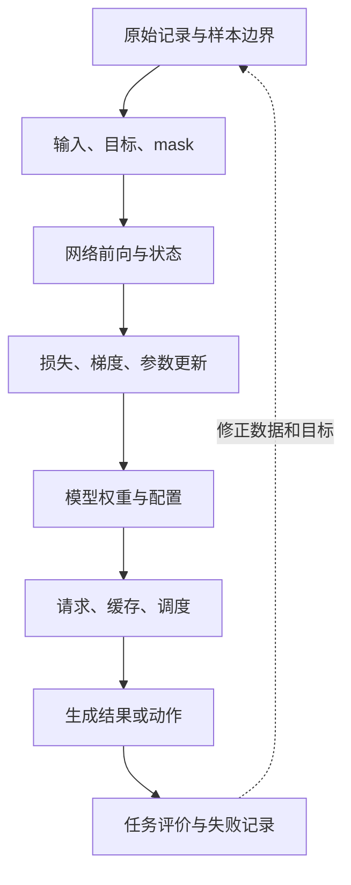

# 技术知识地图

同一个模型可以出现在训练脚本、生成服务和机器人系统中，每个位置需要理解的对象不同。这里按问题连接基础机制与专题，方便补齐缺口。你可以从当前问题进入，也可以沿一条数据流通读，不必按照固定周次或关卡推进。

## 先看一条完整的数据流

一段文本经过分词和打包，成为输入、标签与 mask；网络输出分数，损失把分数与目标比较，梯度改变参数。部署时固定参数，接收新请求，保存运行状态，并逐步产生输出。评测再比较输出与任务要求。

图中的回路表示工程上根据评价修正方案，不表示测试集可以随意回流训练。用于独立报告结果的测试数据，需要与开发过程保持适当隔离。

| 沿图遇到的疑问 | 对应文章 | 读完应能解释的对象 |
| --- | --- | --- |
| 同一批数字为什么有不同含义 | [张量、形状与计算图](../foundations/tensors-shapes-and-computation-graphs.md) | 样本轴、序列轴、通道轴及运算依赖 |
| 数据怎样成为监督 | [数据与数据集](../foundations/data-and-dataset-basics.md) | 样本、右移标签、边界与采样权重 |
| loss 怎样改动参数 | [用分类器读公式](../foundations/symbols-and-minimal-math.md) | logits、概率、损失、导数与更新 |
| 为什么还需其他数学 | [数学工具](../prerequisite-math/index.md) | 当前式子使用的向量、概率或动力学假设 |
| 同一网络怎样学不同能力 | [预训练目标与表示](../foundations/pretraining-objectives-and-representation-learning.md) | 可见输入、目标来源与误差方向 |
| 为什么训练和部署占用不同 | [训练计算与推理服务](../training-and-inference-systems/index.md) | 梯度、优化器、激活与 KV 的生命周期 |
| 一个高分究竟说明什么 | [数据划分与评测](../foundations/data-splits-metrics-and-evaluation-basics.md) | 样本来源、指标分母、权重与比较协议 |

## 模型结构按信息怎样流动来查

[Attention](../foundations/transformer-attention-and-tokenization.md)让当前位置读取其他位置，[位置与 Mask](../foundations/positional-encoding-masks-and-context.md)规定顺序及可见性；[Mamba](../foundations/mamba-and-hybrid-ssm-transformers.md)把历史压入递推状态；[MoE](../foundations/moe-and-large-model-architecture-basics.md)选择部分专家处理 token。它们可以组合，不能仅凭一个模型名字推断全部结构。

碰到一张新架构图时，先沿输入走一遍，标出每条箭头的形状和是否跨时间保存，再确定输出被谁使用。具体索引见[模型结构](../model-architectures/index.md)。

## 按实际问题进入生成、决策与系统

| 问题 | 建议连接的知识 | 为何需要这条连接 |
| --- | --- | --- |
| 视频为什么一开始正常，后面逐渐变形 | [视频生成](../diffusion/video-and-multimodal-diffusion.md) → [长视频与缓存](../diffusion/long-video-and-cache-1029-1246.md) | 区分噪声时间、帧时间、训练条件与生成历史 |
| PPO loss 下降，策略行为却变差 | [强化学习](../reinforcement-learning/index.md) → [评测](../foundations/data-splits-metrics-and-evaluation-basics.md) | 优化的奖励、策略分布与真实任务可能不一致 |
| 图表回答流畅，数字却错了 | [多模态证据](../foundations/multimodal-cot-and-reasoning-basics.md) → [视觉连接器](../vlm/visual-tokenizers-and-connectors.md) | 区分看不清、对象配错与算式错误 |
| 预测视频很好，机器人仍抓不住 | [世界模型](../world-models/index.md) → [动作接口](../vla/action-representation-and-interfaces.md) | 视觉质量不直接检验动作条件、坐标与执行反馈 |
| 量化后模型更小，响应没变快 | [量化](../quantization/index.md) → [算子](../operators/index.md) → [推理](../inference/index.md) | 存储、kernel 与请求耗时需要分别计算 |

## 从理解走到实现

[公式、代码与实验怎样对照](research-and-engineering-study-plan.md)用一个实际梯度推导说明最小实现的方法。[技术对照表](comparison-tables.md)按输入、目标、状态与成本比较方法。[技术决策](common-decision-patterns-and-tradeoffs.md)示范怎样用失败记录排除不相干的优化方向。

持续扩写网站时，先阅读[外部教程的来源、改编与证据边界](source-and-adaptation-guidelines-1110-0106.md)，再决定某篇材料适合独立讲解、许可范围内改编，还是只做导读链接。

成熟教程的主题入口和当前核验状态见[成熟教程来源地图](mature-tutorial-source-map-1110-0711.md)。它用于安排查证顺序，不代表本站会逐段翻译这些来源。

术语记不清时可查[术语表](../glossary/index.md)，但术语定义不替代推导。能够把一个小输入算出结果，再解释换了条件会怎样，比记住一串方法缩写更接近实际理解。
