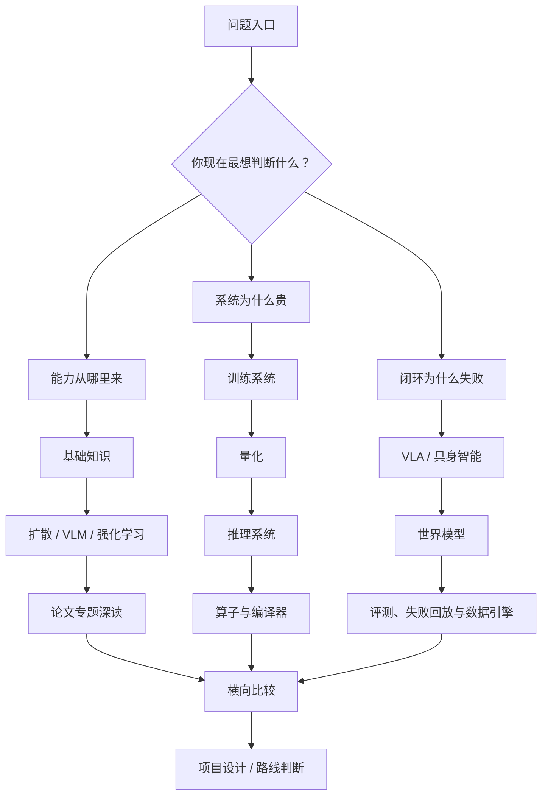

# 路线图

路线图帮助你先选问题链，再决定先读什么、暂时跳过什么，以及遇到真实工程问题时该回到哪个专题下钻。常见入口包括生成模型、训练系统、推理部署、世界模型和具身闭环。

## 三条主线

| 主线 | 适合读者 | 推荐入口 |
| --- | --- | --- |
| 生成与多模态 | 想从扩散模型走到 VLM/VLA，理解视觉、语言和生成的连接 | [扩散模型](../diffusion/index.md) -> [VLM/VLA](../vlm/index.md) -> [世界模型](../world-models/index.md) |
| 训练与系统 | 更关心训练、量化、推理成本和上线稳定性 | [训练](../training/index.md) -> [量化](../quantization/index.md) -> [推理](../inference/index.md) |
| 规划与具身 | 想理解 agent、世界模型、机器人和真实闭环 | [强化学习](../reinforcement-learning/index.md) -> [世界模型](../world-models/index.md) -> [具身智能](../embodied-ai/index.md) |

三条主线可以交叉使用。比如 VLA 既需要多模态表征，也需要训练数据 recipe、推理延迟、世界模型前瞻和具身安全；做项目时通常需要跨专题回跳。

## 按目标选择读法

如果你想做文档问答、多模态助手或屏幕代理，先读 VLM/VLA 和推理系统，再补量化与服务栈。重点看视觉证据如何进入上下文、请求如何路由、成本和延迟能不能被控制。

如果你想做文生图、视频生成或一步生成研究，先读扩散模型的训练、采样、蒸馏和整流路线，再回看论文专题中的 DMD、DMD2、Phased DMD、CausVid、WAN 等页面。不要一开始就陷进方法名，先分清训练目标、采样路径和少步生成各自解决什么。

如果你想做机器人、VLA 或具身项目，先读具身智能路线图，再接 VLA 数据与动作接口、世界模型开发路线、规划控制与安全。这里最容易误判的是把“能输出动作”当成“能闭环部署”；真实系统还要处理传感器、标定、控制器、失败恢复和安全边界。

## 一张全站阅读地图

先选问题入口，再沿主线下钻，最后回到横向比较。比如判断“FP8 对 VLA 有没有价值”，需要同时检查量化、视觉 connector、动作头、risk head、runtime 和闭环评测。

## 三种典型读者路径

| 读者目标 | 第一遍要读 | 第二遍要补 | 最后要能做的判断 |
| --- | --- | --- | --- |
| 多模态应用工程 | VLM、推理、量化 | 评测、RAG、算子 | 哪些请求桶最贵，哪些视觉能力最脆弱 |
| 训练系统工程 | 训练、数据、分布式 | 低精度、算子、推理成本 | 一个训练 recipe 的瓶颈在数据、显存、通信还是数值 |
| 世界模型 / VLA | VLA、世界模型、具身智能 | 强化学习、视频模型、量化 | 动作接口、失败回放和 risk head 是否足以支撑闭环 |

### 路径示例：从“读懂论文”到“会做方案”

如果读到一篇新 VLA 或世界模型论文，可以按下面顺序拆：

1. 先在 [VLA 路线图](../vla/index.md) 判断它解决的是数据、动作接口、评测还是安全。
2. 再到 [世界模型路线图](../world-models/index.md) 判断它是 latent dynamics、视频模拟、动作条件还是风险规划。
3. 接着到 [训练](../training/index.md) 和 [推理](../inference/index.md) 估计数据、显存、rollout 和服务成本。
4. 如果它宣称低成本或高吞吐，再到 [量化](../quantization/index.md) 和 [算子](../operators/index.md) 检查收益是否能兑现。
5. 最后回到评测页，问它的指标能不能解释真实失败。

这样读一篇论文，可以得到一张工程判断表：它适合哪里、贵在哪里、风险在哪里、下一步怎么验证。
