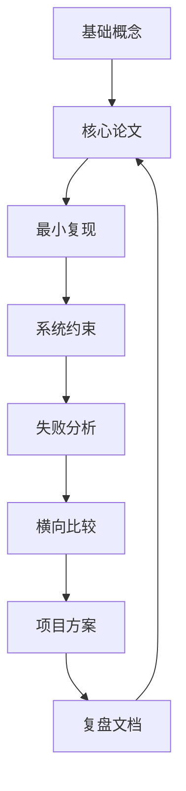

# 研究与工程学习路径

当一个知识体系同时覆盖扩散模型、VLM、VLA、量化、训练、推理、世界模型与具身智能时，真正困难的往往不是“资料太少”，而是“资料太多而缺乏路径”。这份学习路径不是简单罗列章节，而是给出一条兼顾研究理解、工程实现和系统判断力的推进顺序。它尤其适合已经具备基础机器学习背景、希望在 3 到 12 个月内建立系统能力的人。

!!! note "初学者先抓住"

    学习顺序要服务目标：想做研究，就多看目标函数、架构和消融；想做工程，就多看数据管线、推理服务、可观测性和成本；想做技术判断，就训练自己把方法放回系统约束里评估。

!!! example "有趣例子：不要只收集地图"

    学很多论文像收集城市地图，但真正能走路还需要路线、路况和目的地。每个阶段都安排一个小实验、复现或系统设计练习，比只读更多材料更稳。

## 1. 先定目标：你想成为什么样的人

在开始之前，先回答自己想偏向哪一类角色：算法研究者更关注目标函数、架构、理论动机和新方法；系统工程师更关注训练平台、推理服务、量化、可观测性和成本；多模态 / 具身研究者更关注数据、结构理解、控制接口、世界模型与安全；技术负责人更关注方向判断、路线取舍、资源配置与团队方法学。不同目标会改变你读论文、做实验和写代码的优先级。

## 2. 学习顺序的核心原则

建议遵循三条原则：先建立问题地图，再钻具体方法；先掌握主干范式，再看分支优化；每个阶段都要有“动手验证”，而不是只做知识囤积。很多人一上来就冲最新论文，很快会出现“概念认识很多、判断力却不稳”的问题，原因是没先建立足够稳的坐标系。

## 3. 第一阶段：打主干，建立统一坐标

### 3.1 目标

这一阶段要理解三件大事：现代基础模型主要在学什么，这些模型如何训练和部署，不同方向解决的是哪一类瓶颈。

### 3.2 推荐主题

第一阶段建议先通读训练系统基础、推理系统基础、决策学习基础和生成建模基础。前者帮助你看懂目标函数、优化器、数据治理和分布式训练；推理部分补上 batching、缓存、调度、SLO 和成本；决策学习连接 reward、policy/value 和 world model rollout；生成建模则建立自回归与扩散的差别。

### 3.3 为什么先学系统基础

因为无论你最终做扩散、VLM 还是 VLA，只要忽视训练与推理系统，很多判断都会失真。你会知道某方法“理论上不错”，但不知道它为什么上线不了、为什么成本太高、为什么对数据质量那么敏感。

## 4. 第二阶段：沿主线进入各专题

### 4.1 扩散模型主线

建议从 DDPM 的前向加噪与反向去噪开始，再读 DDIM 的确定性采样与加速；随后进入 DPM-Solver、Euler、Heun 的连续时间与数值求解视角；最后再看 Distillation、DMD、Consistency、Rectified Flow，以及视频与动作扩散如何把扩散带入时序和控制。

### 4.2 VLM 主线

建议先读图文对齐基础与 encoder-decoder 结构，再进入文档、图表、UI 等结构化场景；随后补上检索、重排与向量系统，最后看工具使用、屏幕代理和鲁棒性评测。

### 4.3 VLA 与具身主线

建议先读行为克隆、模仿学习和动作接口，再进入 VLA 数据、技能抽象与动作分块；随后补上 Sim2Real、闭环恢复和安全部署，最后看人机协作如何与世界模型结合。

### 4.4 世界模型主线

建议先读 RSSM / Dreamer 与隐状态规划，再进入视频世界模型与生成式预测；随后补上不确定性、风险规划和数据引擎，最后看它如何与 VLA、自动驾驶和机器人结合。

## 5. 第三阶段：开始横向比较

到了这一阶段，不要再只按专题往前读，而应开始横向问问题：扩散与自回归在什么场景各自占优，VLM 与检索系统的边界在哪里，VLA 与传统分层控制的接口该怎样设计，世界模型能否真正提供规划收益，量化、蒸馏和系统优化的优先级如何排序。这种横向比较，会让你从“知道很多方法”走向“会判断路线”。

## 6. 第四阶段：以项目驱动理解

再继续往前，最重要的是做项目。可以选 1 到 2 个系统型主题，例如本地部署的文档 VLM 管线、带检索与重排的多模态问答系统、小型扩散训练与少步蒸馏实验、VLA 小实验与失败恢复分析，或带不确定性评测的世界模型规划 demo。项目的作用不是炫技，而是逼你面对真实的脏问题：数据不齐、显存不够、评测模糊、系统链路太长。

## 7. 学习路径图

这张图强调学习不是“读完一轮就结束”。每读一个专题，都应该至少做一次最小复现或系统设计练习；每做一次项目，都应该回到论文和基础页修正理解。真正的判断力来自这个循环，而不是阅读量本身。

### 一个 6 周小项目模板

| 周次 | 目标 | 产出 |
| --- | --- | --- |
| 1 | 读主线和 2-3 篇核心论文 | 问题地图和术语表 |
| 2 | 搭最小 baseline | 可运行脚本和初始指标 |
| 3 | 加一个系统约束 | 显存、延迟或数据质量报告 |
| 4 | 做失败分析 | 分桶、回放和错误分类 |
| 5 | 改进一处关键瓶颈 | 消融表和成本账 |
| 6 | 写方案复盘 | 方法边界、下一步路线和风险 |

## 8. 每个阶段的产出建议

### 7.1 第一阶段产出

第一阶段建议产出一份主干概念笔记、一张研究地图，以及两三篇核心论文的结构化总结。

### 7.2 第二阶段产出

第二阶段建议给每个专题写一个 2 到 5 页的路线总结，整理关键公式和方法对照表，并完成一个最小复现实验。

### 7.3 第三阶段产出

第三阶段建议产出横向比较报告、方法选择理由和系统层 trade-off 总结。

### 7.4 第四阶段产出

第四阶段建议完成一个端到端小项目，并留下失效分析文档、评测与发布清单。

## 9. 阅读与实践如何配比

建议不要把时间全花在读论文。一个实用比例是 40% 阅读与整理、40% 动手实验、20% 总结与复盘。很多人卡住不是因为没看够，而是因为没有把理解转成实验和总结。

## 10. 如何判断自己真的学会了

可以用四个标准自查：能否用自己的话解释一个方法为什么有效，而不是复述摘要；能否指出它最可能失败的场景；能否判断它上线时最贵、最慢或最不稳的环节；能否设计一个最小实验验证其中一个核心假设。如果还做不到，说明理解还停留在“认识名词”阶段。

## 11. 面向不同时间窗口的建议

### 11.1 三个月

目标应是建立主干地图，能独立读懂中等复杂论文，并做一到两个小实验。

### 11.2 六个月

目标应是进入一个专题方向，形成自己的问题意识，并开始做系统型项目。

### 11.3 十二个月

**目标应是具备横向判断力**：能比较路线，能做较完整的研究计划，能主持一次中型系统迭代或论文复现。

## 12. 一个生动比喻

这条学习路径像学建筑。第一阶段先知道地基、梁柱、材料和施工流程；第二阶段分别学习住宅、桥梁、高层和地下工程；第三阶段开始比较不同结构适合什么地形；第四阶段自己真正带一个小项目。若一开始只看最新造型最炫的建筑案例，却不懂结构和施工，你很难真正设计出站得住的楼。

## 13. 小结

研究与工程学习最怕“知识很多，但缺路径”。这份路线图的核心不是让你更快看完所有材料，而是帮助你按主干到分支、方法到系统、阅读到实践、专题到横向判断的顺序，逐步建立真正可迁移的理解力。 
