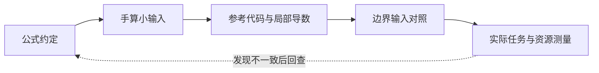

# 公式、源码与实验怎样对照

看到论文公式，最常见的障碍是每个符号似乎都认识，却不知道它在程序里出现在哪里。可以先选一条完整计算，把输入、前向、损失和更新连起来，再扩展到大模型。这个方法不要求先通读所有基础，也不以完成多少章节衡量理解。

## 从一个能算完的目标开始

设模型输出 \(\hat y=wx\)，训练目标为 \(\ell=\tfrac12(wx-y)^2\)。取 \(x=2,y=3,w=1\)，前向预测为2，误差为−1，损失为0.5。链式法则给出

\[
\frac{\partial\ell}{\partial w}=(wx-y)x=-2.
\]

学习率0.1时，新权重为1.2，新预测2.4，新损失0.18。每个数字都对应一个程序对象。这里没有 batch、正则化、动量和混合精度，方便先检查核心机制。

```python
x, y, w, lr = 2.0, 3.0, 1.0, 0.1
loss = lambda v: 0.5 * (v*x-y)**2
grad = (w*x-y)*x
eps = 1e-5
finite_difference = (loss(w+eps)-loss(w-eps))/(2*eps)
w_new = w-lr*grad
print(grad, round(finite_difference,6), w_new, round(loss(w_new),6))
assert abs(grad-finite_difference) < 1e-6
```

输出 `-2.0 -2.0 1.2 0.18`。有限差分检验的是这一个点附近的导数实现，并没有证明训练在任意数据上都收敛。

## 公式中的约定会改变代码

如果把半平方误差改成平方误差，梯度会变为−4；如果对 batch 求和改成平均，梯度会除以样本数。它们都可能是合理目标，代码必须与实际公式一致。分布式训练的有效 token 分母、蒸馏的温度平方、扩散的时间权重，也属于同类问题。

先给符号一张具体映射表，再读网络代码。

| 公式对象 | 要在源码中找到什么 | 容易遗漏的条件 |
| --- | --- | --- |
| 输入 x | dataset、collate、forward 参数 | 归一化、轴顺序、padding、单位 |
| 参数 θ | 可训练 tensor 与 optimizer 参数组 | 冻结部分、共享参数、weight decay |
| 预测 fθ(x) | 生成目标前的输出 | logits 还是概率，噪声还是速度 |
| 目标 y | label、教师输出或环境反馈 | 是否右移、停止梯度、泄漏未来 |
| 损失 L | reduction、mask、权重 | 按 token、序列还是设备平均 |
| 更新 | backward、step、scheduler | 累积次数、精度、跳步与状态恢复 |

## 沿源码的数据流阅读

[micrograd 的 Value 实现](https://github.com/karpathy/micrograd/blob/7bc720e951fe422b8f8814aa5aa1b64121d26b4c/micrograd/engine.py)把标量运算、局部反向函数与拓扑遍历放在较短代码中。可先沿乘法和加法找到上例的前向值，再沿 `backward()` 看梯度如何累加。共享变量被使用多次时，反向需要累加贡献，这一点很容易被手写实现遗漏。

[PyTorch 优化教程](https://github.com/pytorch/tutorials/blob/5672cd98a7671eda4d9122b10f8eec580f74d03e/beginner_source/basics/optimization_tutorial.py)再把过程扩成 tensor、batch 和优化循环。`zero_grad()`、`backward()`、`step()`分别清理历史梯度、计算当前梯度和更新参数。移动调用顺序可能改变算法，不能只确认这三个名字都出现了。



小输入对照能检验公式到代码的映射；实际任务测量才进一步检验泛化和成本。两种证据需要同时保留，不能用一段 smoke test 宣称复现了论文结果。

## 怎样增加复杂度而不丢掉依据

将标量换成二维输入时，先检查形状与梯度；换成 batch 时，检查归约分母；加入 mask 时，构造只有一个有效目标的样本；加入缓存时，对照无缓存结果；加入低精度时，对照误差和真实算子路径。每次增加一个机制，就给它一个能辨别对错的输入。

例如文档打包后的张量尺寸可能完全正确，但 B 文档读取了 A 文档，训练目标已经改变。[位置与 Mask](../foundations/positional-encoding-masks-and-context.md)中的4×4例子专门暴露这种错误。测试形状不能替代测试信息能否流动。

## 论文中的结论要和实验设置一起带回

阅读新方法时，先定位它改动的那一段计算，再看实验如何隔离这一改动。如果新方案同时扩大数据、增加训练步数和更换硬件，结果支持的是组合方案，不能把全部提升归给某个单独模块。

记录最关键的可复查信息即可，包括来源 commit、数据划分、模型配置、目标定义、随机性、评价协议和运行设备。若本地只验证了机制，应写“机制算例”；若确实训练了模型，再给训练日志与评测。原论文的性能数字和自己的测量应明确区分。

[数据划分与评测](../foundations/data-splits-metrics-and-evaluation-basics.md)解释比较协议，[性能分析](../operators/profiling-debugging-and-numerical-stability.md)解释算子计时。遇到不一致时，保留产生它的最小输入，通常比继续扩大实验更容易找到原因。

## 把成熟课程拆成五个交付物

[Stanford CS336：Language Modeling from Scratch](https://stanford-cs336.github.io/spring2025/)的安排有一个很适合自学的特点：每个阶段都要求交出能运行的东西，再进入下一阶段。它先让学生实现 tokenizer、模型和优化器，再做 GPU profiling 与 Triton kernel，然后讨论 scaling、数据处理和后训练。这个顺序比先读完所有 Transformer 论文更容易发现自己究竟缺哪一块。

下面的版本把课程作业改成本站可复用的研究记录。它不是对课程作业的逐段翻译，命令、数据集和验收阈值需要按你的机器与研究问题重新填写。

| 阶段 | 需要交付的最小产物 | 通过条件 | 对应页面 |
| --- | --- | --- | --- |
| A1 基础模型 | tokenizer、bigram、最小 decoder-only Transformer、一次 CPU 训练 | 能在小数据上过拟合；输入、目标、mask、loss 分母都有固定测试 | [tokenizer 与注意力](../foundations/transformer-attention-and-tokenization.md)、[一次参数更新](../training/beginner-model-training-primer.md) |
| A2 系统优化 | 一个带参考实现的 Triton/CUDA kernel、profile trace、显存账本 | 先通过数值对照，再在固定 shape 和 warmup 后报告时间；包含非连续 stride 或 fallback 样本 | [Triton 编程](../operators/triton-programming-model-and-autotuning.md)、[性能排查](../operators/profiling-debugging-and-numerical-stability.md) |
| A3 规模关系 | 一组不同参数量与 token 预算的训练曲线、拟合的 scaling 关系 | 训练预算、数据混合、评测集和随机种子固定；对拟合区间外的外推单独标注 | [Scaling 与训练预算](../training/scaling-laws-and-experiment-economics.md) |
| A4 数据管线 | 原始数据快照、清洗与去重脚本、数据卡、污染检查 | 能从版本号重建样本；训练/验证/测试按用户、文档、视频或 episode 等泄漏单位划分 | [数据质量](../training/data-quality-dedup-and-governance.md)、[数据集边界](../foundations/data-and-dataset-basics.md) |
| A5 后训练与评测 | SFT 或偏好/RL 训练记录、独立评测、失败回放 | 每个分数带分母、提示模板、采样设置和 verifier/judge 版本；至少有一类反例没有进入训练 | [后训练数据](../training/post-training-data-engines-and-judge-models.md)、[评测与消融](../training/evaluation-and-ablation-methodology.md) |

每个阶段只在前一阶段的最小接口稳定后再扩大规模。A1 的 token 右移错误会污染 A4 的数据结论，A2 的 kernel 结果也不能替代 A5 的任务评测。阶段名称用于管理依赖，不代表研究必须按学期完成。

### A1 的验收不要只看 loss

先用几十条 token 让模型完全记住训练样本，再用一条没有出现过的短序列检查它是否按预期使用上下文。打印一条样本的原始文本、token、输入、目标和 loss mask，确认角色或文档边界没有被截断。随后固定一个 batch，分别用 PyTorch 自动微分和有限差分检查一个参数的梯度。通过这些检查，才值得把 block size、batch size 和模型宽度放大。

这一步对应 CS336 的基础作业，也和 [D2L 的训练章节](https://zh.d2l.ai/chapter_deep-learning-computation/index.html)形成互补。D2L 适合看张量和训练循环的递进，CS336 的课程设计提醒你把 tokenizer、优化器和模型接口真正写出来。两者都可以参考，本站的样例数字和代码仍应独立重做。

### A2 的验收要把“快”拆开

一次 kernel 记录至少包含输入 shape、dtype、stride、设备、编译状态、warmup 次数、计时事件和输出误差。再分别记录纯 kernel、包含转换的局部路径和完整模型层。只在连续输入上测到的加速，不能外推到真实模型；只测一次冷启动，也不能和稳态吞吐比较。

[Triton 官方教程](https://triton-lang.org/main/getting-started/tutorials/01-vector-add.html)从 vector add 逐步走到矩阵乘，[CS336 的 systems 作业](https://stanford-cs336.github.io/spring2025/)把 profiling、FlashAttention 和分布式训练放在同一阶段。本站建议保留一个慢但清楚的 reference kernel，让每次 tile、mask 或 layout 修改都有可以逐元素比较的对象。

### A3 的曲线先回答预算问题

不要先拟合一个漂亮的幂律再寻找解释。先固定训练数据和评测集，记录每次运行的参数量、激活参数量、训练 token、实际 FLOPs、峰值显存和 wall-clock。若某个模型因为数据加载或通信长期等待，报告中的计算预算就不能只用理论 FLOPs 代替。拟合时把训练早期的 warmup、异常运行和未收敛点单独标记。

可将 [Chinchilla](https://arxiv.org/abs/2203.15556) 作为训练计算分配的历史参照，将本地结果写成“在这组模型、数据和优化器条件下的趋势”。它不能直接告诉你当前 VLM、VLA 或世界模型应该使用同一参数/token 比例。

### A4 要让一个陌生人重建输入

数据管线的最小记录包括原始快照 ID、解析器 commit、过滤规则、去重哈希或近似方法、tokenizer/processor 版本、split 文件、抽样权重和随机种子。每次生成训练 shard 时，把这些字段写入 manifest。若同一来源的数据混合了多种质量等级，额外保留质量桶，避免清洗后只剩一个无法解释的总量。

[Data Cards](https://arxiv.org/abs/2204.01075)提供了记录数据来源、组成、处理过程和限制的组织方法，[CS336 的 data 作业](https://stanford-cs336.github.io/spring2025/)则把 Common Crawl 的清洗与去重变成可运行任务。本站不直接搬用课程的数据或脚本，建议先在一个可审计的小快照上完成重建，再扩大到完整语料。

### A5 的 verifier 也是实验变量

数学答案比较、代码隐藏测试、偏好模型和人工 rubric 会给出不同的训练信号。记录一个成功样本时，要同时保存原始输出、解析后的答案、verifier 版本和失败原因。若奖励只检查最终字符串，模型可能学会格式投机；若 judge 偏爱更长的回答，长度变化就会混入能力变化。

[OpenAI Spinning Up](https://spinningup.openai.com/en/latest/)适合对照策略梯度和 value 学习的实现边界，[Hugging Face LLM Course](https://huggingface.co/learn/llm-course/chapter1/1)适合补 tokenizer、微调和评测接口。把这些教程用于方法核对，再用自己的一组反例检验训练目标，才能知道模型到底被奖励了什么。

## 研究记录要留下三类可回放证据

一个实验目录至少需要三条链。第一条是**输入链**，从原始样本、处理版本到模型 batch；第二条是**计算链**，从配置、代码 commit 到 checkpoint 和日志；第三条是**判断链**，从评测协议、分桶结果到失败样本和下一步假设。只保存最终权重，无法回答数据变了还是代码变了；只保存曲线，无法回放某个异常样本。

可以把下面的字段作为 `server_monitor`、W&B 和 PaperPilot 之间的共同索引。它是记录模板，不是项目已经生成的真实结果。

```yaml
experiment_id: <stable-id>
question: <one falsifiable question>
data_snapshot: <immutable-id>
code_revision: <commit>
model_config: <yaml or hash>
compute: {host: <name>, gpu: <type>, count: <n>}
train_budget: {tokens: <n>, steps: <n>, wall_clock_hours: <n>}
evaluation: {split: <id>, unit: <sample/episode/user>, verifier: <version>}
artifacts: [logs, checkpoint, trace, failure_replay]
decision: <what changed and why>
```

每次把教程中的例子扩成真实实验时，先复制这份记录，再修改数据和模型字段。这样页面里的小算例仍然负责解释机制，真实运行结果则可以回到对应实验，而不会被写成没有条件的普遍结论。
