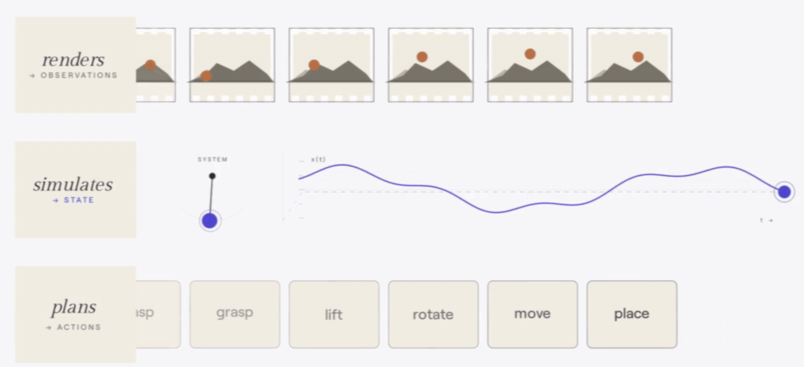
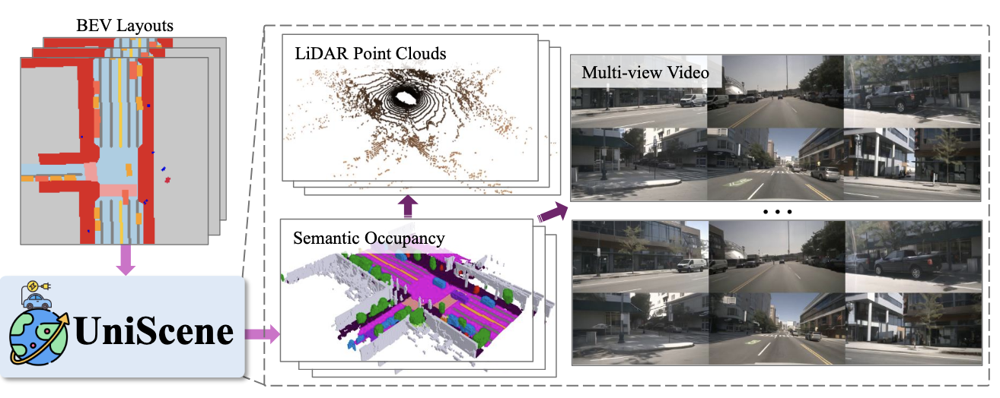
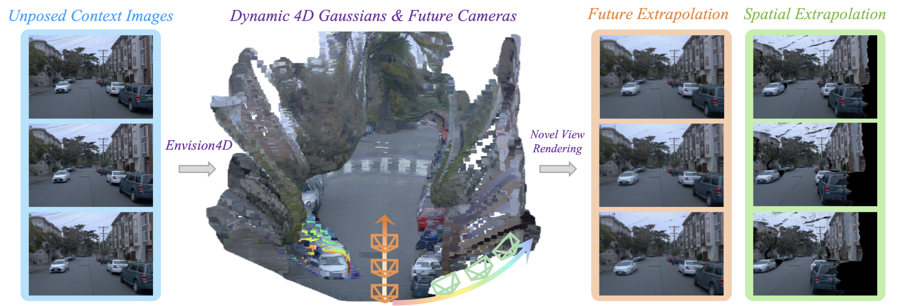
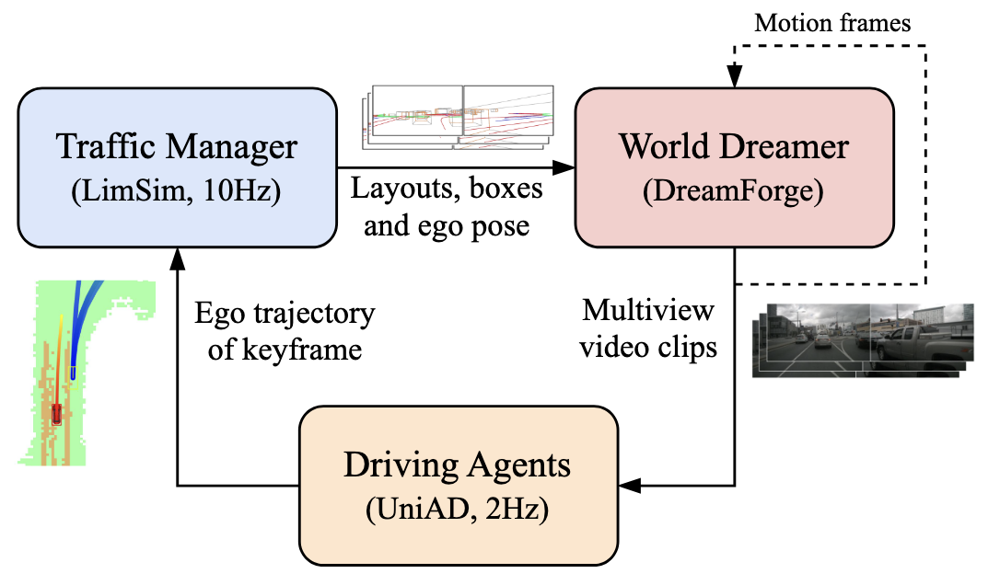
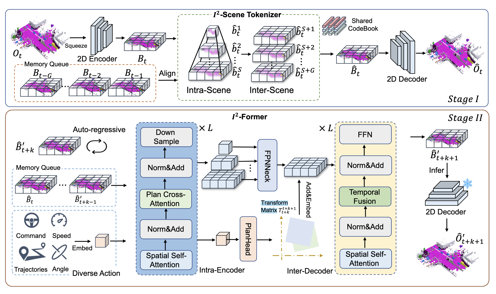
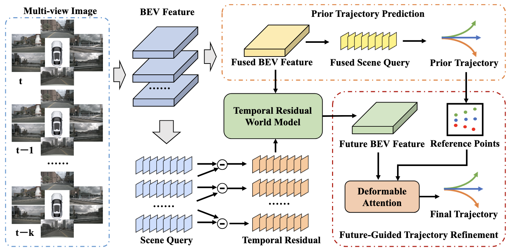
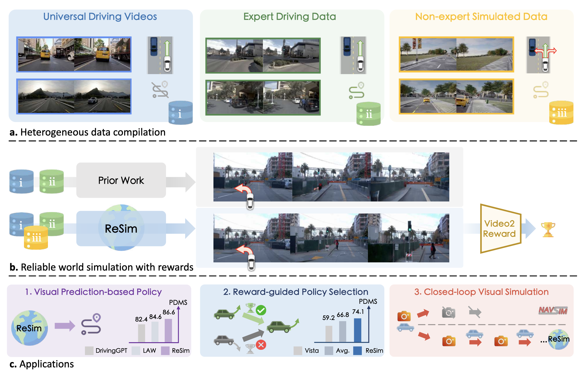

# 自动驾驶中的渲染、仿真与规划

前方10米有一个静止障碍物，自车以5 m/s行驶。如果继续匀速，两秒后到达障碍物；如果立即以−2 m/s²制动，理想点质量模型的停车距离为6.25米。判断这两个动作，首先需要速度、距离、动作持续时间与动力学。生成一段看起来真实的道路视频，并不自动完成这些计算。

下面用这个简化场景区分观测、状态、预测与规划，再阅读已有分享材料中的方法图。图示用于理解接口，不用来比较不同方法的安全性；实际驾驶还需要车辆尺寸、反应延迟、路面条件和其他交通参与者。

## 三类映射各回答什么

设状态为s，动作a，传感器观测o。渲染器给出 `o=g(s)`，动力学给出 `s′=f(s,a)`，规划器根据当前信息及预测选择动作。真实环境部分可观测，因此系统通常维护估计状态或关于状态的分布，不能把单帧图像等同于完整世界。

{ width="900" }

<small>图源：PPT 中引用的世界模型功能分类图。读图重点：不要先问“某个模型是不是世界模型”，而要先看它落在 render、simulate、plan 哪个环节，以及它是否能进入闭环。</small>

图的三行分别对应观测、状态演化和动作选择。可以沿[World Labs的分类讨论](https://www.worldlabs.ai/blog/taxonomy-of-world-models)查这组区分，但具体系统可能把几项功能放入同一网络。

## 两个候选动作怎样得到不同未来

在直线、恒定减速度、无反应延迟的假设下，停车时间为 `5/2=2.5 s`，距离为 `v²/(2|a|)=25/4=6.25 m`。如果动作生效前等待0.3 s，自车还会先前进1.5 m，总距离变为7.75 m。仅这一延迟就吃掉1.5 m余量。

```python
v, decel, delay, obstacle = 5.0, 2.0, 0.3, 10.0
braking_distance = v*v/(2*decel)
travel = v*delay + braking_distance
print(braking_distance, travel, obstacle-travel)
```

输出 `6.25 7.75 2.25`。最后2.25 m只是这个点质量算例的距离余量，未包含车长、制动不确定性和道路安全要求。例子说明动作条件与时间为何不能省略，不是可部署的制动策略。

## 占用表示把空间问题显式化

语义占用可以按空间单元描述哪里有车、行人、道路或其他物体。它让碰撞与可通行性更容易与轨迹相接，但分辨率、遮挡和预测不确定性仍然存在。一个被量化为空的单元，未必真的没有小障碍物。

{ width="880" }

<small>图源：PPT 中 UniScene 系列示意图。读图重点：语义占用像是驾驶世界的中间状态，视频和点云是从状态派生出来的观测。</small>

图中BEV布局进入UniScene，语义占用再连接点云与多视角视频。读图时要分开中间状态和从状态生成的观测。这张分享图能够说明结构接口，不能单独支持某个具体版本的性能结论。

## 4D表示连接时间变化与不同视角

如果同一个状态可从不同相机渲染，可以减少各视角彼此独立生成造成的不一致。引入时间维后，还需描述物体运动、形变和遮挡。几何表示提供组织方式，正确的动力学不会由表示名字自动产生。

{ width="920" }

<small>图源：PPT 中 Envision4D 示例图。读图重点：4D Gaussian 的意义不是“换一种图片格式”，而是把未来预测放进带空间结构的表示里。</small>

从左侧上下文图像进入中间动态4D高斯，再分别看右侧的未来时间外推与新视角外推。二者测试不同能力。某一新视角看起来合理，不足以证明改变自车动作后，其他车辆会作出合理反应。

## 闭环系统中，谁真正更新了世界

{ width="800" }

<small>图源：PPT 中 DreamForge 闭环仿真结构图。读图重点：这里的世界模型不是孤立视频生成器，而是闭环仿真系统里的观测生成组件。</small>

这张DreamForge系统图把Traffic Manager、World Dreamer与Driving Agents分开。驾驶智能体输出轨迹，交通管理器更新布局与位姿，生成模块提供多视角观测。要解释闭环行为，应沿整个回路追踪状态更新，不能把交通管理器的功能全部归给视频模型。

回到制动算例，如果环境的速度更新由外部模拟器完成，视频网络只渲染相应相机画面，就应分别评价动力学和渲染误差。天气与光照可用来增加观测变化，但改变画风不能代替改变摩擦或制动动力学。

## 预测占用与预测用于规划的表示

{ width="920" }

<small>图源：PPT 中 I2World 结构图。读图重点：如果把 occupancy 看成状态，那么模型预测的就不是“下一张图”，而是“下一刻世界被什么占据”。</small>

I2World图的上半部分处理占用表示的编码与解码，下半部分沿时间预测，并接收图中标出的动作或运动条件。要评价它在候选动作比较中的作用，需要固定历史、改变动作，再检查未来占用是否相应变化。训练日志只记录过一个实际动作时，其他动作的真实后果不会凭空出现在数据中。

{ width="900" }

<small>图源：PPT 中 ResWorld 结构图。读图重点：世界模型的目标不是复刻数据集中唯一发生过的未来，而是形成对规划有用的未来表征。</small>

ResWorld图把历史BEV与scene query连接到未来表示，再用于轨迹细化。监督可以侧重规划结果，但这也限制了表示的用途。对轨迹评分有帮助，不代表该表示能正确渲染传感器或支持任意反事实查询。

## 规划器会访问训练中少见的动作

规划不是复述日志。它会比较急刹、变道或避让等候选，其中一些可能远离训练分布。如果模型对没见过的动作过度乐观，优化器反而可能挑中模型预测最错误的方案。

{ width="920" }

<small>图源：PPT 中 ReSim 方法示意图。读图重点：关键不只是“生成未来视频”，而是让世界模型在非专家动作、偏离专家分布的轨迹下仍然可靠。</small>

ReSim分享图同时列出普通视频、专家驾驶和非专家模拟数据，并把未来预测接入奖励与策略选择。它说明数据与消费者可以一起设计；图中的单项结果仍需回到原文的数据、仿真器和评价协议，不能用作现实道路安全保证。

## 分开检验预测、动作敏感性与控制结果

| 检查 | 固定什么，改变什么 | 它能回答的范围 |
| --- | --- | --- |
| 日志预测 | 固定已有历史与实际动作 | 对已观察后续的预测误差 |
| 受控动作对照 | 同一初态改变动作，另用可信环境获得后果 | 模型是否跟随动作变化及误差大小 |
| 闭环任务 | 固定场景分布，对比是否使用模型 | 规划收益、失败与资源成本 |

仅在模型内部生成两个不同未来，证明的是输出对动作有反应，还不能证明两个未来都正确。闭环评估也要使用独立环境或真实记录核查，避免让同一个有偏模型同时出题、规划和打分。


具体状态与动作接口见[世界模型](../world-models/index.md)，时间影响见[观测年龄](embodied-inference-observation-age-1009-2059.md)。本文保留的分享材料图用于连接这些机制，未独立复现图中方法的驾驶实验。
