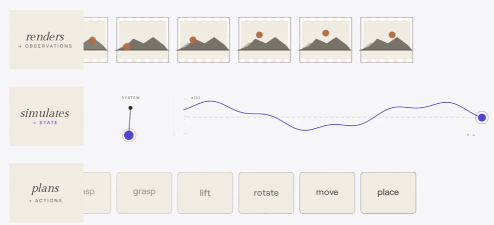
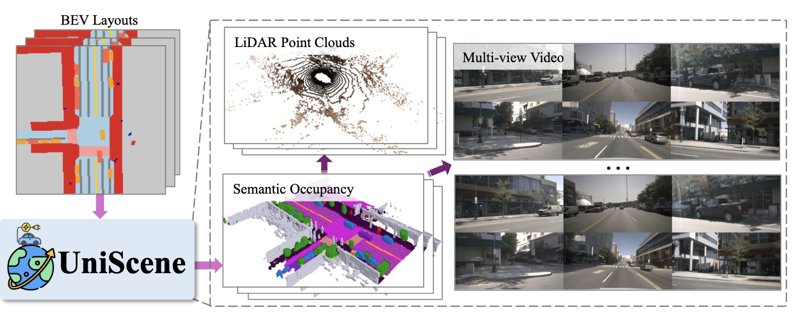
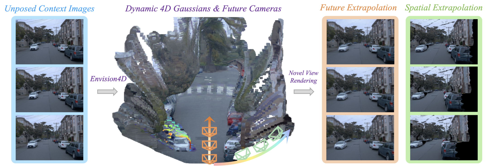
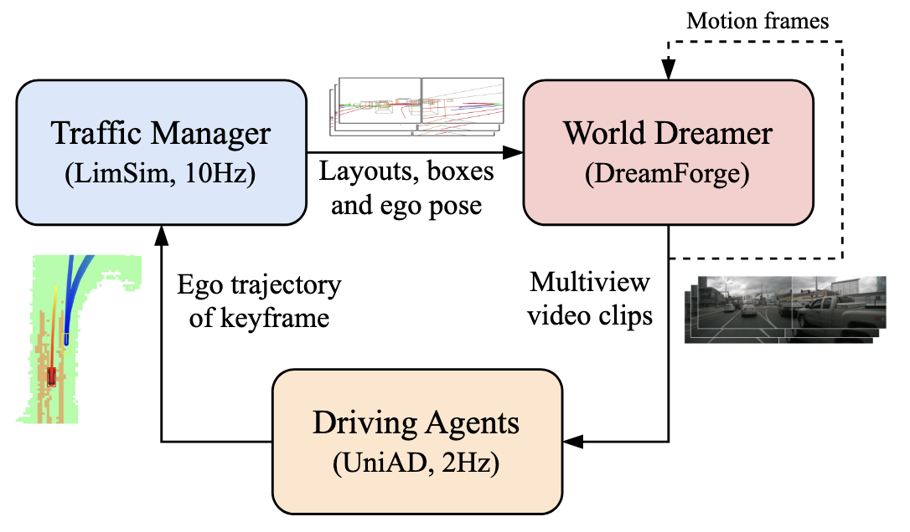
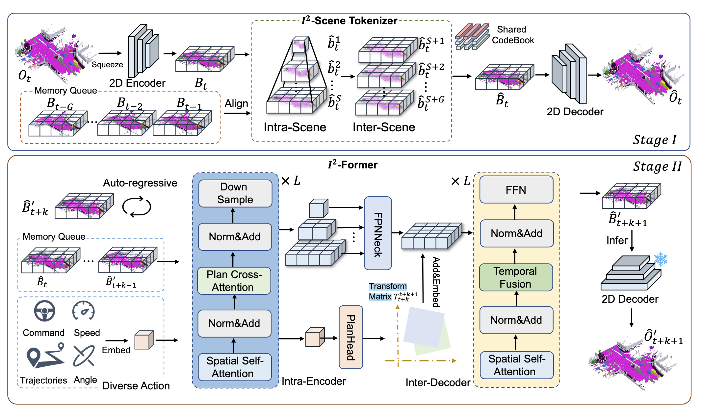
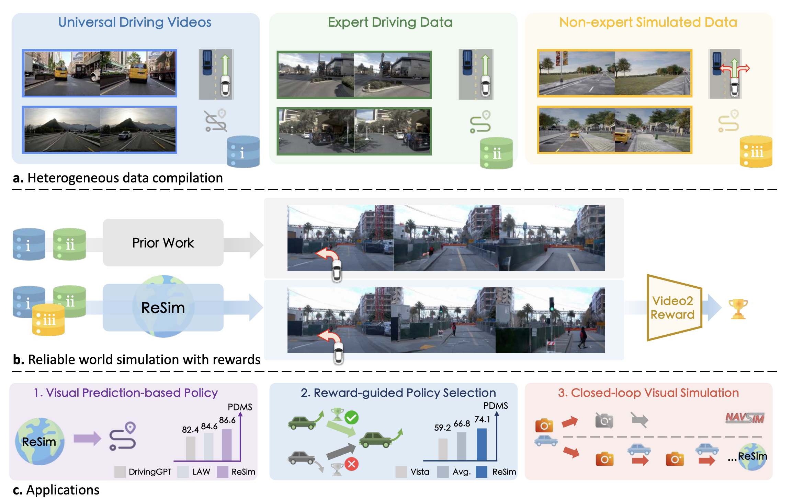
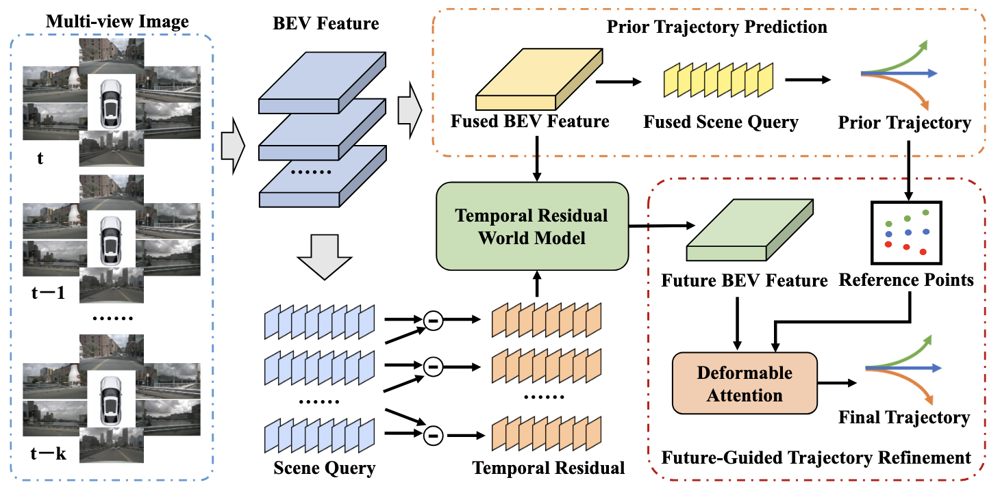
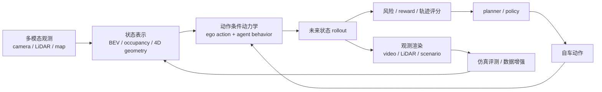

# 自动驾驶世界模型：从渲染、仿真到规划闭环

这份材料给我的核心启发是：自动驾驶中的世界模型不应该只被理解为“预测未来画面”。更准确的读法，是把它放回 `观测-状态-动作` 的闭环里：渲染回答“世界状态怎样变成传感器观测”，仿真回答“状态和动作怎样演化成下一状态”，规划回答“观测怎样变成动作”。

所以，自动驾驶世界模型的真正价值，是提供一种可被规划器、仿真器、数据引擎和安全评测共同消费的未来推演能力。

这份路线思考基于一份分享材料，不替代单篇论文精读；文中论文名称和方向描述沿用 PPT 的整理口径，具体实验数字和实现细节仍应回到原论文核验。

{ width="900" }

<small>图源：PPT 中引用的世界模型功能分类图。读图重点：不要先问“某个模型是不是世界模型”，而要先看它落在 render、simulate、plan 哪个环节，以及它是否能进入闭环。</small>

## 先把三个词分清楚

自动驾驶的世界模型至少涉及三个概念：

| 概念 | 在自动驾驶中的直觉 | 常见表示 |
| --- | --- | --- |
| 观测 | 车辆能看到或测到的部分世界 | 多视角相机、LiDAR、毫米波雷达、BEV feature |
| 状态 | 对世界更完整、更结构化的内部描述 | occupancy、3D/4D Gaussian、地图、交通参与者状态 |
| 动作 | 自车对世界施加的行为 | 轨迹、转向、加减速、规划意图 |

这三个概念对应三个能力：

| 能力 | 方向 | 关键问题 |
| --- | --- | --- |
| 渲染 | 状态到观测 | 给定世界状态，能不能生成一致的相机 / LiDAR / 多模态观测 |
| 仿真 | 状态加动作到下一状态 | 给定自车动作和交通环境，未来状态是否按合理动力学演化 |
| 规划 | 观测到动作 | 模型预测的未来，是否真的改善轨迹选择和安全性 |

这里最容易误解的是“渲染”和“仿真”的关系。很多视频世界模型看起来像仿真器，但如果它只负责把交通仿真器给出的状态渲染成视频，它在系统里更接近 renderer；只有当模型自己维护状态转移，并能响应动作产生不同未来时，它才真正承担 simulator 的角色。

## 渲染：从像素真实走向状态真实

PPT 里第一组例子集中在渲染。UniSceneV2 的路线很有代表性：它不是直接从文本或噪声生成驾驶视频，而是以语义占用为中心，先构建更结构化的世界状态，再从这个状态渲染激光雷达点云和多视角视频。

{ width="880" }

<small>图源：PPT 中 UniScene 系列示意图。读图重点：语义占用像是驾驶世界的中间状态，视频和点云是从状态派生出来的观测。</small>

这条路线的关键价值是：它把“视觉生成”从纯像素空间往几何和语义状态上拉了一层。对自动驾驶来说，规划器最终关心的不是画面里建筑纹理有多逼真，而是：

1. 哪些空间被车、行人、骑行者或障碍物占据；
2. 哪些区域可行驶；
3. 动态目标未来会占据哪里；
4. 多相机、多帧、多模态之间是否一致。

也就是说，自动驾驶世界模型的“真实”不只是视觉真实，更是状态真实。像素可以漂亮但状态错误；状态如果可靠，画面即使不完美，也可能更有工程价值。

## 4D 表示：为什么几何先验重要

Envision4D 这类工作给了另一个启发：世界模型不一定要预测像素，也可以预测可渲染的 4D 高斯表示。

{ width="920" }

<small>图源：PPT 中 Envision4D 示例图。读图重点：4D Gaussian 的意义不是“换一种图片格式”，而是把未来预测放进带空间结构的表示里。</small>

纯视频预测容易遇到两个问题。第一，多视角一致性难保证：同一个车、同一个行人，在不同相机里可能形状、位置或运动关系不一致。第二，长时外推容易漂移：模型能补出看似合理的画面，但物体运动、尺度和遮挡关系可能逐渐失真。

几何表示至少提供三种先验：

| 几何先验 | 对世界模型的帮助 |
| --- | --- |
| 空间存在性 | 物体不是只存在于某个像素块里，而是存在于三维空间 |
| 视角一致性 | 同一状态可以从不同相机渲染出一致观测 |
| 动态约束 | 未来预测可以在位置、速度、轨迹和形变上受约束 |

这并不意味着 4D Gaussian 会自然解决所有问题。动态交通场景里，自车运动、环境车运动、行人非刚体运动都很复杂。更稳妥的判断是：几何表示给世界模型提供了更好的状态容器，但物理一致性和交互建模仍需要额外设计。

## 仿真：最小众，也最可能产生闭环价值

PPT 里对仿真的判断很值得保留：在渲染、仿真、规划三者中，仿真方向相对小众，但它的价值远不止“测评模型”。好的仿真世界模型可以成为闭环训练环境、失败回放环境和反事实数据生成器。

DreamForge 的位置比较典型。它和交通管理器、驾驶智能体一起构成闭环系统，其中视频生成模型负责把道路布局、相机位姿、3D box 等条件渲染成多视角驾驶视频。

{ width="800" }

<small>图源：PPT 中 DreamForge 闭环仿真结构图。读图重点：这里的世界模型不是孤立视频生成器，而是闭环仿真系统里的观测生成组件。</small>

视频扩散模型在这里有一个独特优势：它很擅长生成视觉风格，包括天气、光照、材质、道路纹理和城市外观。这对数据增强和场景迁移很有用。

但它也有两个明显限制：

| 限制 | 影响 |
| --- | --- |
| 主要在像素层预测 | 可能缺少显式几何、运动学和物理约束 |
| 推理较慢 | 闭环仿真和策略训练会被延迟卡住 |

所以我更倾向于把视频扩散世界模型看成“强观测渲染器 + 风格生成器”，而不是天然完整的驾驶仿真器。它要真正进入闭环，还需要状态层、动作层、交通参与者策略和安全评测一起补齐。

## 语义占用：更接近自动驾驶需要的状态层

I2World 的思路把仿真进一步推到语义占用空间：先把动态 4D 语义占用编码成轻量 BEV 表示，再在潜空间里自回归预测下一帧语义占用，并显式预测自车位姿。

{ width="920" }

<small>图源：PPT 中 I2World 结构图。读图重点：如果把 occupancy 看成状态，那么模型预测的就不是“下一张图”，而是“下一刻世界被什么占据”。</small>

这条路线对自动驾驶尤其自然，因为驾驶规划本来就依赖空间占用和可行驶性。相比未来视频，未来 occupancy 更容易被 planner 消费：

```text
历史观测 + 自车动作
  -> 未来 occupancy / BEV 状态
  -> 碰撞风险、可行驶区域、轨迹评分
  -> 规划动作
```

它也让“闭环仿真”变得更具体。仿真不一定从一开始就生成高保真图像；它可以先在 occupancy 或 BEV 状态层滚动，再按需要渲染相机、LiDAR 或其他模态。这样，状态演化和观测生成可以被拆开优化。

## 规划：世界模型不一定直接输出动作

在规划部分，ReSim 展示的是另一种思路：世界模型本身不一定直接输出控制动作，它可以预测未来观测，再通过逆动力学模型、奖励模型或候选轨迹评分来辅助规划。

{ width="920" }

<small>图源：PPT 中 ReSim 方法示意图。读图重点：关键不只是“生成未来视频”，而是让世界模型在非专家动作、偏离专家分布的轨迹下仍然可靠。</small>

这里有一个很重要的问题：只在专家数据上训练的世界模型，往往只见过“正常驾驶”。一旦规划器尝试非专家动作，比如靠近障碍物、偏离车道、急转或极端避让，模型可能产生幻觉。这个问题对安全很危险，因为自动驾驶最需要验证的恰恰是非常规、罕见和临界状态。

因此，规划用世界模型至少要通过三类压力测试：

| 压力测试 | 要回答的问题 |
| --- | --- |
| 分布外动作 | 自车动作不再像专家驾驶时，模型是否仍给出合理未来 |
| 反事实动作 | 同一历史状态下换不同动作，未来是否一致分叉 |
| 对抗性场景 | 遮挡、近碰撞、突然切入、异常行人等场景是否可生成、可评估 |

如果模型只会复现数据集里的平均驾驶，它可以做演示，但很难成为安全系统的一部分。

## ResWorld：隐空间里的未来未必等于真实未来

ResWorld 给了一个更偏规划的视角：未来状态预测不一定要被真实未来状态逐像素或逐 BEV 强监督。模型可以预测一个对轨迹精细化有用的未来表示，只要它最终提升规划性能。

{ width="900" }

<small>图源：PPT 中 ResWorld 结构图。读图重点：世界模型的目标不是复刻数据集中唯一发生过的未来，而是形成对规划有用的未来表征。</small>

这个点很有意思。自动驾驶数据里记录的是某个时刻人类或系统实际走过的一条轨迹，但在规划问题里，同一状态下本来就存在多种可能未来。模型如果被强行要求复刻数据里的那条真实未来，可能反而限制了它对候选轨迹的评估能力。

更合理的目标可能是：

```text
未来表示不必完全等于日志里发生过的未来，
但必须能帮助模型区分更安全、更平滑、更可执行的动作。
```

这也是隐空间世界模型的优势：它可以丢掉不影响决策的视觉细节，把容量留给动态目标、交通互动、可行驶性和碰撞风险。

## 我对这条路线的综合判断

把这几类工作放在一起看，我觉得自动驾驶世界模型正在从“生成未来观测”走向“维护可规划的未来状态”。这里有四个判断。

**第一，像素不是终点，状态才是中枢。**

视频生成很重要，因为自动驾驶数据天然是多传感器观测。但对规划来说，语义占用、BEV、4D Gaussian、轨迹、地图和风险状态更接近可用信息。未来的系统很可能是状态模型和观测渲染模型的组合，而不是单一视频模型包打天下。

**第二，仿真会成为数据闭环的核心。**

真实道路数据覆盖不了足够多罕见事件。闭环仿真可以生成反事实动作、非专家轨迹和 near-miss 场景，帮助模型见到“正常日志里不会频繁出现，但安全系统必须处理”的情况。

**第三，规划收益比生成质量更重要。**

一个世界模型如果 FVD 很好，但接入 planner 后碰撞率、轨迹质量、反应延迟没有改善，它对自动驾驶的核心价值就有限。相反，一个不生成高清图像的隐空间模型，如果能稳定提升规划性能，反而更接近工程目标。

**第四，交通参与者策略建模是下一道坎。**

很多世界模型里的环境车行为来自数据统计，或者来自交通仿真器的简单启发式规则。但真实交通是多智能体互动：自车变道会影响后车减速，行人犹豫会影响自车刹停，旁车激进行为会改变可行空间。未来世界模型如果不建模其他交通参与者的策略，就很难做高质量反事实推演。

## 一个更可落地的自动驾驶世界模型闭环



这张图里，世界模型不是一个孤立模块，而是数据、状态、仿真、规划和评测之间的连接器。它可以在三个位置发挥价值：

| 位置 | 作用 |
| --- | --- |
| 数据生成 | 合成稀有、多样、反事实场景，补真实数据不足 |
| 闭环仿真 | 让规划器在可交互环境中暴露失败 |
| 辅助规划 | 用未来状态、奖励或风险评分改进轨迹选择 |

## 还需要继续探索什么

我觉得后续最值得跟的不是单一模型指标，而是五个问题：

1. **状态表示怎么选。** 像素、BEV、occupancy、3D/4D Gaussian 和 latent token 各有优劣，关键是下游 planner 消费什么。
2. **反事实怎么评估。** 固定历史、改变动作后，模型是否生成一致且可解释的不同未来。
3. **非专家动作怎么训练。** 只学专家数据不够，世界模型必须见过偏离正常驾驶后的状态演化。
4. **物理一致性怎么约束。** 多视角一致、时空一致、速度/加速度约束、碰撞和遮挡都需要更明确的评测。
5. **环境车策略怎么建模。** 自动驾驶不是单智能体游戏，其他交通参与者的反应本身就是世界状态的一部分。

## 最后判断

自动驾驶世界模型的目标，不是让机器拥有一段更高清的未来想象，而是让系统能够在行动前推演后果，在偏离专家分布时仍然可信，在闭环仿真中暴露失败，并最终把这种推演转化为更安全的规划。

一句话概括：

**自动驾驶世界模型的核心，不是预测未来会长什么样，而是预测不同动作会把世界带向哪里。**
