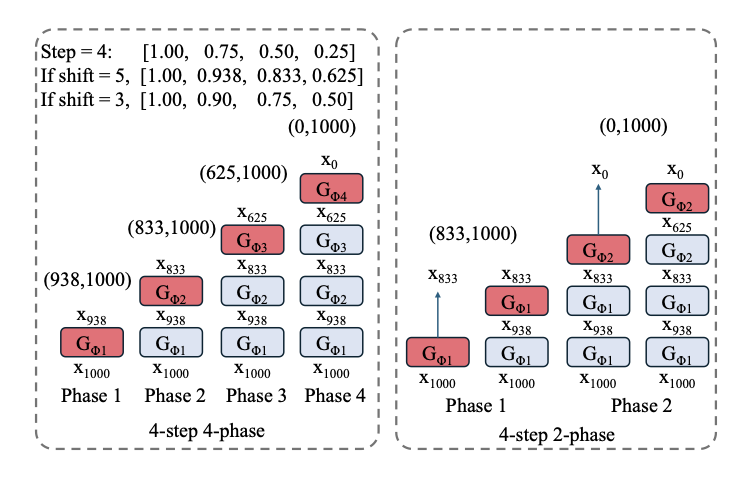
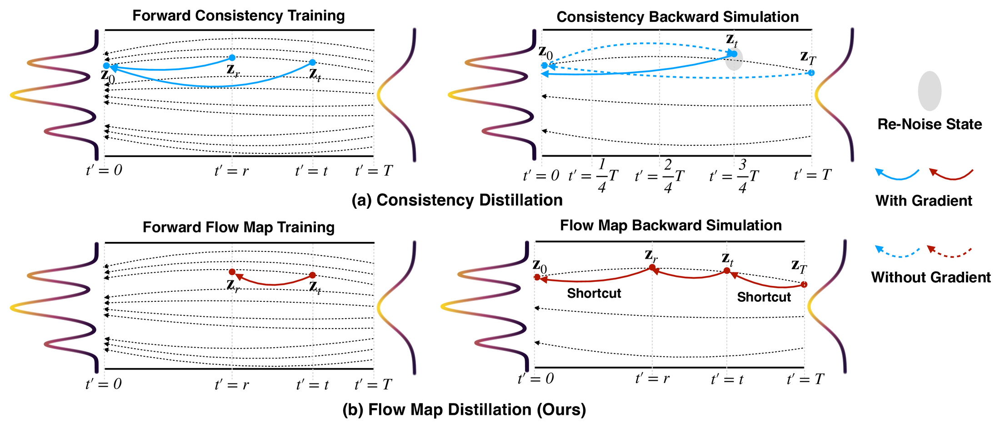
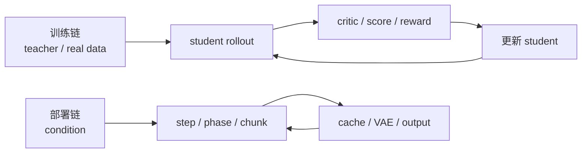

# 扩散加速怎样改变求解误差与生成路径

假设一个方向场已经训练完成，用50次网络调用生成的结果正常，改为5次后出现结构错误。可能是大步积分不准确，也可能是模型在新轨迹经过的位置预测不可靠。若又换成蒸馏学生，连方向场本身都变了。这三种变化需要不同对照，不能都归成“步数太少”。

先用能写出真解的微分方程解释求解误差，再连接少步蒸馏与视频历史。这里的数字都是机制算例，具体方法的生成结果与成本仍以对应原文为界。

## 相同方向场，不同步长会得到什么

考虑 dx/dt = −x，x(0)=1，积分到t=1的真解为e⁻¹≈0.367879。Euler用n等步长得到 `(1−1/n)ⁿ`，n=1时为0，n=2时为0.25，n=10时约0.348678。方向场完全正确，有限步求解仍引入误差。

```python
import math
for n in [1,2,10,50]:
    estimate = (1-1/n)**n
    print(n, round(estimate,6), round(abs(estimate-math.exp(-1)),6))
```

Heun每步先预测一次，再用起终点方向平均；这个方程的一步乘子变为 `1−h+h²/2`。一次Heun步通常使用两次方向场评估，比较它与Euler时应同时报告步数和函数评估数NFE。真实扩散场更复杂、模型也有误差，高阶方法不自动在所有大步长上稳定。

如果把方向场改成 `−0.9x`，即使精确积分也得到e⁻⁰·⁹≈0.406570。继续缩小步长只能逼近这个错误场的解，不能恢复原来的e⁻¹。这就把模型误差与求解误差分开了。

## 不同方法修改的是哪一环

| 论文 | 它主要处理的误差 |
| --- | --- |
| [Score SDE](../paper-deep-dives/diffusion/score-sde.md) | 用 SDE / ODE 坐标分开模型误差、生成路径和数值求解误差 |
| [DPM-Solver++](../paper-deep-dives/diffusion/dpm-solver-plus-plus.md) | 在不重训模型时，降低大 guidance、低 NFE 下的数值积分误差 |
| [DMD](../paper-deep-dives/diffusion/dmd.md) | 把“逐步模仿 teacher”改成一步学生的分布匹配，同时用回归锚住 seed 对应结构 |
| [DMD2](../paper-deep-dives/diffusion/dmd2.md) | 让 fake critic 跟上快速变化的学生，并在学生自己的中间状态上训练多步路径 |
| [Phased DMD](../paper-deep-dives/diffusion/phased-dmd.md) | 防止少步模型把不同 SNR 阶段压成一次近似相同的更新 |
| [AnyFlow](../paper-deep-dives/diffusion/anyflow.md) | 从固定 endpoint 蒸馏扩展到任意区间转移，让额外 NFE 仍能换来质量 |
| [CausVid](../paper-deep-dives/diffusion/causvid.md) | 把双向视频 teacher 的能力迁到 causal、分块、可缓存的流式 student |
| [Diffusion Forcing](../paper-deep-dives/diffusion/diffusion-forcing.md) | 让不同时间 token 拥有不同噪声水平，处理生成历史可信度不一致 |
| [CPS](../paper-deep-dives/diffusion/cps.md) | 修正 Flow-RL 探索噪声对 scheduler 系数和 reward 输入分布的污染 |
| [Wan](../paper-deep-dives/diffusion/wan.md) | 用数据、VAE、DiT、训练课程和推理栈建立其他加速方法要继承的 teacher 上限 |

这十篇并不是一条严格的线性演进史。它们分别修改数值求解、学生分布、时间区间、历史条件和系统执行，适合按改动位置比较。

## 第一层加速：保留模型，只改走法

Score SDE 最重要的作用，是把“学什么”和“怎么走”拆开。score model 描述方向场，reverse SDE 或 probability flow ODE 描述生成路径，solver 决定怎样用有限次模型评估逼近这条路径。

DPM-Solver++ 位于这一层。它没有给模型增加新能力，而是围绕 data prediction 重写 guided diffusion 的 ODE 解法，并用 multistep 复用历史评估。它能在大 guidance 下用较少 NFE 获得更稳的结果，说明 solver order 不是唯一变量，模型参数化、方向场平滑性和 guidance 范围同样决定数值误差。

这一层的优点是便宜、可插拔，不需要重新训练大模型。边界也清楚：solver 可以少走一些冗余小步，却很难把原本几十步的复杂分布变换稳定压成一步。到了这个极端，误差必须进入训练。

## 第二层加速：让学生直接承担分布误差

DMD 的转折是放弃逐步复刻 teacher 轨迹。一步 generator 的目标，是让生成分布接近真实分布。冻结 teacher 提供 real score，在线 fake diffusion model 估计当前学生分布的 score，两者之差推动 generator 更新；paired regression 则防止学生为了总体逼真而丢掉 seed 对应的结构和多样性。

这揭示了少步蒸馏里的两种不同责任：

| 责任 | 缺失时的典型问题 |
| --- | --- |
| 分布级 realism | 样本整体不真实、落在 teacher/real distribution 之外 |
| 输入—输出结构锚点 | 不同 seed 汇到少数模式，内容和条件对应关系变弱 |

DMD2 去掉大部分 paired regression 后，必须补两件事。第一，fake critic 要比 generator 更新得更快，否则它估计的是学生昨天的分布；第二，多步学生要在自己的中间状态上训练，不能只看真实数据加噪得到的干净状态。TTUR、GAN branch 和 backward simulation 分别承担了这些责任。

这里出现了一个跨领域反复出现的规律：**递归系统若训练时只看真值，部署时却吃自己的输出，误差会沿 rollout 累积。** EAGLE-3 的 draft、Self Forcing 的视频续写和具身 policy 的闭环偏移，其实都有同一种结构。

## 少步不代表每一步应该做同一件事

Phased DMD 对 few-step 蒸馏提出了更细的批评。论文在所研究模型中分析不同SNR区间对结构、运动与细节的作用；这种分工依赖模型和目标，不能视为所有扩散过程的固定定律。如果所有 step 都学习相似的全区间跳跃，few-step 模型很容易退化成反复执行“一步生成”，视频运动和 seed 多样性便会被压掉。

{ width="900" }

<small>图源：[Phased DMD](https://arxiv.org/abs/2510.27684)，Supplementary Figure 7。原图表达不同 phase 负责不同噪声子区间。这里的重点是“步骤有职责分工”；它不能单独证明分阶段设计在所有 backbone、步数和数据分布上都最优。</small>

这让我觉得，“几步”并不是最值得先问的问题。更重要的是：每一步覆盖哪个噪声区间，是否见过前一步真实会产生的状态，早期结构错误有没有机会被后期修复。

AnyFlow 又补了另一个维度。固定四步学生可能在四步点上很强，却无法利用八步、十六步带来的额外预算，因为它没有学过可组合的局部 flow map。AnyFlow 学习不同时间端点之间的区间转移，再用学生自己的 rollout 做 on-policy 纠偏，于是一个模型可以根据产品预算选择大跨度 shortcut 或更细的 refinement。

{ width="920" }

<small>图源：[AnyFlow](https://arxiv.org/abs/2605.13724)，Figure 2。原图比较固定端点蒸馏与可组合的 flow-map 路线。它支持“任意步预算需要不同训练接口”的主张；作者在特定 Wan backbone 和训练配方上的结果不能直接外推到所有扩散模型。</small>

这里对应两种不同产品策略：

- 固定少步模型追求一个明确延迟点，适合路径稳定、预算固定的服务
- 任意步模型追求质量—延迟曲线，适合预览、交互编辑和高质量导出共享一份权重

两者没有绝对高下，关键是训练目标是否与真实预算接口一致。

## 视频把误差从单次采样带进了时间

图像的一步误差停在一张图里；视频的误差会成为下一段历史。CausVid 把强 bidirectional teacher 蒸馏到 block-wise causal student，用 few-step sampling 和 KV cache 换取流式生成。代价是 student 只能看过去，chunk seam、长程 drift 和 VAE 解码开始成为新瓶颈。

Diffusion Forcing 提供了另一个思路：不同时间 token 可以拥有不同的噪声水平。已经被真实观测确认的历史可以更干净，模型自己生成、可信度较低的未来可以更 noisy；噪声在这里不只是采样温度，也是一种连续 mask 和不确定性标记。

这两篇放在一起，给了我一个很实用的判断：可以研究是否需要比“已生成 / 未生成”更细的状态区分。真实观测、近期预测、远期预测和待修正片段的可信度不同，训练和推理都应该显式表达这种差异。

但两者的证据边界也很明确。流式视频更快、更连贯，并不等于动作条件正确；token 级噪声调度能表达不确定性，也不自动提供 reward、碰撞、接触和安全状态。

## 连采样器都可能改变训练目标

CPS 讨论的是 Flow-RL 里一个很容易被忽略的问题。为了探索而注入 SDE 噪声时，如果 sample coefficient 和总噪声半径不再遵守原 scheduler，reward model 看到的图像就会偏离模型本来应该生成的分布。此时 RL 优化的对象已经被 sampler 悄悄改写。

它提醒我：一旦 rollout 会进入 verifier 或 reward model，采样器就不再是中性的实现细节。ODE/SDE、guidance、随机噪声、截断和时间权重都会共同定义“训练数据长什么样”。

这条边界值得单独保留。CPS 当前论文标注为 work in progress，主要证据来自图像 reward 曲线，尚不足以说明它已解决视频 Flow-RL、人类偏好或 reward hacking。它提供的是一个重要诊断视角，而不是通用结论。

## Teacher 的上限来自整套系统

Wan 让前面的讨论落回基础设施。强视频 teacher 的能力来自数据过滤与 caption、时空 VAE、DiT、分辨率 curriculum、并行训练和推理优化。AnyFlow、CausVid、Phased DMD 等方法可以改变采样和蒸馏，却无法凭空补回 teacher 没学到的对象持久性、物理规律或长尾场景。

因此，少步结果不好时，不能默认问题都在蒸馏。至少要区分：

| 现象 | 更可能先查什么 |
| --- | --- |
| 单帧就不真实 | teacher、数据、VAE、条件理解 |
| 一步真实但多样性低 | 分布匹配、结构锚点、reward 偏差 |
| 前几帧正常、随后漂移 | self-rollout 分布、cache、时间状态 |
| 运动弱、纹理很好 | SNR 阶段职责、早期 step、motion data |
| 多给 NFE 也不提升 | 是否只训练固定 endpoint、局部转移能否组合 |
| reward 上升、人感下降 | sampler 分布、critic 跟踪、reward hacking |
| kernel 很快、端到端仍慢 | VAE、文本编码、数据搬运和调度 |

加速工作真正困难的地方，往往就是先判断误差属于哪一层。

## 我会怎样设计一个可验收的少步系统

我的综合检查表会同时画两条链。



然后逐项核对：训练链中的 student state 是否就是部署会访问的 state；每个 phase 是否承担不同责任；critic 是否跟得上 student；采样器是否改变 verifier 输入；额外 NFE 是否真的带来增量质量；最终延迟是否已迁移到 VAE、cache 或其他模块。

这张图是跨论文综合，不是某篇论文已经验证的统一架构。它的作用只是让“步数少了”变成一组可以排查的工程问题。

## 用同一组输入区分误差来源

固定模型与初始噪声，只换求解器和NFE，主要检查数值路径；固定求解配置，对照教师与学生，检查蒸馏后的行为；固定单段设置，把真实历史换为自身生成历史，检查递归偏移。视频还要分别记录首段与后续段的质量和延迟。

这些对照不能保证误差彼此独立，但能减少一次更换多个组件造成的混淆。少步方法可以真正减少总成本，不存在误差守恒定律；需要验证的是新的计算与训练方式是否仍满足任务要求。

源码与数值入口见[采样器与ODE](../diffusion/inference.md)，视频时间和缓存见[长视频生成](../diffusion/long-video-and-cache-1029-1246.md)。
