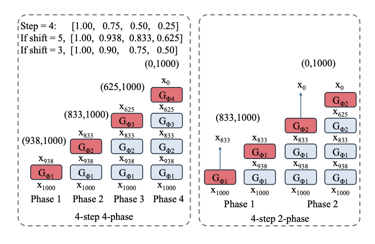
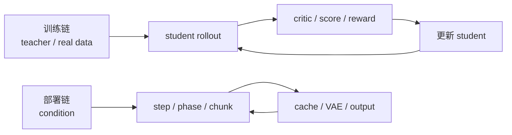

# 扩散模型加速：每删一步，都要重新安排误差

> **本文回答的问题。** 扩散和 Flow 模型从几十步压到四步、两步甚至一步时，究竟删掉了什么？为什么“更少 NFE”经常伴随运动坍缩、模式丢失、训练不稳或预算失去弹性？

读完这一组论文，我不再把少步生成理解成“原路径的快捷播放”。多步采样里的每一段时间，都承担了一部分结构、运动、纹理和误差修正。删掉步骤不会让这些责任消失，只会迫使训练目标、学生模型、在线 critic、采样器或系统模块接手。

所以我对扩散加速形成了一个简单判断：**步数可以减少，误差不会凭空消失；好方法的区别，在于它把误差搬到了一个更可训练、更可验证的位置。**

## 十篇论文分别把误差搬到了哪里

| 论文 | 它主要处理的误差 |
| --- | --- |
| [Score SDE](../paper-deep-dives/diffusion/score-sde.md) | 用 SDE / ODE 坐标分开模型误差、生成路径和数值求解误差 |
| [DPM-Solver++](../paper-deep-dives/diffusion/dpm-solver-plus-plus.md) | 在不重训模型时，降低大 guidance、低 NFE 下的数值积分误差 |
| [DMD](../paper-deep-dives/diffusion/dmd.md) | 把“逐步模仿 teacher”改成一步学生的分布匹配，同时用回归锚住 seed 对应结构 |
| [DMD2](../paper-deep-dives/diffusion/dmd2.md) | 让 fake critic 跟上快速变化的学生，并在学生自己的中间状态上训练多步路径 |
| [Phased DMD](../paper-deep-dives/diffusion/phased-dmd.md) | 防止少步模型把不同 SNR 阶段压成一次近似相同的更新 |
| [AnyFlow](../paper-deep-dives/diffusion/anyflow.md) | 从固定 endpoint 蒸馏扩展到任意区间转移，让额外 NFE 仍能换来质量 |
| [CausVid](../paper-deep-dives/diffusion/causvid.md) | 把双向视频 teacher 的能力迁到 causal、分块、可缓存的流式 student |
| [Diffusion Forcing](../paper-deep-dives/diffusion/diffusion-forcing.md) | 让不同时间 token 拥有不同噪声水平，处理生成历史可信度不一致 |
| [CPS](../paper-deep-dives/diffusion/cps.md) | 修正 Flow-RL 探索噪声对 scheduler 系数和 reward 输入分布的污染 |
| [Wan](../paper-deep-dives/diffusion/wan.md) | 用数据、VAE、DiT、训练课程和推理栈建立其他加速方法要继承的 teacher 上限 |

这十篇并不是一条严格的线性演进史。它们更像从数值、分布、时间阶段、训练分布和系统路径五个方向，回答同一个问题：减少计算以后，原来由多步过程吸收的偏差由谁负责。

## 第一层加速：保留模型，只改走法

Score SDE 最重要的作用，是把“学什么”和“怎么走”拆开。score model 描述方向场，reverse SDE 或 probability flow ODE 描述生成路径，solver 决定怎样用有限次模型评估逼近这条路径。

DPM-Solver++ 位于这一层。它没有给模型增加新能力，而是围绕 data prediction 重写 guided diffusion 的 ODE 解法，并用 multistep 复用历史评估。它能在大 guidance 下用较少 NFE 获得更稳的结果，说明 solver order 不是唯一变量，模型参数化、方向场平滑性和 guidance 范围同样决定数值误差。

这一层的优点是便宜、可插拔，不需要重新训练大模型。边界也清楚：solver 可以少走一些冗余小步，却很难把原本几十步的复杂分布变换稳定压成一步。到了这个极端，误差必须进入训练。

## 第二层加速：让学生直接承担分布误差

DMD 的转折是放弃逐步复刻 teacher 轨迹。一步 generator 的目标，是让生成分布接近真实分布。冻结 teacher 提供 real score，在线 fake diffusion model 估计当前学生分布的 score，两者之差推动 generator 更新；paired regression 则防止学生为了总体逼真而丢掉 seed 对应的结构和多样性。

这揭示了少步蒸馏里的两种不同责任：

| 责任 | 缺失时的典型问题 |
| --- | --- |
| 分布级 realism | 样本整体不真实、落在 teacher/real distribution 之外 |
| 输入—输出结构锚点 | 不同 seed 汇到少数模式，内容和条件对应关系变弱 |

DMD2 去掉大部分 paired regression 后，必须补两件事。第一，fake critic 要比 generator 更新得更快，否则它估计的是学生昨天的分布；第二，多步学生要在自己的中间状态上训练，不能只看真实数据加噪得到的干净状态。TTUR、GAN branch 和 backward simulation 分别承担了这些责任。

这里出现了一个跨领域反复出现的规律：**递归系统若训练时只看真值，部署时却吃自己的输出，误差会沿 rollout 累积。** EAGLE-3 的 draft、Self Forcing 的视频续写和具身 policy 的闭环偏移，其实都有同一种结构。

## 少步不代表每一步应该做同一件事

Phased DMD 对 few-step 蒸馏提出了更细的批评。生成早期的低 SNR 区域决定大结构和运动，后期高 SNR 区域补纹理与局部细节。如果所有 step 都学习相似的全区间跳跃，few-step 模型很容易退化成反复执行“一步生成”，视频运动和 seed 多样性便会被压掉。

{ width="900" }

<small>图源：[Phased DMD](https://arxiv.org/abs/2510.27684)，Supplementary Figure 7。原图表达不同 phase 负责不同噪声子区间。本文用它说明“步骤有职责分工”；它不能单独证明分阶段设计在所有 backbone、步数和数据分布上都最优。</small>

这让我觉得，“几步”并不是最值得先问的问题。更重要的是：每一步覆盖哪个噪声区间，是否见过前一步真实会产生的状态，早期结构错误有没有机会被后期修复。

AnyFlow 又补了另一个维度。固定四步学生可能在四步点上很强，却无法利用八步、十六步带来的额外预算，因为它没有学过可组合的局部 flow map。AnyFlow 学任意 (z_t\rightarrow z_r) 的区间转移，再用学生自己的 rollout 做 on-policy 纠偏，于是一个模型可以根据产品预算选择大跨度 shortcut 或更细的 refinement。

{ width="920" }

<small>图源：[AnyFlow](https://arxiv.org/abs/2605.13724)，Figure 2。原图比较固定端点蒸馏与可组合的 flow-map 路线。它支持“任意步预算需要不同训练接口”的主张；作者在特定 Wan backbone 和训练配方上的结果不能直接外推到所有扩散模型。</small>

这里对应两种不同产品策略：

- 固定少步模型追求一个明确延迟点，适合路径稳定、预算固定的服务
- 任意步模型追求质量—延迟曲线，适合预览、交互编辑和高质量导出共享一份权重

两者没有绝对高下，关键是训练目标是否与真实预算接口一致。

## 视频把误差从单次采样带进了时间

图像的一步误差停在一张图里；视频的误差会成为下一段历史。CausVid 把强 bidirectional teacher 蒸馏到 block-wise causal student，用 few-step sampling 和 KV cache 换取流式生成。代价是 student 只能看过去，chunk seam、长程 drift 和 VAE 解码开始成为新瓶颈。

Diffusion Forcing 提供了另一个思路：不同时间 token 可以拥有不同的噪声水平。已经被真实观测确认的历史可以更干净，模型自己生成、可信度较低的未来可以更 noisy；噪声在这里不只是采样温度，也是一种连续 mask 和不确定性标记。

这两篇放在一起，给了我一个很实用的判断：视频 world model 的状态不应该只有“已生成 / 未生成”两档。真实观测、近期预测、远期预测和待修正片段的可信度不同，训练和推理都应该显式表达这种差异。

但两者的证据边界也很明确。流式视频更快、更连贯，并不等于动作条件正确；token 级噪声调度能表达不确定性，也不自动提供 reward、碰撞、接触和安全状态。

## 连采样器都可能改变训练目标

CPS 讨论的是 Flow-RL 里一个很容易被忽略的问题。为了探索而注入 SDE 噪声时，如果 sample coefficient 和总噪声半径不再遵守原 scheduler，reward model 看到的图像就会偏离模型本来应该生成的分布。此时 RL 优化的对象已经被 sampler 悄悄改写。

它提醒我：一旦 rollout 会进入 verifier 或 reward model，采样器就不再是中性的实现细节。ODE/SDE、guidance、随机噪声、截断和时间权重都会共同定义“训练数据长什么样”。

这条边界值得单独保留。CPS 当前论文标注为 work in progress，主要证据来自图像 reward 曲线，尚不足以说明它已解决视频 Flow-RL、人类偏好或 reward hacking。它提供的是一个重要诊断视角，而不是通用结论。

## Teacher 的上限来自整套系统

Wan 让前面的讨论落回基础设施。强视频 teacher 的能力来自数据过滤与 caption、时空 VAE、DiT、分辨率 curriculum、并行训练和推理优化。AnyFlow、CausVid、Phased DMD 等方法可以改变采样和蒸馏，却无法凭空补回 teacher 没学到的对象持久性、物理规律或长尾场景。

因此，少步结果不好时，不能默认问题都在蒸馏。至少要区分：

| 现象 | 更可能先查什么 |
| --- | --- |
| 单帧就不真实 | teacher、数据、VAE、条件理解 |
| 一步真实但多样性低 | 分布匹配、结构锚点、reward 偏差 |
| 前几帧正常、随后漂移 | self-rollout 分布、cache、时间状态 |
| 运动弱、纹理很好 | SNR 阶段职责、早期 step、motion data |
| 多给 NFE 也不提升 | 是否只训练固定 endpoint、局部转移能否组合 |
| reward 上升、人感下降 | sampler 分布、critic 跟踪、reward hacking |
| kernel 很快、端到端仍慢 | VAE、文本编码、数据搬运和调度 |

加速工作真正困难的地方，往往就是先判断误差属于哪一层。

## 我会怎样设计一个可验收的少步系统

我的综合检查表会同时画两条链。

然后逐项核对：训练链中的 student state 是否就是部署会访问的 state；每个 phase 是否承担不同责任；critic 是否跟得上 student；采样器是否改变 verifier 输入；额外 NFE 是否真的带来增量质量；最终延迟是否已迁移到 VAE、cache 或其他模块。

这张图是跨论文综合，不是某篇论文已经验证的统一架构。它的作用只是让“步数少了”变成一组可以排查的工程问题。

## 证据边界与最后判断

本文所引用的速度、质量和训练结论均来自各论文或官方材料，模型、数据、硬件、指标和人评设置并不统一。DMD 系列、AnyFlow、CausVid 和 Phased DMD 的训练成本较高；CPS 仍是进行中的工作；视频指标也不能替代动作因果、真实闭环或物理安全评测。

“每删一步，都要重新安排误差”是我对这组材料的综合判断。它不意味着成本守恒，也不否认优秀算法能真正减少总计算。它强调的是：局部 NFE 下降只说明调用模型的次数变少，生成质量由谁维护、部署状态怎样被训练、端到端瓶颈去了哪里，仍要逐项验收。

## 相关阅读与下一步

- [高效 AI 的状态账本：少搬状态，比少算一次更重要](efficient-ai-is-state-movement.md)
- [世界模型该预测什么：答案取决于谁消费未来](world-model-future-consumers.md)
- [具身智能的可纠错状态链](embodied-ai-correctable-state-chain.md)
- [前沿模型正在变成受约束的闭环](model-capability-is-a-constrained-loop.md)
- [扩散模型方法对照](../diffusion/comparison-table.md)
- [一致性模型与 Rectified Flow](../diffusion/consistency-models-and-rectified-flow.md)
