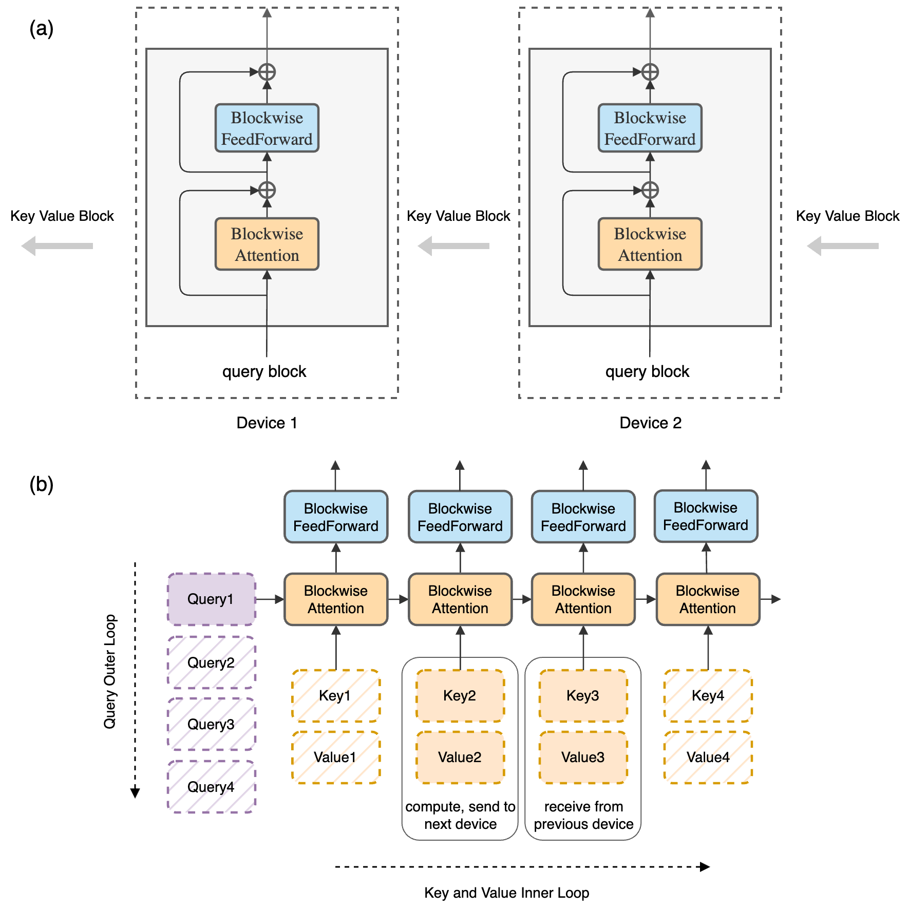
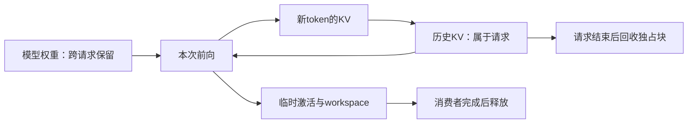

# 训练与推理的状态究竟存在哪里

同一个7B模型，推理时存得下，开始训练却可能超出显存。参数数量没有变，改变的是计算过程中必须保留的状态。进一步加速之前，先追踪一个张量由谁产生、谁读取、何时释放，才能分清减少运算、减少存储和减少搬运的作用。

## 先把每参数的字节数算出来

采用一种常见混合精度Adam配置，BF16参数与梯度各2 bytes，FP32主权重4 bytes，一阶与二阶矩各4 bytes，合计16 bytes/parameter。7×10⁹参数的这些状态约112 GB，尚未计算激活、临时workspace和通信缓冲区。

具体实现可能不用主权重，梯度也可能采用不同精度，因此16 bytes是这里的配置账，不是所有训练的常数。推理不需要这些优化器历史，但会增加请求相关的KV。

| 状态 | 本例字节/参数 | 谁使用 | 何时可以释放 |
| --- | ---: | --- | --- |
| BF16权重 | 2 | 前向与部分反向 | 模型不用时；分片方案可按层调入 |
| BF16梯度 | 2 | optimizer step | 更新后可清零或释放缓冲 |
| FP32主权重 | 4 | 高精度更新 | 跨step保留，若此实现使用它 |
| Adam一阶、二阶矩 | 8 | 下一次更新 | 跨step与恢复保存 |

## ZeRO改变副本的分布，不能让临时工作消失

在8张卡普通数据并行中，每卡都保存上述112 GB。若理想化地只分片12 bytes的主权重和优化器状态，每卡常驻量为 `7e9×(4+12/8)=38.5 GB`；再分片梯度，变为 `7e9×(2+14/8)=26.25 GB`；全部模型状态分片的理想值为14 GB。

这些是状态分片的下界式估算。计算某层时还需收集参数，反向需归约梯度，预取和重叠可能同时保留多个缓冲区。分片减少常驻副本，实际峰值要在时间线上测量，见[分布式状态与恢复](../training/distributed-training-and-checkpointing.md)。

```python
params, ranks = 7e9, 8
for bytes_per_param in [16, 4+12/ranks, 2+14/ranks, 16/ranks]:
    print(round(params*bytes_per_param/1e9,2))
```

输出 `112.0 38.5 26.25 14.0`，单位均为十进制GB。这里没有把GB与GiB混用，也没有把这组数当作实际峰值。

## Attention 的问题是中间状态是否必须写回

常规实现可能构造长度平方大小的分数和概率矩阵。FlashAttention按块计算，并维护归一化统计，使完整概率矩阵不必常驻显存。它保留标准attention定义，但浮点归约顺序不同，数值不一定逐bit相同。

分布式长序列还需要决定KV在哪张卡。RingAttention保留本地query块，让其他KV块依次经过；每个query仍需计算所允许的关系。减少复制不等于减少关系数量，通信能否被隐藏取决于块大小、计算与互联。

{ width="860" }

<small>图源：[Ring Attention with Blockwise Transformers for Near-Infinite Context](https://arxiv.org/abs/2310.01889)，Figure 2。原图上半部分展示 query block 留在本设备、KV block 沿 ring 传递，下半部分展示 blockwise attention 与 feedforward 的组织。这里的重点是“流动状态”可以替代“复制状态”；这张图不能证明长上下文数据一定有用，也不能证明慢互联下通信总能被隐藏。</small>

沿上半图追踪一次KV块传递，再看下半图如何按块计算。该图描述通信组织；不同mask下哪些块真正需要传送，还要根据可见性判断。MagiAttention进一步按有效区域分配计算与通信，代价是元数据和调度本身也要执行。

## 请求缓存会随上下文和并发增长

32层、8个KV头、每头128通道、BF16、长度32768的单请求KV为

\[
2\times32\times32768\times8\times128\times2=4\;\mathrm{GiB}.
\]

最前面的2表示K与V，最后的2表示每元素字节数。4条这样的请求约16 GiB。分页缓存改变物理分配和共享规则，不会改变这些元素本身的大小；前缀共享可能减少实际独立元素，KV量化则改变每元素成本并增加scale等元数据。



图中三类寿命不同。临时张量若在异步执行结束前被重用，会破坏结果；请求KV若不释放，会逐步耗尽容量。正确性与性能在这里共享同一个生命周期规则。

## 低比特与投机都可能新增工作

权重INT4能减少存储，但kernel可能仍需读取scale、解包和反量化。若先完整展开成高精度临时矩阵，再进行GEMM，峰值和带宽收益会与“文件缩小四倍”的直觉不同。应查看实际执行路径，见[量化与算子](../operators/low-precision-and-quantized-kernels.md)。

投机解码又引入候选token与临时KV。目标模型接受的前缀可以提交，拒绝分支要释放；兄弟候选不能在mask中互相读取。平均接受长度提高不代表所有批次都更快，草稿与验证的时间、临时状态和调度共同决定结果。

## 用一个时间下界区分算量与搬运

若某次计算需要F FLOPs并搬运M bytes，在给定有效算力P和带宽B下，理想耗时至少受 `max(F/P, M/B)` 限制。这不是完整预测，还没有启动、通信和同步。假设计算下界2 ms、搬运下界8 ms，仅把F减半，估算仍受8 ms限制；若把M减半，才可能将这个下界降到4 ms。

这里的P和B应来自相近工作负载的测量，不能直接用芯片峰值充当可达性能。[Roofline](../operators/roofline-benchmarking-and-case-studies.md)进一步解释算术强度与测量。

## 如何读具体实现

先跟踪分配、读写、同步和释放的位置，再比较完整任务的质量与耗时。保留全量参考结果，分别引入分片、重算、分页或量化，才能知道哪一种状态变化带来了收益或误差。某些实现会为正确的反向重算额外保存高精度辅助量，所以也不能把“状态越少”当成无条件目标。

[ZeRO](../paper-deep-dives/foundations/zero.md)、[RingAttention](../paper-deep-dives/world-models/ringattention.md)和[PagedAttention](../paper-deep-dives/inference/vllm-pagedattention.md)分别提供训练副本、序列通信与请求缓存的具体实例。它们解决的对象不同，性能数字不能脱离原模型、硬件和负载横排。
