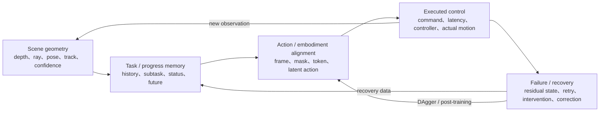

# 具身智能的可纠错状态链：动作之外，系统还要记录什么

一次抓杯失败，可能来自深度、任务阶段、坐标映射、控制延迟，也可能发生在夹爪接触后的滑动。20 篇具身智能论文反复碰到同一个困难：动作头只能回答模型此刻想做什么，真实机器人还得知道场景现在是什么样、任务进行到了哪里、控制器实际执行了什么，以及失败后世界还剩下什么状态。

少一项，闭环里就会出现无法定位的断点。系统仍可继续输出动作，却无法判断该回查感知、任务记忆、坐标接口、控制器，还是接触后的物体状态。

我想讨论的“状态链”就是这五段：

```text
scene geometry
  -> task / progress memory
  -> action / embodiment alignment
  -> executed control
  -> failure / recovery
  -> new scene geometry
```

这条链的要求不高深：每一段都留下可观察状态，每一次转换都能和真实反馈比较，每一种偏差都有回写位置。缺少这些接口时，扩大模型容量能否改善真机可靠性很难判断，失败也更难定位和恢复。

## 一条动作为什么会在真机上变坏

论文里的 policy 常被简写成：

$$
a_{t:t+H}=\pi(o_t,\ell,s_t),
$$

其中 \(o_t\) 是视觉观测，\(\ell\) 是指令，\(s_t\) 是本体状态，模型输出未来一段动作。这个写法适合描述训练目标，却省略了真机上最麻烦的部分。

首先，\(o_t\) 只是投影。它可能没有可靠深度，也看不到遮挡后的物体，更不一定保存杯子被移动前的位置。其次，模型输出的 \(a_t\) 还要经过坐标变换、限幅、轨迹平滑、逆运动学和低层控制器，机器人真正执行的是 \(\tilde a_t\)。接触之后，物体状态又会偏离模型想象。下一次观测因此来自策略自己制造的新分布。

更接近部署的写法是：

$$
x_t=(g_t,m_t,e_t,c_t,r_t),
$$

这里 \(g_t\) 是 scene geometry，\(m_t\) 是 task/progress memory，\(e_t\) 是 embodiment 对齐状态，\(c_t\) 是已执行控制，\(r_t\) 是失败与恢复状态。策略从 \(x_t\) 生成候选动作；控制器执行后，系统再用新观测校正五类状态。

这不是要把机器人重新拆成一堆手工模块。重点是保留纠错接口。端到端模型也可以生成这些状态，甚至可以把它们压进 latent；只要它们能被读取、比较和回写，就仍然是一条可维护的链。

## 我说的“可纠错状态链”是什么

下面这张图是我的综合抽象，不是任何一篇论文的原始架构。



“可纠错”至少包含三个条件。

| 条件 | 系统必须保存什么 | 缺失后的典型现象 |
| --- | --- | --- |
| 可观察 | 几何、任务阶段、动作坐标、实际执行和失败状态 | 失败只能被记成一个 `0`，无法归因 |
| 可比较 | 预测动作、计划后果、实际动作和新状态之间的差异 | 模型看似合理，控制器却执行了另一条轨迹 |
| 可回写 | correction、人工接管、恢复轨迹、置信度和进度变化 | 同一类 near-miss 在部署中反复出现 |

我会把它和“完整可解释系统”区分开。可纠错链不要求每个 latent 都有自然语言含义，也不要求手写所有因果关系。它只要求系统知道错误发生在哪一段，并能把反馈送回对应的数据、模型或控制接口。

## 五类状态：每一类都必须能被看见

### 1. Scene geometry：先确认世界在哪里

[Depth Anything](../paper-deep-dives/embodied-ai/depth-anything.md) 和 [Depth Anything V2](../paper-deep-dives/embodied-ai/depth-anything-v2.md) 先处理单目深度的数据覆盖与标签质量；[Depth Anything 3](../paper-deep-dives/embodied-ai/depth-anything-3.md) 把输出扩成 depth、ray 和 camera；[VGGT](../paper-deep-dives/embodied-ai/vggt.md)、[MapAnything](../paper-deep-dives/embodied-ai/mapanything.md) 与 [D4RT](../paper-deep-dives/embodied-ai/d4rt.md) 再把多视角、metric scale、相机运动和动态点轨迹接进来。

这些工作共同说明，RGB token 里的“空间感”还不够。机器人至少要能回答：目标沿哪条射线、离相机多远、相机自己怎样运动、物体是否在动、这个估计有多可信。否则策略失败后，我们连“看错了”还是“做错了”都分不开。

几何状态也不必永远是一张完整点云。DA3 的 `depth + ray`、VGGT-Ω 的 scene registers、D4RT 的 point query 都在寻找更薄的接口。训练时可以用 depth、normal、point、matching、pose 和 visibility 等丰富监督；部署时只给 policy 提供任务所需的 token、因子或查询结果。

### 2. Task / progress memory：当前帧不等于当前任务

长任务里，视觉相似的画面可能对应不同阶段。摊平的衣服可能意味着“准备折叠”，也可能意味着“刚刚恢复失败”；空桌面可能表示任务完成，也可能表示目标被遮挡。

[π0.5](../paper-deep-dives/embodied-ai/pi05.md) 用 high-level subtask 组织家庭长任务，[DM0.5](../paper-deep-dives/embodied-ai/dm05.md) 把历史关键帧、任务进度和事件预测接进 VLA，[GR-3](../paper-deep-dives/embodied-ai/gr3.md) 则明确输出 `in progress / terminate / invalid`。这些状态不是解释性装饰。它们决定机器人此刻该继续、停止，还是拒绝执行。

WAM 路线补的是另一种记忆：未来趋势。[GR-2](../paper-deep-dives/embodied-ai/gr2.md) 联合预测未来视频和动作，[Video Prediction Policy](../paper-deep-dives/embodied-ai/video-prediction-policy.md) 只取视频模型的 predictive latent，[Fast-WAM](../paper-deep-dives/embodied-ai/fast-wam.md) 更进一步，在训练时做 video co-training，部署时不生成未来帧。它们提示我：任务记忆不只保存过去，也可以保存“系统认为接下来会发生什么”。

### 3. Action / embodiment alignment：动作数值必须有共同物理含义

[RT-2](../paper-deep-dives/embodied-ai/rt2.md) 把连续动作变成 VLM 能生成的 token，建立了 VLA 的基本动作接口。但跨机器人训练很快暴露出下一层问题：相同数值在不同自由度、坐标系和控制频率下未必表示相同运动。

[SpatialVLA](../paper-deep-dives/embodied-ai/spatialvla.md) 在输入侧加入 Ego3D，在输出侧按动作分布构造 adaptive grids；[Qwen-RobotManip](../paper-deep-dives/embodied-ai/qwen-robotmanip.md) 用 80 维 canonical representation、camera-frame EEF delta 和 episode context 对齐多种机器人；[Motus](../paper-deep-dives/embodied-ai/motus.md) 则把 optical flow 压成 latent action，让无动作视频先提供 motion prior，再用目标机器人 SFT 落地。

这些方法的共同点是承认“跨 embodiment”包含多次翻译：图像坐标到空间坐标，视觉运动到共享动作表示，共享动作再到目标执行器。只解决其中一层，迁移就会在下一层断掉。

### 4. Executed control：模型动作和实际动作要分开记

论文通常报告 policy 输出，机器人却执行 controller 处理后的轨迹。RT-2 的低频动作要经过低层控制，GR-2 的 Cartesian trajectory 要交给 WBC，GR-3 的 ByteMini 依赖 pure pursuit 与 trajectory optimization，[DreamZero](../paper-deep-dives/embodied-ai/dreamzero.md) 需要异步执行和真实观测回写，[VO-DP](../paper-deep-dives/embodied-ai/vodp.md) 的 RGB-only 优势也部分来自避开脆弱点云预处理链路。

因此 episode 里至少应区分：

```text
predicted action
  -> transformed / clipped command
  -> controller target
  -> measured joint / EEF motion
  -> observed object motion
```

没有这组记录，训练时的 action label 和部署时的实际运动会被混为一谈。延迟、chunk 接缝、限位、逆运动学失败和接触滑动都会被错误归因给 policy。

### 5. Failure / recovery：失败之后的状态才是可靠性的材料

[kai0](../paper-deep-dives/embodied-ai/kai0.md) 把问题写成 \(P_{train}\)、\(Q_{model}\)、\(P_{test}\) 三类分布之间的错位。成功示教构成的训练分布，与策略自己在真机上访问的状态并不相同。一次偏抓会进入训练集中很少出现的状态；如果系统没有恢复数据，后续每一步都在外推。

{ width="920" }

<small>图源：[χ₀: Resource-Aware Robust Manipulation via Taming Distributional Inconsistencies](https://arxiv.org/abs/2602.09021)，Figure 1。原图表达训练示教分布、模型策略分布和真实部署分布之间的错位，以及 Model Arithmetic、Stage Advantage、DAgger、时空增强和 action-chunk smoothing 的对应位置。这里的重点是 failure/recovery 必须进入状态链；该图只来自特定双臂衣物任务，不能证明五类状态链已经在所有机器人上成立。</small>

kai0 最有价值的提醒是：validation set 也属于状态链。若验证集只包含成功示教附近的状态，系统会选出“顺境里最像专家”的 checkpoint；若验证集包含 near-miss、人工接管和恢复轨迹，checkpoint 选择才更贴近部署。

## 二十篇论文分别补了哪一段

下面按“主要补哪一类状态”分组。很多论文跨越多段，这里只选最直接的一段，避免重复计数；20 篇均显式列出。

| 状态组 | 论文 | 它补进状态链的内容 | 仍然断在哪里 |
| --- | --- | --- | --- |
| Scene geometry | [Depth Anything](../paper-deep-dives/embodied-ai/depth-anything.md) | 大规模无标注图像、强扰动和 feature alignment 带来的相对深度 | 无绝对尺度、无动作闭环 |
| Scene geometry | [Depth Anything V2](../paper-deep-dives/embodied-ai/depth-anything-v2.md) | synthetic teacher 到 pseudo-real student 的干净深度监督 | 仍是单目相对深度 |
| Scene geometry | [Depth Anything 3](../paper-deep-dives/embodied-ai/depth-anything-3.md) | depth、ray、camera 与多视角可融合几何 | 非动态控制与接触模型 |
| Scene geometry | [VGGT](../paper-deep-dives/embodied-ai/vggt.md) | camera、depth、point map、track 的统一前向状态 | 长序列漂移和动态物体仍难 |
| Scene geometry | [VGGT-Ω](../paper-deep-dives/embodied-ai/vggt-omega.md) | 可扩展重建监督与 compact scene registers | VLA 收益主要来自 LIBERO，缺真机消融 |
| Scene geometry | [MapAnything](../paper-deep-dives/embodied-ai/mapanything.md) | 可选 intrinsics、pose、depth 与显式 metric scale | 未显式处理 noisy prior 和 scene flow |
| Scene geometry | [D4RT](../paper-deep-dives/embodied-ai/d4rt.md) | 动态 4D 点查询、visibility、confidence 和 camera state | 不是 action-conditioned dynamics |
| Task / progress memory | [GR-2](../paper-deep-dives/embodied-ai/gr2.md) | web video 动态先验与 future-video/action 联合监督 | 未来视频不是安全 planner |
| Task / progress memory | [Video Prediction Policy](../paper-deep-dives/embodied-ai/video-prediction-policy.md) | single-forward predictive representation | 缺动作反事实与显式恢复 |
| Task / progress memory | [Fast-WAM](../paper-deep-dives/embodied-ai/fast-wam.md) | 训练期 world representation，部署期移除 future generation | 不能外推到长时搜索 |
| Task / progress memory | [π0.5](../paper-deep-dives/embodied-ai/pi05.md) | high-level subtask、verbal instruction 与 task progress | 长期记忆和异常恢复有限 |
| Task / progress memory | [DM0.5](../paper-deep-dives/embodied-ai/dm05.md) | 历史关键帧、embodied CoT 与轨迹进度对齐 | 主要是官方报告，缺完整消融 |
| Action / embodiment alignment | [RT-2](../paper-deep-dives/embodied-ai/rt2.md) | action tokenization、合法输出约束和 web/robot co-training | 语义迁移不等于新物理技能 |
| Action / embodiment alignment | [SpatialVLA](../paper-deep-dives/embodied-ai/spatialvla.md) | Ego3D 与 adaptive action grids | 深度误差和动作量化仍会传递 |
| Action / embodiment alignment | [Qwen-RobotManip](../paper-deep-dives/embodied-ai/qwen-robotmanip.md) | canonical state/action、camera EEF、episode context | H2R artifact 与大 morphology gap |
| Action / embodiment alignment | [Motus](../paper-deep-dives/embodied-ai/motus.md) | optical-flow latent action 与多模式 scheduler | 光流不包含力、摩擦和完整因果 |
| Executed control | [DreamZero](../paper-deep-dives/embodied-ai/dreamzero.md) | 联合 video/action、真实观测回写与 7Hz 闭环 | 计算昂贵，短记忆与精细接触仍弱 |
| Executed control | [GR-3](../paper-deep-dives/embodied-ai/gr3.md) | task status、连续 action chunk 与全身控制栈 | 结果不能只归因给 VLA |
| Executed control | [VO-DP](../paper-deep-dives/embodied-ai/vodp.md) | RGB 中间语义—几何特征接 diffusion policy | 不是开放词汇或长时 VLA |
| Failure / recovery | [kai0](../paper-deep-dives/embodied-ai/kai0.md) | failure-adjacent validation、DAgger、stage、chunk smoothing | 证据集中在衣物任务和官方系统 |

这张表也暴露了一个不均衡：几何和动作生成论文很多，专门处理 failure/recovery 的工作很少。可靠性讨论经常停在平均成功率，却没有把失败后的残余状态、重试次数、接管原因和恢复轨迹当成主要研究对象。

## 训练时表征丰富，部署时接口变薄

把 20 篇论文放在一起，我看到一条反复出现的工程路线：训练阶段给模型更丰富的监督，部署阶段只保留最有用的状态接口。

| 训练时保留的丰富信号 | 部署时变薄的接口 | 对应材料 |
| --- | --- | --- |
| depth、ray、point、normal、matching、pose | scene token、depth-ray 因子或 point query | DA3、VGGT-Ω、D4RT |
| 完整未来视频预测 | predictive latent 或当前帧编码 | VPP、Fast-WAM |
| 文本、subtask、object grounding、FAST action | 低频子任务加连续 action expert | π0.5 |
| VL、canonical action、H2R、episode context | 少步 flow action chunk | Qwen-RobotManip |
| 视频、语言、latent action、真实动作 | scheduler 选择的 VLA/WM/IDM 接口 | Motus |
| 成功、失败、stage、correction、延迟 | checkpoint、progress signal、smoothed command | kai0 |

“变薄”不是删掉世界状态。它是把训练所得知识压到更便宜、更明确的消费者接口。VLA 可能只需要几个 scene registers，控制器只需要一段连续 action chunk，failure monitor 只需要 progress、confidence 和实际执行偏差。若每个控制周期都重建完整点云、生成高清视频并输出长篇 CoT，系统会先被延迟和同步拖垮。

这条路线也有边界。DreamZero 和 Motus 的实验说明，video-action joint prediction 有时确实能带来额外收益；显式未来对离线验证、反事实搜索和失败调试也很有价值。我更倾向于把“薄接口”理解成默认部署路径，把昂贵显式 rollout 留给高风险、低置信度或需要规划的时刻，而不是永久删除。

## 长时可靠性：先看可观察性和恢复，再谈规划

长时任务失败时，人们很自然地想到更长 context 或更强 planner。它们当然重要，但我会先查两个更朴素的问题。

第一，当前状态真的可观察吗？如果系统不知道物体原始位置、子任务阶段、相机运动、夹爪实际位移和指令有效性，planner 只是在错误状态上做更长推理。

第二，失败状态可恢复吗？如果训练集只有成功轨迹，策略一旦偏离，就没有“下一步怎样回来”的经验。更长规划不会自动创造恢复动作。

这也是 DM0.5、π0.5、GR-3 和 kai0 应该连着读的原因：历史关键帧补观测，高层子任务补阶段，`invalid / terminate` 补执行边界，DAgger 与 Stage Advantage 补恢复分布。WAM 再给这条链增加未来趋势，但不能替代前四项。

我会把长时可靠性拆成下面四个乘数，而不是一个总成功率：

$$
R_{long}\approx O_{state}\times C_{transition}\times R_{recovery}\times S_{control},
$$

其中 \(O_{state}\) 表示状态可观察性，\(C_{transition}\) 表示状态转换的一致性，\(R_{recovery}\) 表示失败后的恢复覆盖，\(S_{control}\) 表示执行链稳定性。这个式子是分析框架，不是论文公式。乘法只是强调：任何一项接近零，长任务都会迅速崩掉。

## 论文结论、综合推论与待验证假设

为了避免把博客判断写成论文共识，我把三层结论分开。

| 层级 | 内容 | 证据状态 |
| --- | --- | --- |
| 论文结论 | DA3 的 depth-ray、VGGT-Ω 的 scene tokens、Fast-WAM 的 video co-training、Qwen 的 alignment、kai0 的 train-deploy modules 分别在各自设置中有效 | 作者 benchmark、消融或真机系统结果；口径彼此不同 |
| 综合推论 | 五类状态可以组织成一条可纠错链；训练时丰富、部署时变薄能同时保留监督与实时性 | 由多篇论文机制相互印证，但没有一篇做过完整端到端验证 |
| 待验证假设 | 在等模型、等数据、等延迟下，显式记录五类状态会比单纯扩大 action head 更显著地改善长时成功率、恢复率和故障定位速度 | 目前没有直接对照实验 |

我尤其想验证三个假设。

1. 给同一个 VLA 增加 `geometry confidence + task status + executed action residual`，是否比把 action expert 扩大一倍更能改善 OOD 长任务
2. 将 future video 只用于训练和低置信度触发式 rollout，是否能在接近 Fast-WAM 延迟的同时保留 DreamZero 的部分泛化收益
3. 用 failure-adjacent validation 选择 geometry backbone、policy checkpoint 和 smoothing 参数，是否比 IID success rate 选择更接近真实连续运行结果

这些问题都不能靠当前 20 篇论文直接回答。它们适合成为下一轮系统实验，而不是在文章里提前宣布答案。

## 如果把它做成系统，我会怎样验收

我会先定义一份最小 episode schema，确保链上的状态能对齐到同一时间轴。

| 字段 | 最低记录要求 | 用来排查什么 |
| --- | --- | --- |
| `geometry_state` | depth/ray/pose/track/confidence、坐标系和时间戳 | 看错、标定错、动态目标丢失 |
| `task_state` | instruction、subtask、progress、valid/terminate、history refs | 阶段错、目标错、遗忘 |
| `embodiment_state` | canonical mask、参考 frame、action stats、context id | 跨机器人映射和动作尺度错 |
| `predicted_action` | 原始 action chunk、采样步数和模型版本 | policy 输出错误 |
| `executed_control` | 变换后命令、controller target、measured EEF/joint、latency | 控制与执行偏差 |
| `outcome_state` | 新观测、对象运动、progress delta、constraint event | 动作后果是否符合预期 |
| `recovery_state` | retry、intervention、failure code、correction trajectory | 失败怎样回流训练 |

评测也应分层，不再只给一个 Average SR。

- 几何层：metric error、track continuity、confidence calibration、动态遮挡恢复
- 任务层：subtask accuracy、invalid refusal、terminate timing、progress monotonicity
- 动作层：跨 embodiment transfer、command-to-motion residual、chunk continuity
- 闭环层：成功率、平均进度、retry cost、人工接管、恢复成功率、连续运行时间
- 数据层：失败样本覆盖、correction 回流时延、同类故障复发率

真正有用的 dashboard 应该能从一次失败一路点回原始观测、任务阶段、模型动作、控制器命令和恢复记录。若只能看到“第 137 次 trial 失败”，状态链还没有建立。

## 证据边界

事实底稿来自站内 20 篇具身论文讲解及其所引用的论文、官方博客和项目材料。不同文章使用的机器人、任务、数据、成功率定义和控制栈差异很大，这里不把它们的分数横向相加。

几何论文多数没有机器人闭环证据；VLA/WAM 论文多数没有完整几何、安全与 tail-risk 验收；DM0.5、kai0 的部分结论属于官方报告或官方系统展示，不是独立复现。文中“五类状态链”“四个可靠性乘数”和“触发式显式 rollout”属于我的综合推论或待验证假设。

我目前最有把握的判断很有限：动作头只负责状态链中的一段。只扩大这一段，无法自动修复上游的几何和任务状态，也无法记录下游控制器真正做了什么，更不会凭空产生失败恢复数据。

## 系列文章

- [高效 AI 的状态账本：少搬状态，比少算一次更重要](efficient-ai-is-state-movement.md)
- [扩散模型加速：每删一步，都要重新安排误差](diffusion-speedup-redistributes-error.md)
- [世界模型该预测什么：答案取决于谁消费未来](world-model-future-consumers.md)
- [前沿模型正在变成受约束的闭环](model-capability-is-a-constrained-loop.md)
