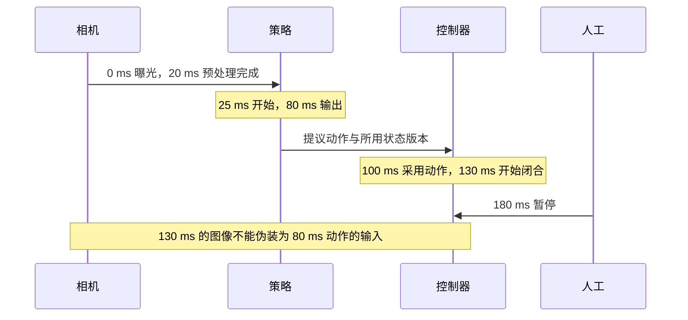
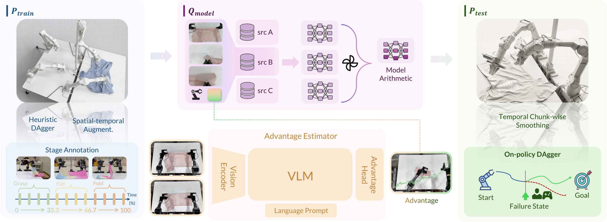

# 抓错杯子以后，系统需要哪些信息才能纠正

用户要求把红杯子放进托盘，机械臂却伸向蓝杯子。可能是视觉目标识别错了，也可能目标正确而坐标转换错了，还可能动作原本正确、执行时杯子已经移动。把三种情况都叫“策略失败”，会让下一轮只知道多收数据，仍不知道该改哪里。

本文用一次错误抓取整理可纠错的记录方式。这是诊断视角，五类信息可以来自不同模块，也可以由同一个模型内部维护，不要求系统必须按五个网络搭建。

## 先沿真实时间把这次错误还原出来

构造一次事件，时间单位为毫秒。相机在 0 ms 曝光，20 ms 完成预处理，策略在 25 ms 开始推理、80 ms 输出动作。控制器在 100 ms 采用动作，夹爪在 130 ms 开始闭合。日志还显示，人于 180 ms 按下暂停。

如果只保存 80 ms 的输出和 130 ms 的图像，训练样本很容易把未来信息与过去动作配错。正确做法是同时保留采集、到达、推理和生效时间，明确动作依据哪个状态版本。时间轴不是附加的性能日志，它决定因果顺序。

先看每个事件发生时间，再检查日志配对。控制器限幅或人工接管会改变实际动作，必须同时保留提议值与执行值，才能继续判断是哪一段出了错。

## 第一个分叉，系统究竟把谁当作目标

视觉模块认为红杯在 $(0.4,0.1,0.2)$ m，蓝杯在 $(0.4,-0.1,0.2)$ m。任务模块若把蓝杯 id 作为目标，后续几何和控制都可能完全一致地执行错误任务。

应保存指令、对象关联、选中的目标 id 以及选择所依据的观察。目标 id 的持续性也需要验证，遮挡后重新出现的物体可能被关联错。一个“目标置信度”数字没有解释它对什么事件计概率，诊断价值很有限。

任务进度同样重要。已经放入托盘的红杯不应再被取出；前一次失败后杯子仍在桌上，又不能把动作序列推进到“松开夹爪”。任务完成和控制动作结束需要分开。

## 第二个分叉，坐标正确却可能执行相反方向

假设相机坐标的右方，对应机器人基座坐标的负 $y$ 方向。如果把相机 $x$ 位移直接写到机器人 $x$ 通道，同样的数值会指向不同位置。对于三维点，应使用明确方向的变换

$$
p^{B}=R_{BC}p^{C}+t_{BC}.
$$

这里 $R_{BC},t_{BC}$ 把相机坐标 C 转成基座坐标 B。对纯位移使用 $\Delta p^{B}=R_{BC}\Delta p^{C}$，不能再加平移。姿态和角速度有各自的约定，不能把欧拉角差无条件当成旋转增量。

这些信息应该进入数据 schema 与标定版本。单位、控制频率、绝对位置或增量、夹爪开合正负方向任一不一致，都可能制造“相同动作标签代表不同物理运动”的冲突。[动作接口](../vla/action-representation-and-interfaces.md)进一步展开这些约定。

## 第三个分叉，模型提出的动作未必被原样执行

策略要求末端一步移动 8 cm，控制器因速度限制只执行 3 cm，或者安全层直接拒绝。若只记录提案动作，训练动态模型时就会把“请求移动 8 cm”与“实际移动 3 cm”配对，模型可能学出系统性缩小的动作响应。

应区分 proposed、accepted 与 executed。执行数据也有噪声，编码器状态、控制指令与真实接触之间未必一致。至少要保留拒绝原因、限幅、控制模式与实际状态，才能知道模型是在预测执行器、环境，还是二者的混合。

这也解释了为什么动作—视频联合生成的内部一致性不够。如果模型想象杯子被抓住，实际夹爪被安全层停下，下一轮必须使用真实反馈更新。否则视频与动作可以一起沿错误分支继续。

{ width="920" }

<small>图源：[χ₀: Resource-Aware Robust Manipulation via Taming Distributional Inconsistencies](https://arxiv.org/abs/2602.09021)，Figure 1。原图表达训练示教分布、模型策略分布和真实部署分布之间的错位，以及 Model Arithmetic、Stage Advantage、DAgger、时空增强和 action-chunk smoothing 的对应位置。这里的重点是 failure/recovery 必须进入状态链；该图只来自特定双臂衣物任务，不能证明五类状态链已经在所有机器人上成立。</small>

## 人工纠正提供了什么监督

人在 180 ms 暂停后，把目标重新指给系统，再遥操作完成抓取。这段记录包含至少三种信息，原策略犯错的状态、人提供的纠正、最终任务结果。它们应保留接管边界。

若最终成功就把整段标成“自主成功”，会高估策略能力；若把失败前所有动作都标成错误，又会抹掉其中正确的移动。恢复示范的监督范围应对应纠正发生的位置和任务阶段。

[χ₀](https://arxiv.org/abs/2602.09021)讨论训练、模型与部署分布差异，并在其衣物操作系统中组合纠正数据、增强、阶段信息与控制平滑。可借鉴的是对分布和接口的具体处理，作者任务表现不能直接推成所有机器人操作的可靠性保证。

## 五类状态怎样组成一条可追溯链

| 要保存的信息 | 本例中的作用 | 缺失时难以区分什么 |
| --- | --- | --- |
| 场景与对象证据 | 红蓝杯在哪里、何时被看到 | 感知错与对象移动 |
| 任务与进度 | 正在拿哪个杯、是否已完成 | 目标错与阶段错 |
| 动作语义与标定 | 数值怎样对应空间运动 | 策略错与接口错 |
| 实际执行 | 哪些动作被采用或限幅 | 预测错与执行偏差 |
| 失败与恢复 | 何时偏离、谁进行了纠正 | 自主恢复与人工完成 |

这张表的价值是给同一次事件保留可连接的证据。字段齐全仍可能有错误，需要回放、已知动作测试与传感器核验，不能靠日志格式宣布可靠。

## 如何判断记录真的改善了系统

可以只对目标错配、坐标反向、控制限幅与观测延迟各构造一组受控故障，观察日志能否区分原因，再检查修复是否改善相应故障而没有破坏正常任务。长期任务还要看失败发生后多久识别、恢复消耗多少动作、哪些情况需要接管。

如果一个字段从未影响定位或修复，它可能不值得每步高成本采集；若某类错误始终无法归因，就需要补对应证据。可纠错状态链因而是一种持续调整的诊断设计，不是预先证明最优的架构。
