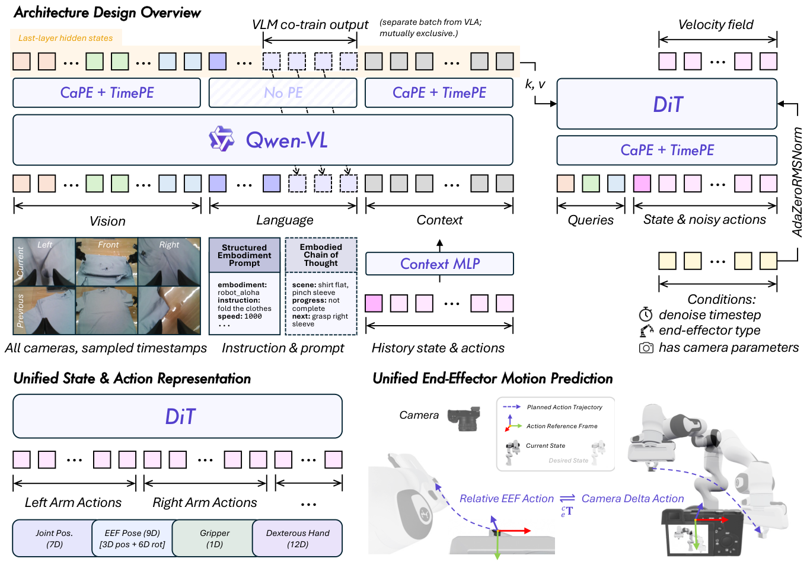
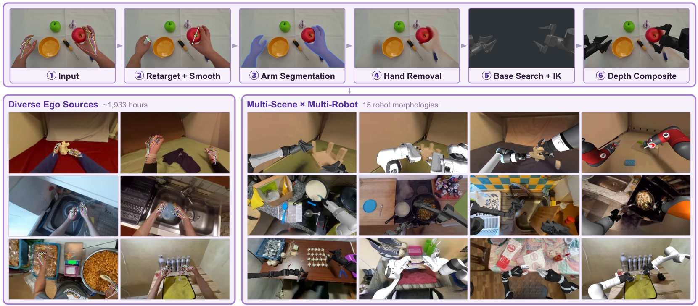
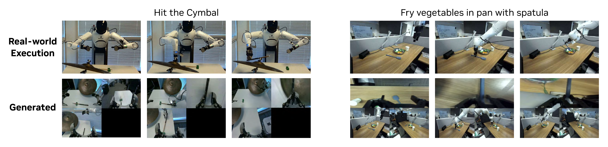

# 把两台机器人的数据放在一起，先统一动作的物理含义

机器人 A 的日志里，向右移动写成 `0.02`；机器人 B 写成 `20`。前者用米，后者用毫米。即使模型有能力拟合两种数据，它也必须先从隐含设备线索猜单位。若再混入不同坐标系、动作频率和夹爪方向，多一万小时数据可能只是增加这种歧义。

具身数据的对齐可以从这个小问题开始。这里的对齐指传感器、时间、空间、动作和任务语义能够共同解释一次物理过程，和语言模型偏好对齐是不同问题。

## 统一单位以后，还没有统一运动方向

把 B 的 20 mm 转成 0.02 m，只解决尺度。设 B 的局部坐标绕世界 $z$ 轴旋转 90 度，其局部向右位移 $[0.02,0,0]$ 在公共坐标里成为 $[0,0.02,0]$。A 的局部向右可能仍是 $[0.02,0,0]$。

$$
\Delta p^{W}=R_{WB}\Delta p^{B}.
$$

纯位移只乘旋转；绝对点位置才需要再加平移。相机随头部运动时，变换还随时间变化。不能把静态外参应用于整段移动相机视频，也不能将相机视角看起来相同当成控制方向一致。

不同机器人关节角更难直接共享。相同末端运动可能对应不同关节组合与碰撞限制。转换为末端位姿能提供部分公共语义，但仍需保留本体信息、可达范围和低层控制映射。

## 频率不同，会把同一速度写成不同动作

设末端以 0.2 m/s 恒速运动。20 Hz 日志每步增量是 0.01 m，10 Hz 日志每步增量是 0.02 m。若统一成 10 Hz，应把两个连续的 20 Hz 平移增量合成 0.02 m，而非简单丢掉一半动作。

```python
import numpy as np

high_rate_delta = np.full(6, 0.01)  # 0.3 秒，20 Hz，单位米
low_rate_delta = high_rate_delta.reshape(-1, 2).sum(axis=1)
print(low_rate_delta)  # [0.02 0.02 0.02]
assert np.isclose(high_rate_delta.sum(), low_rate_delta.sum())
```

这个求和例子只适用于同一固定坐标下的平移增量。连续旋转应按约定组合旋转矩阵或四元数，不能逐分量相加欧拉角；位置设定值需要按时间插值；速度指令要按持续时间积分。降采样还需要考虑抗混叠，插值无法恢复原本没记录的碰撞峰值。

因此每个动作字段都要说明其语义。相机帧率、策略频率和伺服频率也应分开，30 Hz 视频无法完整记录所有高频接触细节。

## 维度补齐不代表缺失的关节真的等于零

A 有单个夹爪，B 有两只手。统一张量可以预留两组槽位，并用 mask 标记哪些维度存在。若缺失手臂的维度直接当作真实零值参与损失，模型会把“没有这只手”误学成“这只手始终处于零位”。

归一化统计同样应基于有效维度和相应动作含义。夹爪的 `0` 可能代表闭合，也可能代表完全张开，还可能是未知。mask、单位与方向需要和数据一起保存，不能只写在导入脚本的注释里。

[Qwen-RobotManip](https://arxiv.org/abs/2606.17846)采用统一 state/action 表示、运动与行为层面的对齐，提供了具体系统实例。它的 80 维模板是该方法的设计选择，不是所有机器人的通用标准。

{ width="920" }

<small>图源：[Qwen-RobotManip](../paper-deep-dives/embodied-ai/qwen-robotmanip.md)，原论文 Figure 1。</small>

## 人类视频给出的监督，与机器人日志不同

视频可以显示手拿起杯子、杯子移动到托盘，却通常缺少机器人关节指令、接触力和实际执行延迟。把人手轨迹重定向给机器人，需要解决运动学可达、夹爪形状、坐标尺度与碰撞，画面里替换成机器人手臂也不能自动验证动力学。

Qwen-RobotManip 的人到机器人合成管线包含动作重定向、平滑、分割、补全和机器人渲染等步骤。原文报告约 1,933 小时人类视频扩成约 24,808 小时合成演示；这些是合成数据量，不能按独立真实机器人采集时长理解。

{ width="920" }

<small>图源：[Qwen-RobotManip](../paper-deep-dives/embodied-ai/qwen-robotmanip.md)，原论文 Figure 2。</small>

合成结果应带源视频 id、处理模型与配置、有效动作 mask，以及哪些标签经过人工或物理检查。同一个源视频派生的多个机器人版本还需要作为相关样本处理，数据划分应避免源视频跨训练与测试造成泄漏。

## 多一个训练目标，会增加约束，也可能增加冲突

动作预测教模型什么动作与当前状态配对，未来预测进一步约束动作后果。联合训练可能让内部表示关注运动与任务阶段，但损失权重、梯度冲突和数据覆盖都影响结果，加入视频目标不会自动学会接触力或恢复策略。

{ width="860" }

<small>图源：[DreamZero](../paper-deep-dives/embodied-ai/dreamzero.md)，原论文 Figure 2。</small>

[DreamZero](https://arxiv.org/abs/2602.15922)研究视频与动作联合建模，[Fast-WAM](https://arxiv.org/abs/2603.16666)区分视频共同训练和测试时显式预测，[LingBot-VA 2.0](https://arxiv.org/abs/2607.08639)研究原生视频动作预训练。它们是不同机制；MoE、MoT、共享注意力和多任务训练也应按具体论文定义理解，不能用一个缩写概括所有路线。

## 扩大数据以后，怎样知道对齐起了作用

先用几个已知运动验证单位、坐标、时间与夹爪方向，再固定模型、训练预算和评测任务，比较原始多源混合、只统一维度、完整语义对齐。分别看原机器人任务与跨机器人迁移，才能分辨收益来自额外样本还是接口修复。

测试应同时保留原分布和明确的变化轴，例如未见物体、相机位置或本体。只做 OOD 测试会漏掉原能力退化，只做 IID 测试又可能低估迁移问题。按 episode、场景或数据来源分组划分，通常比随机拆相邻帧更能避免泄漏。

对齐提供可学习的一致性，规模提供覆盖。二者都还需要有效监督和独立闭环验证。实际错误回流怎样进入下一轮，可继续读[机器人数据回路](robot-data-flywheel-world-models.md)。
