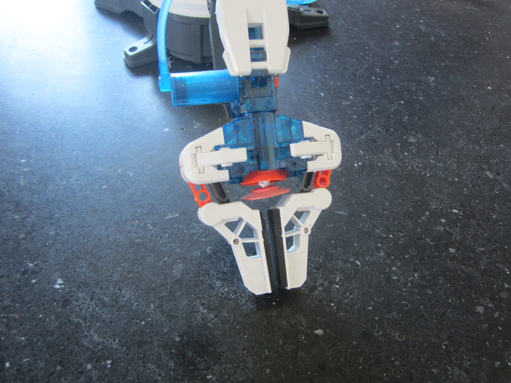

# 具身智能的难点，往往出现在第一次动作之后

机械臂收到“把红杯子放到托盘”的指令，第一下抓空了。它接下来是继续抬手、重复同一动作、换视角，还是请人帮助，取决于系统有没有发现任务状态已经偏离预期。一个顺利执行的演示很难显示这些差别，失败后的连续反应更容易暴露接口问题。

本文讨论这条失败链。它不以“VLA 的某个时代已经结束”划分研究进展，也不从几篇模型报告推导产业必然趋势。

{ width="820" }

<small>图源：[Wikimedia Commons: Hydraulic toy robot arm gripper.jpg](https://commons.wikimedia.org/wiki/File:Hydraulic_toy_robot_arm_gripper.jpg)。读图重点：即使是简单夹爪，也能暴露具身智能的核心难点；动作是接触、力、姿态、误差和恢复的连续闭环。</small>

## 抓空为什么会让模仿策略越来越偏

模仿数据往往由较熟练的操作者产生。策略训练时看到的是专家顺利接触杯子的状态，部署时稍微偏一点，下一帧就变成夹爪悬空。若这种状态没出现在数据里，策略可能继续输出专家在成功抓住以后才执行的抬升动作。

错误改变了后续输入分布，后续动作又继续放大偏离。单独在日志帧上评估动作距离，只能说明专家状态下的拟合，难以看见自己行动以后能否纠正。这是闭环评测比单步动作预测多出来的要求。

可以补失败和恢复示范，也可以通过交互奖励学习重新观察、重抓或停止。两条路线都需要可信的结果与覆盖，不能把任意失败视频直接当正确动作监督。

## 任务状态怎样进入动作判断

抓空后，系统应至少区分“目标仍在、可以恢复”“指令已完成”“目标不存在或当前不可执行”。这些状态可以由模型、规则或外部 checker 判断，具体标签名称不必统一。

如果红杯子根本不在桌上，继续搜索和拒绝执行应有明确边界；如果杯子已经放好，继续动作可能破坏成果；如果只是被遮挡，立即宣布目标不存在又会过早结束。状态判断需要历史和置信信息，不是给模型增加三个输出词就能解决。

一个可检验场景组可以只改变目标存在、遮挡和已完成这三个因素，保持指令相同。观察系统何时停止、重观测或行动，比只统计最终成功更能说明状态接口是否有效。

## 两厘米误差需要从动作生效时解释

设杯子每秒移动 0.1 米，观测采集到动作生效经过 0.2 秒，目标就移动了 2 cm。即使视觉位置估计在采集时完全正确，控制器接收到动作时也可能已经对不准。更大模型如果推理更慢，未必改善这个问题。

Action chunk 进一步延长部分动作依赖旧观察的时间。可以只执行前缀后重新规划，但要处理 chunk 接续和抖动。提高模型调用次数也不等于提高反应速度，旧图像若在队列中积压，系统可能更快地处理过时输入。机制见[观测年龄](embodied-inference-observation-age-1009-2059.md)。

## 世界模型提供前瞻，也会带来新的误差

动作条件模型可以比较重抓、换角度和重新观察的后果，视频先验也可以提供运动与任务阶段信息。但一个模型生成“杯子已经在夹爪里”的未来，不能代替真实接触证据。联合生成的动作与未来还可能相互自洽地犯错。

[DreamZero](https://arxiv.org/abs/2602.15922)和 [V-JEPA 2](https://arxiv.org/abs/2506.09985)提供不同连接方式，前者研究视频与动作联合建模，后者包含动作条件预测与规划。它们的证据应按各自机器人、任务和预算阅读，不能推导“所有机器人都需要同一世界模型组件”。

没有额外预测器的策略也可能通过记忆和反馈很好地恢复。合理对照应固定任务与预算，比较额外世界模型是否减少了错误、接管或计算代价，而不是先按模块数量判断系统先进。

## 失败回流为什么是一项数据工程

抓空轨迹中，策略提出的动作、控制器实际动作、异常最早出现时刻、人工接管和最终结果应分开记录。人工帮机器人把杯子摆正以后完成，既提供有用恢复示范，也不能算作原策略全自主成功。

同一失败附近切出的二十个窗口高度相关，不能当作二十次独立证据。补采还会改变数据分布，例如把少见透明物体大量过采样，可能改善该桶，却影响普通杯子的动作。独立验证应同时覆盖目标短板和原任务分布。

这些工作能够支持持续改进，但“收集得越多越强”并非自动成立。标签错位、重复、评测泄漏和错误合成样本都可能让模型更确信原错误。完整例子见[世界模型数据引擎](../world-models/data-engines-and-self-improvement.md)。

## 我会把什么当作更有说服力的进展

在固定任务和扰动下，系统第一次动作失败以后能及时识别偏离，以合理代价恢复，并在新的物体与场景上保持这项能力，这比单个最好演示更能说明闭环改进。报告还应列出何时需要人工、怎样定义成功，以及增加了多少观察和计算。

这是本文关注的证据方向，并非断言单步策略、预训练或模型规模不重要。它们的贡献最终要沿输入、动作、反馈与任务结果解释。基础技术可以按需查 [VLA](../vla/index.md)、[机器人强化学习](../reinforcement-learning/vla-robotics-and-closed-loop-rl.md)和[世界模型评测](../world-models/evaluation-and-failure-modes.md)。
