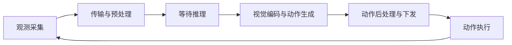

# 具身推理加速，先看动作执行时观测有多旧

读《推理加速的系统方法》时，最值得继续追问的是开头那件事。模型还在推理，目标已经移动了。即使模型对输入画面的理解完全正确，它给出的动作也可能赶不上眼前的变化。

这让我更愿意用一个具体问题判断具身推理优化的价值。**动作真正执行时，它依据的观测已经过去了多久。** CUDA Graph、算子融合、低精度计算和少步去噪都可以缩短其中一段时间，但它们改变的计算、引入的误差，以及需要验证的条件各不相同。

本文参考熊晓焜于 2026 年 10 月 9 日分享的 PPT《推理加速的系统方法》，并核对 realtime-vla、FlashRT 和 ApxInf 的公开资料。项目数字均为作者报告，本文未进行硬件复测；后面的实验设计属于由这些材料提出的研究假设。

## 推理频率与实际反应速度隔着一段时间

PPT 第 2 至 3 页把延迟与运动目标的位置偏差放在一起。沿着这个问题，可以先定义观测年龄

$$
A_k = t_{\mathrm{apply},k}-t_{\mathrm{capture}}.
$$

这里的 $t_{\mathrm{capture}}$ 是本次决策所用观测的采集时刻，$t_{\mathrm{apply},k}$ 是这次预测中第 $k$ 个动作实际作用于机器人的时刻。多相机输入还需要记录各自的采集时间与同步误差，不能只用请求抵达 GPU 的时间替代。

在一个简化的串行执行流程里，可以把它拆成

$$
A_k = T_{\mathrm{input}}+T_{\mathrm{queue}}+T_{\mathrm{infer}}+T_{\mathrm{output}}+T_{\mathrm{wait},k}.
$$

各项依次表示采集后的传输与预处理、排队、模型计算、后处理与下发，以及动作在执行前的等待。异步系统里的这些工作可能重叠，实际测量应直接使用时间戳，避免把重叠部分重复相加。

若目标在这段时间内近似匀速运动，且系统没有运动补偿，由时间错位产生的位置变化可近似写成 $\|\Delta p\|\approx\|v\|A_k$。这只是帮助理解延迟的一阶运动学估计，目标加速度、遮挡、预测控制和执行器动态都会改变实际误差。

单次推理耗时的倒数也要读准。100 ms、50 ms、约 33.3 ms、20 ms 分别对应 10 Hz、20 Hz、约 30 Hz、50 Hz。PPT 第 3 页把最后一项列成了 100 Hz，这里更正为 50 Hz。上述倒数只描述理想串行模型调用频率，无法直接给出相机更新频率、轨迹采样频率或电机控制频率。

即使模型计算压到了 30 Hz，逐帧处理标准 30 FPS 相机仍需要考虑前后处理、调度和延迟波动。若旧图像在输入队列里积压，模型每秒完成更多次计算，也可能一直在处理过时画面。若一次预测的动作块被长时间连续执行，后半段动作所依据的观测会继续变旧。

由此得到的第一个工程判断是，性能报告应同时记录模型延迟和观测年龄。对快速变化的任务，动作更新的时机与过期动作的处理方式，值得和 kernel 优化放在同一张实验表里。

## 固定工作负载给了系统优化更多余地

PPT 第 4 页比较了在线语言服务与机器人控制的工作负载。对单机器人、本地推理、batch 为 1 的部署来说，每次调用的相机数量、输入尺寸、动作长度往往能提前约定。这种约束有利于固定执行图、预分配缓冲区，并针对实际矩阵形状选择 kernel。

通用推理框架也能优化低延迟请求。这里真正需要检查的是，它的调度、缓存和动态形状处理是否符合当前机器人任务。多机器人共享服务器时，并发和批处理仍然可能重要，不能把单机实验的判断扩展到所有具身部署。

realtime-vla 给出了一个有用的比较入口。其 README 报告，在 RTX 4090、10 个 flow steps、空提示、动作块长度 63 的配置下，π₀ 的单视角、双视角、三视角延迟分别为 20.0、27.3、36.8 ms；换成 20 token 提示和长度 50 的动作块，相应数字变为 23.6、32.9、39.2 ms。[1] PPT 第 7 页展示了前一组数字，但它属于 π₀ 的指定配置，不能直接当作 π₀.₅ 的普遍结果。

相机数量和输入约定已经足以改变结论。比较不同运行时时，应先固定模型权重、硬件、精度、提示长度、动作长度、去噪步数及计时范围，再讨论快了多少。

## CUDA Graph 与图化简分别省掉什么

PPT 第 8 至 13 页依次讨论 CUDA Graph、计算图化简、形状调优和融合。把这几种方法分开理解，才能在加速停止时找到下一处瓶颈。

CUDA Graph 记录一组 GPU 工作，之后通过图重放减少重复的主机调度与发射开销。PyTorch 的官方说明强调，重放使用相同的 kernel 参数与内存地址，新输入需要填入约定的缓冲区；静态形状和控制流是常见的适用条件。[2] 它不会自动减少模型的矩阵运算量。若大量短 kernel 之间夹着主机调度空隙，图重放很有吸引力；若主要时间已花在长时间运行的 GEMM 内部，就需要继续分析计算与访存。

图化简处理的是另一个问题。有些训练时分开的操作，在推理时可以利用固定参数提前合并。PPT 第 9 页的 RMSNorm 例子尤其容易被过度概括。设按行表示的输入为 $x$，归一化结果为

$$
\hat{x}=\frac{x}{\sqrt{\operatorname{mean}(x^2)+\epsilon}},
\qquad y=(\hat{x}\odot\gamma)W.
$$

如果 $\gamma$ 是固定的逐通道缩放参数，可以预先计算

$$
W'=\operatorname{diag}(\gamma)W,
\qquad y=\hat{x}W'.
$$

这样省去了单独的逐元素缩放。**依赖当前输入的均方根归一化仍然要做。** 若实现使用 $1+\gamma$ 参数化，折叠时必须使用实际系数；若缩放由条件动态生成，就不能直接离线折入一份固定权重。低精度下还要核对舍入与误差。

QKV 合并则把共享输入的三次投影组织为一次更宽的矩阵乘，在合适的布局下减少发射次数。融合进一步追问，中间结果是否有必要写回显存。如果一个张量只交给紧接着的算子使用，把生产和消费合在一起，可能省掉一次写入与读取。

这些变化都需要测量。融合可能增加寄存器压力，合并后的矩阵也可能落入不同的 kernel 性能区间。把算子数量降下来，只是候选方案成立的开始。

## 静态量化改变了两次矩阵乘之间的工作

PPT 第 17 至 18 页中，FlashRT 最值得注意的细节是量化边界。动态量化路径要在运行中统计激活范围、确定 scale，再转换为低精度输入。静态量化提前确定 scale，让后续重复推理复用它。FlashRT 的校准文档明确区分了权重 scale 和 GEMM 输入的激活 scale，并描述了缓存与失效条件。[3]

沿用 PPT 中 18 层、10 个去噪步骤的配置，一处每层每步都经过的处理会重复 180 次。固定 scale 可以消除相应的在线范围统计与 scale 计算，但 FP8 转换本身以及 GEMM 的缩放恢复仍然存在。

scale 固定以后，前一个算子可以直接产出下一次 GEMM 需要的格式。FlashRT 的融合资料列出了 gated residual、AdaRMSNorm 与 FP8 转换的组合；其 Skinny GEMM 文档还描述了使用下一层条件参数，为下一层预备输入的路径。[4][5] 这使优化范围从单个算子扩展到了相邻层之间的数据传递。

我由此得到的判断是，量化是否值得做，需要检查完整路径。低精度矩阵乘节省的时间，可能被范围统计、格式转换和中间张量读写抵消；反过来，合适的融合能减少这些附加成本。

静态 scale 也带来了一个可测试的假设，校准输入足以覆盖后续部署输入。更换权重、相机配置、任务指令或场景之后，应检查激活饱和、逐动作维度误差与任务成功率。FlashRT 当前文档有使用零输入和代表性提示进行校准的路径，因此不能把 PPT 的“真实输入校准”图示理解为所有实现都已经用充分的真实数据验证过。用代表性部署数据重新校准，是本文建议的验证方案。

## 小 M GEMM 要看并行度，也要看归约代价

动作解码器每次处理的行数较少，矩阵形状可能与大 batch 语言服务差别很大。PPT 第 19 页同时出现了 M=50 与 M=10，应把它读成小行数矩阵的机制示意。核对到的 FlashRT Skinny GEMM 文档以十行动作块说明工作负载，并将该路径标为面向特定硬件的实验性实现。[5]

对于 $C=AW$，其中 $A\in\mathbb{R}^{M\times K}$、$W\in\mathbb{R}^{K\times N}$，常规分块能提供多少并行任务，同时取决于 M、N 和 tile 配置。小 M 是需要检查的信号，单凭它还不能断言 GPU 一定利用不足。

沿 K 维切分会把同一个输出块拆成多个部分和

$$
C=\sum_{j=1}^{s}A_jW_j.
$$

这样增加了可调度的计算块，也增加了部分和存储与最终归约。FlashRT 的实现让后续消费者归约 FP32 部分和，并继续执行所需变换；文档同时说明了权重布局副本、专用宽度与硬件限制。[5]

这类优化的价值来自对实际形状和后续消费者的了解。它还要付出专用实现、额外缓冲区和维护成本。若动作长度、硬件或输入布局发生变化，应重新比较库实现，不能把某一形状下的收益当作通用结论。

## 少步去噪把误差带回了连续决策

PPT 最后把少步 denoise 单独列为算法层优化，这个区分有助于确定验收方式。图重放与代数变换主要追求保留原计算语义；量化改变数值近似；减少去噪步骤则进一步改变动作生成过程。

ApxInf 的公开 one-step warm-start 文档给出了一个具体实现。它把上一动作块按已执行长度向前移动，用末尾动作补齐尾部，再与新噪声混合，从调整后的 flow 时刻开始一步生成。缓存保存在模型的归一化动作空间，并在每个 episode 开始时清空。[6] 本文只据此讨论 warm-start 机制，不把它与 PPT 图中所有 STEP 相关方法视为同一算法。

这条路径利用了相邻决策之间的连续性，也把上一轮预测带进了下一轮。如果目标突然改变、发生接触扰动或任务切换，旧动作块可能提供不合适的初值。缓存何时重置、何时恢复更多步数，就成了动作生成逻辑的一部分。

一次前向输出与基线接近，无法单独证明连续执行可靠。测试至少要包含任务切换、失败恢复和输入突变，并把恢复到多步推理的延迟算进去。平均延迟降低、恢复分支却频繁错过时限，也可能使最终任务更难完成。

## 三个值得做的对照实验

这些材料支持进一步提出三个假设。它们需要在包含动作执行与观测反馈的机器人或仿真实验中验证，目前不能写成已有结果。

| 假设 | 控制变量与对照 | 重点观察 | 什么结果会削弱假设 |
| --- | --- | --- | --- |
| 输入排队较重时，减少旧观测积压比继续压缩部分模型计算更有价值 | 使用同一模型，分别改变 kernel 路径和有界输入队列策略；固定相机频率与任务 | 动作执行时观测年龄的 P50/P95/P99、漏检事件、任务成功率 | 年龄下降却没有改善成功率，或丢帧遗漏了关键事件 |
| 静态量化的收益取决于校准数据与部署分布是否匹配 | 固定权重与融合实现，对比原 scale 和代表性数据重校准；改变光照、物体与指令 | 逐层饱和、动作分维度误差、完整任务成功率、延迟 | 重校准未改善数值与任务表现，说明主要误差可能来自其他环节 |
| 少步推理节省的时间，可以通过更频繁的重规划改善任务结果 | 将去噪步数和重规划间隔作为两个独立变量，保留相同任务集合与扰动条件 | 成功率、完成时间、动作抖动、恢复次数与尾延迟 | 误差和抖动的代价超过更频繁观测带来的收益 |

第一项实验里的丢帧策略也要受任务约束。对持续位置跟踪，最新观测可能更有用；对短暂接触或瞬时事件，旧帧仍可能保留必要证据。需要验证的是输入策略与任务是否匹配。

第二项应增加 BF16 参考路径，帮助判断误差究竟来自量化、模型本身还是环境变化。第三项则应在相同扰动条件下做多次试验，报告区间，避免把少量成功案例当成稳定收益。

如果现在只有时间做一项工作，我会先给采集、入队、推理结束、下发和动作执行加上可对齐的时间戳。在同一组任务上记录这些时间，再决定下一周应该投入算子、输入队列还是重规划策略。只有这条时间线完整了，少掉的几毫秒才有明确的去向。

## 材料与核对范围

- 用户提供的《玉河沙龙261009.pptx》，标题页为《推理加速的系统方法》，熊晓焜，2026 年 10 月 9 日。主要参考第 2 至 4 页的实时性问题、第 8 至 13 页的系统优化、第 17 至 19 页的量化与小 M GEMM，以及第 20 至 21 页的少步生成。原文件未修改，未作为站点附件发布。
- [1] [realtime-vla 项目说明](https://github.com/dexmal/realtime-vla)。用于核对 π₀ 与 π₀.₅ 的测速配置、相机数量和实现组织。读取的 README blob 为 `d3cf8e59e013b2ec607c99041eb36e6441ca20b5`。
- [2] [PyTorch 对 CUDA Graph 的说明](https://pytorch.org/blog/accelerating-pytorch-with-cuda-graphs/)。用于核对重放、固定地址与主机调度开销。
- [3] [FlashRT 的 FP8 校准机制](https://github.com/flashrt-project/FlashRT/blob/66b18eb766e73e2fcad406bc622bd3bfd70664c1/docs/calibration.md)。用于核对静态 scale、校准输入与缓存条件。
- [4] [FlashRT 的融合算子说明](https://github.com/flashrt-project/FlashRT/blob/66b18eb766e73e2fcad406bc622bd3bfd70664c1/docs/kernel_fusion.md)。用于核对 residual、归一化与量化的组合。
- [5] [FlashRT 的 Skinny GEMM 路径](https://github.com/flashrt-project/FlashRT/blob/66b18eb766e73e2fcad406bc622bd3bfd70664c1/docs/pi05_decoder_skinny.md)。用于核对 K-split、归约消费者、实验性状态与适用限制。
- [6] [ApxInf 的 one-step warm-start 实现](https://github.com/infinigence/ApxInf/blob/4116fd7208669388d63d9ab4766a2913b9e6dc9c/doc/run_warmstart_with_onestep.md)。用于核对动作缓存、补尾、噪声混合与 episode 重置。

公开资料核对日期为 2026 年 10 月 9 日。文中公式用于解释时间关系与计算变换；三个对照实验为本文提出的探索方案，尚无本文实测数据。
