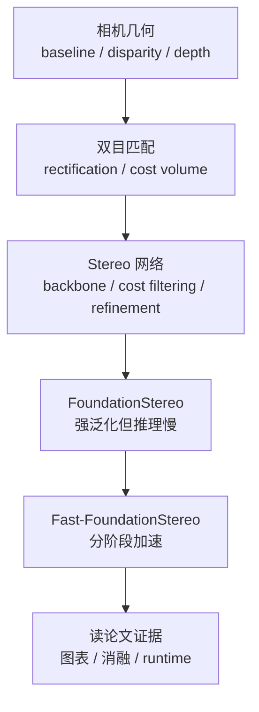
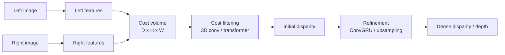

# 读懂 Fast-FoundationStereo：从双目几何到高效推理

Fast-FoundationStereo 的“推理”指机器人、AR、自动驾驶和工业视觉里的实时稠密深度感知。模型每慢几十毫秒，系统看到的世界就会滞后一截；模型每错一块边界，后面的避障、抓取或空间理解就可能跟着错。

[Fast-FoundationStereo](../paper-deep-dives/inference/fast-foundation-stereo.md) 最值得读的地方，不只是“它比 FoundationStereo 快了十倍以上”，而是它把一个强但慢的 stereo foundation model 拆成三个热路径：feature backbone、cost filtering、disparity refinement，然后分别用蒸馏、分块 NAS 和结构化剪枝压成本。读这篇论文前，先把下面这张知识地图放进脑子里，会省很多绕路时间。



## 先看任务：双目到底在估什么

双目相机有左右两个镜头，中间距离叫 baseline。同一个 3D 点会落在左右图的不同水平位置，这个横向位移叫 disparity。知道焦距 \(f\)、baseline \(B\) 和 disparity \(d\) 后，可以用下面这个公式理解深度：

\[
z = \frac{fB}{d}
\]

disparity 越大，通常说明物体越近；disparity 越小，通常说明物体越远。这个公式很短，但它解释了 stereo 为什么适合机器人和 AR：它不是只给一张“看起来有深度感”的图，而是在每个像素上给出可转成几何距离的信号。

{ width="760" }

<small>网页图源：[Wikimedia Commons: Stereo-camera-model.jpg](https://commons.wikimedia.org/wiki/File:Stereo-camera-model.jpg)。原图表达：双目深度来自 baseline 和左右图上的 disparity；同一个点在左右图中位置差越大，通常离相机越近。读图重点：这张图只解释几何前提，真正读 Fast-FoundationStereo 时还要继续检查 rectification、匹配代价和深度误差传播。</small>

这里有一个容易被初学者跳过的输入假设：stereo matching 通常默认左右图已经 rectified，也就是同一个 3D 点在左右图里位于同一条水平扫描线。这样模型只需要沿横向搜索 \(d\)，而不是在整张右图里找匹配点。如果相机没标定好、左右不同步、畸变没去掉，再强的模型也会被输入质量拖垮。

所以读 Fast-FoundationStereo 时，先把任务写成：

```text
输入：rectified left / right stereo images
输出：dense disparity map，再转成 depth
关键风险：低纹理、反光、透明、遮挡、远距离和标定漂移
```

## 从 Disparity 到 Cost Volume

双目网络不是凭空吐出深度。它先提取左右图的 feature，再为每个像素搜索一组可能的 disparity，把每个候选的匹配信息堆成 cost volume。cost volume 可以理解成一张四维评分表：

\[
\mathbf{V} \in \mathbb{R}^{C \times D \times H \times W}
\]

这里 \(H,W\) 是图像空间位置，\(D\) 是 disparity 候选数，\(C\) 是匹配特征通道。它贵就贵在多了一维 \(D\)：每个像素不只要算一次，还要沿许多候选位移反复比较。



cost volume 只是原始证据，还很嘈杂。低纹理墙面、玻璃、反光金属、重复花纹和遮挡区域都会制造错误匹配。因此模型还需要 cost filtering：用 3D convolution、hourglass、axial/planar convolution 或 Transformer 在空间和 disparity 维度上传播上下文，判断哪些匹配更可信。

这些名字可以先不用当成新算法背。它们在这里都服务同一件事：**让一个像素的匹配判断不要只看自己，而是参考周围像素、相邻 disparity 和更大范围的几何上下文**。

| 模块 | 在 cost filtering 里做什么 | 可以怎么直觉理解 |
| --- | --- | --- |
| 3D convolution | 同时沿 \(D,H,W\) 三个维度看邻居，让相邻 disparity 和相邻像素互相校正 | 不只问“这个像素像不像”，还问“附近像素和附近深度候选是否也支持这个判断” |
| 3D hourglass | 先下采样聚合大范围上下文，再上采样回到细分辨率 | 先远看整块墙、桌面和物体轮廓，再回来修每个像素的 disparity |
| axial / planar convolution | 把大范围 3D 处理拆成沿轴或平面传播，减少直接 3D 卷积的成本 | 不一次看完整大方块，而是分方向、分平面传递信息，省一些计算 |
| Transformer | 用 attention 让远处但相关的位置互相参考，建模长程匹配关系 | 重复纹理或遮挡时，允许模型参考更远的上下文，而不是困在局部窗口里 |

所以 cost filtering 的输出不是“重新拍脑袋预测深度”，而是在清理 cost volume：压低不一致的候选 disparity，抬高被上下文支持的候选 disparity，最后形成更可靠的 initial disparity。

最后还需要 refinement。初始 disparity 往往在边界、薄结构和遮挡区域不够细，迭代 refinement 会用图像特征和 hidden state 一轮轮修正它。Fast-FoundationStereo 里提到的 ConvGRU refinement，就属于这条路径。

## 为什么 Foundation Stereo 强但慢

FoundationStereo 强，是因为它不只靠传统小 stereo 网络。它借用了更强的视觉基础模型和更复杂的 cost reasoning，让模型在未见过的数据集上也能保持较好的 zero-shot stereo 质量。问题也在这里：强 backbone、复杂 cost filtering、迭代 refinement 都在推理热路径里。

{ width="920" }

<small>图源：`Fast-FoundationStereo`，Figure 3。原论文图意：FoundationStereo pipeline 包含 feature extraction、cost filtering 和 disparity refinement；Fast-FoundationStereo 分别用 hybrid prior distillation、cost filtering blockwise search 和 refinement pruning 加速。</small>

这张图可以从左到右读成三段：

| 阶段 | 它在做什么 | 为什么贵 |
| --- | --- | --- |
| Feature extraction | 从左右图提取可匹配的视觉特征 | DepthAnything V2 + side-tuning CNN 这类强 backbone 很重 |
| Cost filtering | 在 cost volume 上判断哪些 disparity 合理 | cost volume 多了 \(D\) 维，3D hourglass / Transformer 都不便宜 |
| Disparity refinement | 迭代修正初始 disparity | ConvGRU 多轮更新，重复调用会累积 latency |

读到这里，Fast-FoundationStereo 的主张就清楚了：它不是把整个 teacher 粗暴换成一个小模型，而是先问“热路径里每一段为什么慢”，再给每一段配不同工具。

## 三个瓶颈，对应三种加速手段

这篇论文最像工程方法论的一点，是它承认不同模块的冗余形态不同。

| 瓶颈 | 加速手段 | 为什么这样选 |
| --- | --- | --- |
| Backbone 太重 | Feature distillation | teacher 的中间 feature 可以直接监督 student，适合把强先验换成轻执行形态 |
| Cost filtering 太重 | Blockwise NAS | cost volume 通道本来就小，直接剪枝收益有限；搜索替代 block 更合适 |
| Refinement 有迭代冗余 | Structured pruning | ConvGRU 重复更新，通道冗余更容易变成真实 runtime 收益 |

蒸馏的关键是 teacher/student：teacher 能力强但慢，student 更小更快。Fast-FoundationStereo 的 backbone 蒸馏不是只学最终 disparity，而是让 student 学 teacher 的 multi-level feature pyramid。这样 student 不只是背答案，而是在学习 teacher 的中间视觉表示。

NAS 的关键是不要手工猜结构。论文把 cost filtering 拆成多个 blocks，训练候选 block 贴近 teacher block，再记录每个候选带来的误差变化和耗时变化，最后用 ILP 在 latency budget 下选组合。初学者可以先把它理解成：不是试遍所有完整网络，而是把大搜索拆成一组局部替换题。

剪枝的关键是 structured pruning。删单个 weight 不一定让 GPU 更快；删通道、filter、head 或 block，才更容易变成更小的 dense tensor shape。Refinement ConvGRU 还有 recurrent hidden state，所以剪枝必须遵守依赖图，不能随便删通道。

## 为什么不能只看 MACs

高效推理论文里最容易误读的是“参数少、MACs 少，所以一定快”。真实系统没有这么乖。latency 还受 kernel、memory bandwidth、layout 转换、算子融合、TensorRT 支持、输入 shape 和 batch 影响。

{ width="760" }

<small>图源：`Fast-FoundationStereo`，Figure 10。原论文图意：在 NVIDIA 3090 上，FoundationStereo 的 feature extraction、cost filtering 和 refinement 都比 Fast-FoundationStereo 更耗时，三段共同构成超过 10x 的总加速。</small>

这张 runtime decomposition 比单个 FPS 数字更有用，因为它告诉你收益是不是真的进入了热路径。如果只看到总 runtime 从 496ms 到 49ms，你还不知道是哪个阶段快了；拆开后才能判断 feature、cost filtering、refinement 三段是否都被压下来。

读 Table 5 这类效率表时，可以把三种数字分开：

| 数字 | 说明什么 | 不能说明什么 |
| --- | --- | --- |
| Params | 模型存了多少权重 | 不等于每次推理耗时 |
| MACs | 某个输入 shape 下有多少乘加 | 不包含所有 memory movement 和 runtime 开销 |
| Runtime | 真实硬件上跑完一次的时间 | 依赖实现、硬件、TensorRT 和输入设置 |

Fast-FoundationStereo 的 TensorRT 版本进一步变快，也提醒我们：模型结构和部署工具链是一起设计的。一个理论上 MACs 少的结构，如果难以导出、难以融合或 fallback 到慢 kernel，线上收益会打折。

## 伪标签为什么也是高效推理的一部分

很多人会把高效推理理解成“只改结构”。Fast-FoundationStereo 反过来提醒：结构变小以后，数据质量更重要。小模型容量更有限，如果只在窄分布或合成数据上训练，很容易变成“快但不稳”的传统实时 stereo 网络。

{ width="720" }

<small>图源：`Fast-FoundationStereo`，Figure 6。原论文图意：对 in-the-wild internet stereo data，先用 stereo teacher 预测 disparity，再用 monocular depth estimator 和 normal consistency 做质量检查，最后生成可用于训练的 pseudo labels。</small>

论文从 Stereo4D 取真实双目图，用 FoundationStereo teacher 预测 disparity，再用 monocular depth estimator 提供另一条几何证据。两边都反投影成 3D 后，用 normal consistency 检查局部表面方向是否一致。sky region 还会单独过滤，因为天空没有稳定可匹配的真实深度。

为什么不直接比较 depth？因为真实场景的深度范围差异很大，尺度和远近会让直接数值比较不稳。normal map 更关注局部表面方向，适合做质量门禁。对 student 来说，这一步的意义是：别把 teacher 的明显错误也一起学进去。

所以这篇论文里的“高效”包含两层：

1. 推理时模型更轻，latency 更低；
2. 训练时用更好的真实分布伪标签，让轻模型不要因为容量小而丢掉 zero-shot 泛化。

## 读论文时按这六个问题走

读 Fast-FoundationStereo 正文时，可以边读边问：

| 问题 | 对应章节 |
| --- | --- |
| 输入是不是 rectified stereo pair，输出是不是 dense disparity | 论文位置、伪标签流程 |
| FoundationStereo 到底慢在哪里 | Figure 3、runtime decomposition |
| Backbone 为什么用蒸馏而不是直接剪 | Backbone distillation |
| Cost filtering 为什么用 blockwise NAS | Cost filtering search |
| Refinement 为什么能 structured pruning | Refinement pruning |
| 速度提升有没有保住 zero-shot 质量 | Figure 2、Table 1、Table 4、Table 5 |

如果你能回答这六个问题，就已经不是在“看懂术语”，而是在看论文证据链了。

## 建议阅读路线

最稳的站内路线是：

1. [相机、深度与机器人视觉](../embodied-ai/cameras-depth-and-robot-vision.md)：先知道双目、baseline、disparity、标定和深度公式。
2. [双目匹配与 Cost Volume 入门](../embodied-ai/stereo-matching-and-cost-volume.md)：理解 cost volume、cost filtering、refinement 和 BP/D1 指标。
3. [模型蒸馏入门](../foundations/model-distillation-basics.md)：理解 teacher/student、feature distillation 和中间监督。
4. [模型压缩、剪枝与 NAS 入门](../foundations/model-compression-pruning-and-nas-basics.md)：理解 structured pruning、blockwise NAS、ILP 和 latency 验证。
5. [Depth Anything V2](../paper-deep-dives/embodied-ai/depth-anything-v2.md)：理解单目深度 foundation model、pseudo-label 和真实分布补齐。
6. [Fast-FoundationStereo](../paper-deep-dives/inference/fast-foundation-stereo.md)：回到论文，看它如何把这些知识合成一个实时 zero-shot stereo model。

**一句话收束。**
Fast-FoundationStereo 的基础知识不是零散概念，而是一条链：双目几何决定任务，cost volume 决定计算形态，foundation backbone 决定泛化，蒸馏/NAS/剪枝决定实时化，伪标签和 runtime 验证决定它能不能在真实场景里站住。
