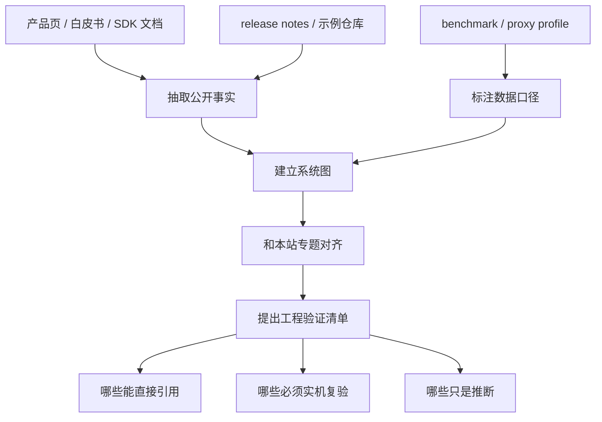

# 思考探索

!!! note "读法定位"
    这页先回答“思考探索”在「思考探索」里的位置：它解决什么局部问题，依赖哪些前置，最后会影响哪类工程或研究判断。
    **前置**：先至少读过相关专题入口页；不熟的名词先回术语表或对应专题。 必要时先看本页路线，或回 [基础知识](../foundations/index.md) 或 [术语表](../glossary/index.md)。
    **主线关系**：把不同专题的技术状态、产业约束和工程判断放到同一张地图里，区分事实、趋势和本站推断。

!!! tip "10 分钟读法 | 深入读法 | 实验/工程读法"
    **10 分钟读法**：先把探索问题写成假设：成本、平台、数据、系统或产品约束。
    **深入读法**：深读时区分论文事实、官方资料、工程推断和个人判断。
    **实验/工程读法**：工程上用小型账本或 prototype 证明路线是否值得进入主线。

!!! warning "核心失败模式"
    | 失败模式 | 先查什么 |
    | --- | --- |
    | 工程推断越界 | 产品/平台判断要和论文结果分开 |
    | 部署约束被低估 | 端侧功耗、内存、runtime 和模型质量要同表看 |
    | 路线过早收敛 | 先写假设和证据缺口，再写结论 |

这一部分用于放不完全等同于论文精读的技术调研、工程观察和平台解析。它和“论文专题讲解”平级，但关注对象更宽：芯片平台、软件栈、产品化约束、开源工具链、行业方案和工程路线都可以放在这里。

!!! info "最小验收指标"
    | 要证明什么 | 最小指标 | 不能替代什么 |
    | --- | --- | --- |
    | 判断可追溯 | 假设、证据、反例和待核验项写清 | 观点输出 |
    | 成本可比较 | 硬件、runtime、内存、延迟和质量同表 | 单点参数 |
    | 能回到主线 | 明确服务表示、交互、系统或验证哪一层 | 泛泛趋势 |

!!! failure "最佳反例"
    探索页最容易失效的方式，是把灵感写成结论。没有成本项、证据路径和最小实验，想法再漂亮也只能保留为假设。

## 模块定位

思考探索页优先回答三个问题：

1. 一个技术平台到底是什么，它解决的是哪类真实场景；
2. 硬件、软件栈、开发工具、模型部署和商业客户之间如何连接；
3. 如果把它用于项目设计，哪些口径能直接引用，哪些只能作为工程估算。

这类文章不追求把所有资料堆成清单，而是把分散在产品简介、开发文档、模型库和开源示例里的信息串成一条可执行的理解路径。

## 和其他模块的关系

“思考探索”解决的是论文之外的上下文缺口。很多工程判断并不来自单篇论文，而来自官方产品简介、SDK 文档、release notes、模型库、benchmark 页面和开发者示例。比如一个端侧 AI 平台到底能不能用，不能只看模型论文，还要看它支持哪些 runtime、哪些算子会落到 NPU、量化流程怎么走、proxy 设备口径是否可靠、实机热稳定是否能撑住。

因此这个模块和站内其他部分的分工如下：

| 模块 | 主要对象 | 思考探索补充什么 |
| --- | --- | --- |
| 论文专题讲解 | 单篇论文、技术报告 | 把论文没有覆盖的产品、平台和工具链上下文补齐 |
| 量化 / 推理 / 算子 | 方法和系统机制 | 把机制放回具体硬件、SDK、runtime 和部署资产里理解 |
| 参考文献 | 源头索引 | 将文档、开源仓库、产品简介和 release notes 组织成可读分析 |
| 训练 / 世界模型 / 具身智能 | 模型能力路线 | 补充能力进入设备、行业和产品后的约束 |

## 写作口径

这类页面尤其需要区分“官方公开事实”和“工程推断”。例如芯片平台常常不会公开裸片价格和 TDP，但会公开产品定位、终端设备、显示规格、相机并发、软件栈和支持 runtime。页面应该明确说明哪些数据来自官方资料，哪些是基于终端产品、proxy profile 或常见系统预算的估算，避免把宣传指标写成可复现 benchmark。

推荐每篇至少覆盖：

| 章节 | 要回答的问题 |
| --- | --- |
| 对象定义 | 这到底是什么，不是什么 |
| 场景定位 | 它面向谁、解决哪类任务 |
| 硬件 / 系统规格 | 能公开引用的参数有哪些 |
| 软件栈 | SDK、runtime、工具链和模型库分别做什么 |
| 数据口径 | proxy、benchmark、release notes、产品页之间如何互相校验 |
| 工程启发 | 如果放进项目，应该先验证什么 |

后续如果补芯片、平台或工具链，优先保留官方原图和英文表格，中文部分负责解释上下文、边界和可执行判断。

## 调研工作流

这张流程图的重点是把“资料收集”变成“证据分层”。同一篇探索文章里，官方规格、网页截图、第三方 benchmark、工程估算和个人判断不能混在一起。只有先把证据层级标清，读者才知道哪些可以写进方案，哪些只能作为试验假设。

## 一个示例：评估端侧 VLM 是否能上设备

假设要判断一个 3B 级 VLM 能不能放进 XR 或机器人边缘设备，不应只看模型参数量。更稳的调研表应该长这样：

| 证据项 | 要收集什么 | 结论用途 |
| --- | --- | --- |
| 硬件公开规格 | NPU/GPU/CPU、内存、相机、显示和热设计相关信息 | 判断资源上限和并发约束 |
| Runtime 支持 | ONNX Runtime EP、QNN、TensorRT、LiteRT、模型格式 | 判断模型能否落到加速器 |
| 量化链路 | INT8/FP16/FP8 支持、校准工具、fallback | 判断是否只是模型变小，还是端到端变快 |
| 任务负载 | 图像分辨率、帧率、prompt 长度、输出长度 | 判断真实延迟和显存 |
| 实机验证 | P50/P95 延迟、温升、功耗、帧时间 | 判断 demo 能否长期稳定 |

这个例子也说明“思考探索”为什么要连回正文专题：量化问题接 [量化路线图](../quantization/index.md)，runtime 问题接 [量化运行时与框架](../quantization/quantization-runtimes-and-frameworks.md)，延迟问题接 [推理系统](../inference/index.md)，硬件路径问题接 [算子与编译器](../operators/index.md)。

## 图片和表格规范

这一模块的图片必须可追溯。优先级是：

1. 官方 PDF、白皮书、论文、文档和开源仓库中的原图；
2. 对官方网页、文档页或模型卡的截图；
3. 根据官方表格重绘的 Markdown 表格，但字段名、英文项和数值不改写；
4. 必要时用纯文本流程图表达结构，不使用无来源的 AI 生成图。

每张图片下方都要写清楚图源，至少说明来自哪份文档、哪一页、哪一个文件名或哪个页面。对于截图或裁剪图，也要说明是“原图裁剪”还是“页面截图”。如果素材来自非官方二手资料，必须在正文里说明其可信度和用途，不应和官方规格混在一起。

表格可以重绘，但要保留来源中的英文列名和关键术语。中文解释放在表格前后，不要把官方字段翻译到难以回查的程度。涉及价格、功耗、TDP、benchmark、出货量等容易随时间变化或商业口径不透明的数据时，需要写明“官方公开”“页面当前显示”“第三方估算”或“工程推断”。

## 适合放什么

适合进入“思考探索”的内容通常有这些特征：

| 类型 | 例子 | 为什么不直接放论文专题 |
| --- | --- | --- |
| 芯片和硬件平台 | XR SoC、NPU、GPU、车载平台、机器人计算盒 | 核心资料往往是 product brief、SDK 和 benchmark，不是一篇论文 |
| 软件栈和 SDK | QNN、TensorRT、ONNX Runtime EP、LiteRT、ROS 组件 | 需要解释工具链边界、部署资产和运行时选择 |
| 产品化案例 | 头显、机器人、端侧 AI app、推理盒子 | 重点是客户、场景、成本、功耗和集成方式 |
| 开源生态调研 | 模型库、示例仓库、benchmark dashboard | 需要把 README、release notes、代码和数据口径串起来 |
| 技术路线判断 | 某个平台是否适合某类模型 | 结论依赖多份资料交叉验证，而不只是论文结论 |

不适合放这里的内容也很明确：如果主题主要是某个算法的数学目标、实验设计和论文贡献，应放到“论文专题讲解”；如果已经是稳定基础知识，应放到对应主题正文；如果只是链接列表，应放到参考文献。

## 维护规则

新增页面时，同步更新本索引、顶部导航和参考文献页。若资料里有不确定项，正文应保留“不公开”“待实机验证”“按页面当前显示”这类口径，而不是强行给出确定值。这样后续复查更容易。

## 当前文章

| 时间 | 主题 | 文章 | 阅读重点 |
| --- | --- | --- | --- |
| 2026-05 | 端侧 AI / XR 芯片 | [XR2 Gen 2：端侧 AI 与量化部署](qualcomm-xr2-gen2.md) | Snapdragon XR2 Gen 2 与 QCS8450 / Proxy 口径、MR/VR 硬件规格、AI Hub Workbench 软件栈、QIDK 示例和 ViT 量化流程 |
| 2026-05 | 世界模型 | [世界模型现状：从视频模拟到工程闭环](world-models-status-and-engineering-loop.md) | 视频世界模型、3D 几何、仿真评测和工程路线判断 |
| 2026-05 | 具身智能 / VLA | [具身智能现状：VLA、数据工厂与真实闭环](embodied-ai-status-and-real-world-loop.md) | VLA、任务状态、数据 recipe、失败恢复和现状思考 |
| 2026-05 | 高效推理 / 双目视觉 | [读懂 Fast-FoundationStereo：从双目几何到高效推理](fast-foundation-stereo-prerequisite-map.md) | 用双目几何、cost volume、蒸馏、NAS/剪枝、伪标签和 runtime 证据串起 Fast-FoundationStereo 的前置知识 |

## 和正文专题的连接

思考探索里的平台文章通常会横跨多个正文专题。读 Qualcomm 这一篇时，可以按下面的路线把平台资料放回系统工程里：

| 想追的问题 | 回到正文哪里 | 为什么要接过去 |
| --- | --- | --- |
| QNN、LiteRT、ONNX Runtime 到底属于哪层 | [量化运行时与框架](../quantization/quantization-runtimes-and-frameworks.md)、[推理系统路线图](../inference/index.md) | 芯片平台只有和 runtime、模型格式、校准与 profile 链路放在一起才有部署意义 |
| ViT 量化为什么不只看模型大小 | [量化路线图](../quantization/index.md)、[评测与部署清单](../quantization/evaluation-and-deployment-checklist.md) | 端侧量化还要看校准数据、NPU placement、CPU fallback、数值误差和整机功耗 |
| XR 头显里的模型为什么要考虑相机、显示和热稳定 | [推理服务系统](../inference/serving-systems.md)、[算子与编译器](../operators/index.md) | 真实设备里模型推理会和渲染、sensor、无线、系统服务争同一个资源预算 |
| Proxy profile 能不能当最终指标 | [可观测性与在线评测](../inference/observability-and-online-evaluation.md) | Proxy 适合早筛，最终仍要在真实设备上做延迟、温升、帧时间和质量回归 |
| 世界模型怎么从 demo 走向工程闭环 | [世界模型路线图](../world-models/index.md)、[世界模型开发路线](../world-models/development-roadmap-data-simulation-and-evaluation.md) | 视频模拟、3D 几何、动作条件和 success checker 必须接起来 |
| 具身智能为什么不能只看 VLA demo | [具身智能路线图](../embodied-ai/index.md)、[VLA 数据、模型与评测路线](../embodied-ai/vla-data-model-and-evaluation-roadmap.md) | 任务状态、无效指令、动作接口、失败恢复和数据回流决定能否落地 |
| Fast-FoundationStereo 为什么需要跨专题读 | [相机、深度与机器人视觉](../embodied-ai/cameras-depth-and-robot-vision.md)、[双目匹配与 Cost Volume 入门](../embodied-ai/stereo-matching-and-cost-volume.md)、[模型压缩、剪枝与 NAS 入门](../foundations/model-compression-pruning-and-nas-basics.md)、[Fast-FoundationStereo](../paper-deep-dives/inference/fast-foundation-stereo.md) | 它同时涉及双目几何、视觉 backbone、训练监督、结构压缩、伪标签数据和实时推理证据 |

!!! note "维护提醒"
    平台资料更新很快，尤其是 release notes、模型库和 runtime 支持矩阵。新增或复查这类文章时，优先跑 `make quality` 和 `make build`，再抽查页面里的图片图源、表格原字段和“官方公开 / 工程推断”的口径是否仍然清楚。

!!! tip "下一站"
    - 按导航顺序继续：[XR2 Gen 2：端侧 AI 与量化部署](qualcomm-xr2-gen2.md)。
    - 概念或符号卡住时，先查 [术语表](../glossary/index.md)，再回到当前页。
