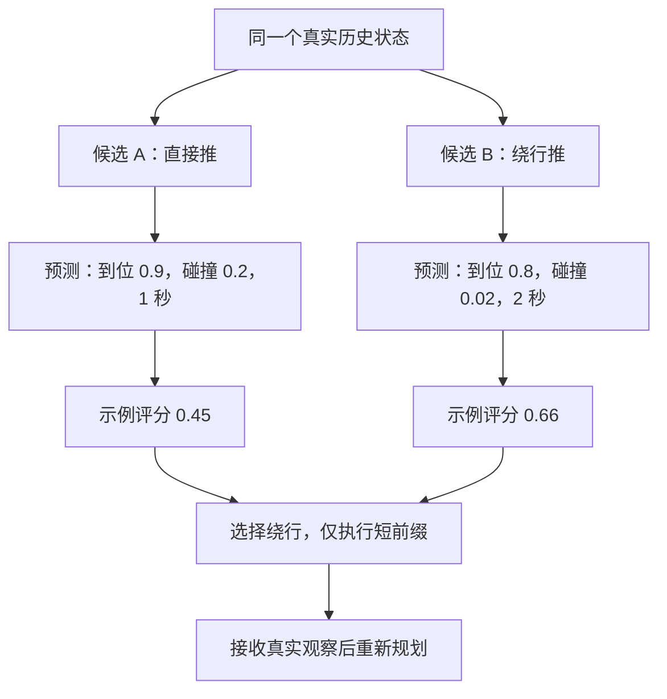
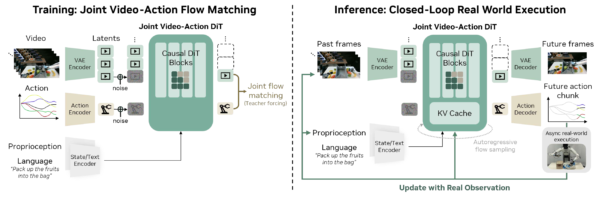

# Latent 世界模型怎样真正参与动作选择

机械臂要把杯子推入托盘。直接向右推最短，却可能把杯子推倒；先绕到另一侧推比较慢，但能避开杯柄。模型若只预测一段自然续接的视频，未必回答这两个动作谁更好。规划需要的是针对候选动作的后果，以及比较这些后果的方法。

这里用同一个推杯子任务说明 latent 的作用。Latent 是内部表示，并没有“适合规划”的天然保证。它压缩掉了什么、未来怎样由动作改变、结果怎样被评分，才决定它是否有用。

## 先把候选动作写成模型能查询的变量

把最近几帧、末端位置与任务编码成 $z_t$。一个候选 $A=(a_t,\ldots,a_{t+H-1})$ 含有未来 $H$ 次控制，必须注明坐标系、单位和每步时长。世界模型给出条件预测

$$
\hat z_{t+1:t+H}^{A}=F(z_t,A).
$$

这与仅从历史预测 $F(z_t)$ 不同。后者可以学到常见动作的平均后果，却没有给规划器一个可干预接口。把同一历史下的“向右推”和“暂时不动”分别送进去，是检查接口是否生效的起点。但预测不同只证明输入有影响；方向、幅度与接触后果是否正确，仍需外部结果验证。

在推杯子任务中，图像里的背景变化很大，杯子倾斜角变化很小。若 latent 主要编码背景，它可以很好地复原图像，却把决定成败的倾斜忽略掉。规划损失与像素损失因此可能选择不同特征。

## 把 latent 距离当目标，先看一个反例

设目标图中杯子处于托盘中央，但拍摄时背景灯光不同。候选 A 真正把杯子推到位，背景与目标图不一致；候选 B 没推到位，背景却很接近。构造两种特征差异如下。

| 候选 | 杯子位置误差 | 背景特征误差 | 两项平方和 |
| --- | ---: | ---: | ---: |
| A | 0.1 | 3.0 | 9.01 |
| B | 0.8 | 0.2 | 0.68 |

直接最小化该 latent 的欧氏距离会选 B。换成更小的 latent 也不自动修复这个问题，关键是表示和距离怎样对应任务。可以训练目标相关表示、使用对象级距离，或学习 reward/risk readout；每种方式都需要自己的监督与验证。

[PlaNet](https://arxiv.org/abs/1811.04551)通过预测奖励评价候选，[V-JEPA 2](https://arxiv.org/abs/2506.09985)包含动作条件 latent 预测和目标驱动规划。它们说明了不同读出方式的可行性，并不证明任意预训练 latent 都可以直接当任务距离。基础推导见 [RSSM 与规划](../world-models/rssm-dreamer-and-planning.md)。

## 好表示还要配上可比较的未来

假设模型为两条路径预测到位概率、碰撞概率与耗时。构造评分为到位概率减去两倍碰撞概率，再减去每秒 0.05 的时间成本。直接推为 $(0.9,0.2,1)$，绕行推为 $(0.8,0.02,2)$，分数分别为 0.45 和 0.66，选择绕行。

这个比较假定两条路径的概率含义一致。若模型对训练中常见的直接推很自信，对绕行一律输出保守概率，排序可能只是数据覆盖的反映。若碰撞是硬约束，还应先筛除超过风险限额的候选，而非允许成功收益随意抵消它。

同一候选也可能有多个未来。杯子接触桌边以后可能滑动或倾倒，只预测平均形状会隐藏两种结局。可使用多次采样、分布预测或模型集成呈现不确定性，但样本分歧小仍不保证正确，多个模型也可能共享盲点。风险的处理见[不确定性与规划](../world-models/uncertainty-and-risk-aware-planning.md)。

两条分支共享起点和评分规则，才能比较。箭头末端接回真实观察；它不会把“预测分数更高”自动转成“真实任务更好”。若碰撞受硬约束，还需在评分前过滤候选。

## 未来可以在不同位置影响动作

最容易检查的方式是先给候选动作，再预测和评分。计算成本随候选数、预测时长与采样数增加，适合把搜索过程暴露出来分析。

另一种方式在训练时联合学习未来与动作，部署直接生成动作，或同时生成两者。[DreamZero](https://arxiv.org/abs/2602.15922)研究视频与动作联合建模。共同训练能建立关联，但“生成的视频显示成功、生成的动作也像成功动作”仍可能是共同拟合了一个错误未来。

{ width="920" }

<small>图源：[World Action Models are Zero-shot Policies，Figure 4](https://arxiv.org/abs/2602.15922)。原图展示训练时联合去噪未来视频 latent 与 action，推理时用真实观测刷新上下文。这里的重点是 WAM 的耦合与纠错接口；这张架构图不能证明所有任务都具有可靠的物理泛化。</small>

[Fast-WAM](https://arxiv.org/abs/2603.16666)进一步把视频共同训练与测试时未来生成分开比较。它在作者任务设置中保留前者、跳过后者仍取得有竞争力的结果。这说明需要检查未来预测究竟在训练中改善表征，还是在每次部署决策中提供不可替代的信息，不能仅凭模型叫 WAM 就规定执行结构。

## 预算会改变最合理的调用方式

构造一个 100 ms 的反应预算，其中感知与执行接口占 30 ms，留给预测与选择的时间只有 70 ms。若单次处理一个候选需要 8 ms，逐个处理 16 个候选已经超时；批处理能否解决，取决于实际并行度和显存，不能直接把时延除以 batch size。

减少候选、缩短 horizon、复用共同前缀或按需解码都可能有用，但它们牺牲的能力不同。缩短 horizon 可能看不到桌边风险；压缩状态可能丢掉杯柄；少采样可能漏掉低概率倾倒。预算分配应在相同端到端时限下比较任务结果，而不是把更多搜索的高分与更少搜索的低成本分开宣传。

## 预测最终要接受新观察的纠正

规划器选绕行后，只执行前几步，再用新图像更新状态。若杯子实际位置偏离预测，后续候选从新状态重新生成；不能把先前想象出的“已接触杯子”当真实历史继续滚动。

可固定初态与候选，记录预测排序、独立执行结果和动作生效时刻。再引入遮挡、延迟、轻微推力变化，观察模型何时发现偏离，以及恢复是否增加碰撞。这样才能区分表示缺信息、动力学预测错、评分器错和控制来不及四种问题。

我倾向于从这个可追溯的候选系统起步，再决定是否加入联合生成或按需解码。这是工程起点，不是对所有任务最优架构的结论。更丰富的生成表征、更稀疏的对象状态以及更便宜的直接策略，都应通过相同任务与预算检验。
