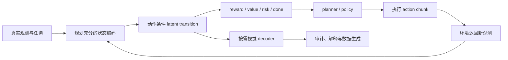

# 从预测未来到利用未来：Latent World Model 怎样进入规划闭环

> **本文回答的问题。** 世界模型学到的哪一种 latent 适合规划，它又该怎样进入动作生成？我的判断是：规划需要的 latent 要对决策足够、对动作敏感、能被闭环纠正；信息越丰富，不一定越适合规划。视觉生成、JEPA、稀疏场景预测、条件注入和 World-Action Model，分别在调整这份状态的内容与接口。

> **材料范围与核验日期。** 本文由一份技术交流 PPT 重构，重点核验了 Vision Banana、DriveLaW、Drive-JEPA、SparseWorld、DriveFuture、DreamZero 和 WAM-Nav 的论文、项目页或官方仓库。Checked Date：2026-07-10。文中实验结果均为作者报告，本站没有独立复现。

这组材料表面上有两场争论：先争生成式 latent、JEPA latent 与稀疏 latent 谁更适合规划，再争未来信息应该作为条件输入，还是和 action 放进同一个生成器。

把方法拆开后，更准确的说法是：它们在回答两类不同的问题。

1. **状态预算**：未来要保留外观、几何、语义、动态，还是只保留 agent、地图和风险相关变量
2. **耦合方式**：action 是未来预测的条件、未来是 planner 的条件，还是两者在同一个模型里联合生成

这两条轴不能合成一条“更先进”的路线。一个 latent 是否有价值，要看它能否改变动作选择；一种联合生成结构是否有价值，要看它能否在真实观测回来后及时纠错。

## 规划首先是一个互相依赖的问题

设当前观测被编码为 \(z_t\)，世界模型根据动作 \(a\) 预测未来状态：

\[
\hat z_{t+1:t+H}^{\,a}=F(z_t,a_{t:t+H-1})
\]

planner 再根据这段未来选择动作：

\[
a^*=\arg\min_a J(\hat z_{t+1:t+H}^{\,a},a)
\]

困难在于，未来依赖 action，action 又依赖未来。模型不能只会延续一段“看起来合理”的视频；它要让同一段历史在不同动作下产生可区分的后果，并让 planner 能比较这些后果。

现有方法大致用了三种解法。

| 解法 | 计算方式 | 代表材料 | 主要代价 |
| --- | --- | --- | --- |
| 条件预测再评分 | 给定候选 action，预测对应未来，再比较代价 | 经典 action-conditioned world model | 候选越多，rollout 成本越高 |
| 交替修正 | 用暂定轨迹预测未来，再用未来修正轨迹，反复迭代 | [DriveFuture](https://arxiv.org/abs/2605.09701) | action 与 future 可能互相强化错误 |
| 联合生成 | 从同一条件中同时生成 future latent 与 action | [DreamZero](https://arxiv.org/abs/2602.15922)、[WAM-Nav](https://arxiv.org/abs/2606.04907) | 联合分布更难校准，错误未来会牵引错误动作 |

因此，“预测准不准”只是第一层问题。面向规划的测试是：预测能否区分动作、能否支持排序、执行后能否被真实观测纠正。

## 第一条轴：未来状态应该保留什么

### 生成式 latent 保留得多，但多不等于可决策

[Image Generators are Generalist Vision Learners](https://arxiv.org/abs/2604.20329) 提供了一条重要证据：在 Nano Banana Pro 上加入少量任务指令微调后，Vision Banana 可以把分割、深度和表面法线等视觉任务统一成 RGB 图像生成，并在若干 2D、3D 感知任务上达到有竞争力的结果。

这说明生成预训练内部确实可能保留可迁移的几何与语义信息，但它没有直接证明三件事：视频中的长时动态是否稳定、同一场景能否响应不同动作、这些表征能否改善闭环规划。Vision Banana 是静态图像感知证据，模型和训练也没有开放；不能从这组结果直接推出“生成模型已经学会足够的物理规律，可以驱动规划”。

[DriveLaW](https://arxiv.org/abs/2512.23421) 把证据往规划方向推进了一步。它让视频 DiT 的中间 latent 进入扩散式轨迹规划器，并报告视频预训练规模增加时 NAVSIM 规划指标同步改善；消融还显示，较早去噪阶段的 latent 对规划更有用。

DriveLaW 的关键证据不在视频清晰度，而在 planner 直接读取生成过程中的特征，不必等待完整视频解码。早期 latent 可能已经包含道路结构和运动趋势，后续去噪增加的纹理细节反而未必服务动作选择。论文报告支持的是特定视频表征在 NAVSIM 上可被 planner 消费，尚未说明视觉逼真度会自动转化为真实道路安全。

### JEPA latent 的价值在表征预训练，不等于在线 rollout

[Drive-JEPA](https://arxiv.org/abs/2601.22032) 用 V-JEPA 的遮挡 latent 预测目标继续预训练驾驶视频编码器，再把 encoder 特征送给轨迹 decoder，并结合由规则模拟器筛选的多模态轨迹蒸馏。

这条路线容易被误读。JEPA 在预训练阶段通过预测被遮挡时空 patch 的 latent 学到时序表征；公开的下游规划代码主要加载 ViT encoder，并没有调用 JEPA predictor 做 action-conditioned future rollout。更准确的表述是“预测式自监督预训练改善了规划表征”，而不是“规划时直接用 JEPA 预演未来世界”。

这一区分很重要。一个 encoder 可以包含运动信息，却仍然没有定义动作怎样干预状态，也没有提供可供 planner 比较的候选未来。强表征是世界模型的一部分，不自动等于完整的规划接口。

### 稀疏 latent 把问题改成“哪些变量不能丢”

[SparseWorld](https://arxiv.org/abs/2605.24354) 放弃预测完整图像或 occupancy，转而滚动预测 agent 与地图元素的几何 anchor 和高维特征，再用这些未来实例修正运动预测与自车轨迹。

它给出了另一种设计原则：规划不需要复原所有可见内容，只需要保留会改变决策的状态。这里的“稀疏”是相对稠密像素和体素而言；论文的效率比较仍使用 900 个 agent anchors 和 100 个 map anchors。系统也依赖上游实例感知，一旦漏检小目标、异常障碍或未建模的道路关系，稀疏世界无法凭空恢复它们。

评估稀疏状态时，应先检查**决策充分性**：被删除的信息是否会改变最优动作。这个问题只能靠下游失败案例、反事实动作和闭环结果回答，不能只看 latent 维度或压缩率。

## 第二条轴：未来怎样进入动作生成

同样一段 future latent，可以在系统里扮演不同角色。

| 接入方式 | future 与 action 的关系 | 代表材料 | 适合观察什么 |
| --- | --- | --- | --- |
| 串联条件 | 视频模型先产生 latent，planner 把它当额外条件 | DriveLaW | 生成预训练能否提供可消费的规划特征 |
| 迭代条件 | 暂定轨迹条件化 future latent，future latent 再条件化轨迹去噪 | DriveFuture | future 与 action 的循环依赖能否在迭代中收敛 |
| 视频—动作联合生成 | 同一个自回归 DiT 联合去噪未来视频 latent 和 action chunk | DreamZero | 动作能否与可见后果对齐，并在真实观测回写后继续工作 |
| 非对称联合生成 | 共享 DiT 同时生成长 horizon action 和短 horizon visual foresight | WAM-Nav | 不同消费者是否需要不同的时间跨度与带宽 |

DriveFuture 先根据当前 latent 和轨迹假设预测未来，再在扩散去噪过程中逐步用更准确的轨迹估计更新 foresight。可以把它看成 action 与 future 的迭代耦合，而非一次单向前向传播。当前证据仍来自 NAVSIM，论文的最高 navhard 结果还依赖外部 trajectory scorer，不能等同于真车闭环。

DreamZero 把未来视频和 action 放进同一个 14B 视频扩散 backbone，共同做 flow matching。它在真实机器人上报告了未见任务和环境的泛化，并通过真实观测刷新、缓存和系统优化实现闭环控制。不过，论文里的 zero-shot 仍以约 500 小时本体机器人训练为前提；7 Hz 结果依赖两台 GB200。这些实验说明该 WAM 路线在作者设置中可以运行，不能推出机器人可以绕过本体数据和部署成本。

{ width="920" }

<small>图源：[World Action Models are Zero-shot Policies，Figure 4](https://arxiv.org/abs/2602.15922)。原图展示训练时联合去噪未来视频 latent 与 action，推理时用真实观测刷新上下文。本文用它说明 WAM 的耦合与纠错接口；这张架构图不能证明所有任务都具有可靠的物理泛化。</small>

WAM-Nav 又给联合生成加了一条有用限制：动作 horizon 可以长，视觉 foresight 可以短。论文消融中，visual horizon 为 1 优于更长预测；真实环境证据来自 Unitree G1 在 4 个场景中的 40 次试验。这个结果提示我们，未来视觉更像对动作的局部约束，不一定要扩展成长视频模拟器。

## 我会用五项检查判断一个 latent 能否服务规划

“生成式还是预测式”不足以决定路线。更可执行的评审方式，是逐项检查 latent 与 planner 的接口。

| 检查项 | 要回答的问题 | 最小实验 |
| --- | --- | --- |
| 决策充分性 | 状态是否保留了会改变动作的对象、几何、接触和任务进度 | 删除或遮挡一类变量，观察动作排序与碰撞率是否变化 |
| 动作敏感性 | 同一历史换一个 action，未来是否按方向、幅度和时机正确分叉 | 固定观测，替换为相反动作、no-op、失败动作和越界动作 |
| 候选可比性 | 不同 future latent 能否被同一套 reward、value 或 risk readout 稳定排序 | 比较模型排序与模拟器、真实结果的一致性 |
| 时域稳定性 | rollout 变长后，关键对象与约束是否漂移 | 报告 horizon curve，而不是只给单个终点指标 |
| 闭环可恢复性 | 预测错后，真实观测能否改写状态并修正动作 | 注入遮挡、延迟和执行偏差，测恢复率与恢复时间 |

这五项检查会把一些看似矛盾的结果放回正确位置。Vision Banana 主要提供决策充分性的上游线索；Drive-JEPA 检验表征质量；SparseWorld 主动压缩状态预算；DriveFuture 处理 action sensitivity；DreamZero 和 WAM-Nav 把未来—动作一致性推到联合生成。它们覆盖的是不同接口，不能用一个视频质量指标或一个规划总分互相替代。

## 一个更可落地的组合按需生成

下面是我从这些材料中得到的系统判断，不是任何一篇论文已经验证的完整架构。

高频控制可以在 compact latent 中运行，只保留 planner 需要的状态、动作后果和风险读出；完整视频在人工审计、数据生成或低频模拟时再解码。生成式预训练负责提供丰富先验，稀疏状态负责控制预算，action-conditioned transition 负责反事实，WAM 式联合训练可以加强未来与动作的对齐，真实观测回写负责打断共同犯错。

这条组合路线有三个待验证点。

1. **[待验证假设]** 从生成模型提取的 latent 是否稳定保留小目标、接触和罕见障碍，不能只靠深度与分割任务推断
2. **[待验证假设]** 联合生成是否真的改善因果 action sensitivity，还是只让视频和动作在训练分布内共同拟合相关性
3. **[待验证假设]** 稀疏状态、风险 head 与可选视频 decoder 是否共享同一套世界语义，避免“画出来的未来”和“用于决策的未来”互相矛盾

## 最后判断

这份 PPT 最有价值的地方，是把问题从“能不能预测未来”推进到“未来怎样被规划使用”。沿着这条线继续走，latent 的评价标准也要改变。

适合规划的 latent 不必最完整，也不必能解码出最好看的视频。它需要满足四个更具体的条件：保留决策关键变量，响应动作干预，允许候选未来被比较，并在真实观测回来后可被纠正。计算预算则决定这些能力应放在稠密视频、抽象 latent 还是稀疏实例层实现。

生成式 latent、JEPA latent 和稀疏 latent 很可能会分层共存：生成预训练提供上游先验，规划状态压缩为可控 latent，未来与 action 在需要的位置耦合，视觉解码只按需发生。判断世界模型是否进入规划闭环，应看这段未来能否改变动作，并在想错时及时让路给真实世界。

## 证据边界

- PPT 中若干日期采用 arXiv 修订日：Vision Banana 的首次公开日为 2026-04-22，DriveLaW 为 2025-12-29，SparseWorld 为 2026-05-23，DreamZero 为 2026-02-17，WAM-Nav 为 2026-06-03
- DriveLaW、Drive-JEPA、DriveFuture 的主要证据来自 NAVSIM；SparseWorld 还报告 nuScenes 与 Bench2Drive。它们不能直接证明真实道路安全
- Drive-JEPA 的最终结果同时依赖领域视频预训练、轨迹 pseudo-teacher 与 momentum selection；SparseWorld 也包含安全损失和轨迹选择，不能把全部提升归因于 latent 形式
- DreamZero 与 WAM-Nav 有真实机器人实验，但 zero-shot 的定义、训练本体、场景数量、硬件与控制频率均有限定
- 这些论文的模型规模、输入模态、任务、指标和闭环协议不同，本文不做横向总分排名

## 自测与下一步

1. 如果两个 action 在模型里产生几乎相同的 future latent，即使视频 FVD 很好，这个 world model 能支持候选规划吗？为什么？
2. SparseWorld 删除了外观与稠密 occupancy。你会设计哪组反事实或失败场景，检查被删信息是否影响最优动作？
3. WAM 同时生成未来和动作时，为什么“二者很一致”仍不足以证明动作正确？真实观测回写应如何进入评测？

下一步可以继续读：

- [世界模型该预测什么：答案取决于谁消费未来](world-model-future-consumers.md)
- [WM / WAM / VAM：动作到底怎样进入世界模型](../world-models/wm-wam-vam-and-action-conditioned-modeling.md)
- [世界模型评测：不要让好看的未来骗过决策系统](../world-models/evaluation-and-failure-modes.md)
- [DreamZero：世界动作模型为什么可以做零样本策略](../paper-deep-dives/embodied-ai/dreamzero.md)
