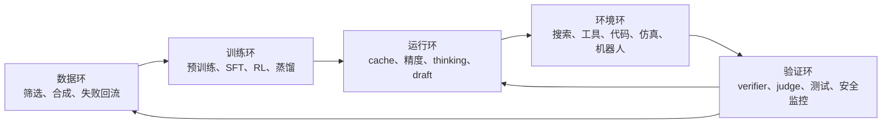

# 读完 12 份技术报告：前沿模型正在变成受约束的闭环

> **本文回答的问题。** 当技术报告同时讨论 MoE、低精度、长上下文、推理预算、工具环境、流式语音和安全评测时，我们究竟应该把“一个模型”理解成什么？

把 12 份技术报告的目录并排，会看到一个反常现象：模型能力越强，报告花在数据、cache、rollout、工具环境和安全控制上的篇幅越多。**checkpoint 仍然重要，但它已经不足以描述一个前沿模型的真实能力。** 同一份权重接入不同的 KV cache、thinking budget、工具环境或安全控制，会表现出显著不同的能力与成本。

这也改变了我读技术报告的顺序。我现在会先找四件事：模型保存什么状态，系统允许它花多少计算，环境怎样返回反馈，失败后由谁截断或恢复。参数量和榜单分数仍然要看，但它们更像结果，不再是解释的起点。

## 这 12 份报告各自把什么搬出了 checkpoint

| 报告 | 最值得带走的系统问题 |
| --- | --- |
| [DeepSeek-V3](../paper-deep-dives/technical-reports/deepseek-v3.md) | MoE 容量只有和 MLA、路由、FP8、通信重叠一起设计，才会转化为可训练、可服务的模型 |
| [DeepSeek-R1](../paper-deep-dives/technical-reports/deepseek-r1.md) | R1-Zero 用 verifier、rollout 和 RL 激发长推理；产品级 R1 的可读性、稳定性与通用能力还依赖 SFT 和后续对齐 |
| [DeepSeek-V4](../paper-deep-dives/technical-reports/deepseek-v4-pro.md) | 百万上下文必须接到压缩注意力、异构 KV cache、推理预算和 agent 基础设施 |
| [Qwen3](../paper-deep-dives/technical-reports/qwen3.md) | thinking / non-thinking 是可切换的服务模式，小模型能力还依赖强模型蒸馏 |
| [Qwen3.5-Omni](../paper-deep-dives/technical-reports/qwen35-omni.md) | 全模态交互受 token 速率、首包延迟、文本—语音对齐和多轮稳定性约束 |
| [Cosmos 3](../paper-deep-dives/technical-reports/cosmos3.md) | Physical AI 需要理解、生成、动作、合成数据和部署设施共同组成训练平台 |
| [Kimi K2](../paper-deep-dives/technical-reports/kimi-k2.md) | Agent 能力生长在工具模拟器、真实沙箱、轨迹过滤和异步 rollout 里 |
| [LongCat-Video](../paper-deep-dives/technical-reports/longcat-video.md) | 长视频能力要同时处理续写接口、偏好奖励、误差累积和高分辨率推理成本 |
| [Gemini 2.5](../paper-deep-dives/technical-reports/gemini-2-5.md) | dynamic thinking、搜索、代码执行和模型家族共同决定质量—成本边界 |
| [GPT-4o System Card](../paper-deep-dives/technical-reports/gpt-4o-system-card.md) | 端到端语音让安全对象从文本回答扩展为实时交互轨迹 |
| [InCoder-32B](../paper-deep-dives/technical-reports/incoder-32b.md) | 工业代码能力来自编译、仿真、测试、性能分析进入数据和评测闭环 |
| [Nemotron 3 Super](../paper-deep-dives/technical-reports/nemotron-3-super.md) | Mamba、LatentMoE、MTP、NVFP4 和多环境 RL 都围绕 agent 工作负载重新分配成本 |

这张表里很少有孤立的“模型技巧”。每一项都在处理模型与外部约束的接口。

## Checkpoint 更像闭环里的一个状态快照

DeepSeek-V3、Kimi K2 和 Nemotron 3 Super 都使用稀疏专家扩大容量，但三者选择了不同的成本路径。DeepSeek-V3 用 MLA 压 KV、用 DualPipe 隐藏通信；Kimi K2 提高 expert sparsity，同时用 MuonClip 控制大规模训练里的 attention logit；Nemotron 3 Super 把专家计算搬到 latent space，并用 Mamba-heavy 主干降低长输出的状态成本。

如果只比较 total parameters，这些差异会消失。真正影响系统的量是：每个 token 激活多少参数，要搬多少 expert 权重，跨卡传多少 token，保存多少历史状态，草稿的平均接受长度是多少。

DeepSeek-V4 又把这条线推到长上下文。CSA、HCA、滑动窗口和 on-disk KV 不是四个可以分开打分的模块；它们共同决定一段历史以什么粒度留在显存、内存或磁盘里。所谓百万上下文，落地后是一套分层状态管理策略。

{ width="920" }

<small>图源：[DeepSeek-V4 Technical Report](https://arxiv.org/abs/2606.19348)，Figure 6。原图展示 SWA、CSA、HCA 的 state cache 与 classical KV cache。本文借它说明：上下文长度最终会落实为多种状态的存储、压缩和复用规则；这张图本身不能证明百万 token 的真实 agent 任务已经可靠。</small>

因此，我会把 checkpoint 理解成闭环里的一个状态快照。它封装了训练得到的参数，却没有封装完整的数据管线、运行时、工具权限、缓存策略和风险控制。单独下载权重，通常只能复现系统能力的一部分。

## 推理能力逐渐变成一项可分配资源

DeepSeek-R1 说明了长推理行为怎样在可验证任务上被 RL 激发；Qwen3 把 thinking 和 non-thinking 融进同一模型，并暴露 thinking budget；Gemini 2.5 与 DeepSeek-V4 则把 dynamic thinking 或 reasoning effort 放进产品和评测接口。

把几份报告放在一起，更容易看出两个边界。

第一，更多 thinking tokens 只在部分任务上有稳定回报。数学、代码和复杂检索往往能从额外计算中获益；简单问答、格式跟随或纯检索任务可能被过度思考拖慢，甚至受到干扰。

第二，thinking budget 不能替代模型容量、知识和工具。一个任务失败，可能是推理不够，也可能是缺少领域知识、上下文没有取对、工具环境不可用，或者 verifier 奖励了错误方向。继续增加 token 只能解决第一类问题。

{ width="820" }

<small>图源：[Qwen3 Technical Report](https://arxiv.org/abs/2505.09388)，Figure 2。原图展示若干数学、代码和 STEM 任务随 thinking budget 增加的表现曲线。它支持“测试时计算可以调节”的主张，但不能推出所有任务都应该使用更长思考。</small>

我更愿意把 reasoning effort 看成和 batch、精度、上下文长度一样的运行时资源。产品路由需要直接判断：当前请求值得花多少内部计算、多少工具调用和多少验证成本。

## Agent 能力存在于环境与反馈里

Kimi K2、Gemini 2.5、InCoder-32B 和 Nemotron 3 Super 都把 agent 训练写到了环境层。工具调用要真的改变状态，代码要进入执行器，软件工程任务要能启动仓库和测试，长轨迹要能暂停、恢复和回放。

这说明静态数据只覆盖了 agent 行为的一部分。模型可以从 SFT 学会工具调用的格式，却要在环境中才会遇到参数错误、权限不足、超时、输出冲突和中间状态损坏。可靠性来自这些失败是否进入训练与评测。

{ width="920" }

<small>图源：InCoder-32B 报告，Figure 3；原报告入口见[论文专题页](../paper-deep-dives/technical-reports/incoder-32b.md)。图中 pre-train、mid-train、post-train 最终接到编译、仿真与执行验证。本文用它说明“评价工具也参与生产训练信号”，不据此比较工业榜单排名。</small>

这里还有一个容易忽略的后果：环境定义了模型能学到的能力边界。

| 环境只提供什么 | 模型更可能学到什么 | 仍然缺什么 |
| --- | --- | --- |
| 最终答案对错 | 解题和结果优化 | 中间步骤的可诊断性 |
| 编译 / 单元测试 | 语法、功能修复 | 性能、可维护性、生产约束 |
| 模拟工具反馈 | 工具协议和多轮格式 | 真实服务的延迟、权限与副作用 |
| LLM judge 分数 | 开放任务的偏好近似 | judge 偏差之外的人类判断 |
| 真实沙箱和失败日志 | 恢复、重试与状态修正 | 跨环境泛化和长期安全 |

Agent 训练的核心资产因而不只是轨迹数量，还包括环境覆盖、反馈可信度和失败可回放性。没有这些，长轨迹可能只是更长的合成文本。

## 全模态把实时性和安全带进了模型定义

Qwen3.5-Omni 用 Thinker-Talker、低频音频 token、ARIA 和流式 Code2Wav 处理多模态交互；GPT-4o System Card 则从另一个方向提醒：语音的真人感、说话人信息和流式播放会产生文本评测覆盖不到的风险。

两份报告放在一起读很有意思。前者说明全模态能力怎样被做出来，后者说明这种能力怎样改变上线边界。音频 token 压缩得够不够，决定长上下文能容纳多少小时；首包延迟够不够低，决定对话是否自然；针对预设声音偏离的流式分类器，则要在输出继续播放前尽早检测并中断。它不覆盖全部音频安全风险。

Cosmos 3 和 LongCat-Video 又把同一问题扩展到视频与动作。视频模型一旦服务 Physical AI 或连续世界模拟，输出不再只接受“看起来不错”的评价。时间一致性、动作条件、物理状态和部署延迟都会成为模型接口的一部分。

这几份材料让我形成了一个更具体的判断：**模态越接近真实时间，系统越不能把评测留到生成结束以后。** 语音需要流式检查，视频需要分段一致性，机器人动作需要闭环观测和安全控制。实时模态把监控从离线验收推到了生成过程内部。

## 一个模型系统至少有五个相互约束的环

下面这张图是我的综合推论，不是任何一份报告的原始架构。

五个环之间不是固定流水线。验证结果会决定数据怎样回流，也会在运行时直接中断一次生成；环境成本会限制 RL 能采多少轨迹；部署精度会改变 rollout 分布；长上下文 cache 又会影响 agent 能保存多少工作状态。

技术报告里的很多“组合拳”，其实都在修这些接口：

- DeepSeek-R1、Qwen3 修训练环与验证环的连接
- Kimi K2、InCoder、Nemotron 修环境环与训练环的连接
- DeepSeek-V3/V4 修训练环与运行环的连接
- Qwen3.5-Omni、GPT-4o 修实时运行与安全验证的连接
- Cosmos 3、LongCat-Video 修生成模型与连续世界的连接

这个视角也解释了为什么某些强模型很难被简单复现。论文公开了权重和部分代码，不代表环境、数据、judge、kernel、缓存与监控也被完整公开。

## 以后我会怎样判断一份模型报告

相比只抄 benchmark，我会多问下面六个问题。

| 问题 | 想确认的事实 |
| --- | --- |
| 状态在哪里 | 参数、KV、Mamba state、工具状态、机器人状态分别存在哪里，能否恢复 |
| 预算怎样分配 | thinking、上下文、采样步数、精度、工具次数由谁控制 |
| 反馈是否可信 | reward 来自硬 verifier、模型 judge、仿真器还是人工偏好 |
| 训练与部署是否同路 | rollout 精度、cache、工具协议和线上执行路径是否一致 |
| 失败能否回放 | 日志、轨迹、测试、异常声音或控制失败是否能定位并进入数据环 |
| 证据能否外推 | benchmark 是否绑定内部 harness、特定硬件、特定本体或官方 judge |

这六个问题不会给出一个方便的总分，却更接近系统能否长期工作的判断。

## 证据边界

本文的事实底稿来自站内 12 篇专题页及其对应技术报告。多数结果属于作者自述，部分模型闭源，很多 agent、长上下文、多模态和安全评测依赖内部 harness、工具权限、硬件或 judge。本文没有把官方 benchmark 当作独立复现，也没有从单项消融推导完整系统的因果贡献。

“模型是受约束闭环”是我对这些报告的综合抽象。它能帮助组织问题，但还不是一个已有统一指标可以直接验证的理论。真正落地时，仍要按具体任务测量质量、延迟、成本、恢复率和安全事件。

## 相关阅读与下一步

- [高效 AI 的状态账本：少搬状态，比少算一次更重要](efficient-ai-is-state-movement.md)
- [扩散模型加速：每删一步，都要重新安排误差](diffusion-speedup-redistributes-error.md)
- [世界模型该预测什么：答案取决于谁消费未来](world-model-future-consumers.md)
- [具身智能的可纠错状态链](embodied-ai-correctable-state-chain.md)
- [训练与推理系统](../training/index.md)
- [RAG、Agent 与长上下文系统](../inference/rag-agents-and-long-context-systems.md)
