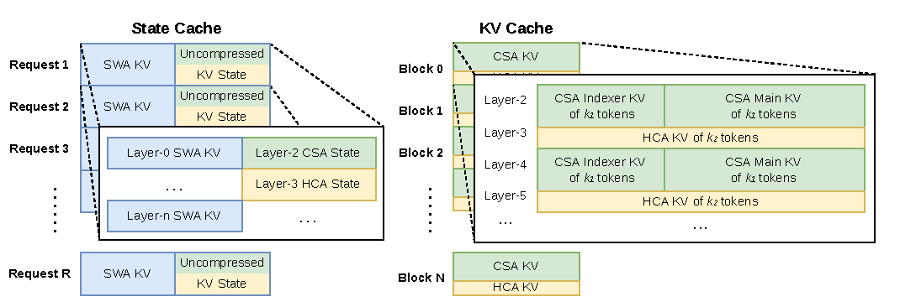
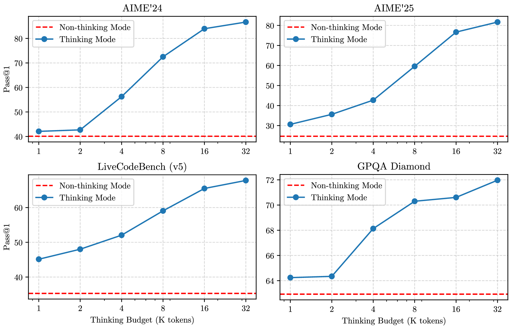
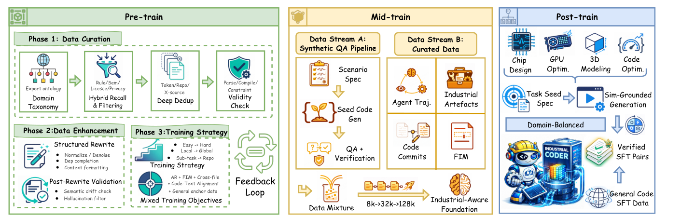
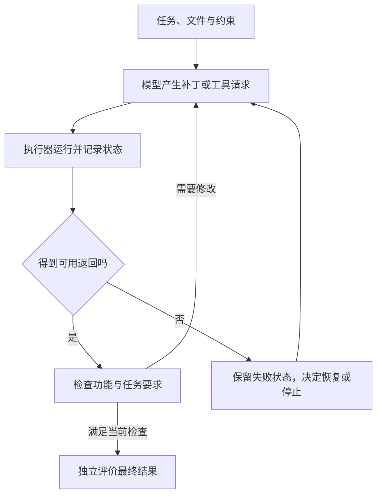

# 模型权重之外，什么改变了任务结果

给同一个代码模型两种设置。一种只能返回一段代码，另一种可以读取仓库、运行测试并根据报错修改。即使权重相同，二者接触的信息与可执行动作也不同。比较“模型能力”时，如果没有记录这些条件，分数差异很难解释。

这里用修复一个函数的任务，连接参数、上下文、推理预算、工具反馈和评价。技术报告中的模型图与曲线是具体例子，不能把不同报告的结果拼成一条统一的因果结论。

## 一次修复包含哪些可变条件

任务要求函数同时处理普通列表、空列表与重复元素。模型先读函数和测试，再生成补丁，执行测试，然后决定是否修改。它可能在四个地方失败。

| 失败记录 | 所缺的信息或能力 | 可区分原因的对照 |
| --- | --- | --- |
| 没读到空列表约定 | 上下文或检索缺失 | 保持权重不变，显式提供约定 |
| 约定已提供，代码仍索引第0项 | 条件理解或代码实现错误 | 提供反例，观察是否修正 |
| 修正代码但没执行测试 | 工具使用或运行流程不足 | 比较允许执行与仅生成的设置 |
| 所有可见测试通过，独立测试失败 | 测试覆盖或泛化不足 | 使用未参与开发的测试与输入分布 |

这些对照不一定只改变一种心理意义上的“能力”，却能明确改变了哪些信息和操作。应保留实际工具输入、返回状态和代码版本，不能把模型自述“已测试”当成执行证据。

## 长上下文容量与有效使用是两件事

仓库越大，模型需要保留的文件、错误日志与修改历史越多。Attention历史状态可能增长，压缩或分层缓存可以降低存储成本，但也必须检验关键证据是否仍可读取。接收一百万token和能可靠解决一百万token中的任务，不是同一个评价。

{ width="920" }

<small>图源：[DeepSeek-V4 Technical Report](https://arxiv.org/abs/2606.19348)，Figure 6。原图展示 SWA、CSA、HCA 的 state cache 与 classical KV cache。这里的重点是：上下文长度最终会落实为多种状态的存储、压缩和复用规则；这张图本身不能证明百万 token 的真实 agent 任务已经可靠。</small>

图中区分不同注意力机制保存的状态。阅读时先数各类缓存的轴与长度，再检查生成新token时如何更新；如果改了缓存压缩，原来通过的远处证据检索用例也应重跑。图示布局本身没有给出所有长任务的成功保证。

[DeepSeek-V4报告](https://arxiv.org/abs/2606.19348)提供这种具体存储设计；基础计算见[KV与内存层次](../inference/context-compression-kv-eviction-and-memory-hierarchies.md)。这里引用它说明接口，未把原文性能当成本地测量。

## 增加生成预算，能改变什么

给模型更多token，可能允许更完整的分析、更多候选或更多工具交互。它也可能重复错误前提。假设单个候选成功概率为0.3，且候选相互独立，采3个至少一次成功的概率是 `1−0.7³=0.657`。若候选完全相关，结果仍是0.3。

即使至少一个候选正确，系统还需知道选哪一个。选择器可能误判，因此“生成集合包含正确答案”与“最终输出正确”必须分开报告。这个例子也不能用来解释所有长思考，因为一条更长轨迹与多个独立样本并不相同。

{ width="820" }

<small>图源：[Qwen3 Technical Report](https://arxiv.org/abs/2505.09388)，Figure 2。原图展示若干数学、代码和 STEM 任务随 thinking budget 增加的表现曲线。它支持“测试时计算可以调节”的主张，但不能推出所有任务都应该使用更长思考。</small>

这张Qwen3曲线比较特定任务的thinking budget。沿横轴读预算，再分别看各任务曲线，不能用某一条上升曲线推断所有请求都值得增加计算。读源码时还需区分总输出上限、思考上限与工具次数，名称相似的参数未必控制同一个对象。

## 验证器也有覆盖边界

函数编译成功只排除了部分语法与类型错误，可见测试通过只检查了已覆盖输入。若任务还要求低延迟或低内存，需要另加正确的性能测量，不能让模型通过删除功能获得高分。

把一个简化选择器算清楚。假设100个候选中30个真正正确，验证器保留其中27个，也错误保留了7个错误候选。被保留集合的正确率为 `27/34≈79.4%`，高于原来30%，但仍有约20.6%错误。验证能改善筛选，却不等于保证。

```python
correct_kept, wrong_kept = 27, 7
print(round(correct_kept/(correct_kept+wrong_kept)*100,2))
```

这个数字来自教学设定。真实验证器的误接收率需要独立标签；如果用同一个有偏judge既训练又评价，分数改善可能只是更适应它的偏好。

{ width="920" }

<small>图源：InCoder-32B 报告，Figure 3；原报告入口见[论文专题页](../paper-deep-dives/technical-reports/incoder-32b.md)。图中 pre-train、mid-train、post-train 最终接到编译、仿真与执行验证。这里的重点是“评价工具也参与生产训练信号”，不据此比较工业榜单排名。</small>

InCoder的Code-Flow图把代码整理、上下文构造和执行反馈接进数据流程。验证结果用于形成监督材料，不应把整个过程直接叫作执行奖励强化学习；训练算法要按具体章节确认。[原文](https://arxiv.org/abs/2603.16790)与[项目](https://github.com/CSJianYang/Industrial-Coder)给出方法背景。

## 把工具状态与模型状态分开保存

模型生成一个运行命令，只表示它提出了动作。工具实际执行后，系统才获得退出状态、输出和可能的文件变化。若超时或返回缺失，不能自动按成功推进；如果重试有副作用，也需要明确前一动作是否已发生。



图中的回路没有要求无限重试。预算、环境和终止条件都是实验设置的一部分。恢复后使用的是哪些文件与工具结果，也会改变后续生成。

## 怎样报告一次可比较的结果

至少固定或披露权重、tokenizer、上下文来源、提示模板、采样与预算、工具版本、可见测试、独立评价和运行设备。若只改工具权限，就报告该变化下的系统结果；若同时换权重与验证器，就不能把收益全部归给模型训练。

[数据划分与评测](../foundations/data-splits-metrics-and-evaluation-basics.md)解释独立估计，[RAG与Agent系统](../inference/rag-agents-and-long-context-systems.md)解释检索、工具和状态。沿着同一次请求追踪这些对象，可以把“模型更强”拆成可检查的具体变化。
