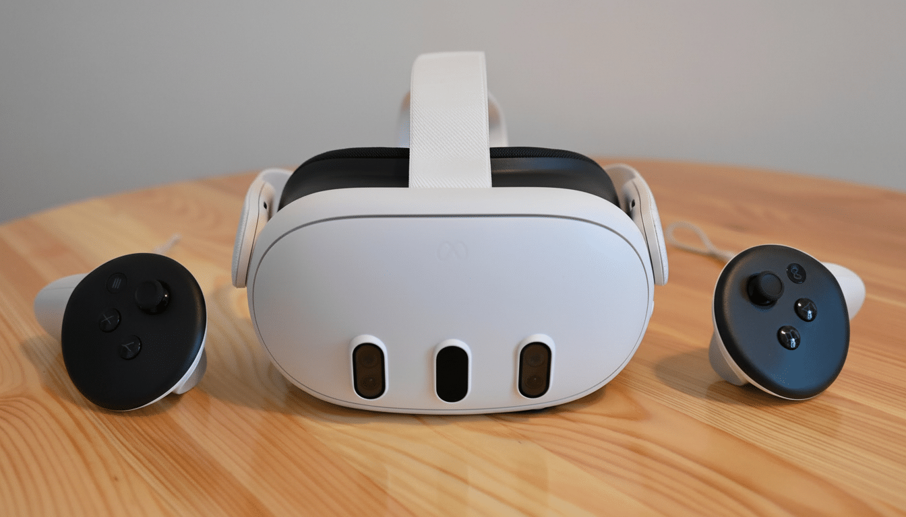
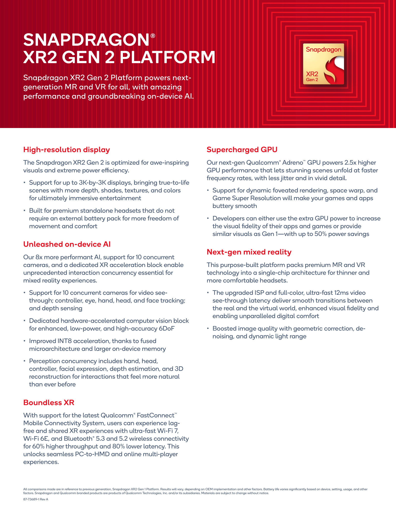
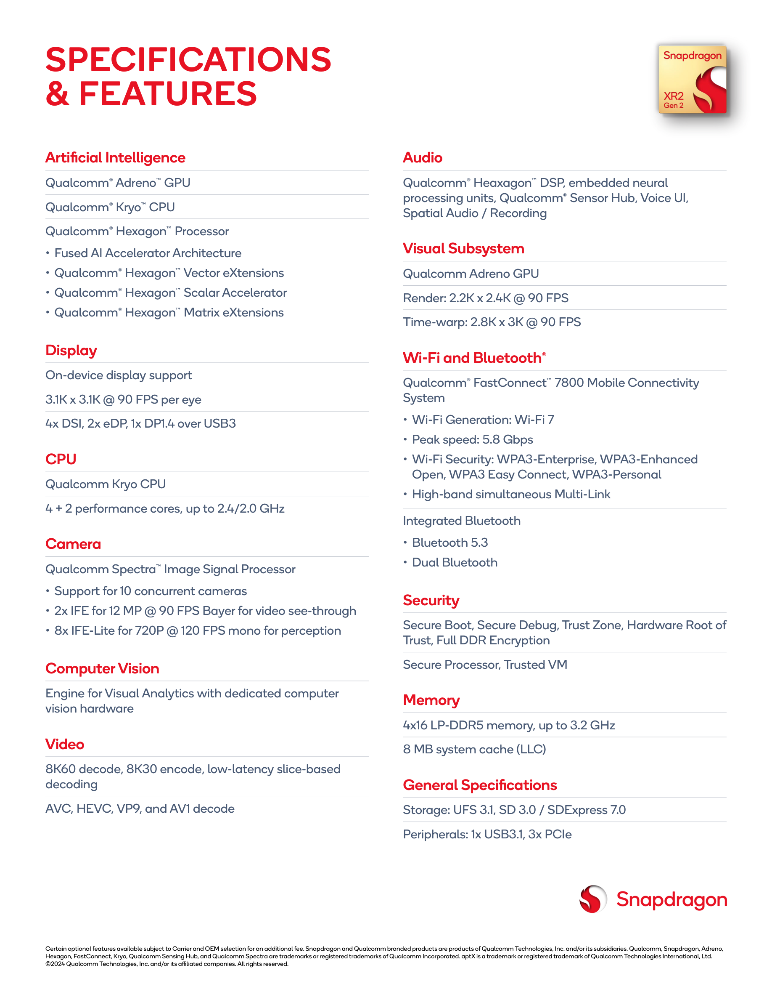
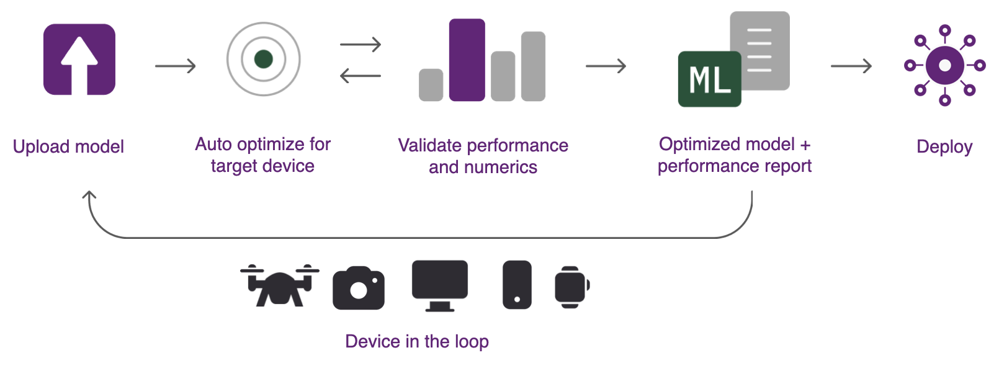

# XR2 Gen 2：端侧 AI 与量化部署

先不谈指标，先想一个动作：你戴上 Meta Quest 3，打开彩色透视，低头看桌面，抬手点一个悬浮按钮。这个动作不到一秒，但头显要同时接收多路相机画面、估计头和手的位置、把真实世界和虚拟画面叠在一起、给左右眼渲染高分辨率画面、维持无线连接，还可能并发运行语音识别、场景理解或应用侧视觉模型。

{ width="820" }

<small>图源：用户提供图片。原图表达：Meta Quest 3 使用 Snapdragon XR2 Gen 2，图中可见头显前侧传感器窗口和 Touch Plus 控制器。本站读法：把它当成一体式 MR / VR 头显的系统边界，后文所有 AI 推理都要和相机、显示、追踪、无线和散热共享预算。</small>

这就是 XR2 Gen 2 的真实工作现场：**它不是一次性跑分机器，而是持续运行的感知-渲染-交互闭环。**所以讨论 Qualcomm XR 平台时，只问“AI TOPS 有多少”并不够；更关键的是模型如何进入软件栈，并在真实头显里稳定、低延迟、低功耗地跑。

**读完应建立的 4 个判断。**
- **先看场景**：XR2 Gen 2 是面向 standalone MR / VR 头显的空间计算平台，AI 推理必须和显示、相机、追踪、无线、内存、散热一起算账。
- **先锁口径**：QCS8450 / XR2 Gen 2 Proxy 是 AI Hub 里的替代目标，适合早筛模型兼容性和 runtime，不等于最终产品 KPI。
- **先看代际**：QCS8450 Proxy 在 AI Hub Models 元数据里是 HTP v69，接近 SM8450 / Snapdragon 8 Gen 1 的后端口径，不能直接套用 v73+ 的量化经验。
- **先分 runtime**：量化通常能压缩模型大小，但不保证更快；同一 `w8a8` 模型在 TFLite、QNN DLC、ONNX Runtime QNN EP 上可能走完全不同的执行路径。

因此这篇文章沿三条线往下拆：XR2 Gen 2 / QCS8450 到底是什么；一个模型从 PyTorch / ONNX 怎么走到头显上；为什么量化部署不能只看 `INT8` 这个标签。

## 从一个动作看整机闭环

把 Quest 3 这类一体式 MR 头显拆开看，XR2 Gen 2 要同时支撑两条主线：一条是用户能不能看得稳、跟得上；另一条是模型能不能在不拖慢系统的前提下持续工作。前者对应显示、GPU、相机、ISP、tracking 和无线；后者对应 Hexagon / HTP / NPU、QNN、LiteRT、ONNX Runtime、AIMET 和 AI Hub。

这个顺序很重要。对服务器推理来说，我们常常先看模型吞吐和单次延迟；对头显来说，模型只是系统里的一个“租客”。它要和渲染、video see-through、sensor fusion、音频、网络和系统服务共享同一套功耗、内存带宽和热预算。一次 profile 数字好看，不代表戴上头显连续运行 20 分钟仍然稳。

如果只记一条链，可以这样理解 Qualcomm 这套部署路径：

```text
PyTorch / ONNX 模型
  -> AI Hub Workbench compile / quantize / profile / inference
  -> 生成 LiteRT、ONNX Runtime 或 QNN 部署资产
  -> 跑到 XR2 Gen 2 / QCS8450 目标设备的 NPU、GPU、CPU 上
  -> 服务渲染、感知、语音、手眼追踪、深度和应用 AI
```

这条链路里有两个关节点。第一个是 **Workbench**：它把训练好的模型变成某个目标设备能跑的部署资产，并返回延迟、内存、layer placement 和数值结果。第二个是 **真实设备验证**：XR 头显不是离线 benchmark 机器，模型推理会和显示、摄像头、SLAM、无线、音频和应用渲染争同一个功耗与散热空间。

**工程判断：**AI Hub 能提前筛模型和 runtime，QIDK / QNN 能帮助工程集成；但最终是否成立，仍然要看真实头显里的连续运行、热稳定、帧时间和交互延迟。

## 名词对齐：谁是芯片，谁是工具

翻 Qualcomm 文档时，最容易被一串相似名字绕进去：产品页讲 Snapdragon XR2 Gen 2，模型库里出现 QCS8450 / XR2 Gen 2 Proxy，SDK 文档又在讲 QNN、LiteRT、ONNX Runtime、AIMET、QAIRT。它们不是同一个东西的不同叫法，而是同一条部署链路上的不同角色。

| 名称 | 在哪里常见 | 在部署链路里的角色 | 读法 |
| --- | --- | --- | --- |
| Snapdragon XR2 Gen 2 Platform | Qualcomm 产品页、发布稿、Product Brief | 面向 standalone MR / VR headset 的 XR SoC 平台 | 对外产品名，说明它服务的是头显整机方案 |
| QCS8450 XR Platform | AI Hub Models、SDK / scorecard 口径 | XR chipset / target 名称 | 更偏开发、模型适配和兼容性测试 |
| QCS8450 (Proxy) / XR2 Gen 2 (Proxy) | AI Hub Workbench、AI Hub Models profile | 云端替代目标设备 | 用于早筛兼容性、生成资产和比较 runtime |
| AI Hub Workbench | Qualcomm AI Hub | 云端编译、量化、profile、inference 服务 | 把训练图加工成目标设备可执行资产 |
| AIMET / AIMET-ONNX | 量化文档、模型导出脚本 | 模型效率与量化工具 | 做 PTQ、校准、QDQ / encodings 等资产 |
| QNN / Qualcomm AI Engine Direct | QNN SDK、QAIRT、runtime 集成 | Qualcomm NPU / HTP 的核心图执行接口 | 更贴近底层加速器，调优空间大 |
| LiteRT / TensorFlow Lite | Android / mobile app 集成 | 便携式推理 runtime | 集成快，但复杂模型的 NPU 映射要单独确认 |
| ONNX Runtime + QNN EP | Android / Linux / Windows 跨平台项目 | 通过 ONNX Runtime 调用 Qualcomm QNN 后端 | 适合统一接口，但要关注 EP 配置和部署包结构 |
| QIDK | Qualcomm 示例和本地开发仓库 | SNPE / QNN / AIMET / Android demo 与模型启用示例 | 帮助把 AI Hub 资产接到本地工程里 |

最容易误读的是 Proxy。[AI Hub Devices 文档](https://workbench.aihub.qualcomm.com/docs/hub/devices.html)把 `(Proxy)` 定义为：当 Workbench 没有托管真实设备时，用替代设备服务于目标设备。它可以帮助判断模型兼容性和生成资产，但官方也提醒，真实设备的性能和准确率会因为操作系统、固件、频率、内存、散热封装等因素而变化。

AI Hub [Release Notes](https://workbench.aihub.qualcomm.com/docs/hub/release_notes.html) 在 2024 年 4 月 22 日写到：Added QCS8450 Proxy devices。AI Hub Models README 把 QCS8450 放在 XR chipsets 里；VIT 页面和 [`perf.yaml`](https://github.com/qualcomm/ai-hub-models/blob/main/src/qai_hub_models/models/vit/perf.yaml) 则能看到 `XR2 Gen 2 (Proxy)` / `QCS8450 (Proxy)` 这类 profile 口径。

**工程判断：**Proxy 数字适合做早期选型，不适合作为最终产品 KPI；它能回答“能不能走 Qualcomm NPU 路径”和“哪些 runtime 值得试”，不能替代整机连续运行、热稳定和相机/渲染并发验证。

## HTP v69：为什么产品名不够用

名字对齐之后，还要问一个更底层的问题：这颗芯片在 Qualcomm 的 AI 加速代际里处于什么位置？端侧 AI 的很多限制，不写在产品名里，而写在 SoC 后端、HTP 版本、runtime 和模型图共同形成的约束里。

可以把 HTP 粗略理解成 Qualcomm SoC 里面向张量计算的 AI 加速后端版本。不同 HTP 版本会影响量化格式、算子融合、kernel 覆盖、编译选项和 fallback 行为。一个量化方案在 v73 / v75 上表现很好，不代表可以直接搬到 v69；反过来，v69 上能跑通，也不代表它是更新芯片上的最佳路径。

AI Hub 里的 QCS8450 不是“名字里带 8450，所以一定等价于某个更新一代的 8 Gen 2 / 8 Gen 3 平台”。在 `qualcomm/ai-hub-models` 的 [`devices_and_chipsets.yaml`](https://github.com/qualcomm/ai-hub-models/blob/main/src/qai_hub_models/devices_and_chipsets.yaml) 里，`qualcomm-qcs8450-proxy` 被标成 XR world，`htp_version: 69`，`soc_model: 36`；同一个文件里，`qualcomm-snapdragon-8gen1` / `sm8450` 也是 `htp_version: 69`、`soc_model: 36`。

| Chipset / proxy target | Typical alias / product line | World | HTP version in AI Hub Models | SoC model | How to read it |
| --- | --- | --- | ---: | ---: | --- |
| Snapdragon 888 | SM8350 | Mobile | 68 | 30 | 前一代高端移动平台，可作为 v69 之前的参照 |
| Snapdragon 8 Gen 1 | SM8450 | Mobile | 69 | 36 | 和 QCS8450 Proxy 在 AI Hub 元数据里处在同一 HTP / SoC model 口径 |
| QCS8450 (Proxy) | XR2 Gen 2 / QCS8450 target | XR | 69 | 36 | 本文重点，适合做 XR 模型早筛，但不是 v73+ 后端 |
| QCS8550 (Proxy) | QCS8550 target | IoT | 73 | 43 | 进入 HTP v73 口径，较新的 QNN / 量化路径更值得优先验证 |
| Snapdragon 8 Gen 2 | SM8550 | Mobile | 73 | 43 | 和 QCS8550 Proxy 在 HTP / SoC model 口径上对齐 |
| Snapdragon 8 Gen 3 | SM8650 | Mobile | 75 | 57 | 后续移动旗舰平台，NPU / HTP 能力继续演进 |
| Snapdragon 8 Elite | SM8750 | Mobile | 79 | 69 | 更晚一代旗舰平台，不能拿它的 profile 倒推 QCS8450 |
| Snapdragon 8 Elite Gen 5 | SM8850 | Mobile | 81 | 87 | 更新一代移动旗舰口径，和 QCS8450 已不是同一代后端 |

<small>表源：`qualcomm/ai-hub-models` 的 [`devices_and_chipsets.yaml`](https://github.com/qualcomm/ai-hub-models/blob/main/src/qai_hub_models/devices_and_chipsets.yaml)。这里的 `htp_version` 和 `soc_model` 是 AI Hub 模型库用于 scorecard / device target 的工程元数据，不等同于 Qualcomm 对外产品命名。</small>

这个定位会直接影响后面的量化判断。比如 ViT 配置里列出 `w8a16`，但这不等于 QCS8450 / SM8450 这一代后端就应该优先走 `w8a16`。在 XR2 Gen 2 上做实验，更稳的顺序是先把 `float` 和 `w8a8` 跑扎实，再把 `w8a16` 或更新 precision 路径留给 QCS8550、8 Gen 2 或更新平台复验。

**工程判断：**本文讨论 QCS8450 / SM8450 这一代 v69 后端上的工程取舍；不要把更新 HTP 版本上的量化、融合或 QNN 编译经验直接倒推到 XR2 Gen 2。

## 硬件资源账本：头显 SoC 同时在忙什么

Snapdragon XR2 Gen 2 是 Qualcomm 在 2023 年发布、2024 年 [Product Brief](https://docs.qualcomm.com/doc/87-73689-1/) 中继续整理规格的 XR 平台。它不是手机 Snapdragon 8 系列的简单改名，而是围绕 MR/VR 头显做的专用平台：显示、渲染、视频透视、相机并发、头手眼追踪、深度感知、空间音频、低功耗 CV 和端侧 AI 都被放进同一个平台叙事里。

Qualcomm 的[官方发布稿](https://www.qualcomm.com/news/releases/2023/09/qualcomm-launches-its-next-generation-xr-and-ar-platforms--enabl)把它定位为 next-generation MR / VR devices 的 spatial computing platform，并说明首批商业化设备来自 Meta：Meta Quest 3 使用 Snapdragon XR2 Gen 2，Ray-Ban Meta smart glasses 使用 Snapdragon AR1。后续 Quest 3S 也使用 XR2 Gen 2。这个定位说明 Qualcomm 卖的不是裸芯片爱好者板卡，而是给头显 OEM 和平台厂商做整机方案的核心计算平台。

{ width="720" .atlas-figure-page }

<small>图源：`Snapdragon XR2 Gen 2 Platform Product Brief (87-73689-1 Rev A)`，page 1。原图表达：平台定位包括 next-generation MR and VR、on-device AI、3K-by-3K display、2.5x GPU、8x AI、10 concurrent cameras、12ms video see-through latency、Wi-Fi 7 / Wi-Fi 6E 等。本站读法：先看多链路并发，不要只看 AI 倍数；XR SoC 的瓶颈常在相机、显示、内存和热预算之间互相挤压。</small>

**这张图真正想表达什么。**
这页 Product Brief 不是在说“XR2 Gen 2 只有 AI 很强”，而是在讲一颗头显 SoC 必须同时处理几条链路。`3K-by-3K display` 和 `2.5x GPU` 指向双眼高分辨率渲染；`10 concurrent cameras` 和 `12ms video see-through latency` 指向 MR 透视、追踪和空间定位；`Wi-Fi 7 / Wi-Fi 6E` 服务 PC 串流、多人同步和高带宽内容。`8x AI` 可以当作方向性信号带过，真正做模型时仍要回到 runtime、layer placement、内存和持续功耗。

下面这张完整规格页最值得看的是显示和相机：10 路并发相机、2x IFE 视频透视、8x IFE-Lite 感知、每眼 3.1K x 3.1K @ 90 FPS、time-warp 2.8K x 3K @ 90 FPS。它说明 XR2 Gen 2 是多传感器低延迟闭环平台，不是单纯“AI 加速器”。

{ width="720" .atlas-figure-page }

<small>图源：`Snapdragon XR2 Gen 2 Platform Product Brief (87-73689-1 Rev A)`，page 2。原图表达：完整规格覆盖显示、相机、ISP、GPU、连接、AI 和内存等模块。本站读法：正文只提炼模型部署最相关的部分，尤其是并发相机、低延迟透视和每眼显示分辨率如何挤占端侧 AI 预算。</small>

| Hardware block | Role in an XR product | Practical question |
| --- | --- | --- |
| Adreno GPU | stereo rendering、time-warp、空间重投影和图形后处理 | 应用画质提高时，是否还能保住 90 FPS 和稳定帧时间 |
| Hexagon / NPU / DSP | 分类、检测、语音、tracking 辅助、轻量感知模型 | 模型是否能被 QNN / LiteRT / ONNX Runtime 放到 NPU 上 |
| Spectra ISP + IFE | video see-through、perception camera 输入和图像质量处理 | 多路相机同时开时，延迟、带宽和功耗是否可控 |
| Sensor Hub / CV hardware | 低功耗姿态、手眼头追踪和视觉分析 | 哪些任务可以脱离大 CPU/GPU 持续运行 |
| FastConnect 7800 | PC-to-HMD、多人同步、Wi-Fi 7 / Wi-Fi 6E 连接 | 无线链路是否影响云串流、多人互动和边缘协同 |
| LP-DDR5 / LLC | 多路视频、AI tensor、渲染资源和系统服务共享内存 | 峰值内存和带宽是否成为模型部署瓶颈 |

**术语框：Hexagon / HTP / NPU。**
Qualcomm 文档里经常同时出现 `Hexagon`、`HTP` 和 `NPU`。可以粗略理解为：`Hexagon` 是 Qualcomm SoC 内承载 DSP / AI 计算的一组处理器与加速单元名称，`HTP` 更偏 Hexagon Tensor Processor 这类张量加速后端，`NPU` 则常作为 AI Hub profile 里“神经网络加速路径”的计算单元口径。工程上不要把 `NPU` 想成一块独立显卡，而应看模型的哪些 layer 最终被 runtime 放到了 Qualcomm 的 AI 加速后端上。

公开资料里没有 Qualcomm 给出的裸 SoC 价格，也没有芯片级 TDP。Meta [Quest 3 launch article](https://about.fb.com/news/2023/09/meet-meta-quest-3-mixed-reality-headset/) 中，Quest 3 发布时 128GB 版本 starting at `$499.99`，512GB 版本为 `$649.99`；这个价格只能说明 XR2 Gen 2 覆盖的是几百美元级消费头显，不代表裸片价格。Product Brief 未公开芯片 TDP，也不应写成“XR2 Gen 2 = x W”。

**工程判断：**真正做模型时，先问输入来自哪条传感器或应用管线，输出喂给哪个闭环任务，推理和 GPU、ISP、CPU、内存带宽、热预算怎么共享；AI Hub 上的延迟数字只有放回这个账本里才有工程意义。

## 软件部署链：从 Workbench 到真实头显

理解 Qualcomm 这套软件栈，可以先把它分成三层：模型从训练框架出来，交给云端工具链加工，再由设备端 runtime 执行。

{ width="920" }

<small>图源：Qualcomm AI Hub Workbench `How-It-Works.png`。原图表达：upload -> optimize -> validate -> deploy 的 device-in-the-loop 流程。本站读法：这张图说明端侧 AI 不是“导出一个 ONNX 就结束”，模型要经过编译、量化、设备侧 profile 和部署资产生成。</small>

| Layer | Qualcomm software | Main function |
| --- | --- | --- |
| Model source | PyTorch, ONNX, TensorFlow via ONNX, AIMET quantized models | 输入训练好的模型，通常需要固定 shape 和清晰的 input / output spec |
| Cloud workflow | Qualcomm AI Hub Workbench | 编译、量化、profile、on-device inference、生成性能报告和部署资产 |
| Model catalog | Qualcomm AI Hub Models | 开源模型适配、导出脚本、性能/数值 scorecard、示例 demo |
| Quantization | AIMET / AIMET-ONNX / AI Hub Quantize Job | PTQ、校准、生成 QDQ / encodings 等量化资产 |
| Runtime | Qualcomm AI Engine Direct / QNN | Qualcomm NPU/HTP 的核心运行时，可生成 QNN DLC、context binary、precompiled QNN ONNX |
| Portable runtime | LiteRT / TensorFlow Lite | Android / Linux 上常用，适合移动端 App 集成 |
| Portable runtime | ONNX Runtime + QNN Execution Provider | Android / Linux / Windows 上通过 ONNX Runtime 调用 QNN EP |
| Local examples | QIDK | SNPE / QNN / AIMET / Android 示例、模型转换、量化、部署和端上 demo |

Workbench 对应研发流程里的四类任务：

| Job / step | Input | Output | Why it matters |
| --- | --- | --- | --- |
| Compile job | PyTorch / ONNX / AIMET quantized model | LiteRT、ONNX、QNN DLC、context binary 等部署资产 | 把训练框架里的图转换成设备 runtime 能执行的图 |
| Quantize job | optimized ONNX + calibration data | quantized ONNX / QDQ-style asset | 用代表性数据确定 scale / zero point，降低模型大小和提升 NPU 友好度 |
| Profile job | compiled model + target device | latency、load time、compute unit utilization、memory 等 | 判断模型是否满足帧预算和是否落到 NPU |
| Inference job | compiled model + sample inputs | on-device outputs | 和本地 PyTorch / ONNX 输出对齐，检查数值差异 |
| Download artifacts | finished jobs | model files + metadata | 进入 App / SDK 集成阶段 |

把它落到项目里，一个务实流程可以压成五步：

1. **Model cleanup**：明确 input / output、shape、layout、预处理、后处理和时间窗口，让本地 PyTorch / ONNX 输出可复现。
2. **Cloud compile/profile**：选择 `QCS8450 (Proxy)` / `XR2 Gen 2 (Proxy)`，跑 compile 和 profile，先看 NPU placement、latency、峰值内存和失败算子。
3. **Quantization**：准备代表性 calibration data，跑 PTQ / QDQ，再重新 compile / profile，同时检查 numerics 与性能。
4. **Local integration**：接入 Android / native library / camera buffer / runtime init / thread scheduling，让真机能在 App pipeline 里持续推理。
5. **System validation**：覆盖冷启动、连续运行、相机+渲染并发、无线高负载、升温降频、不同光照和用户动作。

QIDK 更像本地开发和样例仓库，而不是 AI Hub 的替代品。它覆盖 SNPE、QNN、AIMET、AIMET Model Zoo、Android sample apps 和 Model Enablement 等内容。对于 XR 项目来说，两者最好配合使用：AI Hub 做快速 scorecard，QIDK / QAIRT / QNN 做本地集成和端上验证。

个人开发者一般不是直接买 XR2 Gen 2 裸片，而是通过具体头显、开发套件、AI Hub Workbench、AI Hub Models、QIDK 和 Qualcomm AI Runtime 进入生态；主要直接客户则是 XR 头显 OEM / ODM、平台型客户，以及培训、工业巡检、医疗教育、远程协作等垂直行业设备商。

**工程判断：**Compile job 成功不等于 App pipeline 已对齐，Quantize job 不等于精度合格，Profile job 不等于整机稳定；模型、App、系统三类角色要分别负责导出校准、runtime 接入和热/功耗/profile 验证。

## Runtime 选择：先分执行路径

进入量化案例之前，先把 runtime 分清楚。同一个模型、同一个精度，不同 runtime 上可能走不同 backend、kernel 和资产格式，性能结论必须分开看。

| Runtime asset | Best fit | Tradeoff |
| --- | --- | --- |
| LiteRT / TFLite | Android App 快速集成，移动端团队熟悉 | 可移植性好，但复杂模型的 NPU 映射和调优空间有限 |
| ONNX Runtime + QNN Execution Provider | Windows / Linux / Android 统一接口，便于跨平台 | 需要关注 QNN EP、预编译模型和部署包结构 |
| QNN DLC | 更贴近 Qualcomm AI Engine Direct，适合 NPU 优化 | 集成门槛更高，需要理解 QNN 工具链 |
| QNN context binary / precompiled QNN ONNX | 面向特定 SoC 的 AOT 编译部署 | 设备特异性强，尤其要按前文 Proxy 口径看待 profile |

XR 场景通常更在意稳定延迟和热稳定，而不是一次性 benchmark 的最低值。因为头显里同时有渲染、sensor fusion、video see-through 和后台系统服务，模型推理不能抢走过多内存带宽或导致持续降频。

更稳的判断是：demo 阶段优先选最容易集成的路径，产品阶段优先选可观测、可复现、可控的路径。早期可以用 AI Hub 和熟悉的 runtime 快速跑通；中期比较 LiteRT、ONNX Runtime QNN EP 和 QNN DLC 的延迟、内存、集成成本；后期再根据真实头显 profile 选择最稳定的路径。这里的“稳定”不只是平均延迟低，还包括版本可控、日志可读、失败可复现、资产更新流程清楚。

**工程判断：**没有一个 runtime 永远正确，只有和项目阶段匹配的 runtime；选型时要把集成速度、NPU placement、峰值内存、版本治理和整机 profile 放在同一个决策里。

## ViT 量化案例：INT8 不等于更快

量化最容易被误解成一句话：“把 float32 换成 int8，所以模型会更小、更快。”前半句通常成立，后半句要看模型结构、后端 kernel、runtime 和图优化。

先把词说清楚。模型默认常用 float32 表示权重和激活，精度高，但模型文件大、访存和计算成本也高。量化就是把这些数压到更低比特的整数表示里。`w8a8` 表示 weights 和 activations 都用 8-bit；`w8a16` 表示 weights 用 8-bit，activations 保留 16-bit，在大小和数值稳定性之间取折中。对头显来说，模型变小本身就有价值，因为部署包、加载时间、峰值内存和带宽压力都会下降。

这里用 AI Hub Models 里的 VIT 做观察窗口。它不是 MobileNet 这类天然移动友好的 CNN，而是 86.6M 参数的 Vision Transformer，包含 patch embedding、attention、LayerNorm、Softmax、MLP 和大量 MatMul。它不等同于 LLM，但能暴露端侧 Transformer workload 的共同问题：模型包大小、矩阵乘法效率、激活范围、NPU placement、前后处理一致性和 runtime 差异。

VIT 页面和开源仓库给出的技术信息主要来自 Qualcomm AI Hub 的 [VIT model page](https://aihub.qualcomm.com/models/vit) 和模型仓库中的 [`code-gen.yaml`](https://github.com/qualcomm/ai-hub-models/blob/main/src/qai_hub_models/models/vit/code-gen.yaml)：checkpoint 是 ImageNet，输入分辨率 224x224，参数量 86.6M，float 模型大小 330 MB，`w8a16` 为 86.2 MB，`w8a8` 为 83.2 MB，Top-1 Accuracy 标为 81.1%，supported form factors 包含 Phone、Tablet、IoT、XR，配置中列出 `float`、`w8a8_mixed_int16`、`w8a16`、`w8a8`。

AI Hub Workbench 的 [Quantization 文档](https://workbench.aihub.qualcomm.com/docs/hub/quantize_examples.html) 给出的 PTQ 路径可以简化为：先 trace / export，再 compile 到 optimized ONNX，收集代表性 calibration data，提交 quantize job，拿到 QDQ / fake quantization 风格的 quantized ONNX，最后重新 compile 到 TFLite、QNN 或 ONNX 并 profile。文档中的量化支持口径是：TFLite 支持 int8 weights / int8 activations；QNN 和 ONNX 支持 int8 weights / int8 或 int16 activations；mixed precision 当前表格中标为 Not supported，long-term 目标才包括更多 mixed precision 和 int4 / int8 / int16 组合。

**术语框：AIMET、PTQ 和 QDQ。**
`AIMET` 是 Qualcomm 的模型效率工具，常用于量化、压缩和量化精度分析。`PTQ` 是 post-training quantization。`QDQ` 是 ONNX 常见量化表达，用 `QuantizeLinear / DequantizeLinear` 标出量化边界；AI Hub quantize job 输出的 quantized ONNX 属于这种 fake quantization / QDQ 风格资产。

顺序上有一个容易忽略的细节：**要先把图变成接近部署形态的 ONNX，再做校准和量化。**部署图会经历算子融合、常量折叠、shape 固化、layout 调整和 runtime 适配；如果直接在原始训练图上插 Q/DQ，后续编译可能改变图结构，让校准假设和真实执行路径错位。校准数据也要贴近线上输入，随机样本最多用于快速估计 latency，不适合判断 accuracy。

**QCS8450 上的 w8a16 口径。**
要区分“模型库声明支持某种 precision”和“某个目标 SoC / runtime path 真正适合用它”。ViT 配置里列出 `w8a16`，但 QCS8450 Proxy / SM8450 在 AI Hub Models 设备元数据里是 HTP v69；本文按实验口径处理为：QCS8450 上优先比较 `float` 和 `w8a8`，不要把 v73+ 路径直接套回 XR2 Gen 2。

开源仓库中的 VIT [`perf.yaml`](https://github.com/qualcomm/ai-hub-models/blob/main/src/qai_hub_models/models/vit/perf.yaml) 给出 QCS8450 Proxy 上的部分 profile 数字：

| Precision | Runtime | Device | Job status | Inference time milliseconds | Estimated peak memory range MB | Primary compute unit | Layer counts |
| --- | --- | --- | --- | ---: | --- | --- | --- |
| float | tflite | QCS8450 (Proxy) | Passed | 12.966 | 0-290 | NPU | total 1399, npu 1399 |
| float | qnn_dlc | QCS8450 (Proxy) | Passed | 13.207 | 0-229 | NPU | total 888, npu 888 |
| w8a8 | tflite | QCS8450 (Proxy) | Passed | 20.594 | 0-447 | NPU | total 1451, npu 1451 |
| w8a8 | qnn_dlc | QCS8450 (Proxy) | Passed | 13.179 | 0-310 | NPU | total 889, npu 889 |

<small>数据源：`qualcomm/ai-hub-models` 中 VIT 的 [`perf.yaml`](https://github.com/qualcomm/ai-hub-models/blob/main/src/qai_hub_models/models/vit/perf.yaml)。当前仓库文件的 QCS8450 Proxy 片段来自 profile job 记录，适合做方向判断；但它仍然是 proxy 数字，而且同一文件里不同设备、runtime、tool version 的内存区间有明显波动，所以本文把它当成“需要复现实验的参考值”，不是产品验收值。</small>

这组数字说明三件事：

1. **量化不等于更快**：`w8a8 tflite` 的 20.594 ms 慢于 `float tflite` 的 12.966 ms。
2. **runtime 差异不能忽略**：同样是 `w8a8`，TFLite 明显变慢，QNN DLC 却和 float 延迟接近。
3. **模型尺寸收益更稳定**：`w8a8` 把模型从 330 MB 压到 83.2 MB，部署包和权重带宽压力明显改善。

`w8a8` 变慢通常先查四类原因：

1. **Q/DQ 开销**：Q/DQ 节点、requantization、scale / zero point 是否落在关键路径上。
2. **小算子利用率**：ViT 里的小 MatMul、reshape、transpose、Softmax、LayerNorm 是否让 INT8 kernel 利用率下降。
3. **融合被切断**：Q/DQ 是否打断原本可融合的 pattern，让一步能做完的事变成多步。
4. **激活函数不友好**：GELU 导出到 ONNX 后常展开成 `Erf / Tanh / Add / Mul / Div` 子图，不如 `Gemm -> ReLU` 这类模式容易被后端融合。

激活函数也值得查。ViT MLP 常见 `Linear -> GELU -> Linear`，ONNX 里 `GELU` 可能展开成 `Erf / Tanh / Add / Mul / Div` 子图。若业务精度允许，可在训练或微调阶段尝试 ReLU / ReLU-like 激活，再导出 ONNX 对比 profile。AI Hub Models 的 AIMET 默认配置中，[v69](https://github.com/qualcomm/ai-hub-models/blob/main/src/qai_hub_models/utils/aimet/default_per_tensor_config_v69.json) / [v73](https://github.com/qualcomm/ai-hub-models/blob/main/src/qai_hub_models/utils/aimet/default_per_tensor_config_v73.json) per-tensor config 都把 `["Gemm", "Relu"]` 放在 `supergroups` 中，但没有等价的 `Gemm + Gelu` supergroup。这个配置不是完整 QNN 编译规则，却足以提醒我们：`Gemm -> Relu` 更接近后端常见融合模式。

**用 Netron 看什么。**
打开导出的 ONNX，先看是否有 `MatMul/Gemm -> Erf/Tanh/Mul/Add` 这类 GELU 展开链路，再看 Q/DQ 是否切在 MatMul、LayerNorm、Softmax 前后。真正上线前要用 accuracy 对照确认替换激活不会伤害下游任务，再用 layer timing 确认加速来自激活和融合。

**工程判断：**量化不是孤立算法步骤，而是部署链路中的系统折中；对 XR 来说，精度、延迟、内存、热稳定和用户体验是一组联动指标。

## 项目检查清单

把 XR2 Gen 2 / QCS8450 用到项目里，建议按下面顺序推进：

1. **先明确 workload**：分类、检测、分割、手势、语音、SLAM 辅助、生成式模型，对 runtime 和功耗的要求完全不同。
2. **先用 AI Hub Models 找相似模型**：如果 VIT、MobileNet、YOLO、SAM、Whisper、LLM 等已有模型能跑，就先参考它的 `export.py`、`perf.yaml` 和 `numerics.yaml`。
3. **再用 Workbench 做 proxy profile**：看目标设备是否支持、哪些层落在 NPU、延迟和峰值内存是否可接受。
4. **量化前先看 HTP 版本**：QCS8450 / SM8450 是 HTP v69；QCS8450 上先把 `w8a8` 跑扎实，再把 `w8a16` 留给 QCS8550、8 Gen 2 或更新平台验证。
5. **用图可视化找融合机会**：Netron 里重点看 `GELU` 是否被展开、`MatMul/Gemm + ReLU` 是否能形成更干净的 pattern，再用 QNN / runtime profile 确认收益。
6. **最后做整机闭环**：在目标头显上跑摄像头、渲染、网络、热稳定和用户交互，把早期 profile 变成产品级判断。

上线检查时至少覆盖输入管线、校准数据、float vs quantized numerics、NPU placement、CPU fallback、GELU / QDQ / LayerNorm / Softmax 等 operator pattern、HTP version gate、峰值内存、连续运行后的 latency 和帧时间。不要只报告模型文件大小或单次平均 latency。

回到开头那个“伸手点按钮”的场景：端侧 AI 的部署，不是把模型丢进工具链就完事了。模型结构、量化格式、校准数据、runtime 选择、Proxy 与真机差异、整机并发负载，都会一起决定最终体验。理解这些，才能让 AI 模型在真实头显上稳定、快速、低功耗地跑起来。

**工程判断：**XR2 Gen 2 是 XR 产品平台，不是单纯 AI 加速芯片；QCS8450 / XR2 Gen 2 Proxy 是很有用的开发入口，但真正的难点是把模型放进 XR 整机的持续并发预算里。

## 外部精读

1. [Qualcomm AI Hub Workbench Documentation](https://workbench.aihub.qualcomm.com/docs/)
2. [Qualcomm AI Hub](https://aihub.qualcomm.com/)
3. [AI Hub Devices Documentation](https://workbench.aihub.qualcomm.com/docs/hub/devices.html)
4. [AI Hub Release Notes](https://workbench.aihub.qualcomm.com/docs/hub/release_notes.html)
5. [Snapdragon XR2 Gen 2 Platform Product Brief](https://docs.qualcomm.com/doc/87-73689-1/)
6. [VIT - Qualcomm AI Hub](https://aihub.qualcomm.com/models/vit)
7. [Qualcomm AI Hub Models GitHub](https://github.com/qualcomm/ai-hub-models)
8. [AI Hub Models `devices_and_chipsets.yaml`](https://github.com/qualcomm/ai-hub-models/blob/main/src/qai_hub_models/devices_and_chipsets.yaml)
9. [AI Hub Models VIT `code-gen.yaml`](https://github.com/qualcomm/ai-hub-models/blob/main/src/qai_hub_models/models/vit/code-gen.yaml)
10. [AI Hub Models VIT `perf.yaml`](https://github.com/qualcomm/ai-hub-models/blob/main/src/qai_hub_models/models/vit/perf.yaml)
11. [AI Hub Models AIMET v69 config](https://github.com/qualcomm/ai-hub-models/blob/main/src/qai_hub_models/utils/aimet/default_per_tensor_config_v69.json)
12. [AI Hub Models AIMET v73 config](https://github.com/qualcomm/ai-hub-models/blob/main/src/qai_hub_models/utils/aimet/default_per_tensor_config_v73.json)
13. [QIDK GitHub](https://github.com/quic/qidk)
14. [Netron](https://netron.app/)
15. [Qualcomm launch release: Snapdragon XR2 Gen 2 and AR1 Gen 1](https://www.qualcomm.com/news/releases/2023/09/qualcomm-launches-its-next-generation-xr-and-ar-platforms--enabl)
16. [Meta Quest 3 launch article](https://about.fb.com/news/2023/09/meet-meta-quest-3-mixed-reality-headset/)
