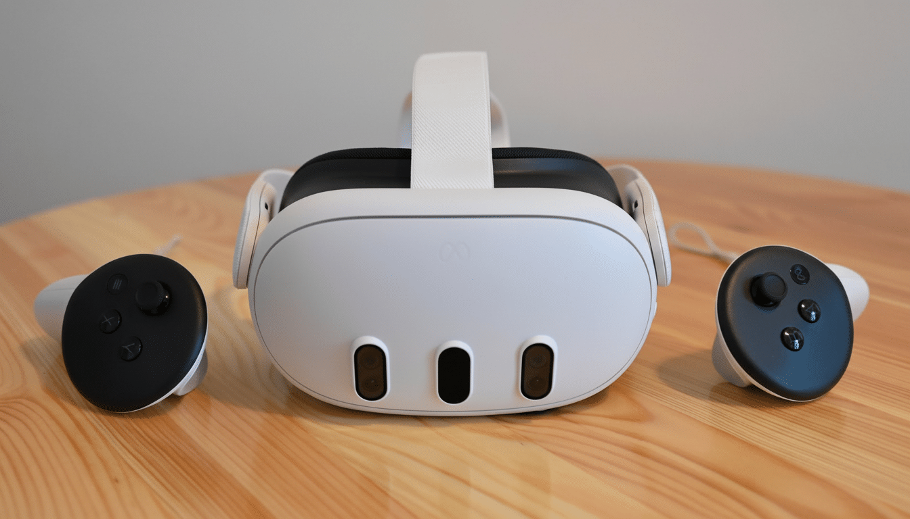
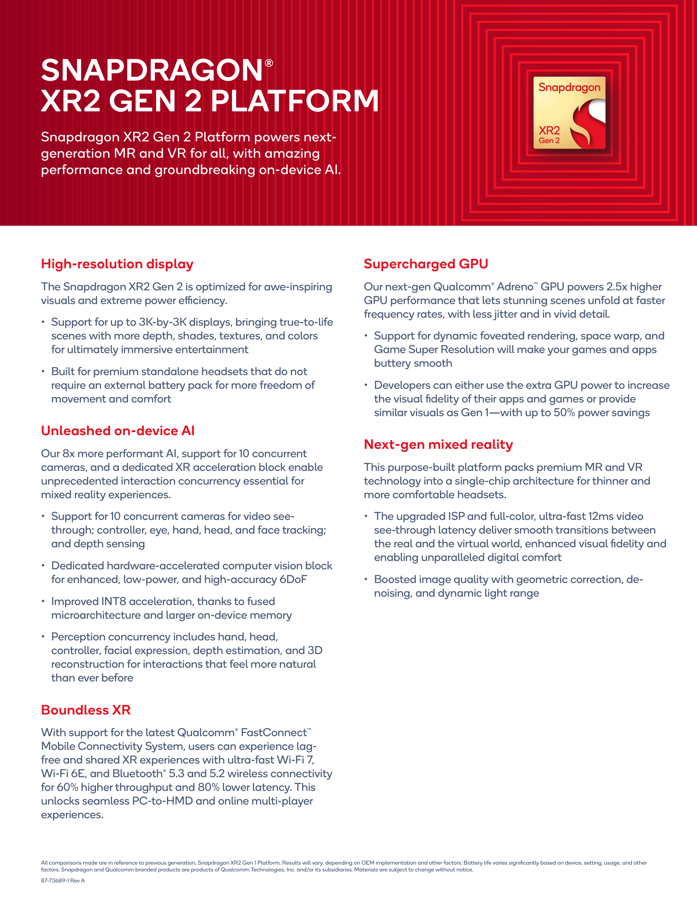
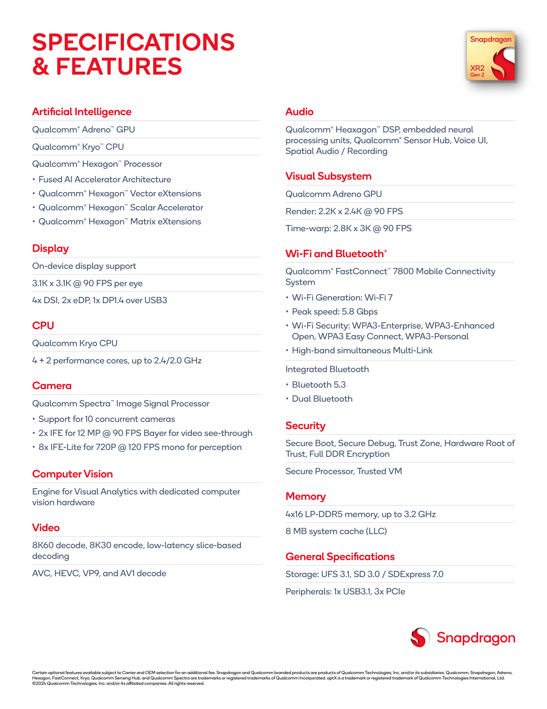
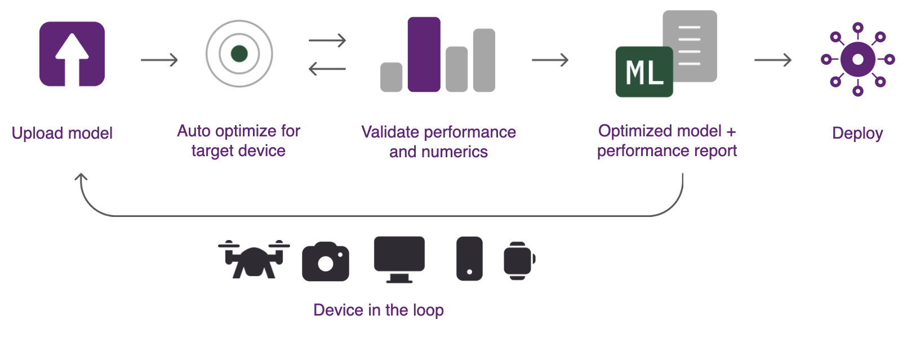
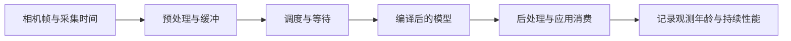

# XR2 Gen 2 上的模型如何部署与测量

头显上的图像模型要与相机、追踪、显示和应用渲染共享资源。单次推理跑得快，只说明一个工作负载在某次测试中的表现；实际交互还取决于输入何时采集、输出何时使用，以及持续运行后的资源竞争。

用一个224×224的ViT分类模型追踪导出、量化、设备编译与性能记录。它不代表完整XR应用，却能把“模型更小为什么未必更快”落到具体数据上。

{ width="820" }

<small>图源：用户提供图片。原图表达：Meta Quest 3 使用 Snapdragon XR2 Gen 2，图中可见头显前侧传感器窗口和 Touch Plus 控制器。读图重点：把它当成一体式 MR / VR 头显的系统边界，后文所有 AI 推理都要和相机、显示、追踪、无线和散热共享预算。</small>

图中的头显提供整机边界。分类模型只是其中一个应用工作负载，不能把模型的吞吐率直接当作显示刷新率或追踪频率。

## 产品名、编译目标与测试设备需要分别记录

Snapdragon XR2 Gen 2是产品平台名称；QCS8450是工具链元数据中相关的芯片标识；QNN、LiteRT与ONNX Runtime是执行路径中的软件对象。三者共同决定可用算子与资产格式，不能只凭产品名选择量化配置。

本页固定核对AI Hub Models的commit `1a23e0a613e2eab71e0ed42343131e83f9779311`。其中设备键为 `qualcomm-qcs8450`，`reference_device` 是 `Snapdragon XR2 Gen 2`，`htp_version` 为69，`soc_model` 为36。旧资料中的 `qualcomm-qcs8450-proxy` 不能不加核对地当成当前文件键。

某些历史记录或服务目标名称带Proxy，表示替代目标；应保留原记录中的名称，不能把替代设备结果改称实机结果。本次固定文件列出的设备名称没有Proxy后缀，但它也没有证明完整Quest应用的持续性能。

- [固定设备配置](https://github.com/qualcomm/ai-hub-models/blob/1a23e0a613e2eab71e0ed42343131e83f9779311/src/qai_hub_models/devices_and_chipsets.yaml)，查芯片属性与reference device
- [固定ViT配置](https://github.com/qualcomm/ai-hub-models/blob/1a23e0a613e2eab71e0ed42343131e83f9779311/src/qai_hub_models/models/vit/manifest.yaml)，查输入、精度与模型元数据

## 平台规格为什么不能替代模型测试

{ width="720" .atlas-figure-page }

<small>图源：`Snapdragon XR2 Gen 2 Platform Product Brief (87-73689-1 Rev A)`，page 1。原图表达：平台定位包括 next-generation MR and VR、on-device AI、3K-by-3K display、2.5x GPU、8x AI、10 concurrent cameras、12ms video see-through latency、Wi-Fi 7 / Wi-Fi 6E 等。读图重点：先看多链路并发，不要只看 AI 倍数；XR SoC 的瓶颈常在相机、显示、内存和热预算之间互相挤压。</small>

产品页将显示、相机、连接和AI放在同一平台中。图上的倍数依赖厂商比较基线，不能据此推算本例ViT会快几倍；视频透视延迟也与任意应用模型的端到端时间不同。

{ width="720" .atlas-figure-page }

<small>图源：`Snapdragon XR2 Gen 2 Platform Product Brief (87-73689-1 Rev A)`，page 2。原图表达：完整规格覆盖显示、相机、ISP、GPU、连接、AI 和内存等模块。读图重点：正文只提炼模型部署最相关的部分，尤其是并发相机、低延迟透视和每眼显示分辨率如何挤占端侧 AI 预算。</small>

第二页可用于确认规格与功能范围。运行应用时还需测实际并发负载，尤其是预处理与渲染争用带宽、设备升温后频率变化。本文不从规格页推导芯片功耗或完整产品帧率。

## 同一个输入怎样走过部署链

先保存一张测试图与完整预处理约定，包括颜色顺序、缩放、裁剪、归一化和NCHW/NHWC轴。参考框架输出作为对照，导出后先检查浮点结果，再引入量化与特定设备编译。否则颜色或布局错误可能被误归因于低比特。

{ width="920" }

<small>图源：Qualcomm AI Hub Workbench `How-It-Works.png`。原图表达：upload -> optimize -> validate -> deploy 的 device-in-the-loop 流程。读图重点：这张图说明端侧 AI 不是“导出一个 ONNX 就结束”，模型要经过编译、量化、设备侧 profile 和部署资产生成。</small>

图中的upload、optimize、validate、deploy是不同步骤。编译成功只说明图被接受；设备推理返回数值才能对照参考输出；profile才提供某种计时范围的性能。把三种状态都记成“模型已跑通”，会掩盖问题。

| 对象 | 保存内容 | 解决的核对问题 |
| --- | --- | --- |
| 原始模型 | checkpoint、配置、预处理 | 测的是哪一个函数 |
| 导出图 | 输入输出名、shape、opset与导出工具版本 | 算子和轴是否一致 |
| 量化资产 | 权重、scale、zero point、校准数据版本 | 误差从哪一步进入 |
| 编译资产 | 目标芯片、runtime、工具版本 | 哪个执行路径可以使用 |
| profile记录 | job、计时、层放置与设备 | 数字能否复查和比较 |

## ViT 的参数量与文件大小

固定manifest声明输入224×224、参数86.6M，float模型约330 MB，w8a8约83.2 MB，w8a16约86.2 MB。这里沿用文件的单位标签，不把它们混同于运行时峰值内存。量化还需scale和其他非8位对象，所以文件大小不必严格按四分之一变化。

该manifest中的81.1% Top-1来自其列出的ImageNet参考来源，不能当作每种设备量化资产都实测达到的准确率。要评价量化质量，应使用同一预处理与独立数据，比较参考输出、逐类误差和任务指标。

## 固定commit中的性能记录实际说了什么

| 精度 | Runtime | 推理时间 ms | NPU层/总层 | Profile job |
| --- | --- | ---: | ---: | --- |
| FLOAT | TFLITE | 14.545 | 523/523 | `j5wy6zymg` |
| FLOAT | QNN_DLC | 14.866 | 384/384 | `jgzzdyqxg` |
| FLOAT | ONNX | 13.405 | 386/386 | `j5m9xkyyg` |
| W8A8 | TFLITE | 17.73 | 575/575 | `jprx3777p` |
| W8A8 | QNN_DLC | 13.377 | 385/385 | `jgzzd0e4g` |
| W8A8 | ONNX | 13.964 | 435/435 | `jgod67z45` |
| W8A16 | ONNX | 7.816 | 459/459 | `jgod69rq5` |
| W8A8_MIXED_INT16 | ONNX | 28.587 | 531/552 | `jp8jyk785` |

以上均为仓库中的作者记录，本站未复测。该批行记录QAIRT `2.50.0.260828221209`，ONNX行另记录ONNX Runtime `1.30.0`。工具版本、job与设备字段共同界定这些数字，不能自动推广到其他安装版本。

[对应perf.yaml](https://github.com/qualcomm/ai-hub-models/blob/1a23e0a613e2eab71e0ed42343131e83f9779311/src/qai_hub_models/models/vit/perf.yaml)可以逐行核对。TFLite从float的14.545 ms变成w8a8的17.73 ms，反而约慢21.9%；QNN DLC从14.866变成13.377 ms，约快10.0%；ONNX还出现w8a16的7.816 ms。因此不能只根据HTP代号就排除一切w8a16路径，也不能从这一条记录推导它对所有模型都更快。

mixed-int16记录的总层552中有21层在CPU、531层在NPU。这个事实提示需要查看回退与数据移动，但仅凭层数还不能确定28.587 ms中有多少由CPU造成。分层计时、传输和同步轨迹才支持进一步归因。

## 量化怎样增加或减少工作

w8a8降低权重和激活表示的位宽，但运行中可能需要范围统计、量化、反量化或重新缩放。QDQ图中的节点可以表达数值边界，并不保证每个Q/DQ都以独立kernel运行；编译器也可能融合它们。应查看编译后的实际层与耗时。

如果一次GEMM节省2 ms，却增加3 ms转换与搬运，完整层会变慢。反过来，把转换融合进前一算子可能减少中间写回。两种情况都需实测，不能只看ONNX图上的算子个数。

更换GELU为ReLU会改变模型函数，需要重新训练或适配并评价。某个量化配置包含Gemm+Relu分组，也不等于它列出了后端全部融合规则，不应据此直接修改模型激活。

## 把profile放回连续交互时间线

假设应用每50 ms使用一次分类结果，采集与预处理8 ms、排队12 ms、模型15 ms、后处理5 ms，则结果使用时至少已过去40 ms。模型降到8 ms会把这段串行时间降到33 ms；如果队列仍积压多帧，更新看到的场景依然可能过旧。

这只是时间关系算例。真实系统中阶段可重叠，应以时间戳测量，覆盖应用并发和持续运行。下一步阅读[观测年龄](embodied-inference-observation-age-1009-2059.md)与[量化部署](../quantization/evaluation-and-deployment-checklist.md)，可以把模型数值、执行路径和用户看到的结果连接起来。

## 资料入口

- [XR2 Gen 2 Product Brief](https://docs.qualcomm.com/doc/87-73689-1/)，规格页用于查产品功能，不作为本地模型测速
- [AI Hub Workbench文档](https://workbench.aihub.qualcomm.com/docs/)，实际提交任务前按当前文档确认参数
- [AI Hub Models固定版本](https://github.com/qualcomm/ai-hub-models/tree/1a23e0a613e2eab71e0ed42343131e83f9779311)，本例配置与性能数据的版本边界
- [QIDK](https://github.com/quic/qidk)，本地集成示例入口
