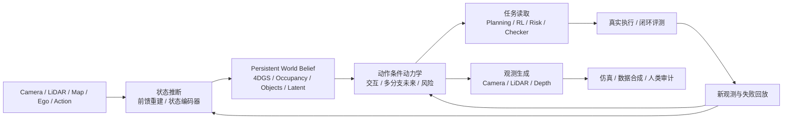

# 从生成视频到维护世界：重建为什么是自动驾驶世界模型的状态接口

> **关注的问题。** 自动驾驶世界模型如果不能只靠“视频看起来真”来证明自己，那么 3D / 4D 重建到底补上了哪一块？

这份 PPT 最值得保留的判断，是把世界模型从“生成一段视频”拉回“维护一个世界”。在自动驾驶里，一段未来视频可以纹理清楚、运动平滑、灯光合理，却仍然没有维护正确的世界状态：车辆被遮挡后可能停止演化，换一个 ego 轨迹后可能没有稳定分叉，多摄像头或 LiDAR 读到的世界也可能彼此矛盾。

所以，自动驾驶世界模型的核心问题不是：

```text
未来画面像不像真实驾驶视频？
```

而是：

```text
系统是否维护了一个可持续更新、可被动作改变、可被多传感器读取、可被规划查询的世界状态？
```

重建的意义就在这里。它不只是把图像变成 3D，也不只是生成新视角；更准确地说，它从有限、带噪、部分可见的观测中反推出一个潜在场景状态。这个状态要能解释当前观测，也要能约束其他可能观测。

## 看起来真，不等于世界建模得对

[WorldLens](https://arxiv.org/abs/2512.10958) 的提醒很直接：驾驶世界模型需要同时看生成质量、重建能力、动作遵循、下游任务和人类偏好。它的关键观察不是某个模型分数，而是能力错位：视觉质量强的模型，未必几何稳定、动作敏感或任务可靠。

这个错位可以拆成三层。

| 层次 | 问题 | 如果失败，会出现什么 |
| --- | --- | --- |
| 观测合理性 | 当前视频是否清晰、连贯、语义合理 | 画面不像真实视频，或者运动显得突兀 |
| 状态持续性 | 对象暂时不可见时，世界是否继续演化 | 车辆、行人、球等对象像是“离开镜头就暂停” |
| 干预有效性 | 改变动作或物理条件，未来是否按正确方向变化 | 两个视频各自都合理，但差异没有反映输入干预 |

[WRBench](https://arxiv.org/abs/2606.20545) 关注第二层：摄像机转开再返回时，对象是否按事件本身继续演化。它报告的典型失败是，模型在目标重新进入视野时把它恢复到离开前的状态，而不是推进到应该到达的新状态。

[What-If World](https://arxiv.org/abs/2605.27589) 关注第三层：只改变一个物理细节或动作条件时，结果之间的差异是否符合因果预期。这个评测很适合暴露一种常见幻觉：模型能分别生成两段看起来合理的视频，却不能让二者之间的差异对应真实干预。

这三层合起来说明：视频质量是必要条件，但不是 world fidelity 的充分证据。世界模型要维护的是状态，不只是逐帧续写观测。

## 世界模型里有三件事

如果把自动驾驶世界模型写成一个最小闭环，它至少包含三类函数。

| 功能 | 要回答的问题 | 典型形式 |
| --- | --- | --- |
| 状态推断 | 从历史观测中，当前世界是什么样 | `b_t = q(s_t | o_{\le t}, a_{<t})` |
| 状态转移 | 给定状态和动作，世界怎样变化 | `s_{t+1} ~ p(s_{t+1} | s_t, a_t)` |
| 观测生成 | 给定世界状态和传感器视角，会看到什么 | `o_{t+1} ~ p(o_{t+1} | s_{t+1}, v_{t+1})` |

重建主要贡献的是第一类和第三类：它帮助系统形成当前世界 belief，并提供可重投影的观测接口。它可以告诉我们哪些几何、尺度、遮挡和对象身份已经被观测约束住，哪些地方还只是模型补全。

但重建本身不自动等于完整动力学。恢复出当前 4D 场景，不代表模型知道 ego 刹车、换道或加速以后，周围车辆怎样响应；也不代表它能在未见过的反事实轨迹上保持长期一致。动力学仍然需要动作条件数据、交互建模、长期记忆和闭环评测来支撑。

## 为什么自动驾驶尤其需要重建

纯 latent world model 可以服务规划。PlaNet、Dreamer、MuZero 这条线已经说明，内部状态不一定要完整重建观测，只要能提供 reward、value、done 或搜索所需的信息，就可能对决策有用。

自动驾驶场景额外重视重建，是因为它需要更强的外部审计能力。一个可重建的世界状态至少带来四种检查方式。

| 能力 | 能检查什么 | 对自动驾驶的意义 |
| --- | --- | --- |
| 可重投影 | 改变相机或 ego 轨迹后，尺度、视差、遮挡是否一致 | 判断新视角和轨迹下的世界是否仍然自洽 |
| 可编辑 | 移动、删除、插入交通参与者后，多视角是否同步变化 | 构造反事实场景，测试长尾风险 |
| 可多传感器读取 | 同一世界状态能否输出 Camera、LiDAR、Depth、Occupancy | 避免每个传感器各自“编一个世界” |
| 可查询 | 查询 free space、对象位置、3D motion、语义和遮挡 | 让 planner、checker、risk head 直接消费状态 |

这也是 PPT 里区分 latent-only route 和 reconstruction route 的关键：前者强调任务充分性，后者强调状态可审计性。二者不是高低关系，而是证据需求不同。

如果系统只输出一段视频，很多错误会被纹理和运动掩盖；如果系统维护一个可查询、可编辑、可重投影的状态，错误就更容易被新视角、传感器一致性和下游任务暴露出来。

## 前馈重建改变了它的位置

传统 NeRF / 4DGS 往往是逐场景优化：给一段日志，经过大量迭代，得到一个只属于这段日志的场景资产。它适合离线拟合，但很难直接处理车队每天产生的海量数据。

前馈式重建把这个过程变成摊销推断：模型在大量场景上学习道路、车辆、建筑、遮挡和动态对象的先验，遇到新场景时一次前向就预测三维或四维状态。[STORM](https://arxiv.org/abs/2501.00602)、[VGGT](https://arxiv.org/abs/2503.11651)、D4RT 这类工作都在推动这个方向。

范式变化比单个速度数字更重要。当前馈重建足够快，它就不再只是“资产制作工具”，而开始接近世界模型里的状态编码器：

```text
多模态观测
  -> 前馈重建 / 状态推断
  -> 可渲染、可查询、可编辑的世界 belief
  -> 动作条件动力学和任务头继续消费
```

这解释了为什么近期工作开始把重建推向预测、规划和部署三条线：Envision4D 这类工作试图从当前观测外推未来 4D 场景；GeoWorldAD 这类路线把几何 token 接入轨迹生成；LiAuto-GeoX 一类系统则关注把几何能力蒸馏到更轻量的车端模型。

这三条线的共同点是：重建不再只回答“现在看到了什么”，而是逐渐变成 planner 和 simulator 可以复用的状态接口。

## 重建的边界：它不能恢复未被观测的唯一真值

重建最容易被误读成“把真实世界复原出来”。在自动驾驶里，这个说法太强。

传感器只能看到世界的一部分。遮挡区域、视野边界、稀疏 LiDAR、动态物体背后的空间，都可能存在多个与当前观测相容的世界：

| 当前观测没有排除的可能 | 与当前图像的关系 |
| --- | --- |
| 大车后面是空路面 | 可以解释当前观测 |
| 大车后面有行人 | 也可以解释当前观测 |
| 大车后面有骑行者 | 仍然可以解释当前观测 |

因此，生成模型在这里的角色不是“恢复唯一真值”，而是对未观测部分建模合理的条件分布。一个可靠的世界状态还应该标记信息来源：

| 状态内容 | 应该怎样对待 |
| --- | --- |
| 传感器直接观测到的几何和对象 | 高约束，不能随意改写 |
| 多视角或时间推断出的状态 | 中等约束，需要随新观测校正 |
| 由生成先验补全的未观测区域 | 低约束，应保留不确定性和多假设 |

这点对安全很关键。如果系统把补全内容当作事实，planner 就可能在一个自信但错误的世界里做决策。世界模型不仅要会补全世界，还要知道自己在哪里并不知道。

## 重建为底，动力学为纲，生成为用

PPT 里最有组织力的一句话是：

> 重建为底，动力学为纲，生成为用。

这句话可以拆成一张表。

| 层 | 负责什么 | 不能替代什么 |
| --- | --- | --- |
| 重建为底 | 建立当前世界：几何、身份、运动、可见性和观测约束 | 不能单独产生完整反事实动力学 |
| 动力学为纲 | 组织状态变化：动作响应、对象交互、多分支未来和长期记忆 | 不能只靠视觉逼真证明正确 |
| 生成为用 | 补全与呈现：未观测区域、长尾外观、多传感器观测和可能世界 | 不能把生成补全伪装成已观测事实 |

这个框架的好处，是避免把“重建”和“生成”写成互相替代的路线。更合理的关系是分工和耦合：重建约束已知世界，动力学推进世界变化，生成把世界状态读成可观察、可训练、可审计的形式。

## 重建和生成正在双向耦合

近期自动驾驶世界模型的趋势，不是重建管重建、生成管生成，而是二者开始相互喂信息。

| 耦合方式 | 代表工作 | 核心机制 | 边界 |
| --- | --- | --- | --- |
| 重建约束生成 | [NeoVerse](https://arxiv.org/abs/2601.00393)、[WorldSplat](https://arxiv.org/abs/2509.23402)、[WoVoGen](https://arxiv.org/abs/2312.02934)、[Xiaomi JWM](https://arxiv.org/abs/2605.18137) | 先形成 4DGS / 4D volume / 3D scene queries，再把几何先验交给视频生成 | 主要增强几何一致和新视角观测，不自动补齐交通交互动力学 |
| 生成帮助重建 | [DriveDreamer4D](https://arxiv.org/abs/2410.13571) | 世界模型生成新 ego 轨迹下的 cousin data，扩展 4DGS 训练分布 | 合成数据如果有结构性偏差，会反过来污染重建 |
| 生成—重建循环 | [TeleWorld](https://arxiv.org/abs/2601.00051)、Xiaomi JWM | 生成结果写回 4D 表示或增量 scene tokens，再约束后续生成 | 需要持续校准，否则循环会放大早期错误 |

NeoVerse 的逻辑很典型：先用前馈 4D 重建提供几何骨架和相机轨迹，再对目标轨迹做退化渲染，最后由生成模型补未观测区域、修复 artifact、恢复纹理真实感。这里的生成不是自由发挥，而是在几何条件下补齐观测。

DriveDreamer4D 则走相反方向：生成模型不是最终仿真器，而是数据机器。它提出新 ego 轨迹，生成这些轨迹下的视频，再和真实日志一起训练 4DGS，让重建模型获得原始采集轨迹之外的监督。

Xiaomi Joint World Model 进一步把 WorldRec 和 WorldGen 放到一个系统里：WorldRec 提供紧凑 3D Gaussian 场景表示和几何记忆，WorldGen 做因果视频生成，并通过增量场景融合维持长期一致性。它代表的方向不是“一个模块赢过另一个模块”，而是几何记忆和生成先验互相校正。

## 我更看好的系统形态

把这些工作合起来看，自动驾驶世界模型更可能是一个混合状态系统，而不是单一视频生成器。



这张图里，视频只是世界状态的一种读出。规划不一定要先生成完整未来视频，再从视频里重新感知一次。更高效的路径是：高频决策直接读取 occupancy、object state、risk、reward、可达性和不确定性；视频生成用于仿真、审计、数据合成和人类检查。

关键不是唯一表示，而是同一个持续世界 belief 能被不同消费者读取：

| 消费者 | 需要的读出 |
| --- | --- |
| Planner | 可达性、碰撞、风险、轨迹收益 |
| Sensor simulator | Camera、LiDAR、Depth 等观测 |
| Data engine | 多样场景、长尾扰动、反事实轨迹 |
| Safety checker | near-miss、遮挡风险、不可见区域不确定性 |
| Human auditor | 可观看视频、可解释失败片段、对象级编辑证据 |

所以，未来更稳的自动驾驶世界模型评测，也应该沿这些消费者收口，而不是只问 FVD、清晰度或人类真实感。

## 判断一个系统是否真的在维护世界

我会用七个问题检查一套自动驾驶世界模型。

1. **状态是什么？** 是 RGB latent、4DGS、occupancy、object tokens、BEV，还是几种表示的组合？
2. **观测约束在哪里？** 哪些内容来自传感器直接观测，哪些来自多视角推断，哪些只是生成补全？
3. **对象是否持续存在？** 摄像机转开以后，对象的身份、速度、位置和事件进展是否继续维护？
4. **动作是否有效干预？** 固定历史、改变 ego 行为或物理条件，未来是否按正确方向分叉？
5. **能否多传感器读取？** 同一世界状态能否同时支持 Camera、LiDAR、Depth、Occupancy，而不是各自生成互相矛盾的观测？
6. **预测被谁消费？** planner、policy、risk head、checker 或 data engine 是否真的使用这些预测？
7. **闭环是否改善？** 接入系统后，是否提高任务成功率、降低碰撞或发现更多失败，而不是只让视频更漂亮？

这几个问题把文章拉回一个很朴素的结论：世界模型不是更会“画未来”的模型，而是更会“维护未来可被检查的状态”的系统。

## 证据边界

本文整理自 PPT《从生成视频到维护世界：自动驾驶世界模型中的重建与生成》，并补充核对了文中涉及的 arXiv 论文页。文中的“重建为底，动力学为纲，生成为用”是对 PPT 主线的概括性整理；“混合状态系统”和“七个检查问题”是基于这些材料做出的工程化归纳。

需要保留边界：WorldLens、WRBench、What-If World 等评测主要说明现有模型在视觉真实、状态持续、动作干预之间存在错位；它们不能直接推出某一种架构已经最优。NeoVerse、DriveDreamer4D、TeleWorld、Xiaomi JWM 等工作展示了重建和生成的耦合趋势，但闭环规划收益、真实车端部署价值和长期安全收益仍需要更系统的任务评测。

## 外部材料

- [WorldLens: Full-Spectrum Evaluations of Driving World Models in Real World](https://arxiv.org/abs/2512.10958)。
- [Current World Models Lack a Persistent State Core / WRBench](https://arxiv.org/abs/2606.20545)。
- [What-If World: A Causal Benchmark for General World Models in Embodied Scenarios](https://arxiv.org/abs/2605.27589)。
- [STORM: Spatio-Temporal Reconstruction Model for Large-Scale Outdoor Scenes](https://arxiv.org/abs/2501.00602)。
- [VGGT: Visual Geometry Grounded Transformer](https://arxiv.org/abs/2503.11651)。
- [NeoVerse: Enhancing 4D World Model with in-the-wild Monocular Videos](https://arxiv.org/abs/2601.00393)。
- [WorldSplat: Gaussian-Centric Feed-Forward 4D Scene Generation for Autonomous Driving](https://arxiv.org/abs/2509.23402)。
- [WoVoGen: World Volume-aware Diffusion for Controllable Multi-camera Driving Scene Generation](https://arxiv.org/abs/2312.02934)。
- [DriveDreamer4D: World Models Are Effective Data Machines for 4D Driving Scene Representation](https://arxiv.org/abs/2410.13571)。
- [TeleWorld: Towards Dynamic Multimodal Synthesis with a 4D World Model](https://arxiv.org/abs/2601.00051)。
- [Xiaomi Auto World Model: A Joint World Model Integrating Reconstruction and Generation for Autonomous Driving](https://arxiv.org/abs/2605.18137)。
