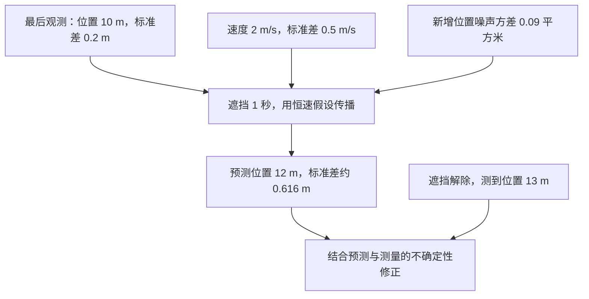

# 重建怎样成为世界模型可查询的状态

自车准备经过一辆停着的大巴。骑行者在前一秒进入大巴后方，当前相机已经看不见他。一个系统把骑行者从当前画面中删去，另一个保留其位置和运动的不确定性。它们可以渲染出同样的当前图像，接下来的减速决策却会不同。

这个例子说明重建与世界模型的连接应从状态开始讨论。重建利用传感器证据约束几何、相机与运动；为了预测遮挡后的未来，还需要状态传播、行为模型以及新观察的纠正。本文提出一种可检查的接口设计，是否优于其他表示仍需任务实验。

## 一张图像允许多个世界同时成立

大巴后面可能有骑行者，也可能骑行者已经转弯离开。当前图像对这两种情况的区分能力很弱。即使重建得到一张非常完整的三维场景，也不能把模型补出的遮挡区域当成已测量事实。

用 $s_t$ 表示世界状态，$o_{\leq t}$ 表示历史观测，$a_{<t}$ 表示过去动作。系统可以维护条件分布

$$
b_t(s)=p(s_t=s\mid o_{\leq t},a_{<t}).
$$

这里的 belief 表达的是已有证据下哪些状态仍可能成立。实际系统未必显式保存完整分布，可以用多个轨迹假设、存在概率和状态协方差近似。但单个确定点估计会丢失什么，应该有明确认识。

## 用一个小数值例子看遮挡中的状态变化

设骑行者一维位置估计为 $x=10$ m，速度 $v=2$ m/s，位置与速度标准差分别为 0.2 m 和 0.5 m/s，二者暂设独立。用恒速模型向前预测 1 秒，位置均值变成 12 m。若新增位置过程噪声方差为 $0.09$ m²，则预测位置方差为

$$
\operatorname{Var}(x')=0.2^2+1^2\times0.5^2+0.09=0.38\ \mathrm{m}^2.
$$

标准差约为 0.616 m。遮挡期间即使没有新像素，位置仍然前移，不确定性也增加。这个简化计算没有考虑速度变化、转弯或位置速度相关性；若两者相关，还要加 $2\Delta t\operatorname{Cov}(x,v)$，不能照抄独立公式。

当新图像重新看见骑行者时，观测应修正这个预测。若真实位置为 13 m，系统需要比较测量噪声与预测不确定性决定更新幅度。直接覆盖会丢掉历史信息，拒绝更新又会把模型假设变成事实。概率更新的基础可查[概率与统计](../prerequisite-math/index.md)。

遮挡期间没有新像素，位置和不确定性仍然会变化。图只算到了预测分布；后续更新还缺测量噪声信息，因此没有凭空给出更新后的精确位置。

## 重建、推进和渲染可以分别出错

可以把三个功能写为当前状态推断、动作条件转移和观测生成。

$$
\begin{aligned}
b_t&=q(o_{\leq t},a_{<t}),\\
s_{t+1}&\sim p(s_{t+1}\mid s_t,a_t),\\
o_{t+1}&\sim p(o_{t+1}\mid s_{t+1},v_{t+1}),
\end{aligned}
$$

其中 $v_{t+1}$ 表示传感器视角与配置。前一个式子的 $q$ 是状态推断算法或模型，不要求它恰好等于真实后验。

如果道路宽度重建错，碰撞查询会出错；如果宽度正确却误判骑行者会让行，是动态或行为预测问题；如果状态正确但渲染漏画骑行者，视觉策略仍会收到错误输入。拆开这些责任，才能设计分别可验证的接口。

[D4RT](https://arxiv.org/abs/2512.08924)从视频建立全局场景表示，用查询接口输出源点在目标时刻、指定相机坐标中的三维位置。它提供了重建与跟踪共享查询的实例。其目标时刻查询处于输入视频所提供的重建证据范围内；不能由此直接推出它能预测任意未来，更不能推出它已建模自车动作对他车的干预。

## 持续状态还要保留身份和信息来源

大巴后出现的骑行者，是此前那个对象还是另一个对象，会影响速度与意图判断。仅把每帧点云拼起来不能自动解决身份。需要时间关联、相机位姿、动态对象分离与更新规则。

一个面向调试的对象记录可以包含当前位置分布、最后直接观测时刻、关联证据、传播模型版本，以及是否来自生成补全。不同来源不等于固定可靠等级，传感器也会出错，模型推断也可能非常可靠；关键是保留依据和不确定性，允许之后检查。

[Depth Anything 3](https://arxiv.org/abs/2511.10647)与 [VGGT-Ω](https://arxiv.org/abs/2605.15195)研究从视觉输入估计可融合几何。这类模型可以成为状态构建工具，但如何连接稳定身份、遮挡记忆与长期更新，仍是额外系统工作。

## 生成可以补观察，合成结果仍需标记

在某个状态假设下，可以渲染自车向左移动后会看到什么，再用生成模型补纹理或未观测部分。这样有助于训练、人工查看和视角变化测试。但如果生成器补出了一条不存在的空路，后续重建再把它融合成高置信地图，就形成了自我确认。

因此真实观察与生成观察应保留不同来源，预测分支不能无条件回写为事实。若需要把生成结果写入长期记忆，应明确它只是一个待验证假设，并在真实观察冲突时撤销。

## 怎样检验这种状态接口是否值得保留

仍用大巴遮挡场景，固定初始传感器记录，分别查询等待、减速和绕行。检查骑行者身份是否持续，预测位置是否推进，多传感器读出是否相容，以及新观察是否能够纠正先前状态。

然后与直接视觉策略或无显式重建的 latent 模型在相同预算下比较。显式几何便于空间查询和诊断，却可能受深度误差、离散化与维护成本影响。如果这些成本超过收益，就应调整表示或减少维护范围。

重建最有用的地方，是让一部分状态可以被观测约束、被查询、被纠正。它不保证完整动力学，也不规定世界模型必须输出三维地图。进一步的动作查询见[自动驾驶闭环](autonomous-driving-world-models.md)。

## 来源与边界

D4RT、Depth Anything 3 与 VGGT-Ω用于说明从视频或多视角估计空间表示的不同入口。大巴、骑行者、恒速传播和方差计算是本站的教学构造，不能当作这些论文的测量结果。它们只用来区分重建、状态推进、渲染和真实观察纠正四个接口。
