# 一次抓取失败，怎样变成可验证的下一轮训练数据

机械臂抓住了杯子，抬起时却滑落。视频有用，但只保存视频还不足以训练下一版策略。我们需要知道动作来自哪版模型、实际夹爪开度是多少、接触何时发生、是否有人接管，以及这次失败和已有数据相比增加了什么。

本文沿这一次失败组织数据回路。所谓回路，是部署结果能够进入有来源的样本、形成训练改动，再由独立任务检验。它不保证每转一轮都会改善，更不能把模型自己生成的成功当作真实进步。

## 先决定这段经验给谁使用

同一次滑落，策略学习器需要恢复动作，动力学模型需要动作与后果，评价器需要预测和实际结果之间的偏差。三者可以共享原始记录，但不能共享一个含义模糊的“质量分”。

第一张图把内部状态、预测与行动相连，读图时沿真实观察进入状态的路径，注意想象分支何时返回外部环境。后两张综述图分别按用途和研究演进组织方法，帮助定位数据消费者，并不代表一套已验证的通用工业系统。

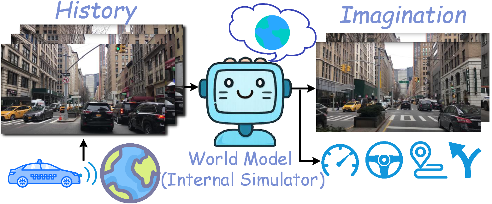{ width="760" }

<small>图源：[A Comprehensive Survey on World Models for Embodied AI](https://arxiv.org/abs/2510.16732)，Figure 1 子图，从论文 PDF 截取。原图把 world model 画成 internal simulator：从历史观测构造内部世界状态，再服务 imagination、planning 和控制。</small>

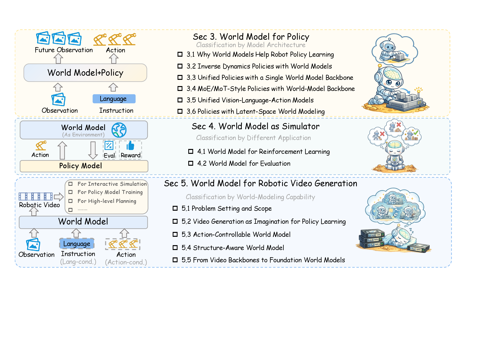{ width="920" }

<small>图源：[World Model for Robot Learning: A Comprehensive Survey](https://arxiv.org/abs/2605.00080)，Figure 1，从论文 PDF 截取。原图把机器人世界模型分成三类角色：接入 policy、作为 simulator、作为 robotic video world model。</small>

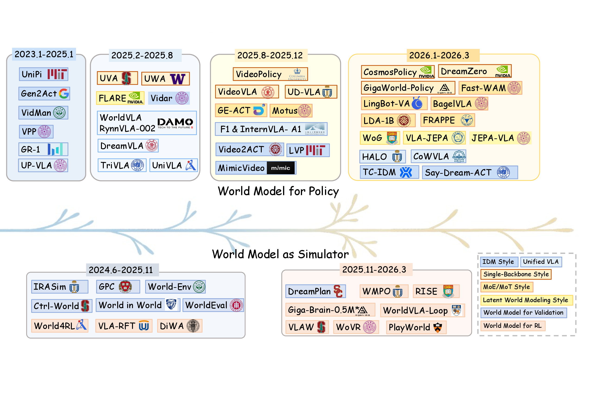{ width="920" }

<small>图源：World Model for Robot Learning survey，Figure 2，从论文 PDF 截取。原图展示 world model for policy 与 world model as simulator 的代表工作演进。</small>

若只训练视觉识别，杯子材质和外观变化很重要；若训练滑落预测，还需要抓力、速度、接触等信息。缺失的力传感器读数不能靠给样本补一个“物理理解”标签解决，应明确模型能观察到什么。

## 把滑落还原为有时间顺序的记录

构造一条 episode，0 ms 采图，80 ms 策略输出，100 ms 控制器采用，300 ms 夹爪接触，650 ms 杯子滑落，900 ms 人工接管。保存传感器采集时间与动作生效时间，才能确定哪个输入对应哪个结果。摄像机到达主机的时间不能直接替代曝光时间。

下面的 LeRobot 图展示表格数据、视觉数据和元数据的分工，CALVIN 图展示多视角与本体信号。读图时应找出它们怎样以同一个 episode 和时间轴关联；文件数量多并不会自动保证同步。

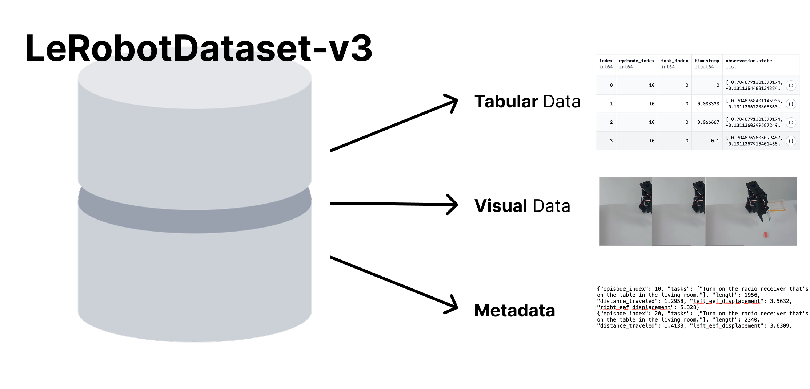{ width="920" }

<small>图源：[Hugging Face LeRobotDataset v3.0 blog](https://huggingface.co/blog/lerobot-datasets-v3)。原图把机器人数据拆成 tabular data、visual data 和 metadata。</small>

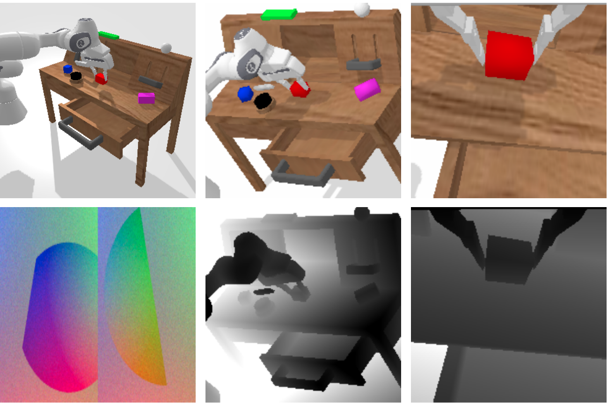{ width="820" }

<small>图源：[CALVIN GitHub README](https://github.com/mees/calvin)，归档。原图展示多视角 RGB-D、静态相机、夹爪相机和本体状态。</small>

除了视频，还应保留 proposed action、控制器 accepted action 与实际状态。若控制器把夹爪力限幅，学习模型需要知道实际发生了什么，不能把原请求当执行真值。标定、坐标系、单位与控制频率也要随版本保存。

Open X-Embodiment 的概览图展示来源与本体差异。这里值得沿设备与任务分布看覆盖，而不是只相加轨迹数。π0.5 的消融图则让读者检查去掉某种数据后的具体任务变化；单项消融不能证明所有来源可无条件互换。

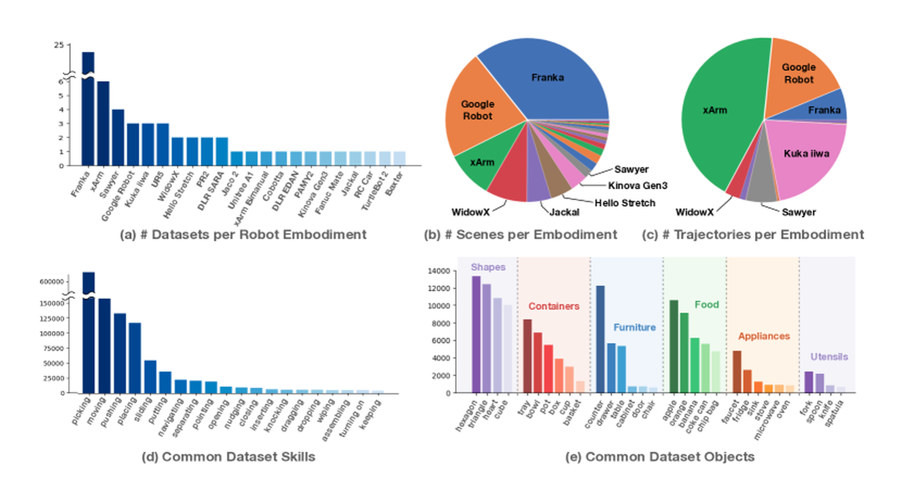{ width="820" }

<small>图源：[Open X-Embodiment / RT-X](https://robotics-transformer-x.github.io/)，Figure 1，从论文 PDF / 项目材料归档。原图统计 robot embodiment、scene、trajectory、skill 和 object category 的分布。</small>

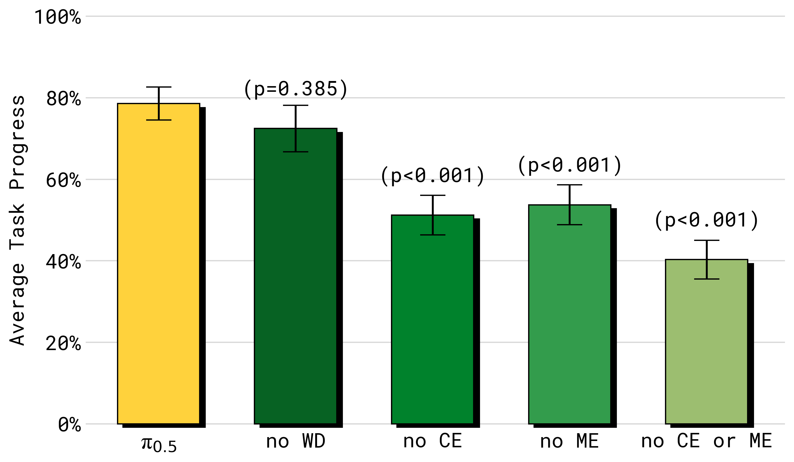{ width="900" }

<small>图源：[π0.5](https://www.physicalintelligence.company/blog/pi05)，Figure 10，从论文 / 官方材料归档。原图比较去掉 web data、cross-embodiment data、multi-environment data 等来源后的表现变化。</small>

## 一段失败，至少有三种不同标签

对策略，这段记录可能是失败初态和人工恢复示范；对动力学，它是给定动作后杯子滑落的监督；对 evaluator，它是一次“预测成功却实际失败”的校准样本。标签要标注适用范围，人工接管后的成功不能回填成原策略自主成功。

下面的用途图把模拟训练与候选评价分开。χ₀ 的系统图进一步区分训练数据、模型行为与部署状态的分布，读图时可追问滑落发生在哪个分布缺口，而非笼统归因数据少。

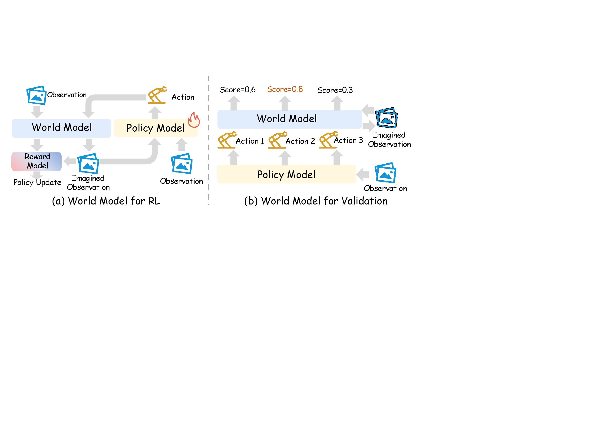{ width="860" }

<small>图源：World Model for Robot Learning survey，Figure 5，从论文 PDF 截取。原图左侧展示 learned simulator for RL，右侧展示 world model as validation / evaluator。</small>

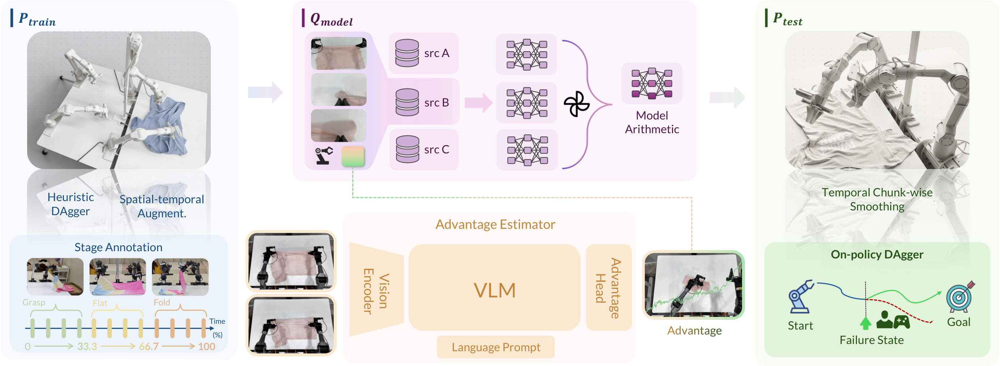{ width="920" }

<small>图源：[χ₀: Resource-Aware Robust Manipulation via Taming Distributional Inconsistencies](https://arxiv.org/abs/2602.09021)，Figure 1，从论文 PDF 截取。原图展示 \(P_{\text{train}}\)、\(Q_{\text{model}}\)、\(P_{\text{test}}\) 三类分布及对齐模块。</small>

本文自绘的四条回路图提供一个组织框架。沿任一回路都应走到独立真实反馈，几何伪标签、视频动作监督、部署失败与合成经验之间的箭头代表可能的数据关系，并非已经证明的增益。

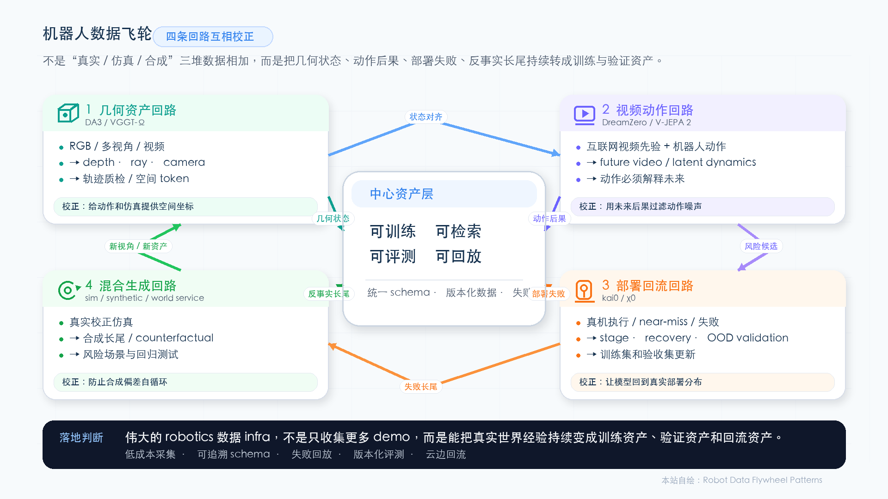{ width="920" }

<small>图源：自绘。它把四种范式压成四条互相校正的数据回路：几何资产回路提供空间状态，视频动作回路约束动作后果，部署回流回路把真实失败放回训练和验证，混合生成回路生产长尾并接受真实数据校正。</small>

## 几何标签让失败可以定位，但也会引入自己的误差

杯子滑落发生在离桌面 8 cm 处，还是 30 cm 处，会影响恢复决策。深度、相机位姿与点轨迹可以把视频转成可查询几何。空间网格示意图展示这类状态如何组织；它没有消除深度尺度和遮挡的不确定性。

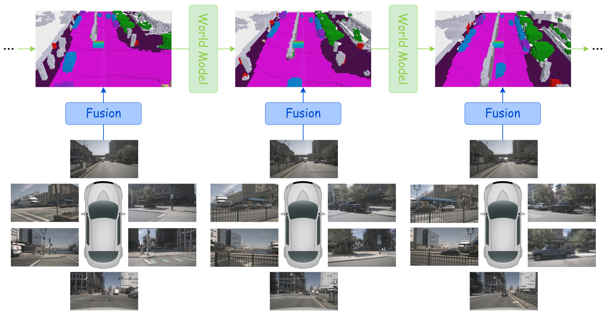{ width="760" }

<small>图源：A Comprehensive Survey on World Models for Embodied AI，Figure 1 子图，从论文 PDF 截取。原图展示 Spatial Latent Grid 用 BEV、voxel、occupancy 或 geometry-aligned latent grid 表示空间世界。</small>

Depth Anything 3 的展示图与结构图可以沿图像输入读到 depth/ray 与可融合几何。它为视觉日志增加空间线索，但生成的几何仍是模型估计，应保存模型版本、有效区域与不确定性信息。

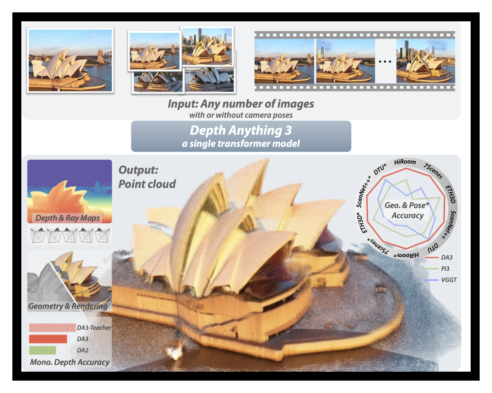{ width="820" }

<small>图源：[Depth Anything 3](https://arxiv.org/abs/2511.10647)，Figure 1，从论文 PDF 截取。原图展示 DA3 从任意数量视觉输入恢复 depth、ray、camera 和可融合 3D geometry。</small>

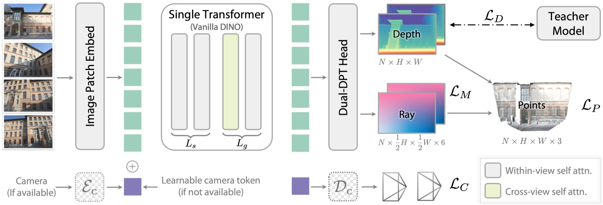{ width="920" }

<small>图源：Depth Anything 3，Figure 2，从论文 PDF 截取。原图展示单个 DINOv2 主干、跨视角 attention、camera token 和 Dual-DPT head。</small>

教师监督示例把原始深度与处理后的几何放在一起。比较时应同时看连续表面和细小边界，平滑后的表面可能更一致，也可能抹掉薄物体。不能仅用视觉光滑程度判定真值更准。

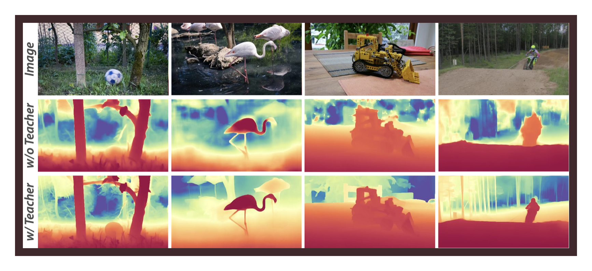{ width="820" }

<small>图源：Depth Anything 3，teacher supervision visualization，从论文 PDF 截取。原图展示真实深度的噪声和 teacher depth 的连续结构。</small>

VGGT-Ω 的规模图和架构图提供另一个几何估计实例。曲线支持作者训练设置下的尺度实验；架构图说明信息怎样在视图间交换。它们本身不证明几何标签改善了这次抓取。

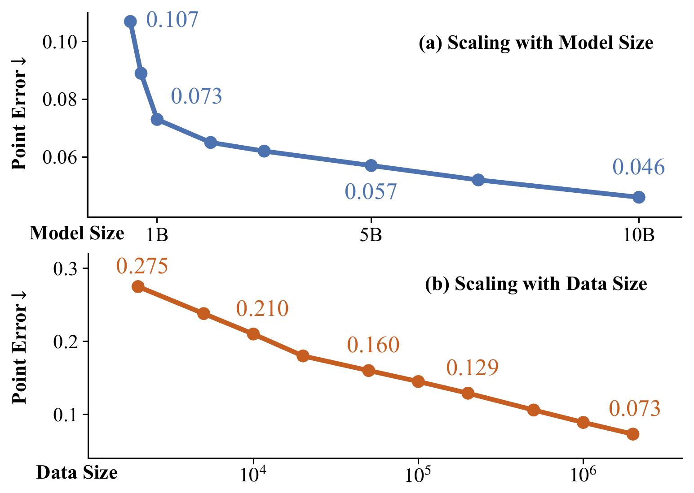{ width="760" }

<small>图源：[VGGT-Ω](https://arxiv.org/abs/2605.15195)，Figure 1，从论文 PDF 截取。原图展示模型规模和数据规模增加时 3D point error 下降。</small>

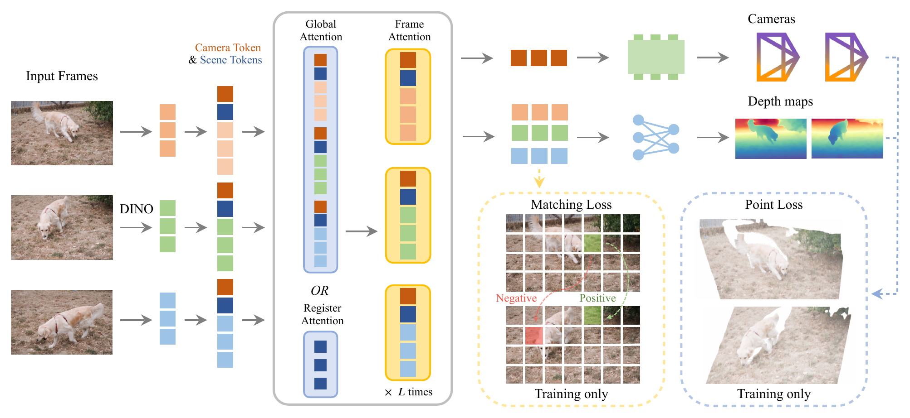{ width="920" }

<small>图源：VGGT-Ω，Figure 2，从论文 PDF 截取。原图展示从多视角图像到 camera、depth、track、point map 等几何输出的统一架构。</small>

接下来的数据问题图尤其值得对照杯柄、反光杯壁与动态手臂。传感器伪影、薄结构误差与动态错配会进入训练标签。motion-aware 示例说明运动对象需要特别处理，不能将整段场景当静态点云融合。

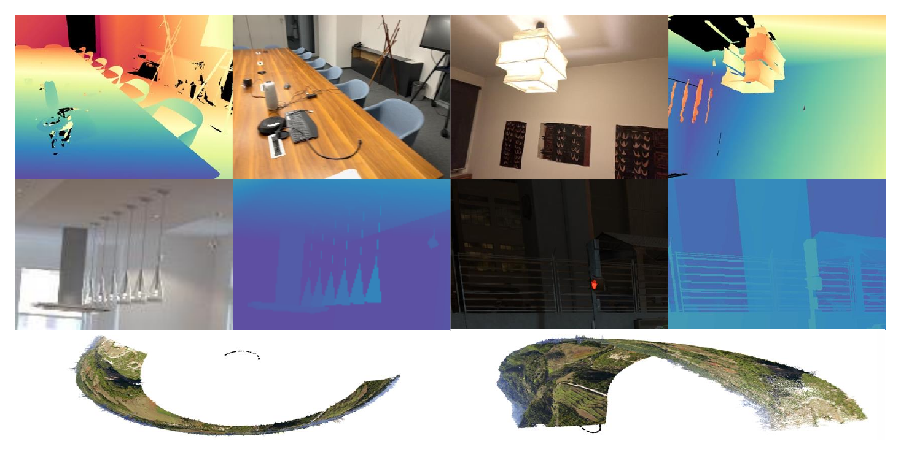{ width="820" }

<small>图源：VGGT-Ω，Common Data Issues，从论文 PDF 截取。原图展示 sensor artifact、thin structure error 和 doming effect。</small>

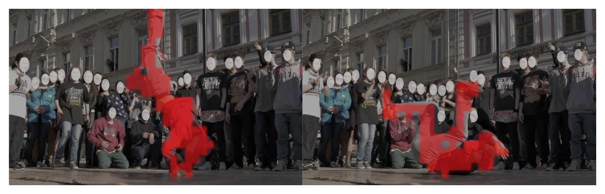{ width="820" }

<small>图源：VGGT-Ω，motion-aware 示例，从论文 PDF 截取。</small>

实践中应抽样人工检查几何误差，再单独测试加入几何标签前后，策略或模型是否在对应故障上改善。伪标签的内部一致性只能做筛选证据之一。

## 视频动作数据要让动作与后果真正对应

滑落前的动作包含抬升速度与夹爪状态。若把动作整体平移 100 ms 再配到图像，模型可能学到“杯子先掉落，机器人随后松手”的反向关系。时间对齐比增加一段自然语言解释更基础。

策略范式图展示未来预测进入动作生成的几个位置。DreamZero 总览与联合视频动作图则给出共同训练的实例，沿相同观测与任务看动作、视频两条输出，避免把一条生成视频当作完整控制记录。

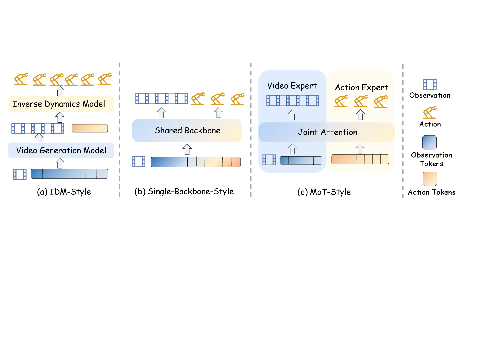{ width="920" }

<small>图源：World Model for Robot Learning survey，Figure 3，从论文 PDF 截取。原图展示 IDM-style、single-backbone-style 和 MoT-style 三种 world model 支撑 policy 的架构范式。</small>

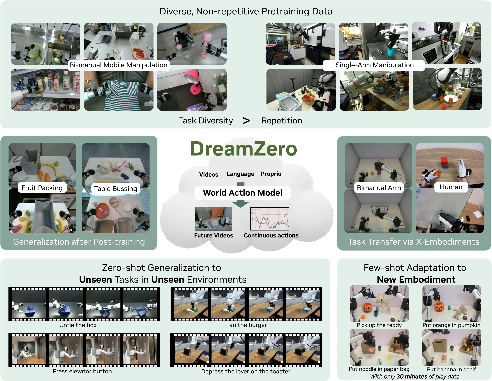{ width="920" }

<small>图源：[World Action Models are Zero-shot Policies / DreamZero](https://arxiv.org/abs/2602.15922)，Figure 1，从论文 PDF 截取。原图展示 DreamZero 从预训练视频扩散 backbone 出发，联合建模未来视频和动作。</small>

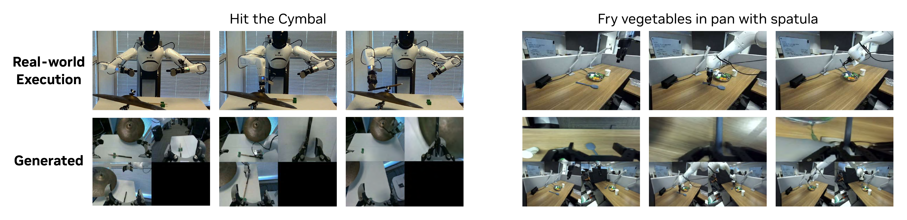{ width="920" }

<small>图源：DreamZero，Figure 2，从论文 PDF 截取。原图展示模型同时生成未来视频和动作。</small>

DreamZero 的架构图补足状态、动作 chunk 和视觉上下文的连接；跨本体图提示纯视频可以提供任务动态线索。它没有给出目标机器人所有可执行动作，也不能替代本体适配。

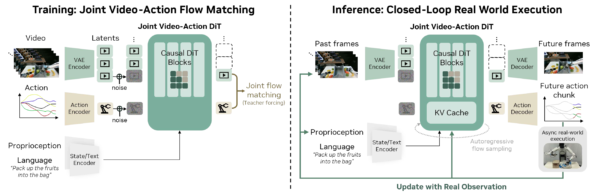{ width="920" }

<small>图源：DreamZero，Figure 4，从论文 PDF 截取。原图展示视觉上下文、语言、本体状态、未来视频 latent 和动作 latent 如何进入同一个自回归 DiT。</small>

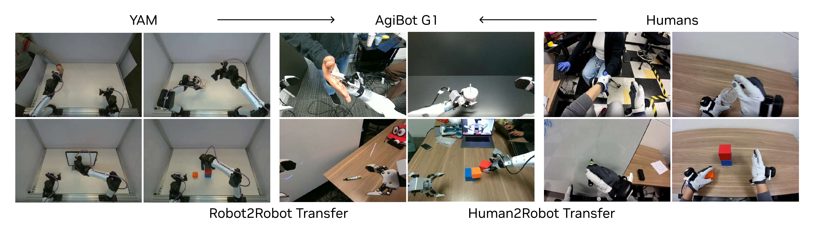{ width="920" }

<small>图源：DreamZero，Figure 11，从论文 PDF 截取。原图展示 robot-to-robot 和 human-to-robot 的 video-only demonstration 对未见任务的帮助。</small>

V-JEPA 2 的动作条件图与综述能力图提供另一种消费方式。读图时看候选动作怎样改变预测，而非只看表征网络名称。最后的结果表应连同任务与实验协议阅读，不与其他论文成功率直接相减。

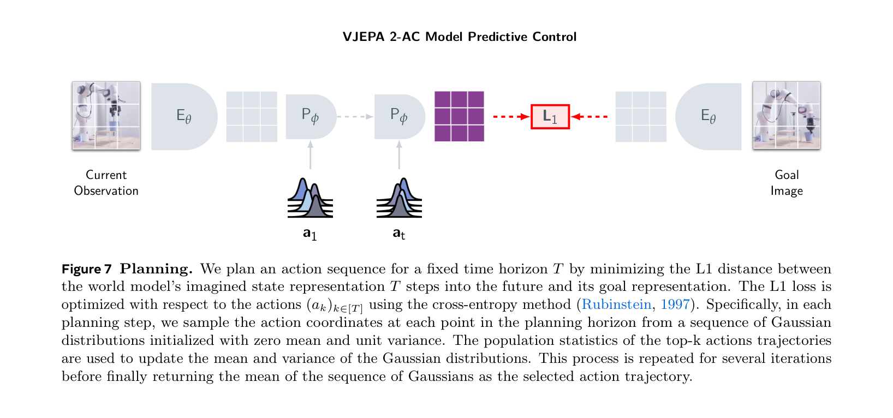{ width="920" }

<small>图源：[V-JEPA 2](https://arxiv.org/abs/2506.09985)，action-conditioned world model 图，从论文 PDF 截取。</small>

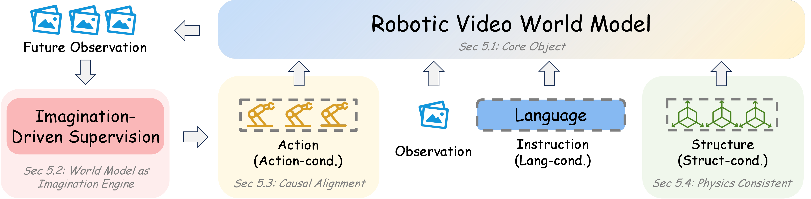{ width="920" }

<small>图源：World Model for Robot Learning survey，Figure 6，从论文 PDF 截取。原图把 robotic video world model 的能力从 task-conditioned imagination 推到 action conditioning、structure priors 和 foundation-scale video backbone。</small>

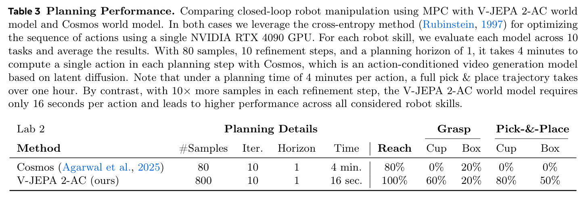{ width="900" }

<small>图源：V-JEPA 2，robot planning results 表，从论文 PDF 截取。</small>

可以先在固定历史下改变抬升速度，比较模型是否预测不同滑落风险，再用可控执行验证方向。如果任意动作都被预测成功，就应检查动作条件、训练覆盖和标签，而非继续扩大同类顺利视频。

## 真实失败回流，会改变数据分布

若原始任务中透明杯只占 1%，失败回收后它占新训练批次的 40%，模型确实获得更多相关经验，也可能改变对普通杯子的表现。应分别记录自然部署分布与训练采样分布，按任务需要设置权重，并保留原能力回归测试。

DreamZero 的失败配对图可沿生成与实际执行对照误差起点。后面两张自绘图说明如何把失败、接管和验证分开，尤其注意验证集不能随每次训练一起被反复调参消费。

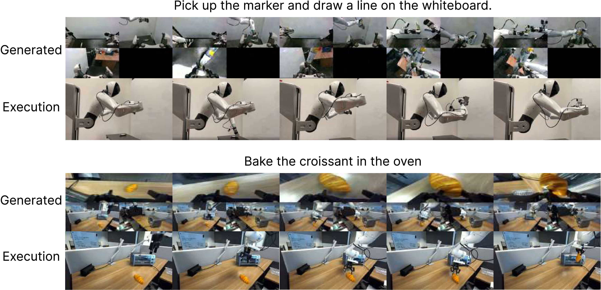{ width="920" }

<small>图源：DreamZero，Figure 16，从论文 PDF 截取。原图展示 generated video 与 executed action 的失败配对。</small>

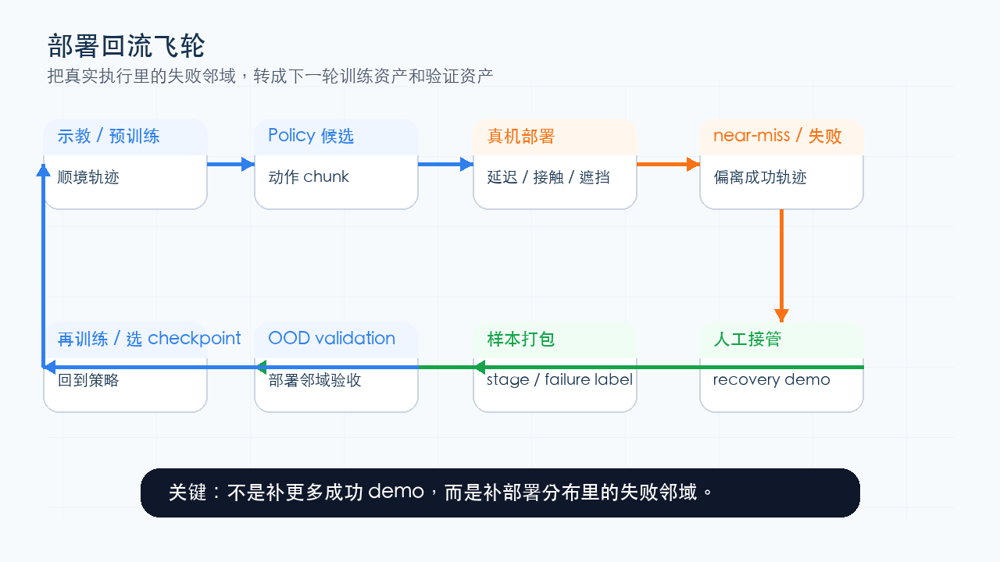{ width="920" }

<small>图源：自绘。它把部署回流拆成示教、policy 候选、真机部署、near-miss / 失败、人工接管、样本打包、OOD validation 和再训练。</small>

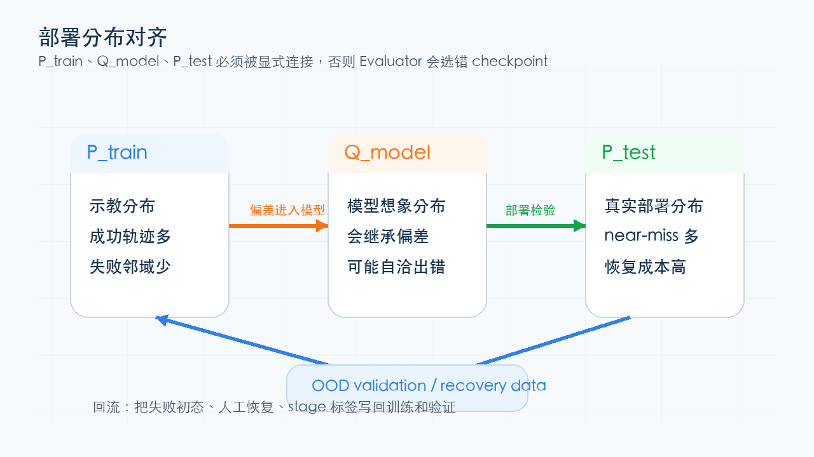{ width="920" }

<small>图源：自绘。它把 \(P_{\text{train}}\)、\(Q_{\text{model}}\)、\(P_{\text{test}}\) 画成三类分布。</small>

χ₀ 的训练部署对齐图提供纠正、增强和平滑的具体组合，模型选择消融图则提醒“选哪个 checkpoint”也是学习流程的一部分。若选择器反复查看同一小验证集，它也会过拟合。

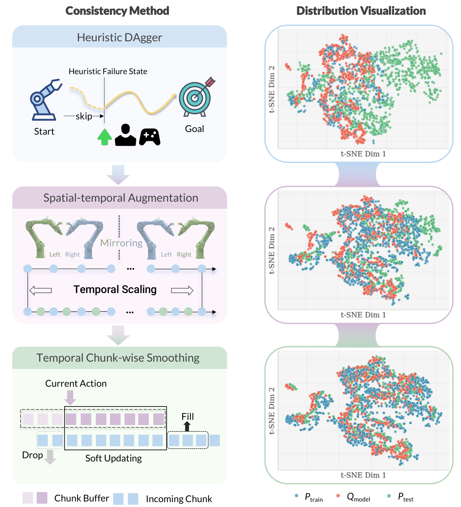{ width="820" }

<small>图源：kai0，Figure 4，从论文 PDF 截取。原图展示 Heuristic DAgger、spatio-temporal augmentation 和 temporal chunk-wise smoothing。</small>

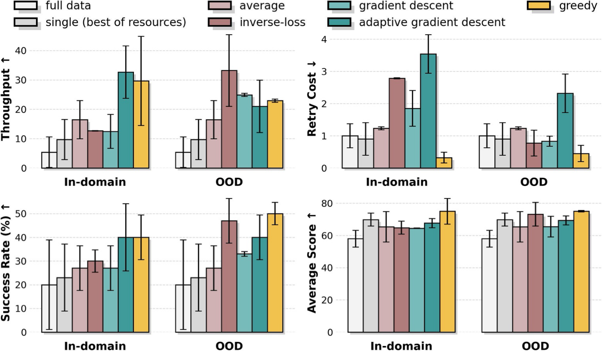{ width="860" }

<small>图源：kai0，Figure 7，从论文 PDF 截取。原图比较 model arithmetic 变体、single-best 和 full-data candidate。</small>

阶段信息图与相应消融可联系滑落后的任务进度。杯子仍在桌面，但任务已从“第一次抓取”转成“失败后恢复”，相似图像可能需要不同动作。阶段标签的边界和人工接管状态必须一致。

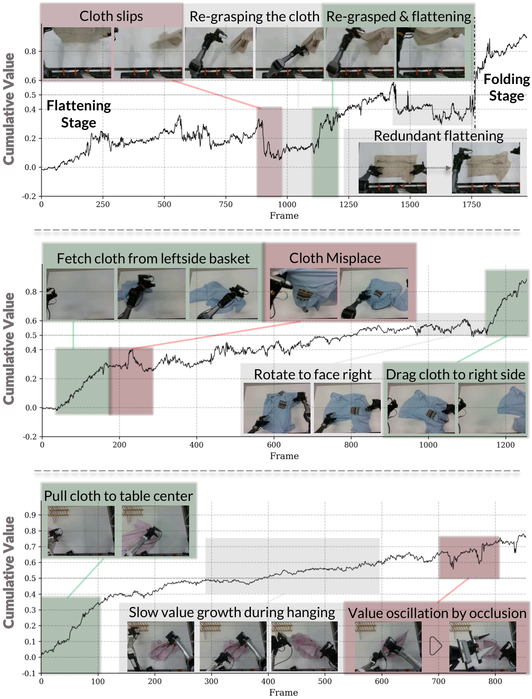{ width="920" }

<small>图源：kai0，Figure 3，从论文 PDF 截取。原图展示 stage advantage 如何把阶段信息注入训练。</small>

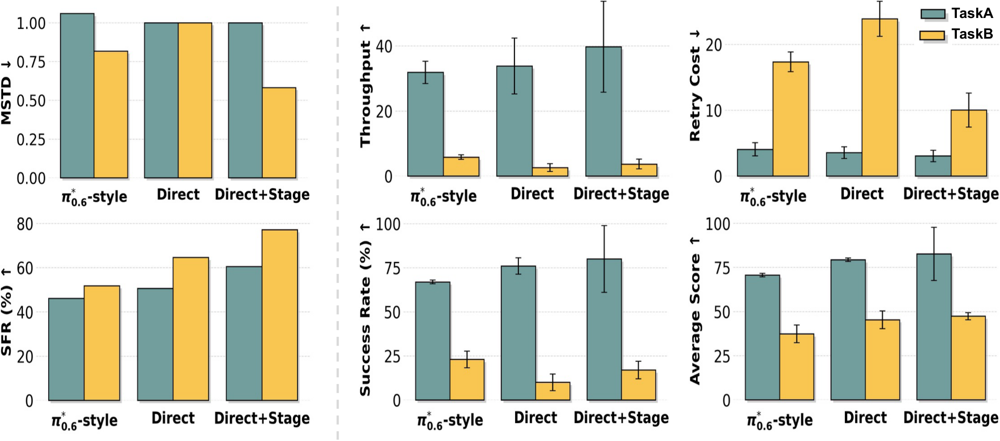{ width="860" }

<small>图源：kai0，Figure 8，从论文 PDF 截取。原图比较 Stage Advantage 的稳定性和任务表现。</small>

控制消融与系统效果图把讨论带回实际执行。读图时把动作平滑、数据增强与整套系统结果分开，各自贡献需要受控对照；作者衣物操作设置不能直接替代杯子任务验证。

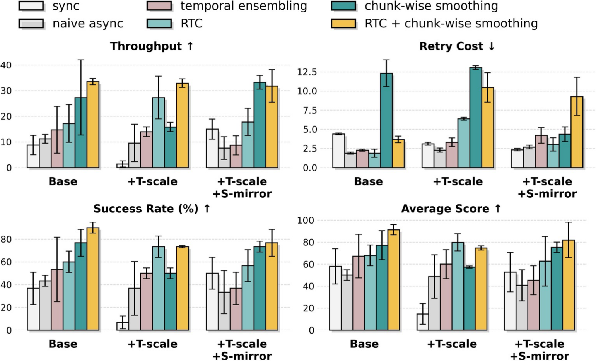{ width="860" }

<small>图源：kai0，Figure 11，从论文 PDF 截取。原图比较 temporal chunk-wise smoothing、temporal ensembling、RTC 和增强策略。</small>

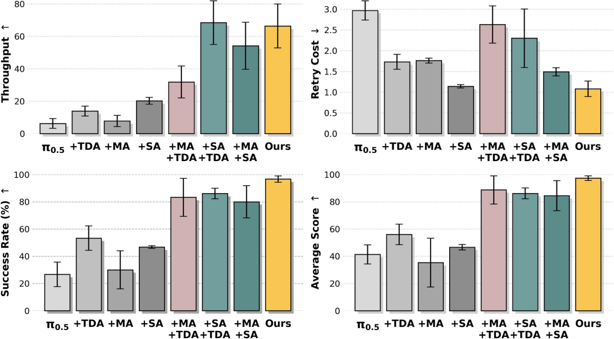{ width="920" }

<small>图源：kai0，system efficacy 图，从论文 PDF 截取。</small>

同一次滑落附近切出的二十个窗口高度相关，应该按源 episode 分组划分训练与评测。若把相邻窗口随机分开，测试可能只是在重看几乎相同的失败。

## 合成补哪些空缺，必须由独立结果回答

真实采集很难覆盖所有摩擦和杯子姿态，仿真与生成可以扩大范围。物理模拟允许受控改变摩擦与动作，视频生成可以增加外观变化，几何重建提供已有场景约束。下面两张分类图把这些工具放到不同位置，重点看各自负责哪种状态或观察，不能据此认为它们提供同等真值。

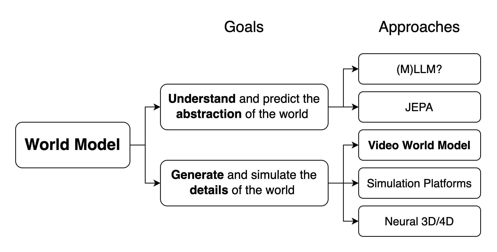{ width="920" }

<small>图源：[Towards Video World Models](https://www.xunhuang.me/blogs/world_model.html)，Figure 2，从论文 / 项目材料归档。原图把 internal world model、external world model、video world model、simulation platform 和 neural 3D/4D 放在同一张 taxonomy 里。</small>

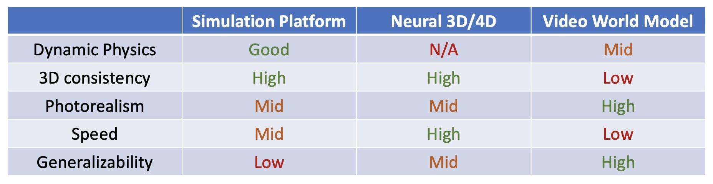{ width="920" }

<small>图源：Towards Video World Models，simulation approaches 图，从论文 / 项目材料归档。</small>

可以把合成数据先用于一个明确用途，例如透明杯外观增强，再固定真实训练量、总训练步数和评测任务，比较加入前后。结果应报告新增成功、原任务退化、生成与筛选成本。若提高只是来自更多训练计算，应有等计算对照。

回路的成本也需要以有效样本计算。构造一批 1,000 段生成视频，其中 200 段标签有效，只有 50 段覆盖此前缺少的故障。若生成、审查和处理总计 100 单位成本，每段新增有效故障样本成本为 2，而非按总视频数得到的 0.1。这里是预算例子，真实项目要定义什么叫新增覆盖。

所谓数据基础设施的长期价值，要由稳定的数据接口、可追溯处理与独立收益证明。商业规模、收益率和行业胜者无法从论文模型分数推出来。对当前学习任务，先完整走通一次失败的来源、标签、训练与验证，就已经能够识别许多空转的数据回路。可运行的静态例子见[数据引擎](../world-models/data-engines-and-self-improvement.md)。
