# 世界模型驱动的机器人数据飞轮：能持续生产经验的系统，才是真正的基础设施

> **关注的问题。** 如果 World Model 是机器人获得“内部模拟器”的关键能力，那么它到底需要什么样的数据飞轮，才能学好、用上，并在真实部署中持续变强？

<div class="atlas-evidence-split">
  <div class="atlas-evidence-copy">
    <p>和一些以底层零部件、运控、整机可靠性为优势的机器人本体团队聊天，经常会听到一个很自然的判断：现在模型还不够好、也不够统一，所以智能化可以先放一放；公司先做沿途下蛋的商业化，等一个更好的模型架构出现，再系统布局上半身智能。</p>
    <p>这个判断并不孤立。围绕 2025 世界机器人大会的多篇产业报道提到，王兴兴认为行业对基础数据的关注偏高，真正瓶颈在模型架构，尤其是当前 VLA 还不够好、不够统一。<a href="https://www.21jingji.com/article/20250809/herald/fecc404938f03df050143f46e4922853.html">21 财经</a>和<a href="https://eu.36kr.com/zh/p/3420014135987845">36 氪</a>的报道都可作为交叉核验。这是值得认真对待的产业视角，因为下半身公司每天面对的是电机、关节、减速器、热管理、量产一致性、控制稳定性和成本曲线。</p>
    <p>但如果从 World Model 的能力边界出发，问题会换一种问法：不是“模型和数据谁更重要”，而是“一个能预测动作后果、支撑仿真、评估策略的内部模拟器，到底靠什么经验变得可信”。我的判断是：<strong>模型架构决定能学什么，数据飞轮决定系统有没有机会学到。</strong></p>
    <pre><code>模型架构决定上限的形状，
数据 infra 决定有没有机会接近那个上限。</code></pre>
    <p>数据飞轮要从 World Model 的系统角色开始：它服务 policy，服务 simulator，也服务 evaluator。每一种角色都有自己的能力瓶颈，每一个瓶颈都会把问题推回到具体的数据系统。</p>
    <p>等一个丝滑通用的开源模型当然有意义，但如果没有数据 infra 和部署回流 infra，模型来了也只能吃一次性数据集；真正能形成壁垒的，是把真实世界经验持续变成训练资产、验证资产和回流资产的系统。</p>
  </div>
  <aside class="atlas-evidence-stack" aria-label="产业报道截图证据">
    <figure class="atlas-evidence-card">
      
      <figcaption>图源：<a href="https://www.21jingji.com/article/20250809/herald/fecc404938f03df050143f46e4922853.html">21 财经</a>，2025-08-09。裁剪标题与相关段落局部，用于核验“数据关注偏高、模型架构是瓶颈”的产业观点来源。</figcaption>
    </figure>
    <figure class="atlas-evidence-card">
      
      <figcaption>图源：<a href="https://eu.36kr.com/zh/p/3420014135987845">36 氪</a>，2025-08-13。裁剪标题与相关段落局部，作为同一观点的交叉佐证。</figcaption>
    </figure>
  </aside>
</div>

证据链分成四层：产业报道只说明“模型架构优先”这类观点真实存在；综述图用来界定 World Model 在机器人系统中的角色；论文图用来拆四条数据飞轮；部署论文用来约束边界，避免把模型能力误读成系统可靠性。

| 判断 | 主要证据 | 证据边界 |
| --- | --- | --- |
| World Model 不是单个模型，而是机器人系统里的角色 | World Model for Robot Learning survey、Embodied AI world model survey | 综述给的是分类框架，不等于任何单一架构已经统一胜出 |
| 三种系统角色对应三类能力瓶颈 | policy / simulator / evaluator 相关综述图、VLA / WAM 范式图 | 不同任务里三种角色的重要性不同，不能一刀切 |
| 四类数据需求可以组织成四条数据飞轮 | DA3、VGGT-Ω、DreamZero、V-JEPA 2、kai0、Towards Video World Models | 这些论文覆盖的是关键切面，不是完整工程系统 |
| 真正的 robotics 基础设施是持续生产经验的系统 | LeRobotDataset、Open X、π0.5、kai0 的数据和部署证据 | 当前强证据常绑定特定任务族、本体和训练资源，外推要谨慎 |

上一篇 [WAM 与 3D 视觉](wam-3dv-world-models.md) 讨论的是：世界模型怎样从视频想象走向物理闭环。这一篇继续往下问：**闭环靠什么持续变好？**

## World Model 不是模型名，而是系统角色

机器人里的 World Model 可以先用一句话理解：给机器人一个“内部模拟器”。它接收历史观测、动作、本体状态和任务语言，输出对未来状态、风险或候选动作后果的预测。

这里的“内部模拟器”不是为了某一个固定任务写死的模块。它更像一种可被系统复用的世界知识：policy 可以用它预演动作后果，simulator 可以用它生成训练和测试环境，evaluator 可以用它判断候选策略是否接近部署分布。也正因为它不是单任务模型，数据问题才会变得更硬：数据不能只回答“这一步动作是什么”，还要回答“这个动作之后世界会怎样、哪里会失败、失败后如何回来”。

传统 policy 更像：

```text
observation + language -> action
```

World Model 关心的是：

```text
history observation + action + goal -> future state / risk / score
```

这个差异很关键。一个策略可以在训练分布内模仿“看到什么就做什么”，但一旦进入偏离成功轨迹的状态，它需要知道动作之后世界会怎样变化。杯子会不会滑，衣物会不会卷，遮挡会不会让目标消失，动作 chunk 接缝会不会抖，这些都不是静态图像分类问题。

所以 World Model 的价值不在于生成一段看起来很像真的视频，而在于它能不能被控制系统消费。能被消费，意味着它的预测要接动作、接几何、接风险分数、接真实观测刷新，还要能被失败回放纠正。

{ width="760" }

<small>图源：[A Comprehensive Survey on World Models for Embodied AI](https://arxiv.org/abs/2510.16732)，Figure 1 子图，从论文 PDF 截取。原图把 world model 画成 internal simulator：从历史观测构造内部世界状态，再服务 imagination、planning 和控制。读图重点：数据 infra 要生产的不是孤立图片，而是能更新 internal state 的时序经验。</small>

从机器人系统看，World Model 至少有三种角色。

| 角色 | 它在系统里做什么 | 对数据的关键需求 |
| --- | --- | --- |
| Policy 支撑 | 预测动作后果，让 policy 或 planner 有因果依据 | 动作和未来状态的配对、失败和恢复轨迹 |
| Simulator | 替代或校正物理仿真，生成训练和测试环境 | 几何精度、接触动力学、真实噪声和异常初态 |
| Evaluator | 对候选策略或 checkpoint 打分 | 贴近部署分布的 near-miss、失败、人工接管和 OOD validation |

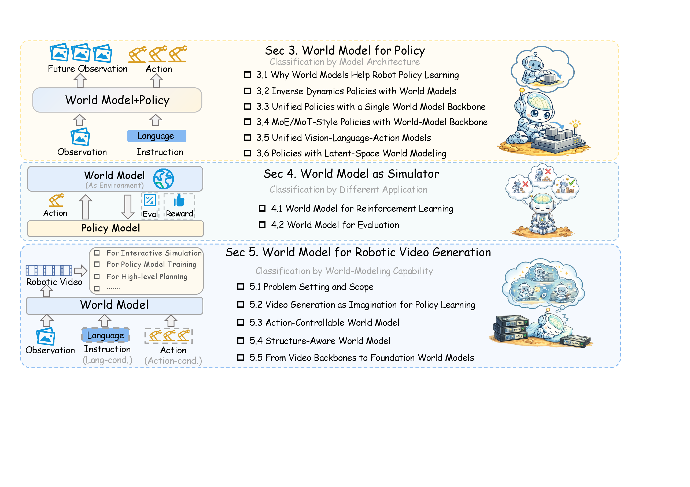{ width="920" }

<small>图源：[World Model for Robot Learning: A Comprehensive Survey](https://arxiv.org/abs/2605.00080)，Figure 1，从论文 PDF 截取。原图把机器人世界模型分成三类角色：接入 policy、作为 simulator、作为 robotic video world model。读图重点：数据 infra 不是单独服务某一个模型，而是要同时支撑动作生成、模拟评估、视频动态和数据生成。</small>

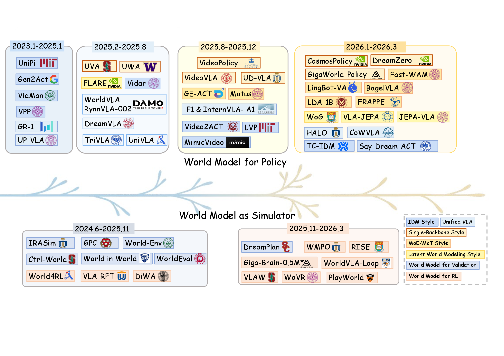{ width="920" }

<small>图源：World Model for Robot Learning survey，Figure 2，从论文 PDF 截取。原图展示 world model for policy 与 world model as simulator 的代表工作演进。读图重点：趋势不是“等一个统一模型突然出现”，而是 policy、simulator、post-training、evaluation 和 data generation 越来越缠在同一个闭环里。</small>

主线不是“数据比模型重要”，而是：

```text
World Model 的能力边界
  -> 推出具体数据需求
  -> 数据需求组织成数据飞轮
  -> 数据飞轮持续生产经验，让模型逼近上限
```

如果把这层判断压缩成一句话，就是：**能持续生产经验的系统，才是真正的基础设施。**

## 三个能力瓶颈，把问题推回数据系统

### 瓶颈一：Policy 学了“状态到动作”，但没有被要求解释后果

当前主流 VLA 的学习范式，本质上是在给定图像、本体状态和任务语言后预测动作 chunk。这个范式有效，但天然有一个缺口：policy 在训练时只知道“做什么动作”，不知道动作之后世界变成什么。

在训练分布内，这个问题被成功示教掩盖了。因为示教里的动作本来就通向成功。但一旦进入 OOD 状态，比如物体位置偏一点、抓取角度偏一点、衣物折叠阶段错一点，policy 很容易做出“局部合理但全局错误”的动作。

修复这个瓶颈，需要的数据不是单纯动作标签，而是动作标签加上对应的未来状态或视频，也就是动作-后果对。未来视频在这里不是展示材料，而是密集动态监督：每一帧都在告诉模型，这段动作有没有把世界推向正确方向。

{ width="920" }

<small>图源：[Hugging Face LeRobotDataset v3.0 blog](https://huggingface.co/blog/lerobot-datasets-v3)。原图把机器人数据拆成 tabular data、visual data 和 metadata。读图重点：一个 episode 不是视频文件，而是状态、动作、视频、统计量、episode 边界、schema 和元数据一起可追溯。</small>

{ width="820" }

<small>图源：[CALVIN GitHub README](https://github.com/mees/calvin)，归档。原图展示多视角 RGB-D、静态相机、夹爪相机和本体状态。读图重点：World Model 要预测动作后果，必须先拿到同步的多模态时序记录。</small>

### 瓶颈二：Simulator 如果只吃顺境数据，就只会生成顺境幻觉

World Model 作为 simulator 的价值很直观：降低真机采集成本，让机器人在虚拟环境里反复练习。但 simulator 是在真实数据上训练出来的。它能生成什么，本质上取决于训练分布里有什么。

如果训练数据只有顺利完成任务的轨迹，simulator 就会天然偏向顺境。那些真实部署里常见的边缘状态，比如接触时物体滑动、遮挡导致视野消失、抓取角度偏差导致失败，可能根本不会进入它的想象空间。

这会制造一个危险闭环：偏向顺境的 simulator 会系统性高估策略能力，policy 在 simulator 里表现很好，一上真机就失败。解决办法不是只扩大数据量，而是让 simulator 持续被真实接触、真实失败和异常初态校正。

这也是公开数据集和企业私有数据之间最核心的差异。Open X-Embodiment 这样的数据集解决了规模、格式和跨本体共识的问题，但它不能自动补齐每个本体、每个任务、每种失败状态的部署分布。Simulator 的经验边界，最终仍然受制于它从未见过哪些真实失败。

{ width="820" }

<small>图源：[Open X-Embodiment / RT-X](https://robotics-transformer-x.github.io/)，Figure 1，从论文 PDF / 项目材料归档。原图统计 robot embodiment、scene、trajectory、skill 和 object category 的分布。读图重点：公开数据集解决“少”的问题，但动作接口、相机视角、控制频率和失败样本分布仍会影响 simulator 的真实性。</small>

{ width="900" }

<small>图源：[π0.5](https://www.physicalintelligence.company/blog/pi05)，Figure 10，从论文 / 官方材料归档。原图比较去掉 web data、cross-embodiment data、multi-environment data 等来源后的表现变化。读图重点：数据源不是简单相加，每类数据补的能力不同；simulator 需要知道自己的训练分布缺什么。</small>

### 瓶颈三：Evaluator 如果只见过顺境样本，就会选错 checkpoint

当我们训练出多个候选策略，想知道哪个更适合真机部署时，World Model 可以作为 evaluator：用预测结果、风险分数或候选未来来选择 checkpoint。这条路线很有价值，但也有一个常被忽视的陷阱。

Evaluator 的判断能力取决于它见过什么。如果它主要见过遥操作成功示教，它对“好策略”的定义就会偏向顺境表现。但真实机器人部署里最常见的，不是完整成功轨迹，而是偏离成功轨迹后的状态：抓偏、滑落、卡住、动作 chunk 接缝抖动、人工接管前的一瞬间。

所以 evaluator 需要的数据，是失败邻域：near-miss、人工接管、失败初态、恢复轨迹和重试成本。否则它选出来的 checkpoint 只是“在顺境里最像示教”，不一定最适合部署。

这一点值得单独强调：评测集不是中立工具，它会决定你把哪个 checkpoint 推到真机上。如果 validation set 来自训练顺境，系统会稳定选出“顺境冠军”；如果 validation set 来自部署失败邻域，它才有机会选出“真实部署里更稳”的策略。

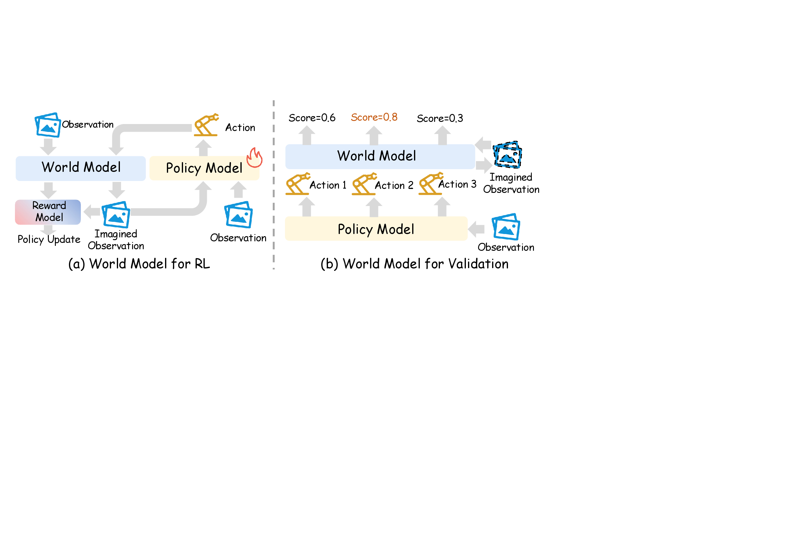{ width="860" }

<small>图源：World Model for Robot Learning survey，Figure 5，从论文 PDF 截取。原图左侧展示 learned simulator for RL，右侧展示 world model as validation / evaluator。读图重点：evaluator 不是离线打分器，而是把候选动作、policy ranking、reward / progress / risk 和真实部署失败连接起来的系统角色。</small>

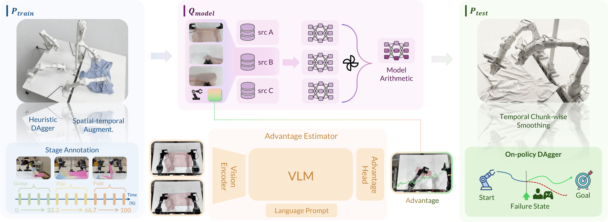{ width="920" }

<small>图源：[χ₀: Resource-Aware Robust Manipulation via Taming Distributional Inconsistencies](https://arxiv.org/abs/2602.09021)，Figure 1，从论文 PDF 截取。原图展示 \(P_{\text{train}}\)、\(Q_{\text{model}}\)、\(P_{\text{test}}\) 三类分布及对齐模块。读图重点：这是部署回流的数据飞轮图，不只是模型 pipeline。</small>

## 从三类瓶颈推出四类数据需求

把上面三类瓶颈合并，就能得到四类具体数据需求。

| 数据需求 | 对应瓶颈 | 对应飞轮 |
| --- | --- | --- |
| 稳定的空间状态 | Policy 和 simulator 都需要知道物体在哪里、空间结构是什么 | 几何资产飞轮 |
| 动作-后果配对 | Policy 不能只知道动作，还要知道动作导致什么未来 | 视频动作飞轮 |
| 部署失败邻域 | Simulator 和 evaluator 都需要贴近真实部署分布 | 部署回流飞轮 |
| 反事实长尾 | 真机采集无法穷举所有危险、稀有和边缘场景 | 混合生成飞轮 |

这四条飞轮不是论文分类，而是四种数据增值方式。它们在真实系统里不会分开运行：几何资产支撑仿真，动作后果支撑 planning，部署失败校正 evaluator，真实数据又校正仿真和合成。

也可以把它理解成一套机器人版“驾驶经验”：几何状态让系统先看清路；动作后果让它知道油门、方向盘和刹车会怎样改变未来；部署失败让它学会防御性驾驶；反事实长尾让它在模拟器里练暴雨、爆胎和视野遮挡。缺任何一类，系统都会有盲区。

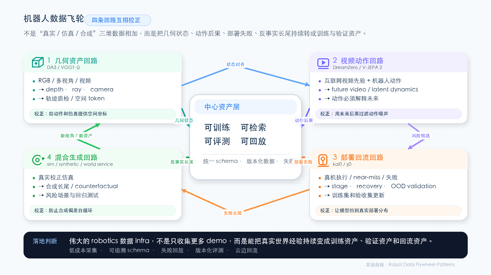{ width="920" }

<small>图源：自绘。它把四种范式压成四条互相校正的数据回路：几何资产回路提供空间状态，视频动作回路约束动作后果，部署回流回路把真实失败放回训练和验证，混合生成回路生产长尾并接受真实数据校正。</small>

## 范式一：几何资产飞轮，先把世界定位清楚

几何不是感知前处理，而是经验资产化的第一层。没有稳定几何，policy 会一直在像素层猜距离、遮挡和可达性；simulator 建出来的场景也会失真。

这条飞轮的关键词是“可结构化索引的几何资产”。它不是“多一个 depth head”，而是把一段机器人轨迹变成可以被质检、回放、检索、规划和仿真构建复用的空间状态：物体在哪里，夹爪在哪里，遮挡发生在哪里，失败前后几何状态怎样变化。

{ width="760" }

<small>图源：A Comprehensive Survey on World Models for Embodied AI，Figure 1 子图，从论文 PDF 截取。原图展示 Spatial Latent Grid 用 BEV、voxel、occupancy 或 geometry-aligned latent grid 表示空间世界。读图重点：机器人数据 infra 需要把视觉日志转成可定位、可融合、可规划的空间状态。</small>

{ width="820" }

<small>图源：[Depth Anything 3](https://arxiv.org/abs/2511.10647)，Figure 1，从论文 PDF 截取。原图展示 DA3 从任意数量视觉输入恢复 depth、ray、camera 和可融合 3D geometry。读图重点：它给机器人数据飞轮补的是“把普通 RGB 轨迹转成几何资产”的入口。</small>

DA3 的关键不是“深度估计更好”这么简单，而是 depth、ray、camera 统一输出。每个像素不只有深度值，还对应相机射线。这对机器人很重要，因为真实数据经常来自多相机、腕部相机和运动视角，标定本来就不稳定。

DA3 类方法的数据飞轮可以写成：

```text
真实 / 合成 / 多视角数据
  -> teacher 生成更干净 relative depth
  -> 和 sparse / noisy metric depth 做 robust alignment
  -> 训练 depth + ray geometry model
  -> 批处理机器人轨迹，生成几何资产
  -> 用几何资产做质检、回放、检索和仿真构建
```

{ width="920" }

<small>图源：Depth Anything 3，Figure 2，从论文 PDF 截取。原图展示单个 DINOv2 主干、跨视角 attention、camera token 和 Dual-DPT head。读图重点：几何飞轮的核心不是把 depth 当附加标签，而是把多视角视觉输入落成 depth + ray 这样的统一几何接口。</small>

{ width="820" }

<small>图源：Depth Anything 3，teacher supervision visualization，从论文 PDF 截取。原图展示真实深度的噪声和 teacher depth 的连续结构。读图重点：数据飞轮里最早的增值点不是策略训练，而是把脏几何监督清洗成能被后续模型消费的状态。</small>

VGGT-Ω 则把几何飞轮推到更大规模。它展示了一个值得关注的现象：几何重建也能出现类似 foundation model 的 scaling 行为，模型规模和数据规模同时扩大时，3D point error 会下降。

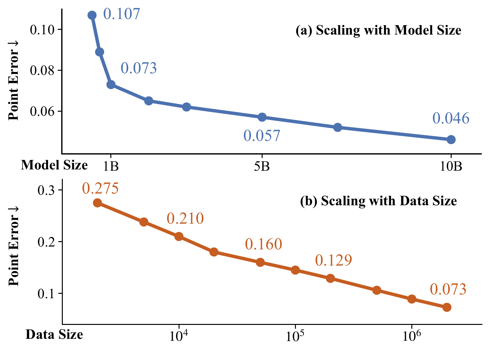{ width="760" }

<small>图源：[VGGT-Ω](https://arxiv.org/abs/2605.15195)，Figure 1，从论文 PDF 截取。原图展示模型规模和数据规模增加时 3D point error 下降。读图重点：几何重建开始像 foundation model proxy task，前提是数据标注、过滤和一致性检查能跟上。</small>

更值得机器人方向关注的是它的数据引擎。论文不是简单抓视频训练，而是经过 VLM 预过滤、动态 mask、特征匹配、初始化、bundle adjustment、dense depth 和多视角一致性检查。透明杯、细杆、反光、人体边界，这些机器人场景里常见的东西，恰好也是最容易产生几何伪标签的地方。

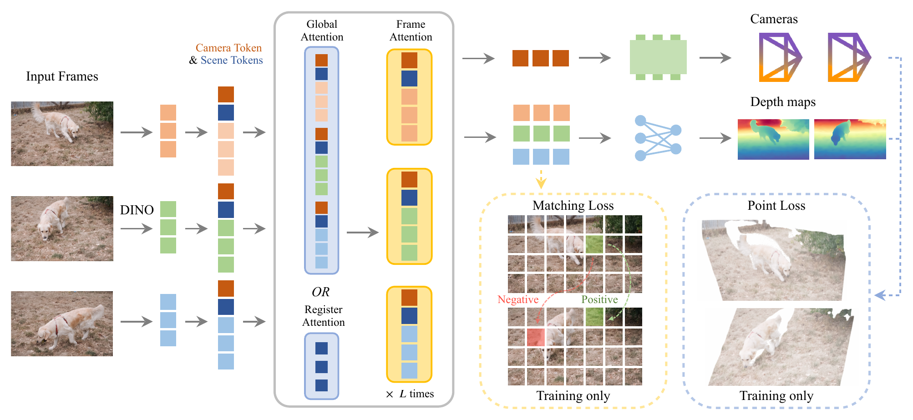{ width="920" }

<small>图源：VGGT-Ω，Figure 2，从论文 PDF 截取。原图展示从多视角图像到 camera、depth、track、point map 等几何输出的统一架构。读图重点：大规模几何模型不是“抓视频就训练”，而是数据过滤、几何一致性和输出接口共同组成的飞轮。</small>

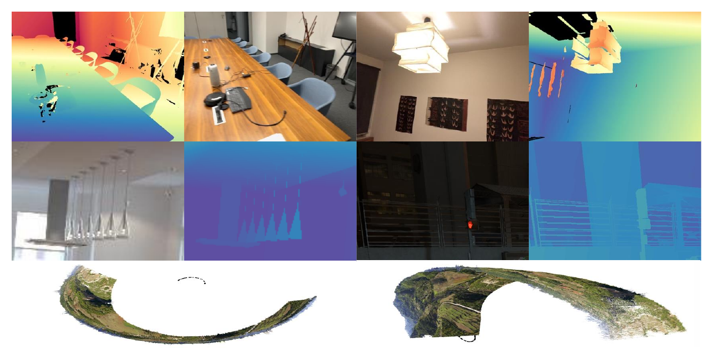{ width="820" }

<small>图源：VGGT-Ω，Common Data Issues，从论文 PDF 截取。原图展示 sensor artifact、thin structure error 和 doming effect。读图重点：数据噪声会变成模型习惯，几何伪标签如果不清洗，最后会放大成真实执行风险。</small>

几何飞轮的边界也要说清楚：它能让世界“被定位”，不等于让机器人“会操作”。几何模型知道杯子在哪里，不代表知道从哪个角度抓不会滑；知道桌面结构，不代表知道接触后物体如何运动。动作因果需要下一条飞轮来补。

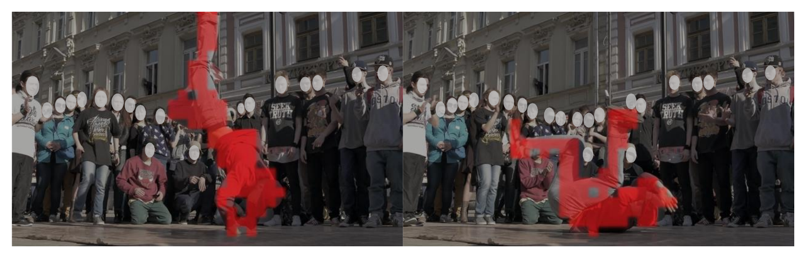{ width="820" }

<small>图源：VGGT-Ω，motion-aware 示例，从论文 PDF 截取。读图重点：动态物体和运动场景进一步说明，几何资产飞轮必须处理时序状态，而不能只做单帧重建。</small>

## 范式二：视频动作飞轮，让动作对未来负责

视频动作飞轮的核心，是从“状态到动作”转向“动作到未来状态”。传统 VLA 把动作作为输出；WAM 类方法把动作和未来视频共同建模，让模型必须解释动作会导致什么后果。

这会改变同一段示教轨迹的价值。在普通 VLA 里，它主要提供动作标签；在 WAM 里，它同时提供动作、动作后的观测序列，以及未来是否接近任务目标的密集监督。视频动作飞轮把“示教数据”升级成了“后果数据”。

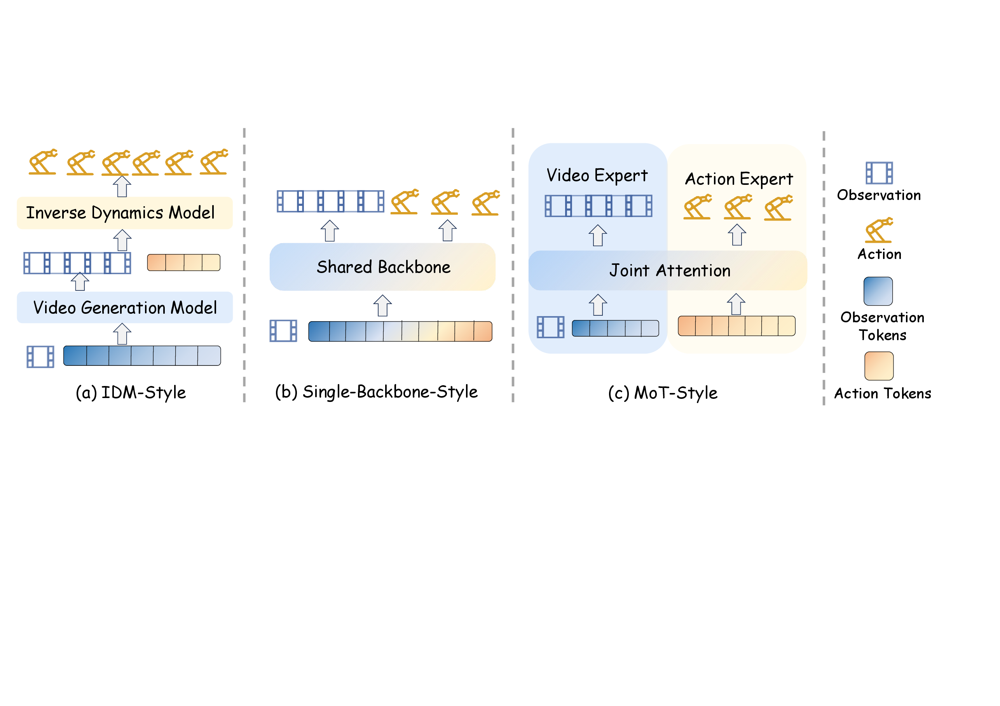{ width="920" }

<small>图源：World Model for Robot Learning survey，Figure 3，从论文 PDF 截取。原图展示 IDM-style、single-backbone-style 和 MoT-style 三种 world model 支撑 policy 的架构范式。读图重点：视频动作飞轮的关键问题是未来预测在哪里影响动作。</small>

{ width="920" }

<small>图源：[World Action Models are Zero-shot Policies / DreamZero](https://arxiv.org/abs/2602.15922)，Figure 1，从论文 PDF 截取。原图展示 DreamZero 从预训练视频扩散 backbone 出发，联合建模未来视频和动作。读图重点：它的数据飞轮关键不是“视频更多”，而是把异构机器人数据里的未来变化转成动作监督。</small>

{ width="920" }

<small>图源：DreamZero，Figure 2，从论文 PDF 截取。原图展示模型同时生成未来视频和动作。读图重点：动作不再是从视频后处理出来的控制量，而是在训练目标里和未来画面共同对齐。</small>

DreamZero 的思路可以拆成三层。

| 数据层 | 论文里的作用 | 飞轮意义 |
| --- | --- | --- |
| 大规模视频 backbone | 提供世界动态先验 | 降低从零学习物体和场景变化的成本 |
| 少量机器人动作数据 | 对齐 action chunk、本体状态和控制频率 | 把视觉动态接到目标机器人身体上 |
| video-only demo / play data / post-training | 做任务迁移和少样本适配 | 新任务不用完全从零收大量重复示教 |

这条线的边界也很重要：视频可以迁移任务目标和世界动态，迁移不了机器人的身体控制。跨机器人 video-only demo 有价值，但最后仍要用目标机器人的动作接口和控制频率完成对齐。

{ width="920" }

<small>图源：DreamZero，Figure 4，从论文 PDF 截取。原图展示视觉上下文、语言、本体状态、未来视频 latent 和动作 latent 如何进入同一个自回归 DiT。读图重点：视频基础模型要进入机器人闭环，必须接上状态、动作、动作 chunk 和真实观测刷新，而不是只离线生成未来画面。</small>

DreamZero 给数据飞轮的另一个启发，是推理不能长期相信自己生成的未来。真实机器人每执行一小段动作，都会得到新的观测；这些观测要回写上下文，打断错误想象的累积。对 WAM 来说，闭环观测刷新、低延迟推理和失败回放不是部署优化，而是模型能不能真机工作的前置条件。

{ width="920" }

<small>图源：DreamZero，Figure 11，从论文 PDF 截取。原图展示 robot-to-robot 和 human-to-robot 的 video-only demonstration 对未见任务的帮助。读图重点：视频可以跨具身共享任务动态，但不能替代目标机器人的动作对齐。</small>

V-JEPA 2 和 WAM 可以放在一起看：先从大量观察数据里学习世界表征，再把动作接进来。V-JEPA 2 在潜空间预测未来表征，而不是直接生成像素；这使它更适合被 planner 消费，因为它的目标不是给人看漂亮视频，而是给机器人选择动作。

{ width="920" }

<small>图源：[V-JEPA 2](https://arxiv.org/abs/2506.09985)，action-conditioned world model 图，从论文 PDF 截取。读图重点：World Model 要进入机器人闭环，必须接收候选动作并输出可用于规划的未来状态或评分。</small>

视频动作飞轮可以按能力阶梯来判断证据强弱。更稳的拆法是三层：先能按任务想象结果，再能按动作预测未来，最后让 planner 或 MPC 真正消费这些预测。

| 能力层级 | 说明 | 证据强度 |
| --- | --- | --- |
| task-conditioned imagination | 能想象任务完成后的状态 | 有用，但离闭环还远 |
| action-conditioned prediction | 能预测给定动作后的未来 | 更接近 policy 支撑 |
| planner / MPC 消费 | 预测真正指导动作选择 | 最接近机器人任务成功率 |

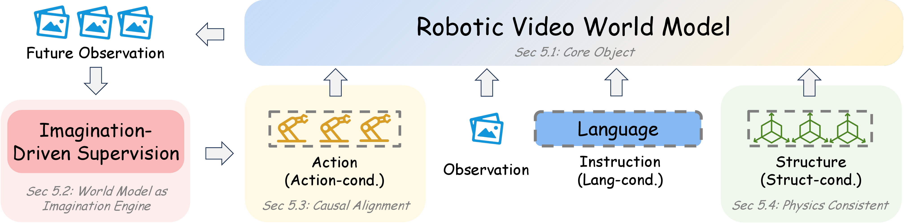{ width="920" }

<small>图源：World Model for Robot Learning survey，Figure 6，从论文 PDF 截取。原图把 robotic video world model 的能力从 task-conditioned imagination 推到 action conditioning、structure priors 和 foundation-scale video backbone。读图重点：数据 infra 的任务，是把普通视频先验一步步接到动作、结构、长时一致和真实机器人闭环上。</small>

{ width="900" }

<small>图源：V-JEPA 2，robot planning results 表，从论文 PDF 截取。读图重点：真正有说服力的证据，不是生成视频是否逼真，而是 World Model 被规划器消费后，机器人任务成功率是否提升。</small>

视频动作飞轮也有风险：错误想象会给错误动作找理由。WAM 把动作和未来画面耦合，如果未来预测错了，动作选择也会跟着错，而且模型可能生成一个看起来合理的未来画面，让错误推理链自洽。

{ width="920" }

<small>图源：DreamZero，Figure 16，从论文 PDF 截取。原图展示 generated video 与 executed action 的失败配对。读图重点：数据飞轮不能只回收成功视频，也必须回收“模型想象和真实执行如何一起错”的样本。</small>

因此视频动作飞轮必须和部署回流飞轮配合。真实观测刷新、安全检查、低延迟部署、失败回放和人工接管，不是工程细节，而是 WAM 进入真机系统的底线。

## 范式三：部署回流飞轮，把真实失败放到中心

部署回流飞轮直接回应 evaluator 的瓶颈，但它的意义不只是为 evaluator 服务。它从根本上改变了数据采集逻辑：不是补更多成功 demo，而是补部署分布里的失败邻域。

示教分布反映的是“人类在理想条件下做任务”。真实部署分布反映的是“机器人在真实条件下，经常处于半成功、半失败之间”。这两个分布之间的缺口，不会随着收集更多顺利示教而缩小，只会随着真实部署失败数据的回流而缩小。

部署回流飞轮最重要的一句是：**部署回流不是补数据量，而是补分布缺口。** 训练集里常见的是完整成功轨迹，部署里常见的是偏离后的中间状态；如果这些状态没有进入训练集和验证集，evaluator 就无法知道哪个 checkpoint 真正适合上线。

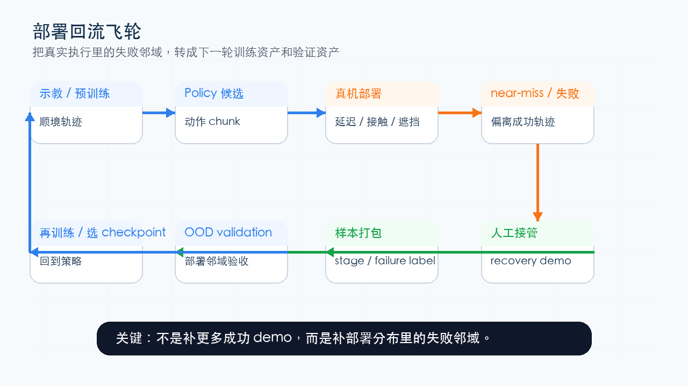{ width="920" }

<small>图源：自绘。它把部署回流拆成示教、policy 候选、真机部署、near-miss / 失败、人工接管、样本打包、OOD validation 和再训练。读图重点：部署飞轮不是“多收 demo”，而是让失败邻域进入训练和验证。</small>

{ width="920" }

<small>图源：自绘。它把 \(P_{\text{train}}\)、\(Q_{\text{model}}\)、\(P_{\text{test}}\) 画成三类分布。读图重点：evaluator 如果只见过训练顺境，就会选错 checkpoint；必须用 recovery data 和 OOD validation 把部署分布写回系统。</small>

kai0 的飞轮可以写成：

```text
expert demos
  -> pi0.5 full-parameter finetuning
  -> subset checkpoints and model arithmetic
  -> stage advantage labels for progress
  -> real deployment with chunk smoothing
  -> heuristic / on-policy DAgger recovery
  -> OOD validation and next training mixture
```

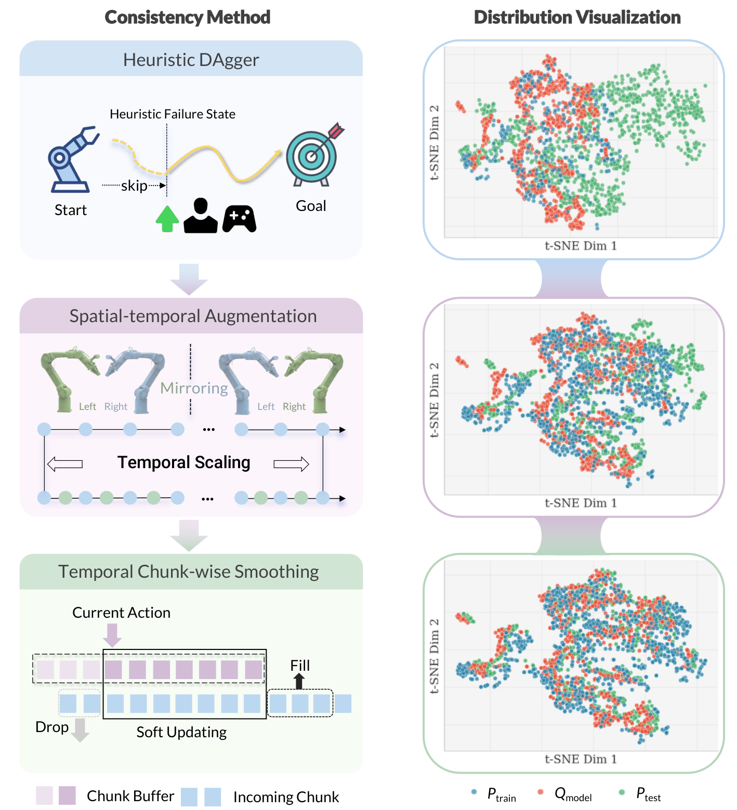{ width="820" }

<small>图源：kai0，Figure 4，从论文 PDF 截取。原图展示 Heuristic DAgger、spatio-temporal augmentation 和 temporal chunk-wise smoothing。读图重点：部署回流飞轮不是只把失败视频存起来，而是把失败初态、恢复动作、动作平滑和验证集选择一起纳入系统。</small>

这篇论文最值得借鉴的不是某一个模块名，而是工程习惯。

| 模块 | 数据飞轮读法 |
| --- | --- |
| Heuristic DAgger | 把失败初态和人工恢复动作收回训练集 |
| Stage Advantage | 让 policy 知道任务处于哪个阶段，而不只看当前图像 |
| Chunk smoothing | 处理 action chunk 接缝处的抖动，降低执行中的失败率 |
| OOD validation | 验证集来自部署失败邻域，而非训练顺境样本 |
| Model arithmetic | 用多个数据子集训练出的 checkpoint 形成策略多样性，再用部署邻域验证 |

{ width="860" }

<small>图源：kai0，Figure 7，从论文 PDF 截取。原图比较 model arithmetic 变体、single-best 和 full-data candidate。读图重点：checkpoint 合并本身不是魔法，关键在于用更接近部署失败邻域的 OOD validation 来选择和验证策略。</small>

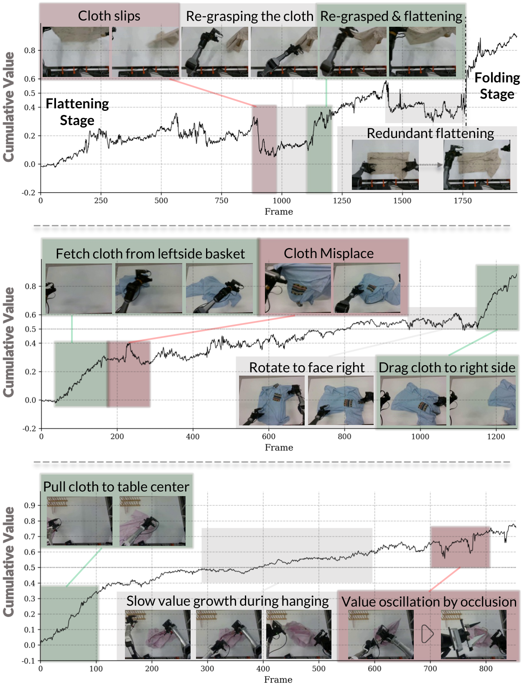{ width="920" }

<small>图源：kai0，Figure 3，从论文 PDF 截取。原图展示 stage advantage 如何把阶段信息注入训练。读图重点：长时任务里的相似视觉状态，需要 stage / progress 这样的结构化标签，否则动作很容易错位。</small>

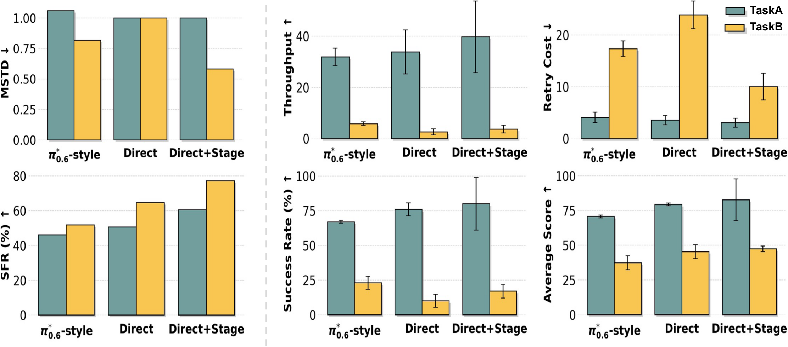{ width="860" }

<small>图源：kai0，Figure 8，从论文 PDF 截取。原图比较 Stage Advantage 的稳定性和任务表现。读图重点：长时任务不能只记录最终成功失败，还要记录 stage、progress、停滞和回退，才能把失败回流变成可训练信号。</small>

{ width="860" }

<small>图源：kai0，Figure 11，从论文 PDF 截取。原图比较 temporal chunk-wise smoothing、temporal ensembling、RTC 和增强策略。读图重点：数据飞轮最后要落到真实控制链路，推理延迟、动作 chunk 接缝和低层控制频率都会决定回流数据能否转化成可靠执行。</small>

这里也必须保留边界。kai0 的证据集中在特定双臂衣物任务族、特定硬件平台和采集方式下。它的价值不在于证明“任意 20 小时数据都够”，而在于证明：当数据回流、验证分布和部署分布被系统性对齐时，真实机器人任务可以显著变稳。

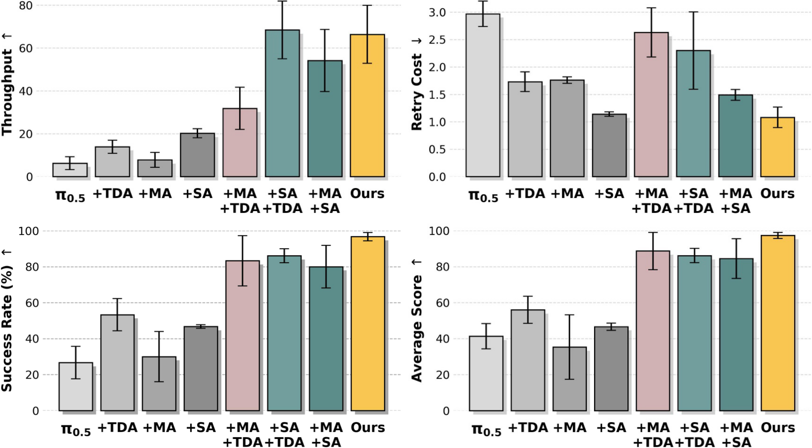{ width="920" }

<small>图源：kai0，system efficacy 图，从论文 PDF 截取。读图重点：部署飞轮的可信度来自边界清楚，而不是 claim 更大。有效性必须绑定任务族、硬件系统、采集方式、验证分布和运行环境。</small>

## 范式四：混合生成飞轮，真实、仿真、合成互相校正

第四条飞轮是把前三条整合起来的系统视角：真实、仿真和合成数据不是三堆数据相加，而是在 World Model 框架下互相校正。

真实机器人数据是校正锚点。它提供接触力、传感器噪声、控制延迟和真实部署分布，这些是仿真和生成难以完全复现的。仿真数据提供可控性，可以系统生成碰撞、长尾初态和任意相机视角。生成式 World Model 可以扩充候选未来，预演风险。

最大风险是偏差循环：如果合成数据生成后没有被真实失败数据校正，就会把 World Model 已有偏差再喂给 World Model，让偏差在每一轮迭代里越积越深。所以混合生成飞轮的关键不是“生成更多”，而是“生成之后如何验收、过滤、回流”。

{ width="920" }

<small>图源：[Towards Video World Models](https://www.xunhuang.me/blogs/world_model.html)，Figure 2，从论文 / 项目材料归档。原图把 internal world model、external world model、video world model、simulation platform 和 neural 3D/4D 放在同一张 taxonomy 里。读图重点：混合生成飞轮不是单一视频生成路线，而是物理仿真、视频生成、3D/4D 表示和内部动态模型互相补位。</small>

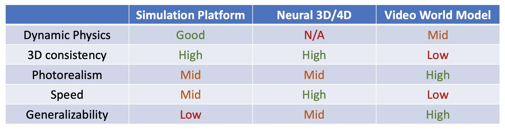{ width="920" }

<small>图源：Towards Video World Models，simulation approaches 图，从论文 / 项目材料归档。读图重点：仿真、视频生成和世界模型服务化之间不是替代关系，而是用真实数据互相校正的工程栈。</small>

| 数据域 | 适合提供什么 | 主要风险 |
| --- | --- | --- |
| 真实机器人数据 | 接触、传感器噪声、控制延迟、部署分布 | 贵、慢、失败样本不均匀 |
| 互联网 / 第一视角视频 | 人类活动、物体动态、语义和视觉变化先验 | 没有机器人动作接口，因果控制弱 |
| 3D / 仿真数据 | 可控场景、反事实、碰撞、长尾初态 | sim-to-real gap、资产和材质偏差 |
| 合成 world model 数据 | 扩充候选未来、生成风险预演 | 可能把模型偏差重新喂给模型 |
| 部署遥测 | 真实失败、near-miss、延迟和恢复轨迹 | 需要隐私、安全和数据治理 |

这条飞轮的工程验收点不是“合成比例是多少”，而是三件事。第一，合成样本有没有被真实数据过滤；第二，仿真场景有没有被几何资产和失败回放校准；第三，生成出来的风险样本有没有进入 OOD validation，而不是只进入训练集。

这部分可以接到 [世界模型 Infra](world-model-infrastructure.md) 的工程视角：数据湖、streaming I/O、记忆检索、分布式训练、服务化部署和边缘回传，不是外围工具，而是 World Model 能持续运行的基础设施。

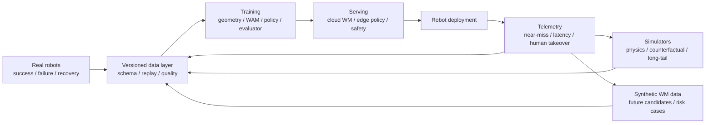

## 一张总表：四条飞轮分别修什么

| 范式 | 最小闭环 | 代表输入 | 代表输出 | 最适合的机器人任务 | 最大短板 |
| --- | --- | --- | --- | --- | --- |
| 几何资产飞轮 | RGB 轨迹 -> 几何伪标签 -> 轨迹质检 / 空间 token -> 下游策略 | 多视角图像、视频、深度、相机 | depth、ray、camera、scene tokens、point cloud | 抓取前感知、导航、数据清洗、仿真资产 | 不直接证明动作因果 |
| 视频动作飞轮 | 大视频先验 -> 机器人动作对齐 -> WAM -> 失败 / 新任务回流 | 视频、语言、本体状态、action chunk | future video、action chunk、latent dynamics | 新任务泛化、跨具身迁移、少样本适配 | 错误想象会诱导错误动作 |
| 部署回流飞轮 | 示教 -> policy -> 真机部署 -> failure / recovery -> OOD validation | 人类示教、失败初态、stage、部署 trace | recovery data、stage advantage、平滑动作、合并 checkpoint | 长时操作、衣物、恢复、低重试部署 | 人工恢复和任务标注成本仍在 |
| 混合生成飞轮 | 真实校正仿真 -> 仿真 / 合成扩长尾 -> 真实失败再校正 | 真实、仿真、合成、遥测 | counterfactual data、risk cases、评测集 | 长尾场景、危险动作预演、系统评测 | sim-to-real 和 model bias recycling |

可以把几篇论文的启发压成四句话：

```text
DA3 / VGGT-Ω 解决“世界状态怎样可计算、可质检、可复用”。
DreamZero / V-JEPA 2 解决“动作怎样对未来负责，并被规划器消费”。
kai0 解决“部署失败怎样回到训练集、验证集和控制链路”。
混合生成飞轮解决“长尾数据怎样被系统性制造、过滤和验收”。
```

## 对 robotics 基础设施公司的判断

如果文章只停留在“数据很重要”，这句话其实没什么信息量。更具体的判断应该是：World Model 越强，对持续回流经验的需求越高，而不是越低。

原因很简单。更强的 World Model 可以消费更细粒度的数据，也会更快把已有数据吃完，进入需要新经验才能继续提升的阶段。一次性的大规模数据集不够，持续采集、清洗、回流、验证的系统才是基础设施。

这也是和“下半身公司”讨论时最容易分叉的地方。硬件和运控当然是真问题，但从产业供给看，很多机器人本体已经足够强壮，真正稀缺的是把本体跑出来的真实经验沉淀成数据资产的基础设施。没有这层 infra，开源模型再好，也只是拿到一个需要被喂养、被校准、被验证的外部变量。

所以真正值得关注的 robotics 基础设施公司，可能不是只做本体，也不是只等开源模型，而是能把真实世界经验持续变成三类资产的公司：

| 资产 | 含义 |
| --- | --- |
| 训练资产 | 可训练的几何状态、动作后果、任务阶段和恢复轨迹 |
| 验证资产 | 贴近部署分布的 OOD validation、风险场景和回归集 |
| 回流资产 | near-miss、失败、人工接管、重试成本和真实遥测 |

最后的结论是：

**机器人 World Model 的数据飞轮，不是“真实、仿真、合成”三堆数据相加，而是“几何状态、动作后果、部署失败、反事实长尾”四条回路互相校正。**

硬件越强壮，瓶颈越会被推到经验生产系统上。谁能更稳定地把真实世界经验变成训练资产、验证资产和回流资产，谁就更接近下一代机器人基础设施公司的样子。

最终可以把全文收成一句话：**能持续生产经验的系统，才是真正的机器人基础设施。**

## 证据边界

- 产业报道用于说明“模型架构优先”观点真实存在，不作为技术实验证明。
- 论文图用于解释数据飞轮范式，不意味着不同任务和本体可以直接外推同等效果。
- kai0 的强证据绑定特定双臂衣物任务族、硬件系统、训练资源和验证分布。
- DreamZero / V-JEPA 2 的价值在于说明视频动作飞轮的方向，但真实机器人闭环仍需要动作接口、真实观测刷新、延迟、安全和失败回流。
- DA3 / VGGT-Ω 说明几何资产飞轮的空间基础价值，但几何可定位不等于动作可执行。

## 外部材料

- 原论文：[Depth Anything 3: Recovering the Visual Space from Any Views](https://arxiv.org/abs/2511.10647)。
- 项目页：[Depth Anything 3](https://depth-anything-3.github.io/)。
- 原论文：[VGGT-Ω](https://arxiv.org/abs/2605.15195)。
- 项目页：[VGGT-Ω](https://vggt-omega.github.io/)。
- 原论文：[World Action Models are Zero-shot Policies / DreamZero](https://arxiv.org/abs/2602.15922)。
- 项目页：[DreamZero](https://dreamzero0.github.io/)。
- 原论文：[χ₀: Resource-Aware Robust Manipulation via Taming Distributional Inconsistencies](https://arxiv.org/abs/2602.09021)。
- 项目页：[kai0](https://mmlab.hk/research/kai0)。
- 背景论文：[V-JEPA 2](https://arxiv.org/abs/2506.09985)。
- 背景数据：[Open X-Embodiment](https://robotics-transformer-x.github.io/)；[DROID](https://droid-dataset.github.io/)。
- 综述论文：[World Model for Robot Learning: A Comprehensive Survey](https://arxiv.org/abs/2605.00080)。
- 综述论文：[A Comprehensive Survey on World Models for Embodied AI](https://arxiv.org/abs/2510.16732)。
- 综述博客 / 论文：[Towards Video World Models](https://www.xunhuang.me/blogs/world_model.html)。
- 数据 infra：[LeRobotDataset v3.0](https://huggingface.co/blog/lerobot-datasets-v3)。
- 数据配方：[π0.5 blog](https://www.physicalintelligence.company/blog/pi05)。
- 产业观点：[21 财经：宇树科技王兴兴谈模型与数据](https://www.21jingji.com/article/20250809/herald/fecc404938f03df050143f46e4922853.html)；[36 氪：聊模型的王兴兴](https://eu.36kr.com/zh/p/3420014135987845)。
