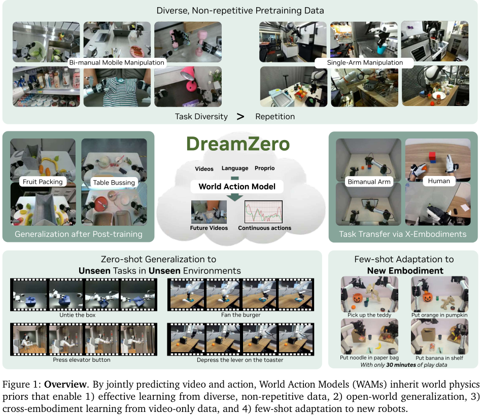
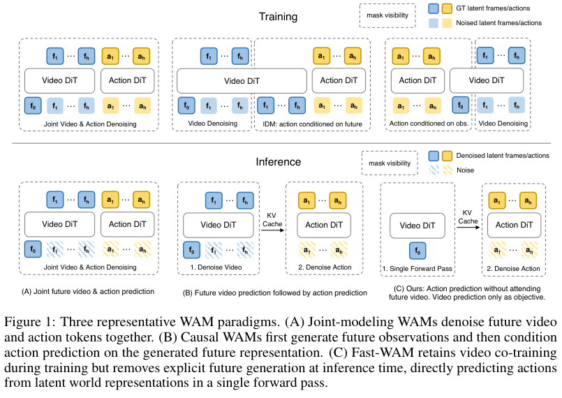
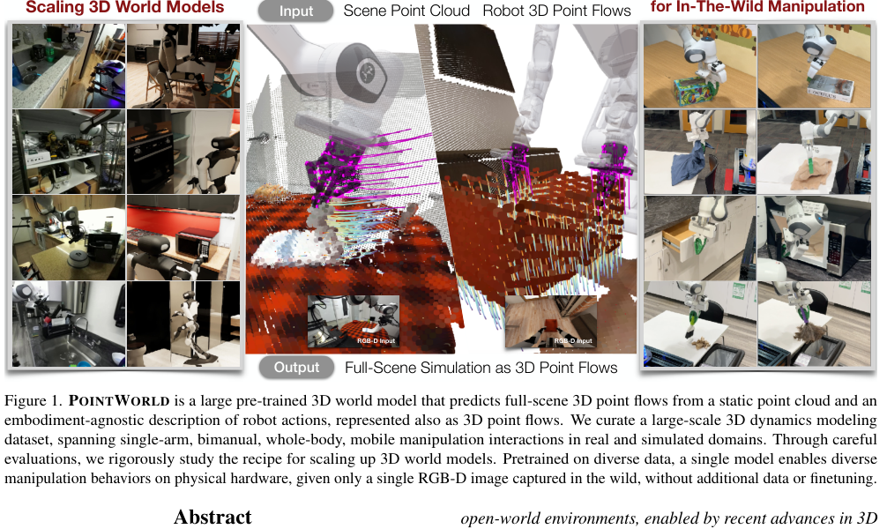
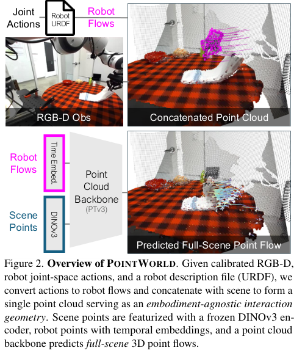
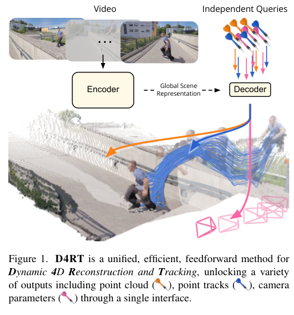
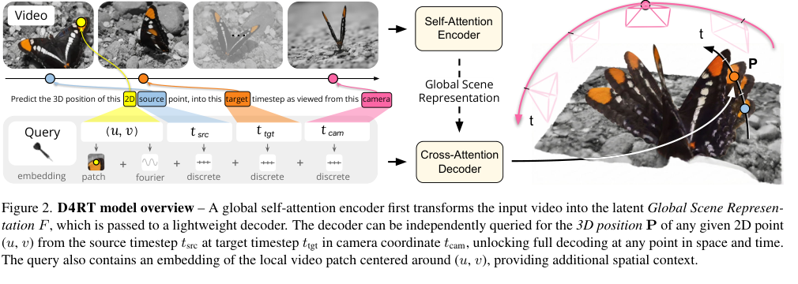
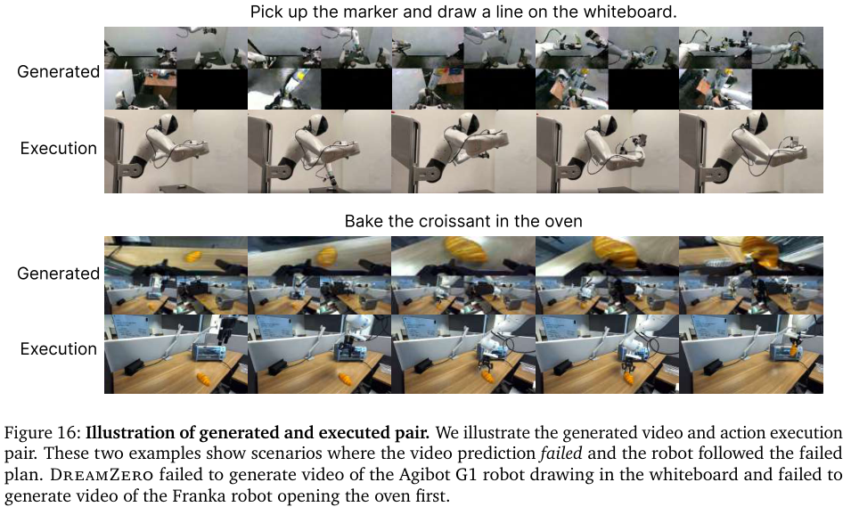

# WAM 与 3D 视觉：世界模型从视频想象走向物理闭环

> **本文关注的问题。** `World Action Models` 与 `3DV in WM` 如何从视频想象走向机器人可用的物理闭环。

2026 年具身智能里，世界模型和 WAM 迅速升温，但真正值得追问的不是“又出了哪些新模型”，而是 **世界模型到底怎样变成机器人可用的物理闭环**。

如果只从概念上讲，WAM 很容易被理解成“视频生成模型加动作头”。但结合 DreamZero、Fast-WAM、PointWorld 和 D4RT 几篇原论文看，事情更细：WAM 的价值不一定在推理时生成一段完整未来视频，而在于训练时让动作、未来状态和世界动态互相约束；3D 视觉的价值也不只是多一个输入模态，而是把未来预测变成深度、位姿、点流、轨迹和风险这些可检查的物理证据。

{ width="920" }

<small>图源：[World Action Models are Zero-shot Policies / DreamZero](https://arxiv.org/abs/2602.15922)，Figure 1，本站从论文 PDF 截取。原图展示 DreamZero 如何把多样非重复机器人数据、视频、语言、本体状态、未来视频和连续动作放进同一条 WAM 路线。本站读法：先看它的目标不是“生成好看的视频”，而是让视频动态先验服务真实机器人动作泛化。</small>

## 先把 WAM 和 VLA 分开

VLA 和 WAM 的差异可以先压成两句话：VLA 有强语义理解能力和大量真机部署实例；WAM 有物理动态建模能力和更强场景泛化潜力。这个对比还可以继续往下拆。

VLA 的典型接口是：

```text
观测 + 语言 -> 动作
```

WAM 的典型接口更像：

```text
观测 + 语言 + 本体状态 -> 未来世界 + 动作
```

差异不只是输出多了一个未来视频，而是训练信号变了。VLA 可以把动作当成监督标签回归；WAM 则要求动作和未来世界共同成立。一个动作是否合理，要看它是否能解释未来画面、物体运动、接触关系和任务进展。

DreamZero 论文的核心证据也在这里。原文强调，它基于预训练视频扩散 backbone 构建 WAM，通过联合建模 video 和 action，从异构机器人数据中学习技能，而不依赖大量重复演示；论文报告在真实机器人新任务和新环境泛化上相对 VLA 有超过 2 倍提升，并通过系统优化让 14B 自回归视频扩散模型达到 7Hz 闭环控制。这里最关键的不是数字本身，而是证据等级：它不是只展示离线视频，而是把 WAM 放进真实闭环里验证。

中文解读文章也基本抓住了这个点。具身智能观察室的 DreamZero 文章把它解释成从“观测到动作映射”转向“让动作解释未来物理状态”；机器之心转载的分析则提出一个很好的追问：DreamZero 到底是范式突破，还是数据、模型规模、时间上下文和视频辅助监督共同作用的结果。这个问题比简单喊“WAM 取代 VLA”更值得保留。

更稳妥的判断是：**WAM 不是 VLA 的替代词，而是动作学习的一种更强约束方式。** 语义层面仍需要 VLA / VLM，执行层面仍需要 controller，安全层面仍需要 checker。WAM 的独特位置，是把动作和未来动态绑定起来。

## Fast-WAM 的反向提醒：训练时世界建模，推理时未必要想象

Fast-WAM 的关键结论是：训练时视频预测监督比推理时的视频预测先验更重要；为 action prediction 加入未来帧 video tokens，并没有显著增加成功率；推理时不预测视频 tokens，则能显著减少计算开销。



<small>图源：[Fast-WAM: Do World Action Models Need Test-time Future Imagination?](https://arxiv.org/abs/2603.16666)，Figure 1，本站从论文 PDF 截取。原图对比三种 WAM 范式：联合去噪未来视频与动作、先生成未来视频再预测动作、以及 Fast-WAM 在推理时跳过未来视频分支。本站读法：这张图把“世界建模监督”和“测试时显式想象”拆开了。</small>

Fast-WAM 原论文的问题非常尖锐：WAM 的收益到底来自测试时显式生成未来，还是来自训练时视频建模带来的表示塑形？论文的结论倾向后者。它保留训练阶段的视频 co-training，但推理时跳过未来预测，直接做动作生成；论文报告 190 ms 推理延迟，比 imagine-then-execute WAM 快 4 倍以上，同时去掉视频 co-training 会带来更大的性能下降。

这对理解 WAM 很关键。很多时候，未来视频更像训练时的教师，而不一定是部署时的输出。视频预测迫使模型学习物体、手、工具和场景的时序变化；但到了控制循环里，系统可能只需要 action chunk、风险估计、任务进展或 latent state。

所以“WAM 的价值可能不只在推理时想象未来”这一点，可以更明确地表达为：

```text
训练时：视频预测提供密集动态监督，帮助动作表征对齐物理世界。
推理时：是否显式生成未来视频，要看下游是否真的消费它。
```

这也回应了青稞社区那篇 WAM 总结里的一个直觉：AC-WM 和 WAM 的区别可以从“动作是输入还是输出”来理解，但真实系统未必只选一种纯形态。未来更可能是 VLA、WAM、AC-WM、risk model 和 controller 的混合架构。

## 为什么 3D 视觉会进入 WAM

如果 WAM 只生成二维视频，它仍然会遇到一个工程问题：像素未来能不能被控制系统使用？

机器人真正关心的不是一段未来视频是否逼真，而是：

1. 物体、夹爪和目标区域在什么三维位置；
2. 相机外参、深度和尺度是否可信；
3. 动作后是否会遮挡、碰撞、滑落或卡住；
4. 任务阶段是否推进；
5. 真实观测刷新后，模型能否纠偏。

这些问题都指向 3D。二维视频可以隐含几何，但隐含不等于可检查；对 planner 和 checker 来说，深度、位姿、点云、点流和可见性比纹理更直接。

DepthVLA、PointVLA、Spatial Forcing、BridgeVLA 可以理解成“显式注入三维信息”的路线：把深度、点云、空间 token 或几何约束接入 VLA / WAM。它的优点是容易和现有架构结合，缺点是三维信号可能只是辅助特征。要证明它真的进入了世界模型层，仍然要看反事实动作、闭环成功率和失败回放。

## PointWorld：把状态和动作都放进 3D 点流

PointWorld 最能代表“3D world model”的路线野心。原论文把状态和动作统一到共享三维空间：输入 RGB-D、机器人 URDF 和关节动作后，先把机器人动作转换成 3D robot point flows，再和场景点云拼接，最后预测全场景未来点流。

{ width="920" }

<small>图源：[PointWorld: Scaling 3D World Models for In-The-Wild Robotic Manipulation](https://arxiv.org/abs/2601.03782)，Figure 1，本站从论文 PDF 截取。原图展示 PointWorld 用静态点云和机器人 3D 点流预测全场景 3D 点流。本站读法：这不是“给 VLA 加深度图”，而是把动作本身也改写成三维空间里的运动。</small>

{ .atlas-figure-compact }

<small>图源：PointWorld 论文 Figure 2，本站从论文 PDF 截取。原图表达：RGB-D 观测、URDF、关节动作先被转换成 scene points 与 robot flows 的混合点云，再由 DINOv3 与 Point Transformer V3 处理并预测 full-scene point flow。本站读法：动作接口从“某个机器人专属关节空间”转向“末端和机器人表面在 3D 中怎样运动”。</small>

原论文的几个数字值得关注：

| 维度 | PointWorld 论文证据 |
| --- | --- |
| 数据规模 | 约 2M trajectories / 500 hours，覆盖真实与仿真、Franka 与双臂人形机器人 |
| 训练配置 | PointWorld-1B 使用 128 张 H100 训练 20 天 |
| 推理速度 | 约 0.1s，可接入 MPC |
| 输出形式 | full-scene 3D point flow，而不是只预测单个物体或末端轨迹 |

这条路线对 WAM 的启发很大：如果动作最终发生在三维空间里，就不要总把动作困在某个 embodiment 的关节角里。用 3D 点流表示动作，可以更自然地表达接触、遮挡、物体形变、重力和跨机器人迁移。

但它也把数据 pipeline 的难度暴露出来了。PointWorld 的附录提到使用 FoundationStereo、VGGT、CoTracker3 等组件改善 DROID 的深度、外参和点跟踪质量。也就是说，3D 世界模型不是只靠模型结构“长出几何”，而是严重依赖深度、相机姿态、机器人 mask、点追踪和质量过滤。

这也引出一个工程判断：**Data Pipeline 仍为重中之重。**

## D4RT：4D 重建提示我们重新理解“世界状态”

PointWorld 讨论的是机器人动作条件下的 3D 点流；D4RT 则从视频 4D 重建角度给了另一个启发：动态世界不应该被拆成一堆互相打补丁的任务。

{ .atlas-figure-compact }

<small>图源：[Efficiently Reconstructing Dynamic Scenes One D4RT at a Time](https://arxiv.org/abs/2512.08924)，Figure 1，本站从论文 PDF 截取。原图展示 D4RT 用统一接口输出点云、点轨迹和相机参数。本站读法：D4RT 的意义不只是 4D 重建效果，而是把深度、点轨迹、相机和动态场景放进同一套查询接口。</small>

{ width="920" }

<small>图源：D4RT 论文 Figure 2，本站从论文 PDF 截取。原图展示 D4RT 的全局场景表示和查询式 decoder：给定源点、源时刻、目标时刻和相机参考帧，模型预测目标 3D 位置。本站读法：这类 query interface 很适合作为世界模型状态层的设计参考。</small>

D4RT 项目页和 DeepMind 博客都强调同一点：它不是为 depth、tracking、camera pose 分别做一个模块，而是用统一 encoder-decoder Transformer 和查询机制，在一个 global scene representation 上按需解码。DeepMind 博客还强调，传统动态场景 3D 理解往往慢且碎片化，而 D4RT 的查询式设计能让 4D 重建更接近实时应用。

雷峰网的中文解读有一句判断值得吸收：D4RT 重要的不是“更多模块”，而是用一个干净接口把原本分裂的任务收拢到同一套表示里。这个观点放到 WAM 里也成立。真正有用的世界模型，不应该是视频模型、深度模型、跟踪模型、位姿模型和动作模型的松散拼接；它至少要有一个能被不同消费方查询的状态表示。

## 中文公众号文章给的三个提醒

相关中文解读里，有三类观点值得吸收，但它们都应该作为“理解线索”，不能替代论文证据。

**第一，WAM 的核心争议是动作接口。**

青稞社区的 WAM 总结把 AC-WM 和 WAM 的差别讲得很直观：AC-WM 里动作是输入，WAM 里动作和未来状态一起输出。这是很好的入门视角。但工程上不能停在二分法，因为 Fast-WAM 已经说明，训练时的世界建模和推理时的未来生成可以拆开。

**第二，DreamZero 的成功不该被解释成单因素胜利。**

机器之心转载的分析文章问得很对：DreamZero 是范式突破，还是数据、模型主干、时间上下文和视频辅助监督一起造成的结果？更稳妥的解释倾向后者。WAM 的范式很重要，但没有多样数据、14B 视频 backbone、闭环缓存、系统优化和真实评测，它很难单独成立。

**第三，产业文章里的“先思后行”叙事要保留，但要降温。**

36氪等文章把 WAM 写成从“盲动”到“规划推理”的转变，这个方向感是对的：机器人需要执行前评估动作后果。但学术写作里还要补一句：模型想象可能错，错误未来会诱导错误动作，所以必须有真实观测刷新、安全过滤和失败回放。

DreamZero 论文自己的失败图就说明了这点。

{ width="920" }

<small>图源：DreamZero 论文 Figure 16，本站从论文 PDF 截取。原图展示 generated video 与 executed action 的失败配对。本站读法：WAM 更强也更危险，因为错误未来和错误动作可能互相支持；闭环系统必须能在真实观测刷新后纠偏。</small>

## 综合判断

把原论文和中文解读合起来看，可以收束成三句话。

**第一，WAM 的核心不是生成未来，而是让动作对未来负责。**

DreamZero 证明视频动作联合建模可以做真实机器人闭环策略；Fast-WAM 则提醒我们，显式未来生成未必是部署时必要条件。两篇放在一起看，结论更稳：WAM 的关键收益来自 world modeling 对动作表征的约束，而不是每次推理都必须完整想象未来。

**第二，3D 视觉进入 WM，不是为了“多模态”，而是为了可验证。**

PointWorld 把状态和动作统一成 3D point flows；D4RT 用统一查询接口重建动态 4D 世界。它们都在回答同一个问题：世界模型输出的未来，能不能被 planner、controller、checker、人审和 replay 系统消费？

**第三，Data Pipeline 是 3DV with Scaling 的前提。**

二维视频模型 scaling 有 web video 支撑；3D 世界模型 scaling 需要深度、外参、尺度、点轨迹、机器人 mask、仿真与真实对齐。没有这些，3D 只会成为 noisy auxiliary signal；有了这些，WAM 才可能从“视频想象”走向“物理闭环”。

## 一个更可落地的系统图


这张图比“一个大模型控制机器人”更朴素，但更接近工程现实。WAM 提供动态先验，3D 视觉提供物理状态，VLA 提供语义接口，planner/controller 提供可执行性，data pipeline 提供持续改善。

## 最后判断

WAM 的真正价值，不是让机器人拥有一段更高清的想象，而是让动作必须对未来负责。3D 视觉的真正价值，也不是给模型多一个输入通道，而是把未来变成可验证、可规划、可回放的空间事实。

核心判断可以压成一句话：

**3DV with Scaling will benefit WM，但前提是 3D 数据、动作接口和闭环评测一起 scaling。**

## 外部精读

- 原论文：[World Action Models are Zero-shot Policies / DreamZero](https://arxiv.org/abs/2602.15922)。
- 原论文：[Fast-WAM: Do World Action Models Need Test-time Future Imagination?](https://arxiv.org/abs/2603.16666)。
- 原论文：[PointWorld: Scaling 3D World Models for In-The-Wild Robotic Manipulation](https://arxiv.org/abs/2601.03782)。
- 原论文：[Efficiently Reconstructing Dynamic Scenes One D4RT at a Time](https://arxiv.org/abs/2512.08924)。
- 项目页：[DreamZero project](https://dreamzero0.github.io/)。
- 项目页：[Fast-WAM project](https://yuantianyuan01.github.io/FastWAM/)。
- 项目页：[PointWorld project](https://point-world.github.io/)。
- 项目页：[D4RT project](https://d4rt-paper.github.io/)。
- 中文解读：[具身智能观察室：DreamZero 世界模型实现零样本泛化与跨具身迁移](https://zhuanlan.zhihu.com/p/2018725795179295138)。
- 中文解读：[机器之心：训练机器人方式对了吗？英伟达 DreamZero 双榜第一新反思](https://h5.ifeng.com/c/vivo/v0020FItFu9mPWErnPrPMhIuSL2lAGRS6r2Rf5vwu9zgYEQ__?vivoBusiness=hiboardnews)。
- 中文解读：[青稞社区：关于 World Action Model 的思考和总结](https://qingkeai.online/archives/20260406)。
- 中文解读：[36氪：世界模型驱动，具身智能告别“盲动”时代](https://eu.36kr.com/zh/p/3678363993252488)。
- 中文解读：[雷峰网：D4RT 统一、高效的动态 4D 场景重建](https://www.leiphone.com/category/ai/gTcpiNZWLaQMDCtG.html)。

## 相关阅读与下一步

- 站内下一步：[WM / WAM / VAM：动作到底怎样进入世界模型](../world-models/wm-wam-vam-and-action-conditioned-modeling.md)。
- 站内下一步：[DreamZero：世界动作模型为什么可以做零样本策略](../paper-deep-dives/embodied-ai/dreamzero.md)。
- 站内下一步：[VLA、WAM 与世界模型系统图](../embodied-ai/vla-wam-world-model-system-map.md)。
- 站内下一步：[相机、深度与机器人视觉](../embodied-ai/cameras-depth-and-robot-vision.md)。
- 站内下一步：[VGGT：前向恢复相机、深度、点云与轨迹](../paper-deep-dives/embodied-ai/vggt.md)。
