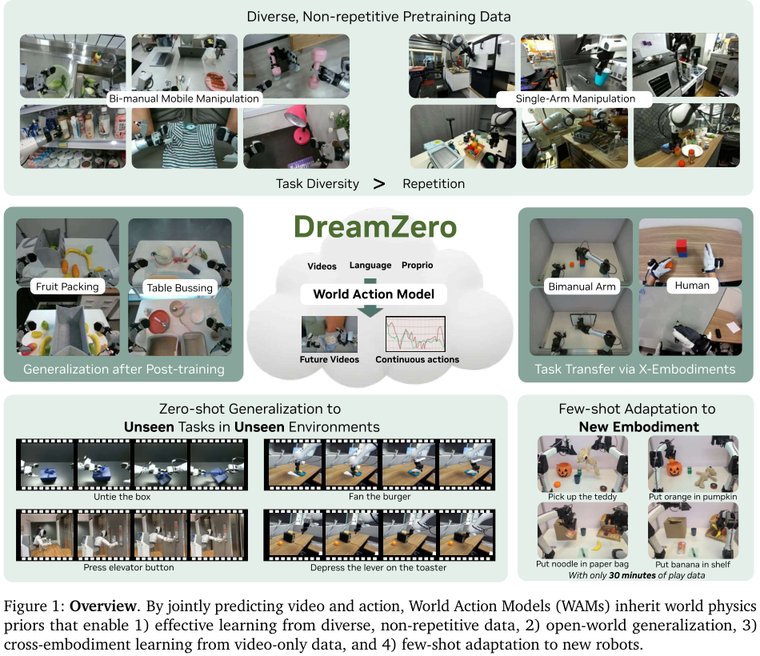
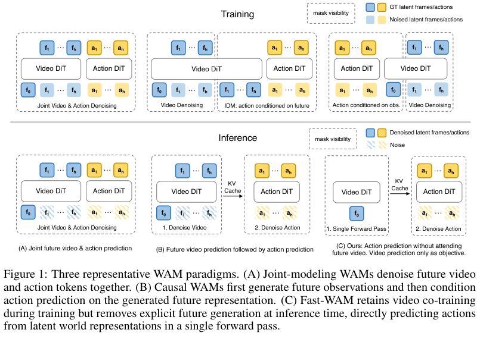
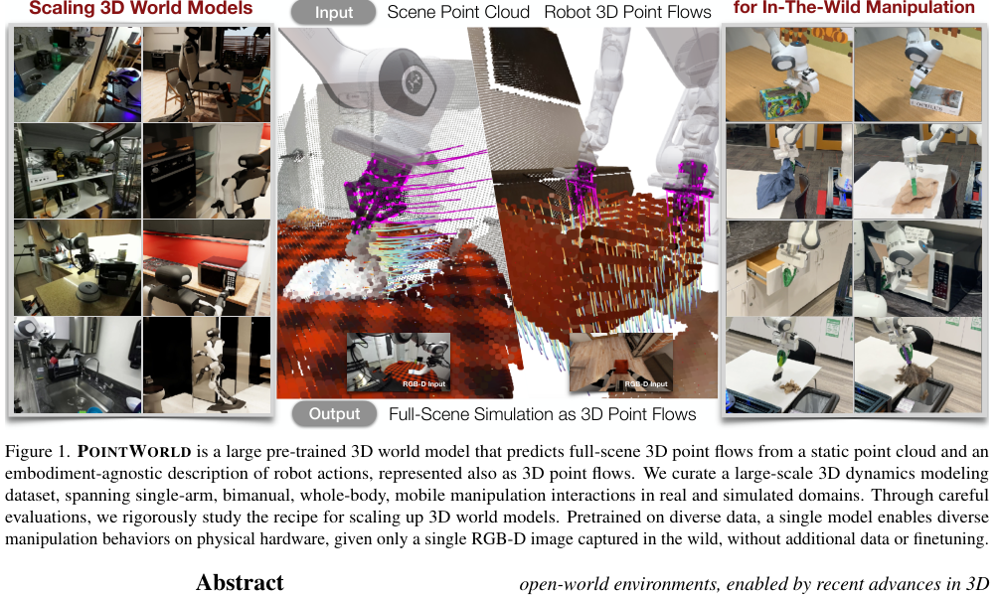
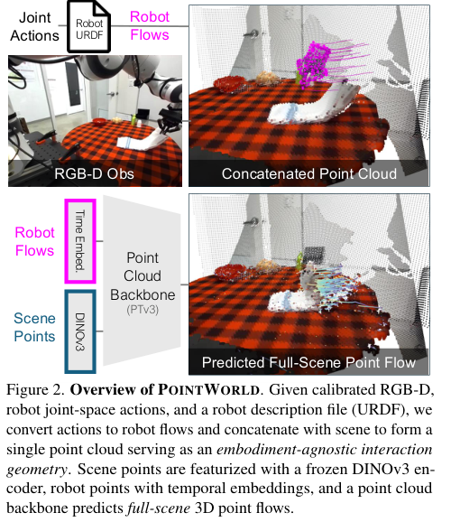
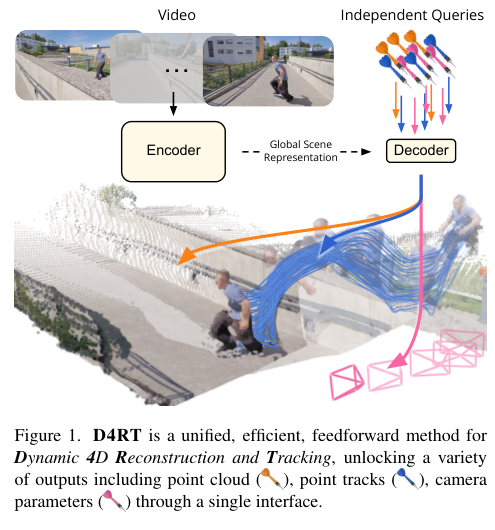
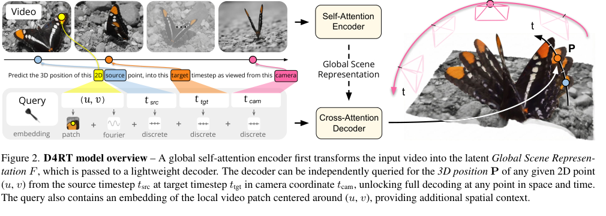
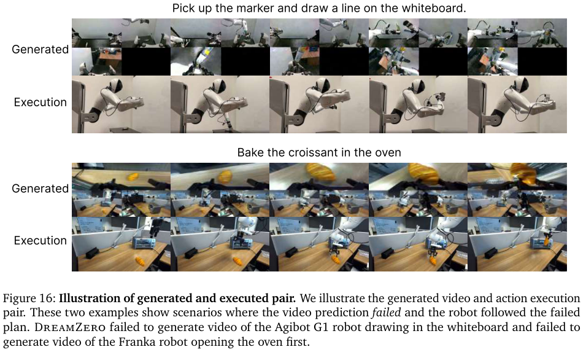

# WAM 与三维视觉，分别怎样解释一次推杯子的动作

机械臂准备从左侧推杯子。视频模型可以预测杯子会向右移动，三维模型可以预测杯子表面各点的位移，控制策略可以直接输出末端轨迹。它们描述同一个过程，却在提供不同类型的信息。选择哪种表示，需要看后续决策怎样使用它。

把 VLA 简化成“只懂语义”、把 WAM 简化成“已经懂物理”都过于粗糙。动作学习也可以包含记忆、几何和反馈，未来视频监督也会遗漏接触与隐藏力。下面沿推杯子任务解释视频、点流和重建的连接。

## 视频与动作联合建模，增加了哪条约束

如果训练样本只给当前图像和动作，模型主要学习它们的配对。加入未来视频后，内部表示还需要解释动作附近的可见变化，例如夹爪接近、杯子平移和任务阶段推进。

DreamZero 的总览图可以从观测、语言与机器人状态顺着箭头读到未来视频和动作。这展示联合建模的输入输出，支持“动作与可见后果共同学习”这一机制；是否学会未见接触规律，应由作者具体实验和进一步验证回答。

{ width="920" }

<small>图源：[World Action Models are Zero-shot Policies / DreamZero](https://arxiv.org/abs/2602.15922)，Figure 1，从论文 PDF 截取。原图展示 DreamZero 如何把多样非重复机器人数据、视频、语言、本体状态、未来视频和连续动作放进同一条 WAM 路线。</small>

这种训练可能利用视频预训练先验，也会面临动作尺度、时序对齐和生成成本。杯子看起来平移得合理，仍可能发生夹爪穿模，或者动作实际上没有足够摩擦推动杯子。可见一致性是证据的一部分。

## 训练时预测未来，部署时是否还要生成

假设一次行动预算很紧，生成未来视频要占用大部分时间。可以问，视频分支是否必须在线运行，还是它已经在训练中改善了动作表示。

Fast-WAM 的范式图恰好区分联合生成、先想象后动作与部署跳过未来预测。原文在作者设置中比较这些因素，发现保留视频共同训练、跳过测试时未来生成仍有竞争力。这个对照支持把两个因素拆开分析，不支持“未来预测对所有任务都没用”。

<small>图源：[Fast-WAM: Do World Action Models Need Test-time Future Imagination?](https://arxiv.org/abs/2603.16666)，Figure 1，从论文 PDF 截取。原图对比三种 WAM 范式：联合去噪未来视频与动作、先生成未来视频再预测动作、以及 Fast-WAM 在推理时跳过未来视频分支。</small>

推杯子若只需要快速修正末端，直接策略可能足够；若需要比较十种绕障碍路线，显式后果查询仍可能提供价值。应在同一任务、数据和端到端预算下做取舍。

## 点流让“杯子向右移动”成为可查询的几何量

设杯子上一个点当前位置为 $p=(0.4,0.1,0.2)$ m，动作后位移预测为 $\Delta p=(0.03,0,0)$ m，则下一位置为 $(0.43,0.1,0.2)$ m。对许多点都做这种预测，就可以检查目标距离、物体形变或与障碍的接近程度。

[PointWorld](https://arxiv.org/abs/2601.03782)把环境和机器人动作表示为三维点流。总览图中应先区分当前场景点与用于条件化的机器人点运动，再看预测的全场景位移。它并非只在图像输入旁添加一张深度图。

{ width="920" }

<small>图源：[PointWorld: Scaling 3D World Models for In-The-Wild Robotic Manipulation](https://arxiv.org/abs/2601.03782)，Figure 1，从论文 PDF 截取。原图展示 PointWorld 用静态点云和机器人 3D 点流预测全场景 3D 点流。</small>

动作点流可由机器人已知 URDF、关节配置序列和正向运动学得到。原文实际为效率主要采样夹爪表面点。这种公共几何描述能减少本体专属关节空间差异，但仍依赖运动学、标定与动作可执行性。

{ .atlas-figure-compact }

<small>图源：PointWorld 论文 Figure 2，从论文 PDF 截取。原图表达：RGB-D 观测、URDF、关节动作先被转换成 scene points 与 robot flows 的混合点云，再由 DINOv3 与 Point Transformer V3 处理并预测 full-scene point flow。</small>

结构图进一步说明 scene points 与 robot flows 怎样进入模型。查询预测后仍需成本函数和搜索决定动作，点流本身不等于策略。深度噪声、遮挡和点对应错误会继续传入规划；预测一段位移也不意味着系统建立了永久对象身份。

## 三维重建提供当前证据，未来干预需要额外模型

杯子被手遮住时，重建模型可以利用多帧恢复可见几何与运动。[D4RT](https://arxiv.org/abs/2512.08924)用统一查询接口估计视频中的深度、点轨迹和相机相关量。下图先看它输出的三类结果，它们来自共享场景表示。

{ .atlas-figure-compact }

<small>图源：[Efficiently Reconstructing Dynamic Scenes One D4RT at a Time](https://arxiv.org/abs/2512.08924)，Figure 1，从论文 PDF 截取。原图展示 D4RT 用统一接口输出点云、点轨迹和相机参数。</small>

下一张图把查询写得更具体，给出源图像点、源时间、目标时间和相机参考帧，得到对应三维位置。目标时间属于被输入视频支持的重建问题；这是对已观测动态的推断，并不自动给出“换一种机器人动作会怎样”的反事实动力学。

{ width="920" }

<small>图源：D4RT 论文 Figure 2，从论文 PDF 截取。原图展示 D4RT 的全局场景表示和查询式 decoder：给定源点、源时刻、目标时刻和相机参考帧，模型预测目标 3D 位置。</small>

因此可以构想先用重建建立状态，再由动作条件点流模型预测后果，最后由 planner 选择动作。但这是系统组合假设。模块之间的误差、表示转换和总时延都可能让组合不如更简单策略，必须实测。

## 让同一次失败检验三种表示

假设模型预测杯子平稳移动，实际却翻倒。视频消费者可能看到姿态变化但不知道接触原因；点流消费者可以检查哪部分位移预测错误；控制日志则能指出夹爪实际轨迹是否偏离提案。

DreamZero 的失败配对图将生成未来与执行结果放在一起。应沿同一任务比较两者在哪个阶段分离；它说明需要真实反馈打断错误想象，不足以得出某个模型家族普遍更危险或更可靠。

{ width="920" }

<small>图源：DreamZero 论文 Figure 16，从论文 PDF 截取。原图展示 generated video 与 executed action 的失败配对。</small>

一个有诊断价值的实验可固定起点、杯子和三个候选推法，分别记录视频、关键点位移、碰撞或倾倒结果和总时延。再改变杯子材质、摩擦和遮挡，检查每种表示丢失的信息。只展示最好的一段视频，很难发现这些条件差异。

三维表示提供几何查询，视频提供丰富可见线索，直接策略提供低成本反应。它们可以共同使用，也可以按任务选择。判断连接是否成立，应沿状态、动作、后果与反馈逐段检查，基础接口见[WM、WAM 与动作条件建模](../world-models/wm-wam-vam-and-action-conditioned-modeling.md)。
## 继续读

继续看[世界模型与机器人学习](../paper-deep-dives/world-models/world-model-for-robot-learning-survey.md)和[D4RT 几何查询](../paper-deep-dives/embodied-ai/d4rt.md)。
