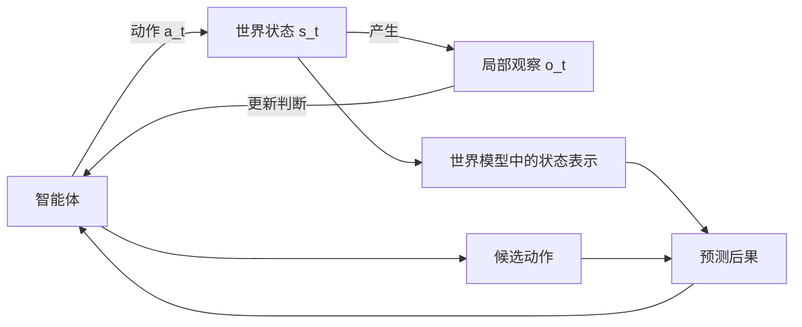

# 世界模型是什么：从预测画面到承受行动后果

> **关注的问题。** 当视频生成、3D 场景、机器人策略和强化学习都在使用“世界模型”这个词时，怎样给它一个既不过宽、也不把技术路线排除在外的定义？

“世界模型”正在变成 AI 里最容易产生误会的词之一。能生成一段视频的模型、可编辑的 3D 场景、物理仿真器、Dreamer 一类的 latent dynamics，以及带视觉输入的机器人策略，都可能被这样称呼。它们确实共享一些能力，却没有在做同一件事。

我认为，先区分两个层级，讨论才能落到可检验的地方。

- **广义的世界建模能力**：模型学习空间、时间、物体和变化之间的规律，并能以图像、结构状态或动作等形式使用这些规律
- **严格意义上的世界模型**：模型必须表示当前状态，接收行动干预，并预测干预后的状态如何变化，使智能体能据此比较行动、规划或学习

第一个定义适合描述一条技术谱系，能包容渲染、重建、预测表征和模拟。第二个定义适合判断一个系统能否进入行动闭环。两者并不冲突，差别只在讨论对象：前者问模型学到了什么，后者问模型能否对行动后果负责。

## 定义的起点是一个闭环

Fei-Fei Li 与 World Labs 的分类从强化学习中的 POMDP 闭环开始：智能体采取行动，行动改变世界状态，智能体获得局部观察，再据此采取下一步行动。这里的状态不等同于一张图像。它指向某一时刻世界中与任务有关的对象、位置、速度、属性和关系；观察只是智能体从这个状态中看到的一部分。

因此，世界模型的核心关系可以写成：

\[
s_{t+1} = f(s_t, a_t)
\]

这个式子很小，含义却很强。模型需要在当前状态相同时，对不同动作给出不同的未来；它还需要在后续观察到来后修正自己的状态。实际模型不一定显式存储完整的 \(s_t\)，也可能用视频 token、RSSM state、点云、occupancy 或 latent 表示，但动作介入后的状态转移不能缺席。

## 一段逼真的视频还缺什么

视频模型会生成连续画面，因而很容易被理解为“已经在模拟世界”。Xun Huang 的文章提供了一个清晰的分界：视频世界模型需要因果性、交互性、持久性、实时性和足够的物理准确性；其中因果性与交互性是硬约束。

普通视频生成和行动条件世界模型的差异，可以先压缩成一张表。

| 问题 | 普通视频生成 | 行动条件世界模型 |
| --- | --- | --- |
| 预测什么 | 在既有条件下，下一段画面可能是什么 | 当前状态下，采取某个动作后会发生什么 |
| 动作是否能随时介入 | 常常只能在生成前用 prompt 或条件影响 | 行动可以在 rollout 过程中注入，未来随之分叉 |
| 时间结构 | 可能一次生成一个片段，未来信息间接影响过去 | 历史决定未来，系统能持续接收新观察和新动作 |
| 成功标准 | 视觉连贯、风格和真实感 | 反事实后果、长时一致性、任务物理和闭环收益 |
| 下游用途 | 内容生成、预览、数据增强 | 规划、策略学习、仿真训练、风险评估 |

Not Boring 用“看梦”和“在梦里行动”来解释这个区别，技术上对应从 \(P(x_{t+1} \mid x_t)\) 走向 \(P(s_{t+1} \mid s_t, a_t)\)。关键不是多了一个符号，而是多了反事实问题：同一状态下，若把动作换成另一种方式，未来是否会以合理方式改变？

这也是为什么视频质量不能单独证明世界建模能力。镜头里的杯子看起来像玻璃，不代表模型知道它被推倒后会滚、会碎，还是会被桌沿挡住；模型生成的城市可以从空中看起来稳定，换成驾驶视角后却可能失去空间连续性。视觉逼真是有价值的观察输出，不能自动推出结构和动力学可信。

## 渲染、模拟与规划是不同的输出

World Labs 的文章把当下常被称为世界模型的系统分成三个功能方向。

| 功能 | 主要输出 | 关键约束 | 典型消费者 |
| --- | --- | --- | --- |
| 渲染器 | 人能看到的观察，例如像素或视频 | 视觉保真、视角一致性 | 人、创作工具、交互媒体 |
| 模拟器 | 可计算的状态，例如几何、物理和动态结构 | 结构正确、物理可操作 | 训练环境、工程工具、机器人系统 |
| 规划器 | 下一步动作或动作序列 | 目标、风险、动作后果 | 机器人、自动驾驶、软件智能体 |

这张表带来一个重要提醒：世界模型不必等于一个包办所有能力的单体模型。渲染器可以提供观察，模拟器提供状态转移，规划器消费预测后果；它们也可以在统一表征中逐步融合。

把三者称为世界模型的不同投影，是一种宽口径分类。若需要判断一个系统是否能够支撑具身决策，更严格的检查仍然是：它有没有可靠的状态转移，转移是否受行动条件约束，预测能否真的改变决策。一个只输出漂亮画面的渲染器属于世界建模技术栈，却未必单独构成可用的行动世界模型。

## 内部理解与外部模拟，服务不同尺度

Xun Huang 还区分了内部世界理解模型与外部世界模拟器。前者在抽象表示中保留任务所需的动态规律，后者试图给出人和程序都能进入的高保真环境。

这一区分避免了另一个误解：世界模型并不需要复刻现实的所有细节。下棋时，棋子位置已经足以决定规则中的未来；机器人抓取玻璃杯时，接触点、摩擦、尺度和遮挡就可能成为不可省略的状态。状态表示是否“足够”，取决于谁要消费它，以及错误会造成什么后果。

latent world model 的优势在于高效。它可以放弃不可预测的纹理细节，把计算留给长时 rollout、搜索和策略学习。生成式世界模型的优势在于可见、可检查，还能为未知的下游任务保留更多信息。两条路线的取舍不应由“是否生成像素”决定，而应由任务需要的物理细节、规划时延和验证方式决定。

## 我会用五个问题检查一个定义

“世界模型”并没有学界唯一的术语边界。与其争论标签，工程上更有用的做法是逐项追问：

1. **状态是什么？** 模型保留的是图像、几何、潜变量还是任务进度？关键接触、尺度、遮挡和对象身份会不会在表示中丢失？
2. **动作怎样进入？** 固定历史并改变动作时，预测的未来是否稳定分叉，还是继续输出最常见的画面？
3. **时间怎样展开？** 模型是否能在自己的预测历史上持续运行，并在新观察到来后更新，而非只生成一次短片段？
4. **什么叫正确？** 任务需要的是视觉可信、几何可用、物理准确、低延迟，还是风险与成功率的校准？这些指标之间往往有取舍。
5. **谁消费预测？** 预测是否真的被 planner、policy、controller、checker 或数据引擎使用，并在真实或高可信评测中带来可观察的收益？

这五个问题的好处是，它们允许不同路线诚实地说明边界。一个模型可以是很强的表征预测器，却还没有动作接口；一个交互视频系统可以具备行动条件，但长时持久性与物理准确性仍有限；一个规划器可以很有效，却依赖外部模拟器而没有自行学习完整世界状态。

## 数据与校准决定模型会不会脱离现实

动作条件是严格定义的核心，也正是训练最困难的部分。互联网视频提供了大量观察，却很少记录精确动作、接触力、相机轨迹和隐藏状态。模型可以从视频中推断动作，但推断得到的标签在遮挡、接触和长尾事件上存在不确定性。

因此，世界模型的挑战不只是更多参数或更长视频。它还包括行动标注、传感器对齐、坐标系、长期记忆、反事实评估，以及从模拟回到真实环境时的校准。模拟出来的世界若持续偏离现实，策略会在其中学到错误的因果关系；再逼真的画面也无法弥补这一点。

我更愿意把世界模型看成一个持续校准的系统：它从观察中维持状态，用行动生成可检验的预测，再用新的观察修正预测。它的价值不在于一次性造出一个“像真的世界”，而在于使未来能够被试验、比较和纠错。

## 结语

对世界模型最简洁的判断可以写成一句话：**它要让智能体在行动前预演后果，在行动后根据现实反馈修正预演。**

这一定义保留了渲染、3D、潜变量预测和规划之间的联系，也划出了更严格的行动边界。语言模型可以描述世界，视频模型可以呈现世界；当模型能在行动干预下维持状态、预测变化并接受反馈时，它才开始具备一个可被检验的“世界”。

## 外部阅读

- [World Labs: A Functional Taxonomy of World Models](https://www.worldlabs.ai/blog/taxonomy-of-world-models)。
- [Fei-Fei Li: A Functional Taxonomy of World Models](https://drfeifei.substack.com/p/a-functional-taxonomy-of-world-models)。这篇与 World Labs 发布版本为同一篇文章的不同发布渠道。
- [Xun Huang: Towards Video World Models](https://www.xunhuang.me/blogs/world_model.html)。
- [Not Boring: World Models](https://www.notboring.co/p/world-models)。
