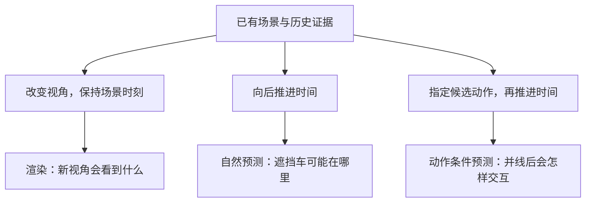

# 世界模型的定义，应该跟着它要回答的问题走

一辆车暂时被大巴遮住，预测器根据此前运动估计它可能仍在前进。这个预测器没有输出自车动作，也未必生成视频，却显然在建模看不见的环境。另一方面，一个生成器可以画出非常逼真的道路，仍无法回答“自车此刻减速，旁车会怎样反应”。两者都可能出现在世界模型讨论里，名字本身不足以判断功能。

我更愿意把世界模型视为一组有重叠的建模任务，再为具体用途规定可检验的接口。本文提出的是分析口径，不试图给整个研究领域设唯一合法定义。

## 从遮挡车辆的预测开始，先分清观察和状态

相机当前看不到车辆，系统仍可能根据过去图像保存它的位置、速度和存在概率。观察 $o_t$ 是传感器提供的局部证据，状态 $s_t$ 则是决定未来所需的信息。内部 latent $z_t$ 可以近似总结这些信息，不必与每个物理变量逐项对应。

如果只预测遮挡车的自然运动，可写成 $p(s_{t+1}\mid h_t)$，其中 $h_t$ 是可用历史。若预测自车行动后的交互，就需要 $p(s_{t+1}\mid h_t,a_t)$。后者多了一个可以查询的控制条件，能力要求更强，但不能因此说前者不含任何世界建模。

状态还可以是分布。两条可能轨迹分别从障碍左右经过，它们的均值轨迹可能穿过障碍；保留不确定性对于风险判断比只输出平滑平均值更有用。具体的 belief 与动力学推导见[世界模型基础](../world-models/beginner-world-models-primer.md)。

## 同一场景，可以有三个不同查询

把自车相机移到旁边，渲染新的观察，询问的是视角变化后会看见什么。让时间推进，并预测遮挡车在哪里，询问的是状态随时间如何变化。指定自车并线动作，再预测旁车是否让行，则进一步询问行动干预后的未来。

这三种查询会共享几何和语义信息，却不能互相替代。静态三维场景可以提供视角一致性，没有因此学会驾驶行为；动作条件模型可以提供风险估计，也未必有高质量图像 decoder。规划器负责利用预测选择动作，并不要求环境模型自己输出策略。

[World Labs 的功能分类](https://www.worldlabs.ai/blog/taxonomy-of-world-models)和 [Towards Video World Models](https://www.xunhuang.me/blogs/world_model.html)提供了组织这些讨论的视角。阅读分类时，应继续检查作者怎样定义 renderer、simulator 与 planner，而不是把同名模块视为统一标准。



三个分支明确区分查询中改变的量。能回答新视角，不代表已经预测运动；能预测运动，也需要额外证据才能解释行动干预后的后果。

## 用一个两动作例子检查“动作条件”是否真的存在

假设车辆当前速度为 8 m/s，前方遮挡区域有两种可能状态。候选动作是保持速度 `keep` 或减速 `brake`。一个教学模型给出的碰撞概率如下：

| 隐藏状态 | `keep` | `brake` |
| --- | ---: | ---: |
| 前车继续前进 | 0.02 | 0.01 |
| 前车突然停车 | 0.60 | 0.08 |

若当前 belief 认为两种状态各占一半，`keep` 的预测碰撞概率为 0.31，`brake` 为 0.045。这个模型至少能回答“改变动作后，未来风险怎样变”。它仍然没有说明 belief 是否准确，也没有说明减速的舒适度和后车风险；这两项需要另加状态、代价或外部验证。

如果模型无论输入 `keep` 还是 `brake` 都输出同一分布，它仍可能是一个很好的自然运动预测器，却没有提供可用于这项选择的动作条件接口。检查接口时，固定历史和随机种子，只改变动作，比较预测变量是否以符合动力学的方式变化。不要只比较两段视频的像素差异。

上表是本站构造的概率例子。它的用途是区分“模型接受动作作为条件”和“模型输出未来画面”，不代表自动驾驶系统的安全概率。

## 用于行动时，模型要接受更强的检验

现在让自车真的在等待与并线之间选择。模型需要对两个候选给出可比较的后果，且这些后果应与独立执行或可信实验相符。如果无论动作如何都生成一条顺利并线的视频，可能只是强目标先验盖过了控制条件。

即使改变动作后视频不同，也要看变化是否发生在相关变量上。改背景颜色带来的像素差异，不能替代他车响应、碰撞或车道占用的预测。规划需要的是动作差异导致的任务后果差异。

因此本文在讨论“用于控制的世界模型”时，要求明确历史状态、动作接口、预测变量以及外部验证。这个要求适用于当前用途，而非用来否认其他预测表示研究的意义。[PlaNet](https://arxiv.org/abs/1811.04551)与 [Dreamer](https://arxiv.org/abs/1912.01603)是动作条件 latent dynamics 被规划或行为学习消费的具体方法。

## 评估时把三个问题分开

同一个模型可以得到三种看起来都像“预测正确”的结果：

| 问题 | 最小评测 | 不能由它推出什么 |
| --- | --- | --- |
| 遮挡物下一刻在哪里 | 位置或状态误差 | 改变动作后的后果 |
| 指定动作后会发生什么 | 候选动作排序、碰撞或终止预测 | 长时程规划一定可靠 |
| 依据预测选出的动作是否有效 | 固定起点上的真实执行结果 | 换场景后的泛化 |

评测集应保留同一起点的多个候选动作，才能检查模型有没有把动作差异传到结果。只有实际执行过的动作，无法直接评价未执行分支；可以用受控模拟或补采样提供对照，但要把模拟真值和现实真值分开记。

一个简单的记录格式可以是：

```text
history_id: scene-07-t12
candidate_action: brake
predicted_outcome: collision_probability=0.045
executed: true
observed_outcome: no_collision
verification: real_rollout
```

若 `executed` 为 false，`observed_outcome` 应保持为空，不能把预测值自动写成标签。这个约束很小，却能阻止规划数据把模型自己的想象重新喂给自己。

## 高保真和决策充分之间没有固定胜者

只保留车辆位置、速度与道路边界，可以减少状态维数和预测成本。可是一辆车顶上的超长货物可能改变碰撞边界，粗状态若没有表示它，就会漏掉决定动作的信息。完整像素保留了更多细节，却也要求模型处理大量与当前决策无关的纹理。

一个表示是否充分，需要相对于任务分布和消费函数讨论。固定任务下可以用遮挡、删除或替换特征的对照，观察动作选择是否改变。更换任务后，原先可忽略的信息可能变重要，因此“最小状态”没有脱离任务的统一答案。

也不能把 latent 天然等同高效。若 decoder、读出或搜索很昂贵，低维状态的系统成本未必更低；如果任务需要可视化审查，解码本身就是有价值的工作。比较应计入整条调用链。

## 一个模型该怎样接受现实纠正

遮挡解除后，真实车辆出现在比预测更远的位置。系统应让新证据更新状态，并记录此前误差，而不是因为旧想象内部自洽就继续相信它。模型、规划器和记忆之间需要明确哪些量来自真实观察，哪些来自预测，哪些已经过期。

这个要求也揭示了训练难点。视频往往没有精确动作、接触、隐藏状态或行为选择原因，观察相关性不总能被解释成干预后果。合成未来又继承生成模型的偏差，不能只凭内部一致就变成新真值。

我会保留一个有限判断。对于决策系统，世界建模的价值在于提供可查询、可比较、可被新观察纠正的预测。它可以由多个模块组成，也可以主要在 latent 中发生。是否有用应由具体任务证据回答，名称和视频观感都不能代替这个检验。相关不同用途可继续读[谁消费未来](world-model-future-consumers.md)。

## 来源与自测

World Labs 的[功能分类](https://www.worldlabs.ai/blog/taxonomy-of-world-models)、[PlaNet](https://arxiv.org/abs/1811.04551)与 [Dreamer](https://arxiv.org/abs/1912.01603)用于区分渲染、状态预测和动作条件动力学。这里的遮挡车辆、belief 数值、动作风险表和评测记录是本站构造的分析例子，不代表任一论文的实验结果。

自测时为一个候选动作写出历史、动作接口、预测变量和外部验证结果，检查“画面更像”是否真的改变了选择。若只有生成图片而没有动作对照和新观察纠正，证据仍停留在视觉连贯性。
