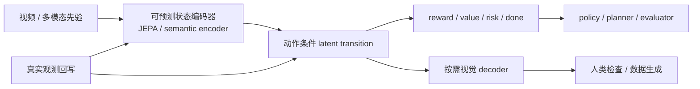

# 世界模型该预测什么：答案取决于谁消费未来

> **本文回答的问题。** 世界模型应该预测像素、视频 token、latent state、reward、value，还是下一步动作？我的判断是：先确定谁会使用这段未来，再决定预测什么、保留什么，以及用哪类证据验收。

把 PlaNet、Dreamer、V-JEPA 和 LingBot-World 放在一起，最先出现的冲突是：它们预测的对象不同，却都被称作世界模型。于是，“像素生成和 latent dynamics 谁更接近真正的世界模型”这个争论就问错了方向。

一段高清未来视频很容易检查，却可能没有严格响应动作；Dreamer 的 latent rollout 看不见，却能直接训练 actor；MuZero 连观测重建都不要，只保留搜索所需的 reward、policy 和 value；V-JEPA 在 frozen image/video probes 上表现出强表征，却没有动作、reward 和 planner。

这些模型预测的对象不同，因为它们面对的消费者不同。内容创作者要看画面，数据引擎要生成多样轨迹，在线 planner 要快速比较候选动作，actor-critic 要可重复采样的训练环境，安全 evaluator 则要校准过的风险和终止信号。

所以我更愿意把世界模型理解成一份**决策契约**。契约写清五个接口：`state`、`action intervention`、`transition`、`decision readout`、`consumer`。输出模态只是这份契约的一个结果。

## 一份世界模型契约有五个接口

| 接口 | 要回答的问题 | 常见实现 | 最容易漏掉的检查 |
| --- | --- | --- | --- |
| `state` | 当前世界由什么状态表示 | RGB、video latent、RSSM state、token sequence、occupancy、hidden state | 状态是否保留了消费端真正需要的小物体、接触、几何和任务进度 |
| `action intervention` | 候选动作怎样改变未来 | 动作向量、action chunk、文本动作、latent action、搜索树 action | 固定历史换动作，预测是否真的分叉，而非继续最常见的视频 |
| `transition` | 状态怎样随时间展开 | 一步 dynamics、多步 prior、chunk-wise AR、global video prediction | 训练时是否偷看未来，推理时是否吃过自己的生成历史 |
| `decision readout` | 消费端靠什么比较未来 | reward、value、policy prior、risk、done、goal distance、未来视频 | 读出是否校准，是否会被 policy 利用漏洞 |
| `consumer` | 谁用预测，怎样改变行为 | CEM、actor-critic、MCTS、MPC、candidate ranker、人、数据引擎 | 预测是否真的改变动作、训练数据或评估结论 |

这五项缺一项，论文的能力边界就会变得模糊。V-JEPA 在 frozen image/video probes 上学到强表征，但原论文没有 `action intervention` 和控制端 `consumer`；普通文生视频模型有 `transition` 和可解码输出，却可能没有稳定动作接口；一个 reward head 如果没有真实闭环校准，也不能仅凭名字成为可靠的 `decision readout`。

几篇经典工作的差异，用同一份契约会看得很清楚。

| 方法 | State | Action intervention | Transition | Decision readout | Consumer |
| --- | --- | --- | --- | --- | --- |
| [PlaNet](../paper-deep-dives/world-models/planet.md) | RSSM 的 deterministic memory + stochastic state | 连续控制动作 | prior latent rollout + latent overshooting | reward prediction | CEM / MPC |
| [Dreamer](../paper-deep-dives/world-models/dreamer.md) | RSSM posterior state | actor 采样动作 | prior imagination | reward、continuation、value | imagined actor-critic |
| [MuZero](../paper-deep-dives/world-models/muzero.md) | 不要求可解码的 hidden state | 搜索树中的假设动作 | learned dynamics function | reward、policy、value | MCTS |
| [V-JEPA](../paper-deep-dives/world-models/v-jepa.md) | 视频 target representation | 原论文没有动作接口 | masked latent prediction，非 action-conditioned transition | 原论文没有 reward、value、risk 等决策读出 | frozen probe / downstream encoder |
| [LingBot-World](../paper-deep-dives/world-models/lingbot-world.md) | 可生成视频 latent 与历史缓存 | 相机、键盘等控制信号 | causal video rollout | 未来视频，尚缺通用 reward/value | 人类交互、外部模拟和数据生成 |

**[综合推论]** 判断一个系统是否构成可行动的世界模型，关键不在它输出像素还是 latent，而在这五个接口是否闭合。这个定义比“会不会生成视频”窄，也比“是否包含世界知识”更可检验。

## 20 篇材料落在六个位置

下面的分组覆盖本轮读过的 20 篇文章。分组依据是未来由谁消费，不是模型发布时间或参数规模。

| 位置 | 本组文章 | 主要消费者 | 这组材料真正证明了什么 | 共同边界 |
| --- | --- | --- | --- | --- |
| 决策型 latent dynamics | [PlaNet](../paper-deep-dives/world-models/planet.md)、[Dreamer](../paper-deep-dives/world-models/dreamer.md)、[DreamerV2](../paper-deep-dives/world-models/dreamerv2.md)、[DreamerV3](../paper-deep-dives/world-models/dreamerv3.md)、[MuZero](../paper-deep-dives/world-models/muzero.md) | planner、actor-critic、MCTS | 紧凑状态、动作转移和 reward/value 可以直接支撑控制或搜索 | 多在游戏和模拟控制中验证，开放视觉、真实接触和几何表达较弱 |
| 表征型预测 | [JEPA](../paper-deep-dives/world-models/jepa.md)、[H-JEPA](../paper-deep-dives/world-models/h-jepa.md)、[V-JEPA](../paper-deep-dives/world-models/v-jepa.md) | 表征学习器、潜在的下游 policy | 预测表征可以避开大量不可预测像素细节；层级抽象适合不同时间尺度 | JEPA/H-JEPA 偏路线与理论，V-JEPA 的实证主要是 frozen representation，没有闭环动作证据 |
| 生成式交互模拟 | [Genie](../paper-deep-dives/world-models/genie.md)、[Towards Video World Models](../paper-deep-dives/world-models/towards-video-world-models.md)、[Self Forcing](../paper-deep-dives/world-models/self-forcing.md)、[LingBot-World](../paper-deep-dives/world-models/lingbot-world.md) | 人、外部 simulator、数据引擎 | latent action、因果 rollout、self-rollout post-training 和实时化让视频模型更接近可交互系统 | 可视化与视频指标强于 reward calibration、动作反事实和真实机器人闭环证据 |
| 统一多模态底座 | [BAGEL](../paper-deep-dives/world-models/bagel.md)、[Emu3.5](../paper-deep-dives/world-models/emu3-5.md)、[Lance](../paper-deep-dives/world-models/lance.md)、[Beyond Language Modeling](../paper-deep-dives/world-models/beyond-language-modeling.md) | 统一理解/生成模型、上层 agent | interleaved context、双视觉表示和专家分工提供共享状态；Beyond 的实验进一步测试了少量动作对齐 | 多数 world modeling 证据仍是生成任务；连续动作、接触和执行反馈不足 |
| 长上下文基础设施 | [RingAttention](../paper-deep-dives/world-models/ringattention.md)、[LWM](../paper-deep-dives/world-models/lwm.md) | 长序列模型本身 | exact sequence parallelism 与 progressive curriculum 让百万 token 文本/视频训练可行 | 能读长历史不等于能维护持久世界状态，也不自动提供动作因果 |
| 综述与证据地图 | [World Model for Robot Learning](../paper-deep-dives/world-models/world-model-for-robot-learning-survey.md)、[Embodied World Model Survey](../paper-deep-dives/world-models/world-models-embodied-ai-survey.md) | 研究者、系统设计者 | decision utility、时间展开、空间表示和 policy/simulator/video WM 角色可以统一组织 | 综述没有重跑统一实验，跨论文表格不能当成排行榜 |

这张表也解释了为什么 RingAttention 要单列。它解决“历史放不下”的问题，没有规定状态怎样更新，也没有规定动作怎样进入 transition。长上下文是世界模型的基础设施边界，不是 world modeling 目标本身。

## 像素未来适合被看见，也适合生产数据

像素生成路线通常并不直接在 raw RGB 上计算。Genie 使用离散视频 token，LingBot-World 在视频 latent 中生成，扩散模型也在 VAE latent 中去噪。它们最终都能解码为可观看的未来，所以这里把它们统称为“可解码观测未来”。

这类输出保留的信息多。人可以检查对象是否消失、视角是否跳变、场景是否被重造；数据引擎可以生成训练样本；多视角或结构通道还可以服务 3D 重建。它也有明确成本：视觉细节占据大量 token 和采样步骤，短期画面自然不保证接触、碰撞、摩擦和罕见事故正确。

[Genie](../paper-deep-dives/world-models/genie.md) 的论文结论很具体：没有真实动作标签的视频可以先学出离散 latent actions，再用这些 action codes 驱动未来 token。它证明了“动作发现”可以成为视频预训练的一部分。它没有证明 action code 已经等同于机器人关节或末端控制。

[Self Forcing](../paper-deep-dives/world-models/self-forcing.md) 又解决了另一层问题。模型训练时真的执行自回归 self-rollout，用自己的生成历史和 KV cache 继续向前，再对整段视频做 distribution matching。论文的消融支持它缓解 AR 视频扩散的 train-test mismatch；这项改进不提供动作因果、reward 或物理约束。

因此，可解码未来常见于三类消费者：人类检查、离线数据引擎、低频外部模拟。若消费者要在高频控制周期内比较大量动作，完整视频常常过重。

## PlaNet、Dreamer 和 MuZero 只保存决策需要的未来

PlaNet 把像素压进 RSSM，规划时只 rollout latent 和 reward。Dreamer 保留同一类 posterior/prior 分工，把在线 CEM 搜索摊销成 imagined actor-critic。DreamerV2 用 categorical latent 和 KL balancing 适配 Atari 的离散事件；DreamerV3 又用 symlog、two-hot、free bits 和 return normalization 处理跨任务尺度。

这些工作都有观测重建信号，但它们的消费者不看未来图片。重建约束负责塑造 state，真正进入决策的是 latent transition、reward、continuation 和 value。

MuZero 走得更远。它的 hidden state 不必重建棋盘或 Atari 画面，只需让 learned dynamics 在搜索树中预测 reward、policy 和 value。这里的标准是 value-equivalence：内部状态和真实环境可以长得完全不同，只要 MCTS 得到的决策信息足够。

**[论文结论]** PlaNet、Dreamer 系列和 MuZero 都用环境 return 或 search improvement 证明了任务相关 latent 可以服务决策。它们没有证明 latent 比像素生成普遍优越；它们证明的是，当消费者明确为 planner 或 policy 时，完整观测重建并非必要的部署接口。

我从这里得到一个更实用的判断：预测精度不能脱离读出函数讨论。一个模型的背景纹理预测得更准，却把 reward、done 或可达性预测错，对 planner 没有净收益；另一个模型的视频有些模糊，只要对象状态、动作后果和价值排序正确，仍可能是更好的控制模型。

## JEPA 先回答“什么值得成为状态”

JEPA 把预测目标从观测移到表示。context encoder 提供当前状态，target encoder 提供目标表示，predictor 预测目标 representation，loss 再度量二者距离。不可预测的树叶纹理可以被表示主动丢掉，动作、对象关系和可达性则应留下。

这个“应留下”仍是要求，不是既成事实。JEPA 的 position paper 和 H-JEPA 教学论文解释了 anti-collapse、latent capacity 与层级抽象；[V-JEPA](../paper-deep-dives/world-models/v-jepa.md) 用 EMA target encoder、stop-gradient 和高比例 3D masking 证明 latent video prediction 能学到强运动表征。原论文没有动作、reward、done 或 planner。

**[论文结论]** V-JEPA 是有实证支持的视频状态 encoder 候选。

**[综合推论]** JEPA 很适合放在高维观测和 action-conditioned dynamics 之间，负责把“可预测且可能有用”的信息压进 state。

**[待验证假设]** V-JEPA 式表征是否保留机器人控制需要的小物体、接触、摩擦和失败征兆，必须用动作反事实和闭环任务验证，frozen action recognition 分数回答不了这个问题。

## 统一多模态模型提供共享状态，尚未自动补齐动作契约

BAGEL、Lance 和 Emu3.5 都在缩短理解与生成之间的接口。BAGEL 让文本、ViT 语义 token 和 VAE latent 在共享 attention 中交换信息；Lance 用双 expert 保留理解与生成的不同优化路径；Emu3.5 把长视频帧、transcript、instruction 和 keyframe 都放进统一 next-token sequence，并用 DiDA 加速视觉块生成。

这些模型有能力描述世界状态，也能生成下一视觉状态。它们的 world exploration、navigation、rotation 或 embodied manipulation 证据，主要来自生成式输出。高层指令确实改变了未来画面，但这和低层动作干预仍有距离：真实控制还要处理时间同步、动作频率、proprioception、接触、失败和恢复。

[Beyond Language Modeling](../paper-deep-dives/world-models/beyond-language-modeling.md) 给出了这一组里最值得继续追的控制实验。论文在 Navigation World Model 中发现，通用视频预训练对动作条件未来预测很重要，少量域内 action-conditioned data 主要负责接口对齐。

**[论文结论]** 这个结果成立于导航式视觉未来和 action-as-text 设置。

**[待验证假设]** “通用视频先验 + 少量动作对齐”能否覆盖接触丰富的机器人操作，目前不能从导航结果直接推出。

## 同一历史换动作，是最便宜也最严格的测试

生成式模型很容易利用数据相关性。看到杯子和“拿起杯子”的指令后，即使忽略具体 action chunk，它也可能生成一段常见抓取视频。训练 loss 会下降，画面也合理，但 planner 无法用它比较“从左侧抓”和“从右侧抓”。

我会把 action counterfactual 放在视频指标之前：固定 history 和 task，只替换动作，检查未来是否按动作方向、幅度和时机发生分叉。至少要包含相反动作、no-op、失败动作和超出训练幅度的动作。

| 证据层 | 最小实验 | 能支持的主张 |
| --- | --- | --- |
| 表征层 | frozen probe、action recognition、object tracking | state 含有某类可读信息 |
| 预测层 | open-loop latent/video prediction、horizon curve | 模型能延续数据分布中的未来 |
| 干预层 | 固定历史替换动作、no-op、错误动作 | transition 对动作敏感，并具有一定方向正确性 |
| 读出层 | reward/done calibration、candidate preference、policy rank correlation | 预测可以比较决策后果 |
| 闭环层 | planner/policy 接入后的 task success、collision、return | consumer 使用预测后确实改善任务 |
| 真实环境层 | OOD 对象、视角、动作幅度、接触和恢复 | 收益能否离开训练分布继续成立 |

{ width="920" }

<small>图源：[World Model for Robot Learning: A Comprehensive Survey](https://arxiv.org/abs/2605.00080)，Figure 1，本站从论文 PDF 截取。原图把机器人世界模型分成 world model for policy、world model as simulator 和 robotic video world model 三个功能角色，表达的是“未来会被不同模块消费”。本文借它说明 consumer 应进入模型定义；这张综述图不能证明任何具体方法已经在真实机器人闭环中有效。</small>

这张图也提醒我，不能把三种角色排成高低顺序。用于 policy 的 latent state、用于 simulator 的 imagined rollout、用于数据引擎的视频未来，各自承担不同工作。评测应该沿消费者收口，而不是强迫所有模型参加同一场视频质量比赛。

## 长上下文和稳定世界状态是两件事

[RingAttention](../paper-deep-dives/world-models/ringattention.md) 让 KV blocks 沿设备环流动，使 exact attention 的上下文随 sequence-parallel 设备数扩展；[LWM](../paper-deep-dives/world-models/lwm.md) 用它训练百万 token 的文本、图像和视频模型。它们证明长视频历史可以被直接放进 Transformer，也展示了长视频问答和检索能力。

模型能读取一小时前的帧，不代表它维护了一个可被动作更新的对象状态。场景回访、遮挡后的对象身份、任务阶段和接触状态仍可能在长序列里漂移。反过来，Self Forcing 缓解了模型吃自己生成历史时的视觉漂移，也没有自动得到跨窗口的空间记忆。

**[综合推论]** 长时世界模型至少有两个正交问题：历史容量和 transition 稳定性。前者由长上下文、压缩记忆或结构化状态处理；后者由 causal rollout、self-generated context、观测回写和多步训练处理。把 context window 拉长，只解决第一部分。

对不同消费者，这两项的权重也不同。小时级视频问答重历史容量；实时游戏 simulator 同时要低延迟和自生成稳定；机器人 planner 更需要对象、几何、reward 和 risk 的持久状态，原始帧是否全部留在上下文反而是次要问题。

## 我更看好按需解码的预测栈

下面是我的综合设计，不是任何一篇论文已经验证的完整架构。

这套分工有一个直接好处：高频决策在 compact latent 中运行，完整视频只在需要审计、解释、数据生成或低频外部模拟时解码。消费者决定预测预算，不再让所有控制周期都支付高清未来的成本。

它也有三处待验证风险。

1. **[待验证假设]** JEPA/semantic state 可能丢掉接触和小目标，必须让结构、动作和失败信号进入训练
2. **[待验证假设]** reward/value head 可能学到视觉捷径，需要 hard negatives、失败轨迹和真实 replay 校准
3. **[待验证假设]** 可选 decoder 可能与 latent planner 使用不同状态语义，需要检查“画出来的未来”和“用于决策的未来”是否一致

我不认为像素生成会被 latent dynamics 替代。像素是人和数据引擎最自然的接口，latent 是高频决策更经济的接口，JEPA 负责学习什么值得进入 state，统一多模态模型则提供语言、视觉和任务之间的共享上下文。真正的系统更可能同时保留几种未来，只让每个消费者读取自己需要的一层。

## 证据边界

本文的事实底稿来自前述 20 篇专题页及其对应论文或官方材料。多数结果属于作者报告，本站没有独立复现所有模型、速度和 benchmark；两篇综述的横向表也来自不同任务、数据和协议，不能直接排列绝对强弱。

文中的“决策契约”“按消费者选择未来表示”“按需解码预测栈”均为综合推论。它们用于组织系统设计，不是已有统一 benchmark 验证的理论。尤其不能从当前材料推出：V-JEPA latent 天然适合机器人控制、少量动作数据足以学会接触物理、长上下文自动产生持久世界状态，或更逼真的视频一定带来更强 policy。

目前最可靠的写法仍然是逐层报告证据：表示学到了什么，动作是否造成正确分叉，reward/value 是否校准，consumer 是否改善闭环结果，收益是否能跨对象、视角、动作幅度和真实硬件继续成立。

## 相关阅读与下一步

- [高效 AI 的状态账本：少搬状态，比少算一次更重要](efficient-ai-is-state-movement.md)
- [扩散模型加速：每删一步，都要重新安排误差](diffusion-speedup-redistributes-error.md)
- [具身智能的可纠错状态链](embodied-ai-correctable-state-chain.md)
- [前沿模型正在变成受约束的闭环](model-capability-is-a-constrained-loop.md)
