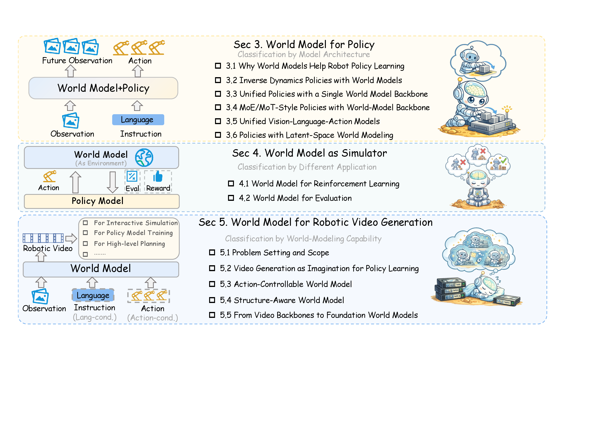
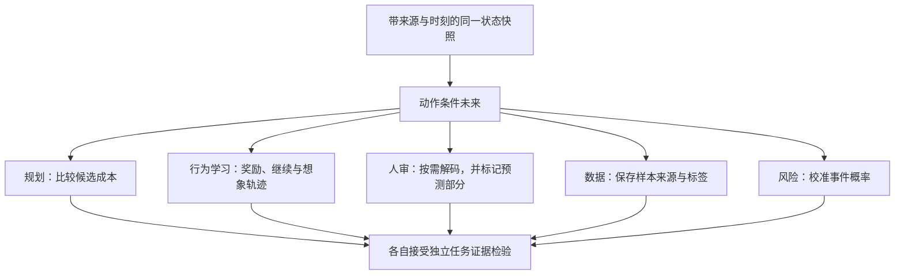

# 世界模型该输出什么，取决于谁使用这段未来

模型预测机械臂会把红杯子放进托盘。规划器想知道哪条动作更安全，人想检查是否抓错杯子，数据管线想拿它训练视觉模型，强化学习又想在其中尝试更多动作。一段未来可以进入四种工作，但每种工作对输出和真实性的要求不同。

把这些要求放在同一个杯子任务里，比按模型名字排出一条进化路线更容易判断系统应该保留什么。本文是一种接口分析方法，具体方法的技术基础见[世界模型专题](../world-models/index.md)。

## 规划器只需要能改变选择的信息

假设候选动作是直接抓、绕过障碍抓和先调整视角。规划器需要当前状态、动作条件转移以及可比较的成本。颜色纹理通常不直接参与碰撞检查，却可能决定哪个杯子才是目标；是否保留某类信息，要看删掉它会不会改变动作。

一个规划接口可以返回末端与目标距离、成功概率、碰撞风险和耗时。它不一定返回完整视频。若 planner 只看目标距离，却不读取碰撞信息，再丰富的未来表示也不能自行保证安全。

[PlaNet](https://arxiv.org/abs/1811.04551)展示了在学习到的 latent dynamics 中用预测奖励搜索动作。其意义在于预测被明确的选择过程消费。它的任务与模型假设不能直接搬成开放世界机器人能力。

## 强化学习需要能够反复展开的训练环境

现在让 actor 在想象中学习。模型不只比较预先给出的三条动作，还会面对不断变化的策略产生的新动作。每次策略更新都可能把查询推到数据较少的位置，例如更快、更贴边的抓取。

[Dreamer](https://arxiv.org/abs/1912.01603)用 latent imagination 学习行为，模型误差因此进入价值与策略更新。一个对现有候选排序还可以的模型，不一定适合无限扩大策略搜索；策略可能学会利用模型漏洞。

需要控制 rollout 范围，保留真实数据支撑，并检查想象收益能否转化成真实任务改进。模型给出的成功标签不能成为独立验证自身的证据。模型训练与策略训练怎样相互影响，可读[世界模型与强化学习](../reinforcement-learning/rl-for-world-models.md)。

## 人审需要可见证据，也需要知道哪些来自想象

人看到未来视频，可以发现模型拿了蓝杯子、碰倒旁边物体或跳过必要动作。视频在这里提供了 latent 数字难以直接表达的上下文，因此解码成本可能值得付出。

但人也容易被连贯画面说服。界面若把预测视频接在真实历史之后而不标记来源，会让“模型想象已经成功”看起来像“机器人确实成功”。应显示真实观察截至何时、哪个动作条件产生该未来、哪些片段是预测，以及预测是否已经被新观察推翻。

视频审查擅长捕捉明显语义错误，对接触力、隐藏碰撞或标定漂移并不充分。需要的证据仍应来自适当传感器与执行记录。这里的可解释性是帮助定位问题，不能等同物理正确性的保证。

## 数据生成需要把来源和标签一起保留下来

如果把未来视频用来训练杯子检测器，可以改变背景或光照，保留已知目标框；如果用来训练控制策略，就还要知道生成视频与动作是否对应同一个物理过程。两个用途对合成数据的要求差很多。

例如模型生成了夹爪穿过杯壁却成功抓起的片段。它或许还能提供某些外观变化，却会给接触动力学和控制学习错误监督。不能因为画面逼真就把整段统一标成“高质量样本”。

[Genie](https://arxiv.org/abs/2402.15391)从视频学习 latent actions 与交互动态，[LingBot-World](https://arxiv.org/abs/2601.20540)研究可交互的视频世界。这些工作提供生成与交互机制，特定合成数据是否改善某个下游机器人任务仍需单独验证。

{ width="920" }

<small>图源：[World Model for Robot Learning: A Comprehensive Survey](https://arxiv.org/abs/2605.00080)，Figure 1，从论文 PDF 截取。原图把机器人世界模型分成 world model for policy、world model as simulator 和 robotic video world model 三个功能角色，表达的是“未来会被不同模块消费”。这里的重点是 consumer 应进入模型定义；这张综述图不能证明任何具体方法已经在真实机器人闭环中有效。</small>

## 风险评估比一般候选评分多一个校准要求

假设模型给一百条抓取轨迹各预测 1% 碰撞概率。若这些轨迹的真实碰撞比例远高于 1%，即使模型把最危险轨迹排在前面，也不能把这个概率直接拿来满足风险限额。

排序与校准是不同性质。前者问相对顺序，后者问“预测为这个概率的样本，实际有多少发生”。风险评估还受数据分布影响，训练中的硬杯与部署中的软杯可能需要不同误差分析。稀有危险事件样本少，置信区间会很宽，少数零碰撞演示无法证明极低风险。

[世界模型评测](../world-models/evaluation-and-failure-modes.md)把预测、排序与闭环指标分开。所谓 evaluator 也可能只是辅助评分模型，是否有资格执行硬过滤，要看独立验证与失效策略。

从中间的未来分到五个读出，表示五种使用需求。图不要求同一网络实现全部读出，也不表示一种评测结果足以验证另外四种用途。

## 同一个状态不必服务所有消费者

可以共享历史编码，再为规划、视频解码与风险分别设置读出。这能节省重复计算，却会引入版本与一致性问题。如果风险头读取的是更新前状态，视频 decoder 读取更新后状态，同一次请求的两个输出就不再可直接对应。

一种合理的设计草图是给状态快照、模型版本、动作序列与输出统一的请求标识，按消费者只计算必要结果。高频控制不需要每次完整解码，人审需要视频时再生成；训练消费者则把 rollout 的来源、策略版本和生成配置一起保存。草图不能证明共享表示总比独立模型好，任务冲突与转换成本也可能抵消收益。

| 消费者 | 主要使用什么 | 应外部验证什么 |
| --- | --- | --- |
| 在线规划 | 候选后果与成本 | 排序、执行成功与时限 |
| 行为学习 | 可展开状态、奖励与终止 | 想象收益的真实迁移 |
| 人工审查 | 可见未来与来源 | 关键事件是否可查证 |
| 数据管线 | 生成样本及标签 | 下游收益与偏差放大 |
| 风险评估 | 事件概率与置信信息 | 校准、覆盖与漏检 |

当一个新模型声称预测未来更好时，可以先把它放入其中一个消费过程，说明增加了什么可用信息、花了什么成本、改变了什么行为。这样才能判断改进对当前任务的价值，而不必把不同输出类型强行排成统一榜单。
