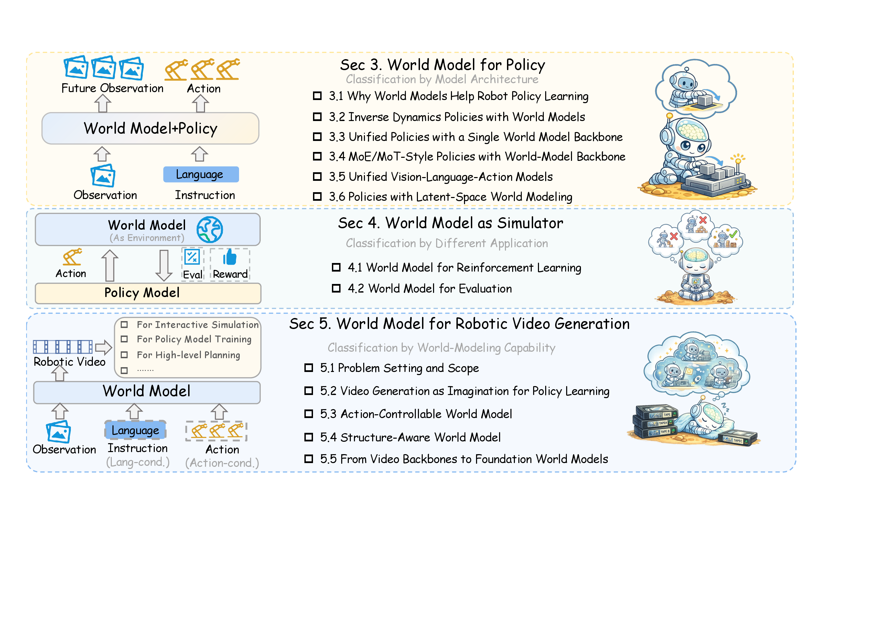
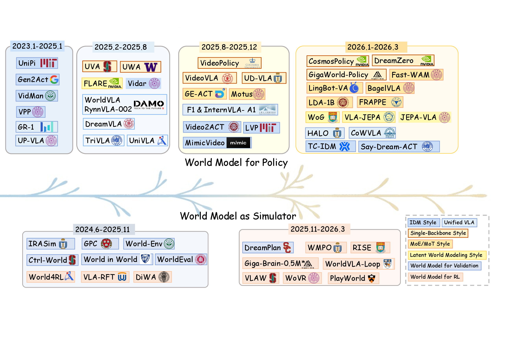
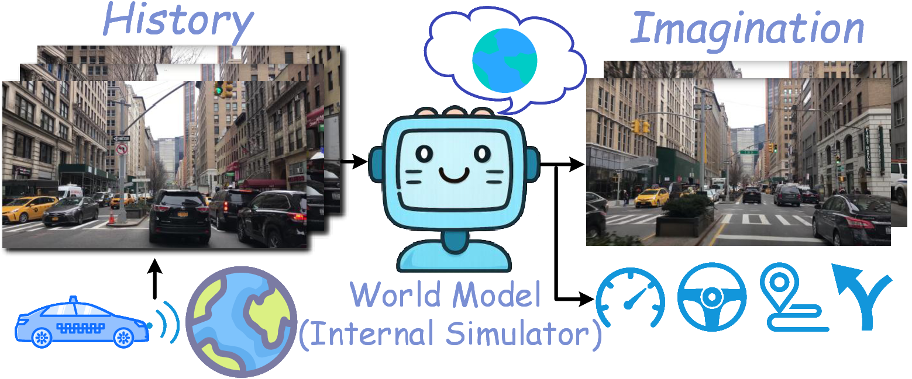
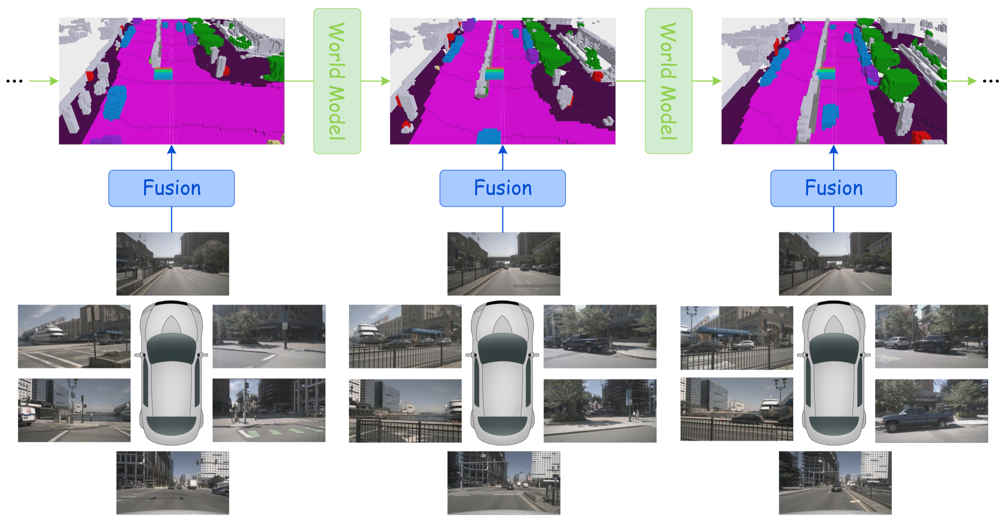
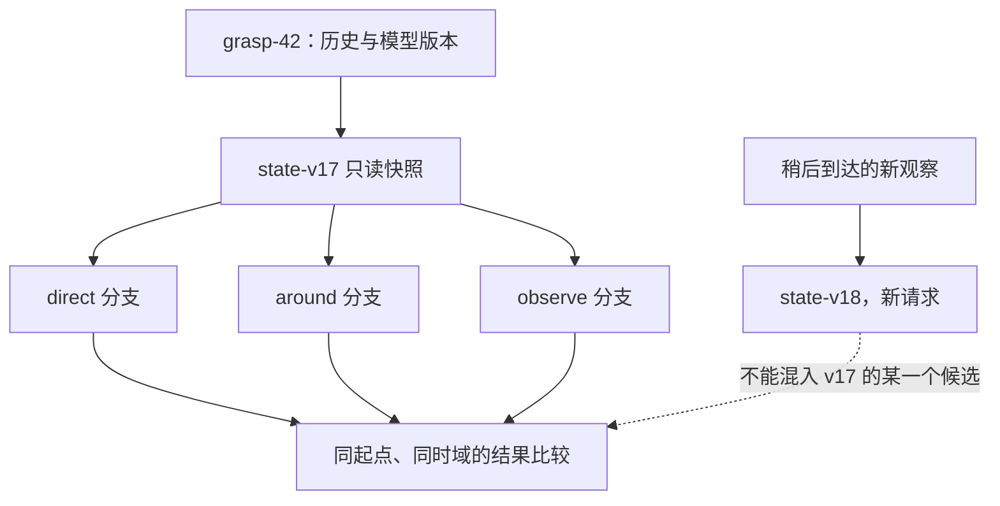
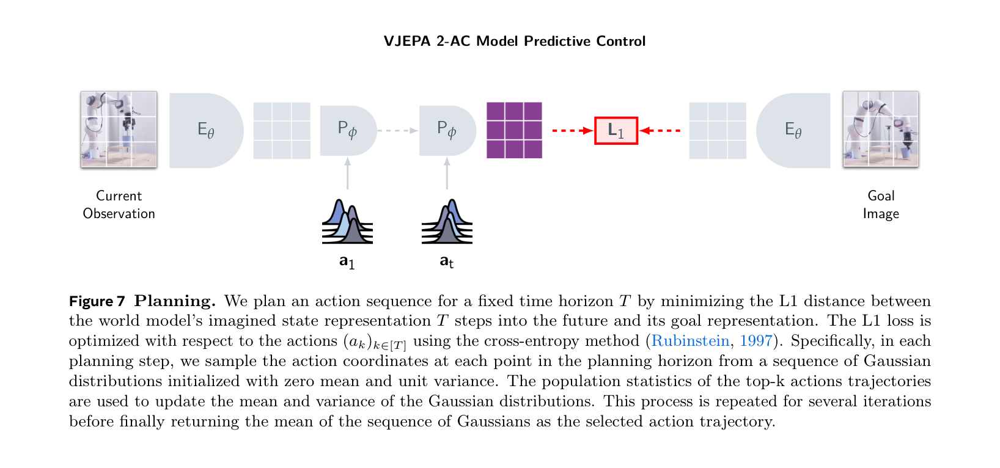
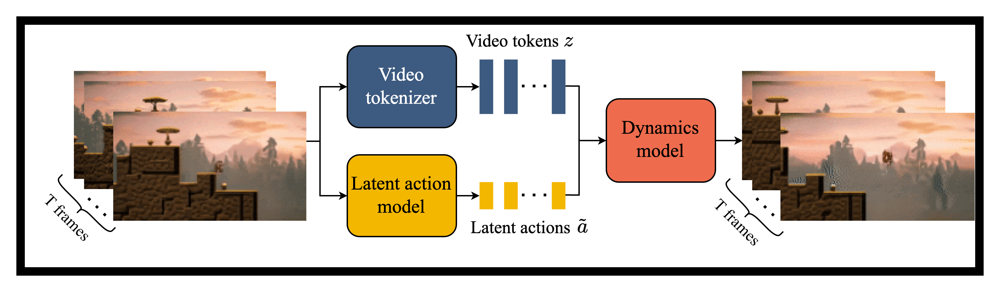
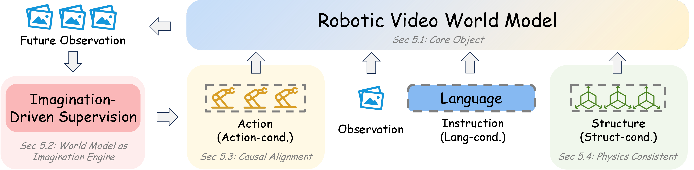
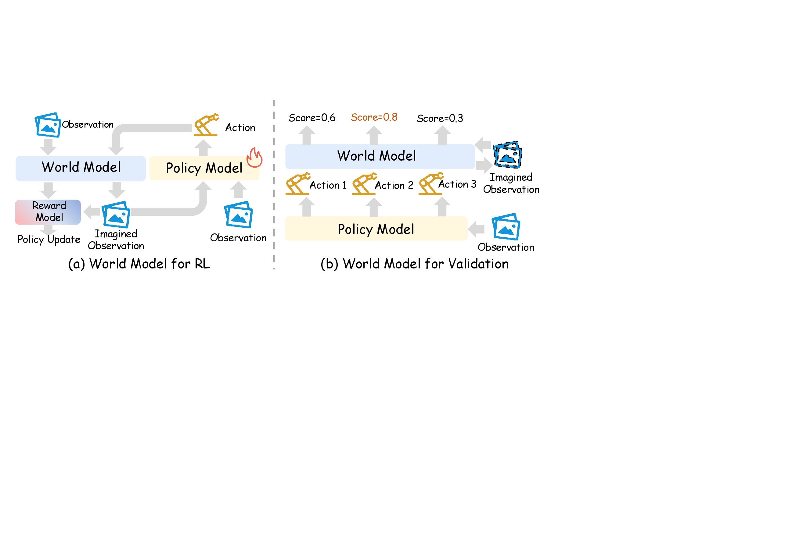

# 世界模型的工程基础，从一次预测请求追到真实反馈

机械臂准备抓杯子，规划器提出三条候选路径，请世界模型分别预测后果。模型返回三个分数，系统选择其中一条。直到真实抓取失败，工程师才发现三个分数并非来自同一个状态版本，其中一条还用了旧动作坐标。模型算得再快，这次比较也没有明确含义。

讨论世界模型基础设施，可以从这类具体故障开始。本文沿请求 `grasp-42` 说明数据、状态、预测、服务和评测怎样相接。下面的字段与接口是设计草图，不是某个现成产品的 API。

## 请求进入以前，输入已经带着版本

`grasp-42` 的输入包含相机采集时间、校准版本、任务、机器人状态，以及过去实际执行过的动作。视频帧与控制日志可以分开存储，但应通过 episode 和时间戳关联。只有文件路径与帧号，无法判断这张图是在动作之前还是之后采到的。

训练数据同样需要来源。原始日志、重建标签、合成视频和人工纠正可以共享 schema，却应保留来源标记及处理版本。模型升级后，旧的深度伪标签可能仍在缓存里；若没有数据版本，所谓复现实验就会读取一组已经变过的输入。

下面两张综述图分别展示方法角色与研究演进。阅读时先看模型是给策略提供特征、用作模拟器，还是生成可见未来；这些角色决定要保存哪些输入输出，并没有规定统一的软件分层。

{ width="920" }

<small>图源：[World Model for Robot Learning: A Comprehensive Survey](https://arxiv.org/abs/2605.00080)，Figure 1，从论文 PDF 截取。原图把机器人世界模型分成 policy、simulator、robotic video world model 三个功能角色。</small>

{ width="920" }

<small>图源：[World Model for Robot Learning: A Comprehensive Survey](https://arxiv.org/abs/2605.00080)，Figure 2，从论文 PDF 截取。原图展示 world model for policy 与 world model as simulator 两条路线的时间演进。</small>

## 一个状态快照要能被多个候选共同引用

编码器将最新有效历史变成状态 `state-v17`。三个候选都应引用这个不可变快照。预测期间如果新图像到达，可以建立 `state-v18` 并发起新的规划；不能悄悄替换某个候选的前缀而仍把它的分数与旧候选比较。

状态可以是 RSSM、对象集合、空间网格或视频 token。下面的两张图分别提醒内部状态与空间表示的不同组织方式。前者突出历史怎样进入预测，后者突出空间单元怎样让几何查询有定义。

{ width="760" }

<small>图源：[A Comprehensive Survey on World Models for Embodied AI](https://arxiv.org/abs/2510.16732)，Figure 1 子图，从论文 PDF 截取。原图把 world model 视为 internal simulator：从历史观测中构造内部世界状态，再服务 imagination、planning 与控制。</small>

{ width="760" }

<small>图源：[A Comprehensive Survey on World Models for Embodied AI](https://arxiv.org/abs/2510.16732)，Figure 1 子图，从论文 PDF 截取。原图展示 Spatial Latent Grid 用 BEV、voxel、occupancy 或 geometry-aligned latent grid 表示空间世界。</small>

持久状态还应标明哪些来自观察、哪些是遮挡传播、哪些是生成假设。状态压缩与删除必须以消费任务为依据，不能仅按 token 新旧决定重要性；一个较早观察到的尖锐障碍，仍可能影响当前动作。



实线上的三个候选共享同一状态快照。右侧新观测可以触发下一轮请求，但混用两个状态版本，会使分数差异同时包含动作和起点变化。

## 模型服务的返回值，需要说明它回答了什么

一个概念请求可写成下面的记录。这里只表达数据关系，不承诺能直接调用某个服务。

```json
{
  "request_id": "grasp-42",
  "state_id": "state-v17",
  "model_version": "wm-demo-3",
  "action_frame": "robot_base",
  "action_dt_seconds": 0.1,
  "horizon_steps": 8,
  "candidate_ids": ["direct", "around", "observe"],
  "outputs": ["success", "collision", "uncertainty"]
}
```

8 步、每步 0.1 秒对应 0.8 秒预测时域。如果 planner 的成本按 1.6 秒任务计算，就需要更长展开或明确终端价值，不能把这个返回值当整段任务结果。输出中的 `success` 也应定义为哪个目标、哪个期限内成功。

DreamerV3 图中可以沿 observation → representation → dynamics → heads 读出训练和想象的连接。V-JEPA 2 图则突出动作条件如何进入 latent 预测。两者的服务接口不同，基础设施应保存其语义，不能强行把所有张量都叫 `state` 后直接互换。

{ width="920" }

<small>图源：[Mastering Diverse Domains through World Models / DreamerV3](https://arxiv.org/abs/2301.04104)，Figure 3(a)，从论文 PDF 截取。原图展示 DreamerV3 如何把观测编码为离散 latent representation，并用 recurrent dynamics 在动作条件下预测未来 latent。</small>

{ width="920" }

<small>图源：[V-JEPA 2](https://arxiv.org/abs/2506.09985)，论文 / 项目图，从论文材料截取。原图展示 action-conditioned world model 如何基于视频表征和动作预测未来状态。</small>

## 共享前缀能够省资源，也可能让错误串到其他请求

三个候选具有相同历史，可以共享只读前缀缓存，再为各自动作分支分配独立空间。共享的前提是模型版本、位置编码、状态内容、注意力规则等相同。仅仅“视频来自同一个 episode”不足以确认缓存可复用。

构造一个缓存例子，共同前缀占 24 MiB，每条分支新增 3 MiB，16 条独立复制需要 $16(24+3)=432$ MiB，共享前缀则是 $24+16\times3=72$ MiB。这只计算缓存 payload，尚未包含参数、临时张量、调度与对齐开销。真实收益需看模型的缓存结构和运行时。

新观察使 `state-v17` 失效后，缓存应按规则保留用于审计或撤销，不能让旧想象继续作为新真实输入。分支 id 与状态版本在这里同时影响正确性与性能。[rollout 服务实例](../world-models/rollout-serving-quantization-kernel-case.md)展开了这些预算。

## 交互生成还要说明动作接口从哪里来

Genie 的训练图可沿 tokenizer、latent action model 和 dynamics 三部分阅读。它展示从视频学习可交互模型的一种做法。这样的 latent action 需要自己的语义解释，并不等于机器人关节命令。

{ width="920" }

<small>图源：[Genie: Generative Interactive Environments](https://arxiv.org/abs/2402.15391)，Figure 2，从论文 PDF 截取。原图展示 video tokenizer、latent action model 与 dynamics model 的训练关系。</small>

机器人视频世界模型的综述图进一步按条件和结构组织能力。看图时应追踪控制信号进入哪个模块，以及预测被哪个消费者读取；图中的分类不能替代每个实现的可控性测试。

{ width="920" }

<small>图源：[World Model for Robot Learning: A Comprehensive Survey](https://arxiv.org/abs/2605.00080)，Figure 6，从论文 PDF 截取。原图梳理 robotic video world model 从 imagination 到 controllable / structured / foundation-scale 的能力演进。</small>

如果服务接受键盘、文本、相机轨迹与机器人动作，应为每一种指定范围、时间语义和错误处理。把所有条件塞入一段字符串虽然灵活，却会让动作版本、校准和验证更难追踪。

## 真实反馈要回到当时的预测上

执行 `around` 后杯子滑落。系统需要找到 `grasp-42` 中该分支的原始概率、当时状态、实际动作与执行结果，再区分预测错、评分错和控制偏差。只收集最终失败视频，无法还原模型当时究竟承诺了什么。

下面这张图区分世界模型作为策略训练模拟器与候选验证器。前者产生训练经验，后者帮助选择；两种用途的偏差传播路径不同。模型生成的成功不能同时充当独立验收结果。

{ width="920" }

<small>图源：[World Model for Robot Learning: A Comprehensive Survey](https://arxiv.org/abs/2605.00080)，Figure 5，从论文 PDF 截取。原图对比 world model 作为 RL simulator 与 validation / candidate evaluation model 的不同用法。</small>

可以先保存一条小而完整的事件链，回放时重新计算候选分数并对照真实结果，再逐步增加异步调度、缓存和数据生成。仓库的[最小实验报告](../world-models/world-model-efficient-training-experiment-report.md)展示静态样例如何连通计算与评测，它没有运行真实训练或机器人实验。

基础设施的价值在于让一次预测可复现、可归因、可被现实纠正。组件多并不自动带来这些能力；先把一条请求追到底，才知道下一个组件该解决什么问题。
