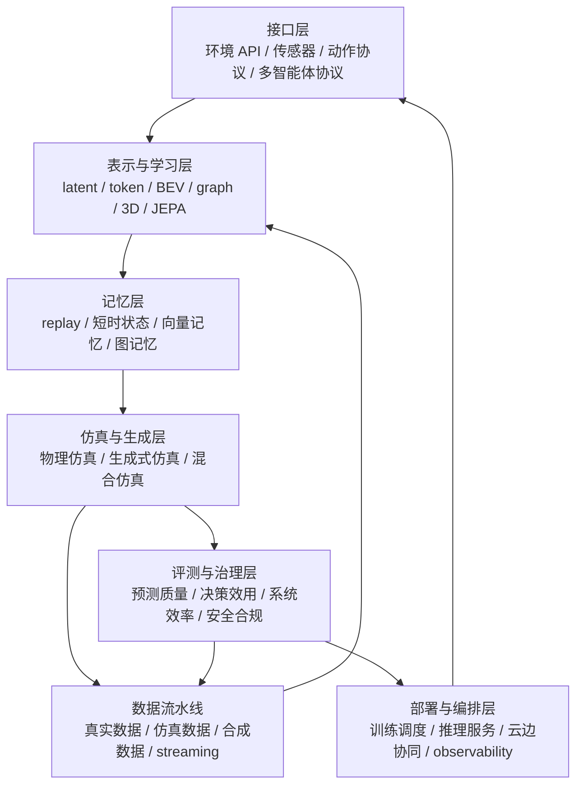

# 世界模型 Infra：从模型谱系到物理 AI 工程栈

> **这篇回答的问题。** 如果不再只问“哪个模型是 world model”，而是问“什么基础设施能持续训练、评测、部署和治理 world model”，整个方向会怎样重新分层。

世界模型已经不只是一个算法名词。早期 PlaNet、Dreamer、MuZero 让我们看到：agent 可以先学习环境动力学，再在内部 rollout、搜索或训练策略。后来的 V-JEPA、Genie、GAIA-1、Sora 2、NVIDIA Cosmos 又把这个问题推向更大的尺度：视频、动作、语言、3D、仿真和合成数据都开始进入同一个系统。

但这也带来一个危险：大家在说 world model 时，可能指的是 latent dynamics、视频生成器、机器人策略、自动驾驶 simulator、物理仿真平台、数据引擎，甚至只是一个很会生成视频的模型。概念变大以后，最有价值的问题反而不是“它是不是世界模型”，而是：

```text
它的状态表示是什么？
动作怎样进入系统？
未来预测被谁消费？
数据和失败怎样回流？
评测是否证明了决策收益？
部署后如何做延迟、成本、安全和合规治理？
```

这就是为什么需要从 **world model** 转向 **world model infrastructure**。模型谱系回答“有哪些路线”；基础设施视角回答“怎样把这些路线变成可复用、可迭代、可治理的工程闭环”。

## 操作性定义

本文把世界模型基础设施定义为：

> 一套支持“世界状态表示、动力学学习、记忆与检索、仿真与生成、接口编排、数据流水线、评测治理、部署运维”闭环的技术栈。

这个定义故意比单个模型宽，但仍然有边界。

| 纳入对象 | 为什么纳入 |
| --- | --- |
| PlaNet / Dreamer / MuZero 这类 action-conditioned dynamics | 它们直接学习状态转移、奖励、价值或搜索所需的内部动力学 |
| V-JEPA / V-JEPA 2 这类 latent predictive representation | 它们提供可预测的视频状态表示，后续可接动作条件规划 |
| Genie / GAIA / Cosmos / Sora 2 这类生成式世界模拟路线 | 它们把视频、动作、文本、场景条件接到可生成或可交互未来 |
| MuJoCo / Brax / Isaac / CARLA / Habitat 等仿真系统 | 它们提供训练、评测和 sim-to-real 数据来源 |
| replay、vector memory、lakehouse、streaming、orchestration、serving、observability | 它们决定 world model 能否持续迭代和线上运行 |

| 不直接纳入 | 原因 |
| --- | --- |
| 纯聊天 LLM | 没有显式环境状态、动作后果或闭环评测接口 |
| 不含动作 / 环境接口的普通文生视频模型 | 可以是世界模型的前置技术，但不能自动等同于可控 world model |
| 单独的数据标注平台或渲染工具 | 只有接入状态、动作、仿真、训练或评测闭环时才属于 infra |

这个边界和 [World Model for Robot Learning](https://arxiv.org/abs/2605.00080) 的机器人视角一致：世界模型的核心不是未来画面是否漂亮，而是预测是否能服务 policy、planning、simulation、evaluation 或 data generation。也和 [A Comprehensive Survey on World Models for Embodied AI](https://arxiv.org/abs/2510.16732) 的三轴 taxonomy 呼应：功能耦合、时间建模和空间表示必须一起看。

{ width="920" }

<small>图源：[World Model for Robot Learning: A Comprehensive Survey](https://arxiv.org/abs/2605.00080)，Figure 1，本站从论文 PDF 截取。原图把机器人世界模型分成 policy、simulator、robotic video world model 三个功能角色。本文读法：world model infra 不是单一路线，而是要支撑这三类角色在同一工程闭环里互相调用。</small>

## 一张分层图

如果把基础设施拆开，它更像七层系统，而不是一个端到端大模型。



这张图里最重要的是两个回路。

第一是 **学习回路**：数据进入表示与动力学学习，模型进入仿真或生成，失败样本再回流到数据层。第二是 **运行回路**：模型部署成服务，接收真实观测和动作请求，输出预测、风险、候选未来或策略信号，再由评测治理层约束它是否能继续被信任。

如果没有数据回流，世界模型只是一次性训练出的预测器。如果没有评测治理，世界模型很容易变成“看起来能模拟世界、但不知道是否改善任务”的展示系统。

## 从谱系到组件

世界模型的发展可以粗略压成四代，每一代都把新的基础设施需求带了出来。

{ width="920" }

<small>图源：[World Model for Robot Learning: A Comprehensive Survey](https://arxiv.org/abs/2605.00080)，Figure 2，本站从论文 PDF 截取。原图展示 world model for policy 与 world model as simulator 两条路线的时间演进。本文读法：从 decoupled 模块到 unified / latent / simulator 闭环，变化的不只是模型结构，也是采样、训练、评估和部署方式。</small>

| 阶段 | 代表 | 主要问题 | 暴露出的 infra 需求 |
| --- | --- | --- | --- |
| 潜变量规划 | [PlaNet](../paper-deep-dives/world-models/planet.md) | 从像素交互中学习 latent dynamics，并在 latent space 规划 | replay、RSSM、短 horizon rollout、reward / done head |
| 想象学习 | [DreamerV3](../paper-deep-dives/world-models/dreamerv3.md) | 在 world model 里生成 imagined trajectories 训练 actor-critic | 稳定训练 recipe、跨域尺度归一、模型偏差监控 |
| 搜索一体化 | [MuZero](https://arxiv.org/abs/1911.08265) | 不重建观测，只学习搜索需要的 value、reward、policy、dynamics | 规划接口、tree search、value-aware dynamics |
| 基础世界模型 / 物理 AI 平台 | [V-JEPA 2](https://ai.meta.com/research/vjepa/)、[Genie](../paper-deep-dives/world-models/genie.md)、[GAIA-1](https://arxiv.org/abs/2309.17080)、[NVIDIA Cosmos](https://github.com/nvidia/cosmos) | 大规模视频、动作、文本、场景和机器人数据如何接到可控未来 | tokenizer、长上下文、合成数据、仿真平台、guardrails、serving |

PlaNet 和 Dreamer 证明了一个基本点：世界模型可以不是外部视频模拟器，而是 agent 内部的 compact environment。MuZero 更进一步，说明模型甚至不必重建观察，只要能支持搜索就足够。V-JEPA 这条线则把预测对象从像素转向 latent representation；Genie 解决的是无动作视频里学习 latent action interface；GAIA-1 把 video、text、action 放进自动驾驶生成式世界模型；Cosmos 则明确把 world foundation models、datasets、tools 放到 physical AI 平台里。

所以“基础设施视角”的第一条判断是：**不同 world model 不在做同一件事，但它们最终都要回答接口问题。**

```text
谁提供状态？
谁提供动作？
谁消费预测？
预测错了谁负责发现？
失败样本怎样进入下一轮训练？
```

## 八个组件

把提纲里的组件合并后，world model infra 可以按八个部件理解。

| 组件 | 典型形式 | 关键问题 |
| --- | --- | --- |
| 表示 | global latent、token sequence、BEV / voxel、scene graph、3DGS / 4D | 状态是否保留可规划、可控、可评测的信息 |
| 学习 | 重建式、预测式、JEPA、diffusion / flow、value-aware dynamics | 训练目标是否服务动作后果，而不只是视觉质量 |
| 记忆 | recurrent state、replay buffer、Reverb、Faiss / Milvus、graph memory | 短时状态和长期经验怎样被检索和更新 |
| 仿真 | MuJoCo、Brax / MJX、Isaac Sim / Lab、CARLA、Habitat、生成式 simulator | 物理规则和数据驱动模拟怎样互补 |
| 接口 | Gymnasium / TorchRL、传感器 schema、action protocol、多智能体 API | 环境、机器人、策略和 world model 怎样互相调用 |
| 编排 | IMPALA、SEED RL、Ray / RLlib、Kubeflow、EnvPool | 采样、训练、评测、推理如何分布式运行 |
| 数据流水线 | Hugging Face Datasets、WebDataset、Delta Lake、Kafka、数据版本 | 多模态时序数据如何持续供给且可追溯 |
| 评测治理 | FVD / LPIPS、return / success、Safety-Gymnasium、内容标识、审计日志 | 是否同时证明预测质量、决策收益、系统效率和合规边界 |

这八个组件里，表示、学习和仿真通常最容易被论文标题看见；数据、记忆、编排、服务和治理更像“水面下的工程”。但真正落地时，水面下的东西经常决定系统能不能长期工作。

## 核心层：表示、动力学和仿真

世界状态表示有四条常见路线。

{ width="760" }

<small>图源：[A Comprehensive Survey on World Models for Embodied AI](https://arxiv.org/abs/2510.16732)，Figure 1 子图，本站从论文 PDF 截取。原图把 world model 视为 internal simulator：从历史观测中构造内部世界状态，再服务 imagination、planning 与控制。本文读法：表示层不是视觉 encoder 的附属品，而是所有后续动力学、记忆、仿真和评测的共同接口。</small>

| 表示路线 | 代表 | 优势 | 风险 |
| --- | --- | --- | --- |
| latent dynamics | PlaNet、Dreamer、DreamerV3 | 紧凑、适合实时控制和 imagined rollout | 几何结构不显式，可解释性弱 |
| token / Transformer worlds | GAIA-1、Genie、LWM、视频世界模型 | 易扩展到多模态、长上下文和基础模型训练 | token 成本高，动作后果可能没有扎实 grounding |
| grid / BEV / occupancy | 自动驾驶 world model、OccWorld / Drive-WM 一类路线 | 对 planner 友好，空间位置明确 | 需要强标定和几何数据，远 horizon 衰减明显 |
| graph / 3D / rendering representation | Graph Network Simulator、NeRF / 3DGS / 4D scene | 适合物体关系、接触、可渲染数字孪生 | 动态对象和大规模更新仍难 |

这里不要把“高维视频生成”自动等同于“更强 world state”。对机器人和自动驾驶来说，planner 更关心 collision、occupancy、pose、depth、reward、constraint violation，而不一定需要高清 RGB。JEPA 路线的启发正在这里：如果未来细节不可控又不影响决策，就不应该强迫模型重建所有像素。

{ width="760" }

<small>图源：[A Comprehensive Survey on World Models for Embodied AI](https://arxiv.org/abs/2510.16732)，Figure 1 子图，本站从论文 PDF 截取。原图展示 Spatial Latent Grid 用 BEV、voxel、occupancy 或 geometry-aligned latent grid 表示空间世界。本文读法：自动驾驶和机器人规划常常需要这种可落到空间坐标的状态，而不是只要 RGB 视频续写。</small>

动力学学习也至少有四种范式。

| 范式 | 代表 | 学到什么 |
| --- | --- | --- |
| 显式重建型 | DreamerV3 | latent 能解释观测、奖励和 continuation，prior 可 rollout |
| 规划相关型 | MuZero | 只学习对搜索有用的 reward、value、policy、dynamics |
| 行动条件型 | V-JEPA 2-AC、Genie latent action | 固定历史下，不同动作要导致不同未来 |
| 多模态条件型 | GAIA-1、Cosmos、Sora 2 | 视频、文本、动作、相机或场景条件共同约束生成未来 |

{ width="920" }

<small>图源：[Mastering Diverse Domains through World Models / DreamerV3](https://arxiv.org/abs/2301.04104)，Figure 3(a)，本站从论文 PDF 截取。原图展示 DreamerV3 如何把观测编码为离散 latent representation，并用 recurrent dynamics 在动作条件下预测未来 latent。本文读法：这是 world model infra 的最小闭环原型：replay、latent dynamics、reward / continuation head 和 imagined rollout 都必须同时存在。</small>

{ width="920" }

<small>图源：[V-JEPA 2](https://arxiv.org/abs/2506.09985)，论文 / 项目图，本站从论文材料截取。原图展示 action-conditioned world model 如何基于视频表征和动作预测未来状态。本文读法：V-JEPA 类表征路线要进入机器人控制，关键补丁就是让 action 显式进入 latent transition，并用规划结果而不是像素指标收口。</small>

仿真层则需要区分两类世界。

| 类型 | 代表 | 适合做什么 | 不足 |
| --- | --- | --- | --- |
| 物理仿真 | [MuJoCo](https://mujoco.readthedocs.io/)、[Brax](https://github.com/google/brax)、[Isaac Lab](https://isaac-sim.github.io/IsaacLab/)、[CARLA](https://carla.org/)、[Habitat-Lab](https://github.com/facebookresearch/habitat-lab) | 可控实验、接触动力学、机器人学习、自动驾驶场景 | 资产、材质、传感器噪声和真实分布仍有 sim-to-real gap |
| 生成式仿真 | [Genie](https://arxiv.org/abs/2402.15391)、[GAIA-1](https://wayve.ai/thinking/scaling-gaia-1/)、[Cosmos](https://github.com/nvidia/cosmos)、[Sora 2 System Card](https://openai.com/index/sora-2-system-card/) | 开放场景扩展、反事实生成、数据增强、人类可检查未来 | 物理一致性、动作敏感性、长时记忆和安全边界更难证明 |

更可能的工程形态不是二选一，而是混合仿真：用物理引擎提供可计算约束，用生成式模型补足视觉真实感、长尾场景和多样环境，再用真实数据闭环校正。

{ width="920" }

<small>图源：[Genie: Generative Interactive Environments](https://arxiv.org/abs/2402.15391)，Figure 2，本站从论文 PDF 截取。原图展示 video tokenizer、latent action model 与 dynamics model 的训练关系。本文读法：生成式世界模拟器要想可交互，必须把“状态 token 化”“动作接口发现”和“动作条件动态预测”拆成可训练、可评测的组件。</small>

{ width="920" }

<small>图源：[World Model for Robot Learning: A Comprehensive Survey](https://arxiv.org/abs/2605.00080)，Figure 6，本站从论文 PDF 截取。原图梳理 robotic video world model 从 imagination 到 controllable / structured / foundation-scale 的能力演进。本文读法：视频生成只是入口，真正进入 infra 后还要补动作条件、结构约束、长时一致和系统评测。</small>

## 支撑层：数据、记忆、编排和服务

世界模型 infra 的中心不是模型文件，而是数据飞轮。

```text
真实世界数据
  -> 清洗 / 标定 / schema 对齐
  -> 仿真与生成式扩增
  -> 训练 world model / policy / evaluator
  -> 离线评测 + 闭环评测
  -> 线上失败、near-miss、人工审核样本回流
  -> 下一轮数据
```

真实数据可以来自 [Open X-Embodiment](https://robotics-transformer-x.github.io/)、[Ego4D](https://ego4d-data.org/)、[Waymo Open Dataset](https://waymo.com/open/) 这类机器人、第一视角和自动驾驶数据；仿真数据来自 CARLA、Isaac、Habitat、HSSD 等环境；合成数据可以来自 Cosmos Transfer、生成式 driving world model 或交互式环境生成。V-JEPA 2 这类工作还说明，大规模互联网视频预训练可以成为世界状态表示的底座，但如果要控制机器人，仍要补少量交互轨迹和动作条件后训练。

数据管线本身也要工程化。

| 工具 / 模式 | 在 world model infra 里的作用 |
| --- | --- |
| [Hugging Face Datasets](https://huggingface.co/docs/datasets/) / Arrow / streaming | 大规模样本索引、分片读取、流式训练 |
| [WebDataset](https://github.com/webdataset/webdataset) | 顺序 tar shard I/O，适合视频、图像、多模态样本 |
| [Delta Lake](https://docs.delta.io/) | lakehouse、ACID、版本回溯、流批统一 |
| [Apache Kafka](https://kafka.apache.org/documentation/) | 线上事件、机器人日志、失败样本和遥测流 |

记忆层可以从 replay buffer 开始，但不能停在 replay buffer。

| 层次 | 代表 | 作用 |
| --- | --- | --- |
| 短时状态 | RSSM hidden state、Transformer KV、episode context | 支撑当前 rollout 和局部决策 |
| 经验回放 | replay buffer、[Reverb](https://github.com/google-deepmind/reverb) | 支撑 off-policy / model-based RL、失败复盘 |
| 长期检索 | [Faiss](https://github.com/facebookresearch/faiss)、[Milvus](https://milvus.io/docs) | 检索相似场景、长尾失败、历史反事实 |
| 图记忆 | scene graph、road graph、object relation graph | 记录对象、拓扑、因果关系和可达性 |

训练和编排层决定系统能否规模化。IMPALA 把 actor 和 learner 解耦，SEED RL 用中心化推理提高吞吐；[Ray](https://docs.ray.io/) / RLlib / Ray Serve 提供分布式采样、训练和服务；[Kubeflow Pipelines](https://www.kubeflow.org/docs/components/pipelines/) 提供 Kubernetes 原生 workflow；[EnvPool](https://github.com/sail-sg/envpool) 用 C++ 批量环境执行提高 RL 采样效率。

部署层则把 world model 从训练产物变成 world service。它可能不是直接输出动作，而是提供以下服务：

```text
predict_future(state, action_sequence)
score_candidate(state, action_sequence)
generate_counterfactual(scene, control)
retrieve_similar_failures(state)
estimate_risk(state, plan)
```

这时 [KServe](https://kserve.github.io/website/)、[NVIDIA NIM](https://docs.nvidia.com/nim/)、[Ray Serve](https://docs.ray.io/en/latest/serve/) 和 Jetson 边缘部署就会进入系统设计。典型形态是：云上训练和合成数据，边缘侧低延迟推理与控制，失败日志和不确定样本回传云端。

## 评测与治理

世界模型的评测不能只看视频质量。更稳的指标是五层。

| 层 | 指标 | 回答的问题 |
| --- | --- | --- |
| 预测保真度 | FVD、LPIPS、PSNR、SSIM | 生成或预测是否像真实数据 |
| 动作敏感性 | counterfactual consistency、action-conditioned divergence | 同一历史下换动作，未来是否合理分叉 |
| 决策效用 | return、success rate、planning success、constraint violations | 模型预测是否改善任务结果 |
| 系统效率 | throughput、p95 latency、GPU-hours、每百万步成本 | 能否支撑闭环控制和持续训练 |
| 安全合规 | Safety-Gymnasium cost、审计日志、内容标识、数据条款 | 是否能被安全上线和追责 |

{ width="920" }

<small>图源：[World Model for Robot Learning: A Comprehensive Survey](https://arxiv.org/abs/2605.00080)，Figure 5，本站从论文 PDF 截取。原图对比 world model 作为 RL simulator 与 validation / candidate evaluation model 的不同用法。本文读法：评测治理层不只是打分表，它决定 world model 是拿来训练策略、筛选候选动作，还是作为上线前的风险过滤器。</small>

[Hou et al. 2026](https://arxiv.org/abs/2605.00080) 的重要提醒是，机器人世界模型要按 policy、simulator、robotic video world model 的功能角色评估。[Li et al. 2025](https://arxiv.org/abs/2510.16732) 也把 pixel quality、state-level understanding、task performance 分开看。换句话说，FVD / LPIPS 是必要体检，但不能替代闭环任务指标。

治理也必须进入基础设施层，而不是上线前补一个 checklist。原因很简单：world model 会生成视频、虚拟场景、驾驶场景、机器人行为和模拟数据，一旦进入产品或数据飞轮，来源追踪和标识会影响后续所有训练样本。

截至 2026-06-15，中国《[互联网信息服务深度合成管理规定](https://www.cac.gov.cn/2022-12/11/c_1672221949354811.htm)》已经施行；《[人工智能生成合成内容标识办法](https://www.cac.gov.cn/2025-03/14/c_1743654684782215.htm)》和强制性国家标准 [GB 45438-2025](https://openstd.samr.gov.cn/bzgk/std/newGbInfo?hcno=F32EA2A561F1886CD8D606513512D547) 对生成合成内容标识提出了显式 / 隐式标识要求。OpenAI 的 [Sora 2 System Card](https://openai.com/index/sora-2-system-card/) 也把风险评估、数据过滤、C2PA、可见水印和部署限制放进系统卡；另据 [OpenAI Help Center](https://help.openai.com/en/articles/20001152-what-to-know-about-the-sora-discontinuation)，Sora web/app 已于 2026-04-26 停用，API 计划于 2026-09-24 停用。Waymo Open Dataset 这类数据源也通过单独条款限定数据使用边界。

所以 world model infra 需要原生设计：

1. 数据来源和授权记录；
2. 合成内容显式 / 隐式标识；
3. 训练样本、模型版本、评测报告可追溯；
4. 失败样本、near-miss、人工审核结论可回放；
5. 访问控制、导出限制和水印策略；
6. 面向机器人 / 自动驾驶的安全约束和回退策略。

这不是合规部门的附属任务，而是数据飞轮能否可信运行的前提。

## 典型系统怎样映射

| 系统 | 更像哪一层的代表 | 基础设施启发 |
| --- | --- | --- |
| DreamerV3 | 表示 + 动力学 + policy learning | 一个可复现 world model 闭环必须同时有 replay、latent dynamics、reward / continuation、imagined actor-critic |
| MuZero | 规划导向动力学 | 世界模型可以只学习搜索需要的抽象状态，而不追求像素重建 |
| V-JEPA 2 | 表征型世界模型 | 视频预训练可以先学习物理动态 latent，再用少量交互数据做 action-conditioned post-training |
| Genie | 生成式交互环境 | 无动作视频可通过 latent action interface 变成可控环境，但实时性、长时一致性和动作 grounding 仍是边界 |
| GAIA-1 | 自动驾驶生成式世界模型 | video + text + action token 可以生成可控 driving scenarios，但仍需规划效用和安全指标收口 |
| Cosmos + Isaac | 物理 AI 平台闭环 | 世界模型正在和数据、仿真、后训练、guardrails、机器人开发工具合并成平台 |
| Sora 2 | 高保真视频 / 音频生成与安全部署样本 | 对 world model infra 的启发主要在物理一致性、可控性、系统卡、来源标识和产品边界，而不是直接等同于机器人 simulator |

这里最值得吸收的是 Cosmos 的平台化信号。NVIDIA Cosmos GitHub 把它描述为面向机器人、自动驾驶和智能基础设施的 world models、datasets、tools 开放平台；Cosmos Cookbook 进一步提供 post-training scripts、recipes 和 physical AI workflows。这说明 world model 的竞争正在从“单模型能力”转向“模型 + 数据 + 后训练 + 仿真 + 部署工具”的组合能力。

## 未来挑战

**第一，统一 world state IR。**
现在 latent、token、BEV、occupancy、scene graph、3DGS、road graph 都在各自系统里工作。真正的 infra 需要一种中间表示，让感知、规划、仿真、生成和评测可以共享状态，而不是每个模块各说各话。

**第二，从离线视频预训练走向闭环在线适应。**
V-JEPA 2、Genie、GAIA-1 证明了视频规模的重要性，但机器人和自动驾驶最终要面对在线分布漂移。难点不是再训练一个大模型，而是边收集、边过滤、边验证、边部署的持续学习流程。

**第三，评测要越过像素保真。**
未来 world model 论文如果只报 FVD / LPIPS，会越来越不够。更需要同时报告 action sensitivity、planning utility、latency、cost、constraint violations 和真实闭环成功率。

**第四，sim-to-real 数据飞轮需要标准化。**
真实、仿真、生成三域的数据必须有统一 schema：相机、外参、时间戳、动作、控制频率、碰撞、接触、reward、success checker、合成来源和授权都要对齐。没有 schema，对齐问题会被误判成模型能力问题。

**第五，长期记忆要从 replay 扩展到可检索世界经验。**
未来的世界模型不只需要记住最近一段上下文，还要检索历史失败、相似场景、长尾风险和人类修正。Faiss / Milvus 这类向量检索只是起点，图记忆和因果事件记忆会越来越重要。

**第六，compliance-by-design 会变成默认能力。**
生成式世界模拟器越接近真实视频和虚拟场景，越不能把来源标识、审计日志、水印、访问控制和数据条款当成后处理。基础设施必须默认支持可追溯。

**第七，接口和 benchmark 需要社区标准。**
Gymnasium、TorchRL、RLlib、KServe、Kubeflow、MLflow Model Registry 这些生态已经给了接口启发，但 world model infra 仍缺一套统一的状态协议、动作协议、模拟协议和多层评测协议。

## 我的判断

世界模型的下一阶段不会只由一个更大的视频模型定义。更可能出现的是一套“物理 AI 工程栈”：上层是可控生成和抽象预测，中层是状态表示、动作接口、记忆和仿真，下层是数据飞轮、训练编排、评测治理和云边部署。

所以做 world model infra 时，优先级应该是：

1. 先定义状态、动作、数据 schema 和 success checker；
2. 再选择 latent、token、BEV、3D 或混合表示；
3. 用物理仿真和生成式仿真共同扩展数据；
4. 用闭环任务指标证明预测能改变动作选择；
5. 把数据来源、内容标识、审计和部署监控做成默认能力。

模型会继续变强，但真正稀缺的是可复用闭环。世界模型要从论文能力变成基础设施，靠的不是一个“能想象未来”的模型，而是一整套能持续发现错误、回收错误、修正错误的系统。

## 外部精读

- 综述：[World Model for Robot Learning: A Comprehensive Survey](https://arxiv.org/abs/2605.00080)。
- 综述：[A Comprehensive Survey on World Models for Embodied AI](https://arxiv.org/abs/2510.16732)。
- 综述：[Understanding World or Predicting Future? A Comprehensive Survey of World Models](https://arxiv.org/abs/2411.14499)。
- 基础路线：[PlaNet](https://planetrl.github.io/)、[DreamerV3](https://github.com/danijar/dreamerv3)、[MuZero](https://arxiv.org/abs/1911.08265)。
- 表征路线：[JEPA](https://openreview.net/forum?id=BZ5a1r-kVsf)、[V-JEPA](https://github.com/facebookresearch/jepa)、[V-JEPA 2](https://github.com/facebookresearch/vjepa2)。
- 生成式世界模型：[Genie](https://arxiv.org/abs/2402.15391)、[GAIA-1](https://arxiv.org/abs/2309.17080)、[Wayve GAIA-1 blog](https://wayve.ai/thinking/scaling-gaia-1/)、[NVIDIA Cosmos](https://github.com/nvidia/cosmos)、[Cosmos Cookbook](https://github.com/nvidia-cosmos/cosmos-cookbook)、[Sora 2 System Card](https://openai.com/index/sora-2-system-card/)。
- 仿真与数据：[MuJoCo](https://mujoco.readthedocs.io/)、[Isaac Lab](https://isaac-sim.github.io/IsaacLab/)、[CARLA](https://carla.org/)、[Open X-Embodiment](https://robotics-transformer-x.github.io/)、[Ego4D](https://ego4d-data.org/)、[Waymo Open Dataset](https://waymo.com/open/)。
- 基础设施：[Hugging Face Datasets](https://huggingface.co/docs/datasets/)、[WebDataset](https://github.com/webdataset/webdataset)、[Reverb](https://github.com/google-deepmind/reverb)、[Ray](https://docs.ray.io/)、[KServe](https://kserve.github.io/website/)、[NVIDIA NIM](https://docs.nvidia.com/nim/)。
- 治理：[互联网信息服务深度合成管理规定](https://www.cac.gov.cn/2022-12/11/c_1672221949354811.htm)、[人工智能生成合成内容标识办法](https://www.cac.gov.cn/2025-03/14/c_1743654684782215.htm)、[GB 45438-2025](https://openstd.samr.gov.cn/bzgk/std/newGbInfo?hcno=F32EA2A561F1886CD8D606513512D547)、[Waymo Open Dataset Terms](https://waymo.com/open/terms/)。

## 相关阅读与下一步

- 站内下一步：[世界模型现状：从视频模拟到工程闭环](world-models-status-and-engineering-loop.md)。
- 站内下一步：[WAM 与 3D 视觉：世界模型从视频想象走向物理闭环](wam-3dv-world-models.md)。
- 站内下一步：[World Model for Robot Learning：机器人学习世界模型综述](../paper-deep-dives/world-models/world-model-for-robot-learning-survey.md)。
- 站内下一步：[Embodied World Model Survey：具身世界模型综述](../paper-deep-dives/world-models/world-models-embodied-ai-survey.md)。
- 站内下一步：[世界模型中的强化学习](../reinforcement-learning/rl-for-world-models.md)。
