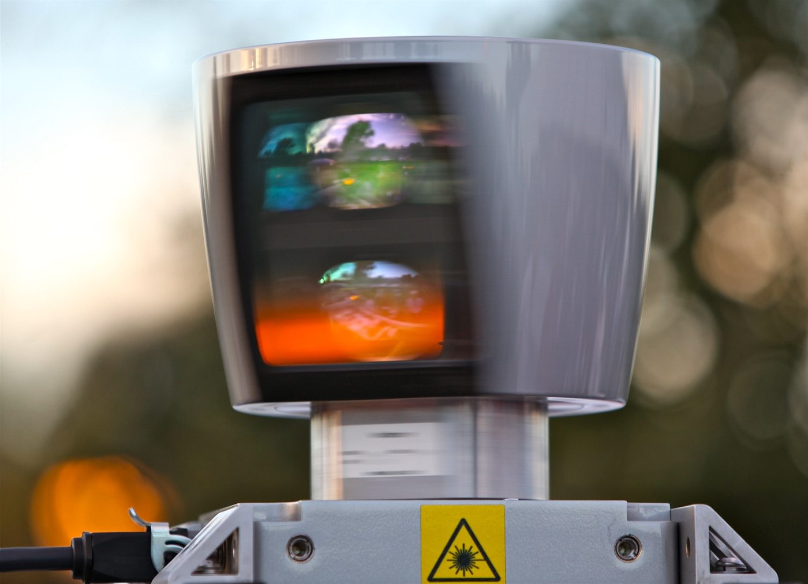

# 世界模型走到哪一步了：从视频模拟到工程闭环

世界模型这几年变成了一个很热的词，但它正在同时指向两件并不完全相同的东西：

1. **会生成可交互世界的外部模拟器**，例如从文本生成一个能走进去探索的环境；
2. **能帮助智能体做决策的内部预测器**，例如在机器人执行前预测动作后果、风险和成功概率。

这条工程路线的价值，是把这两个方向重新拉回工程地面：如果模型最后要服务机器人任务，就必须从数据字段、相机标定、3D 几何、仿真环境、success checker 和闭环评测开始，而不只是追逐更漂亮的视频生成。

{ width="860" }

<small>图源：[Wikimedia Commons: Velodyne High-Def LIDAR.jpg](https://commons.wikimedia.org/wiki/File:Velodyne_High-Def_LIDAR.jpg)。世界模型面向真实系统时，核心不是“画面像不像”，而是传感器、空间、动作和风险能不能被同一套状态表示消费。</small>

## 1. 当下的三股力量

今天的世界模型大致由三股力量推动。

第一股是 **model-based RL 和 latent dynamics**。PlaNet、Dreamer、DreamerV2/3 这条线的观点很朴素：学习一个内部 dynamics，在 latent space 里 rollout，然后用 imagined trajectories 训练策略或做规划。这条线不追求高清视频，但它很接近“决策需要什么”。

第二股是 **视频世界模型和生成式模拟**。[Genie 3](https://deepmind.google/models/genie/) 把世界模型描述成能用文本生成实时可探索的 photorealistic environments；[NVIDIA Cosmos](https://www.nvidia.com/en-us/ai/cosmos/) 则把 world foundation models、tokenizer、guardrails 和合成数据管线接到 physical AI。它们展示的是外部模拟器方向：世界模型可以成为训练 agent 的世界生成器。

第三股是 **几何基础模型和具身感知**。[VGGT](https://vgg-t.github.io/) 和 [MapAnything](https://arxiv.org/abs/2509.13414) 一类工作说明：如果世界模型要进入机器人、自动驾驶和工业检测，它不能只靠像素续写，还要知道 camera、depth、point map、scale、pose 和可见性。

这三股力量最终会合到同一个问题：**模型预测的未来，是否能被 planner、policy、controller 或 evaluator 使用？**

## 2. 工程提醒：别从模型名开始

这条路线最有价值的一点，是它没有把问题写成“选哪个 SOTA 模型”。它先写：

1. 相机内参、外参；
2. 6D 位姿估计；
3. 3D 重建；
4. 数据字段；
5. 模型路线；
6. 仿真环境；
7. benchmark 和 success checker。

这其实是正确顺序。世界模型项目最怕的是跳过前几步，直接训练一个看起来很高级的模型。结果常见地变成：

1. 数据里 `cam_pose_list` 和代码要的 `cam_pos_list` 不一致；
2. 缺 `seam_pose`，导致模型不知道目标几何在哪里；
3. 相机、工件和焊缝不在同一坐标系；
4. 仿真能跑，但 success checker 只看最终位置，漏掉过程碰撞；
5. 离线预测不错，闭环一执行就失败。

世界模型的“世界”首先是数据 schema 里的世界。如果字段、坐标、单位、频率、轨迹和评测没有定义好，模型学到的只是混乱的平均数。

## 3. 视频世界模型还差什么

视频世界模型已经很惊艳，但用于具身决策时仍要跨过几道门槛：

| 门槛 | 问题 |
| --- | --- |
| 动作敏感性 | 同一状态下换动作，未来是否真的分叉 |
| 空间一致性 | 长时间探索后，场景和物体身份是否保持 |
| 几何可用性 | 能否输出深度、位姿、可达性、碰撞风险等结构信号 |
| 控制接口 | 预测结果能否被 action planner 或 controller 使用 |
| 评测闭环 | 接入系统后是否提高真实成功率，而不只是生成质量 |

这也是“3D 场景理解、2D VLM、diffusion based”三路线并列的原因。单靠视频生成不一定能解决焊缝覆盖、遮挡判断、机械臂可达性和成功判定；单靠 3D 几何又缺少开放世界动态先验。真正可用的世界模型会更像混合系统。

## 4. 小雨焊缝任务的启发

小雨任务很适合说明世界模型的务实版本：用仿真生成相机观测，让模型预测一段相机/机械臂动作轨迹，再用几何/遮挡判断这段轨迹能否把焊缝看全。

这不是炫目的“生成一个世界”，但它非常世界模型：

```text
当前几何状态 + 候选轨迹
  -> 未来可见性
  -> 风险和覆盖收益
  -> 选择下一段动作
```

它关心的是 what-if：如果相机移动到这里，焊缝能不能看全？如果机械臂从这个角度走，会不会遮挡或碰撞？如果换一条轨迹，覆盖率是否更高？

我觉得这类任务会成为世界模型落地的好入口。原因是它比开放家庭机器人更可控，又比纯视频生成更接近真实决策。只要把数据契约和 checker 做扎实，就能非常清楚地评估世界模型有没有贡献。

## 5. 未来的融合路线

我更看好的方向不是“视频路线击败几何路线”，也不是“Dreamer 式 latent dynamics 击败生成式模拟”。更可能的形态是三层融合：

1. **几何层**：相机、深度、点云、pose、可见性和可达性；
2. **动态层**：动作条件状态转移、风险、任务进度、reward / done；
3. **生成层**：未来视频、反事实可视化和合成数据。

在机器人场景里，这三层可以这样分工：

| 层 | 提供什么 | 谁消费 |
| --- | --- | --- |
| 几何世界 | 哪些东西在哪里、能不能看见、会不会碰 | planner、checker、controller |
| 动态世界 | 动作后果、任务进度、风险、不确定性 | policy、MPC、RL |
| 生成世界 | 可视化未来、数据增强、场景扩展 | 人类标注、数据引擎、仿真训练 |

好的世界模型不一定一次输出所有东西，但它必须知道自己服务哪一层。

## 6. 我对现状的判断

世界模型现在最像“从概念热词进入工程拆解”的阶段。Demo 让大家相信模型可以模拟世界，但真正的差距会出现在数据和评测：

1. 是否有稳定数据契约；
2. 是否有足够动作条件数据；
3. 是否能处理失败和 near-miss；
4. 是否能在真实闭环里提高成功率；
5. 是否能解释失败从哪一步开始。

这条思考路线很务实：先让 3D、动作、仿真和评测形成闭环，再逐步换更强的模型。这个顺序也许不够酷，但它更接近能交付的世界模型。

## 参考资料

- [Genie 3](https://deepmind.google/models/genie/)。
- [NVIDIA Cosmos](https://www.nvidia.com/en-us/ai/cosmos/)。
- [MapAnything](https://arxiv.org/abs/2509.13414)。
- [VGGT](https://vgg-t.github.io/)。
- [RLVR-World](https://arxiv.org/abs/2505.13934)。
