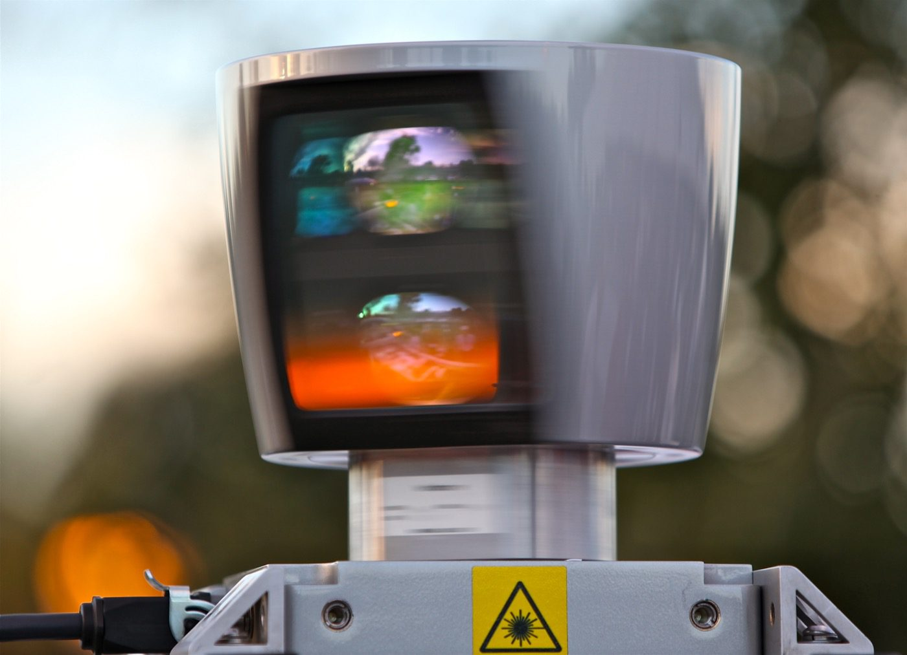

# 世界模型进入工程，先看一次预测能否改变行动

一个检测机械臂要沿工件移动相机，把一条焊缝看完整。它可以生成移动后的高清视频，也可以直接预测下一视角会看到哪些焊缝点。后者画面不一定漂亮，却更接近当前决策需要。这个构造任务适合讨论世界模型如何进入工程，也能说明为什么几何、动力学和视频方法经常需要共同使用。

原先笔记里出现的“小雨焊缝任务”缺少可公开核验的背景。这里统一把它作为假想的工业检测场景，不据此声称已有用户项目或实验结果。

## 从一条未被看见的焊缝开始

设工件上的焊缝点为 $p_1,\ldots,p_n$，当前相机因夹具遮挡只看见一半。候选动作是移动相机到两个不同位姿。评价可定义为新视角新增的有效覆盖，减去运动时间与碰撞代价。

先检查几何就能解决一部分问题。已知工件、夹具和相机标定，可以计算点投影、视锥与遮挡，判断某条轨迹是否可达。若工件静止、光照简单且几何可靠，规则计算可能已经是强基线，无须先训练大型视频预测器。

{ width="860" }

<small>图源：[Wikimedia Commons: Velodyne High-Def LIDAR.jpg](https://commons.wikimedia.org/wiki/File:Velodyne_High-Def_LIDAR.jpg)。读图重点：世界模型面向真实系统时，核心不是“画面像不像”，而是传感器、空间、动作和风险能不能被同一套状态表示消费。</small>

多传感器不自动提供统一状态。相机外参、深度尺度与机械臂末端位姿必须描述同一坐标关系，动作也要有持续时间。否则“模型预测错了”可能只是把毫米当米，或者把相机采集时刻与机器人执行时刻错配。

## 几何无法解释的部分，才形成新的建模任务

反光可能让几何上可见的焊缝在图像中不可辨认；机械臂运动可能遮住关键区域；工件或夹具可能有轻微变形。这些因素要求更丰富的观测模型或动态预测。可以先问，错误发生在“点是否可见”，还是“可见以后能否可靠检测”。两个标签需要不同监督。

若任务只关心检测覆盖，模型可以输出每个点的可辨认概率。若要训练视觉检测器，还可能需要生成新光照下图像；若要规划机械臂动作，必须同时处理可达和碰撞。这些用途共享输入，却不要求由同一个网络包办。

这也使方法谱系变得可理解。PlaNet/Dreamer 研究内部动态如何服务控制，视频模拟研究可见未来与持续交互，几何方法提供空间结构。这些路线可以互补，但组合后的系统收益需要额外验证，不由三个领域各自的论文分数相加得到。

## 一次预测如何实际改变选择

构造两个候选视角 A、B，分别预计新增 20、14 个可辨认点，移动耗时 2、1 秒。若每秒成本为 3 个点的等价值，分数为 14 与 11，选 A。若 A 的轨迹碰撞不可行，应在有效集合中去掉 A，而不是让高覆盖轻易抵消硬约束。

实际移动后只新增 8 个点，说明预测偏高。要保存当时的姿态、预测概率、实际图像与检测结果，才能判断是反光、遮挡、标定还是 checker 失误。只记一次任务失败，无法指导下一轮。

这里的分数和代价是设计示例。真实项目应根据覆盖、时间和风险要求确定目标，并保留不使用学习模型的几何或启发式基线。

## 视频看起来更像，不等于规划更好

预测画面的像素误差、感知特征误差和任务决策误差回答的是三件事。模型生成的画面很清晰，可能仍然把可通行区域、接触状态或碰撞风险预测错；反过来，低分辨率的状态预测只要能正确排序候选动作，也可能对规划有用。评测时应把短期预测、长期 rollout、候选动作排序和最终任务结果分开记录。

可以固定同一批起点和候选动作，比较几何基线、学习模型和组合方法。除了覆盖和时间，还记录预测置信度与实际误差的关系，例如把低置信度样本交给更保守的规划器。若这种分流没有减少碰撞或无效移动，就说明置信度还没有成为可用的风险信号。

## 训练数据怎样支持这个查询

一份检测日志只记录执行过的视角。它没有告诉我们同一起点下未执行的候选会看到什么。模拟器能补受控视角，前提是渲染与几何假设足以覆盖反光等关键因素；真实补采可以验证这些假设，却有重置与人工成本。

[动作条件训练](../world-models/action-conditioned-video-world-model-training-case.md)解释时间窗和监督怎样组织。对于焊缝任务，可以把状态估计、动作条件可见性、检测可靠度分别建模，先让它们在少量可回放样本上对齐，再扩大数据。这里没有理由预设必须按某个模型家族升级。

## 怎样评价这条工程判断

可以固定工件集合、覆盖标准、动作预算与检测器，比较几何规划、学习评分以及二者组合。分别记录新增覆盖、路径时间、不可执行比例和误判原因。若视频质量提高但选择没有改善，就说明此次生成改进没有给这个消费者带来相应收益；它仍可能对人审或视觉增强有用。

我更看好按用途组合模块的原因，是错误更容易归因，部署也能只运行必要部分。但这仍是一项工程偏好，需要和端到端系统在相同预算下比较。若模块边界丢失关键信息、转换成本过大，组合方法也可能更差。

本文支持的范围是上述任务分解，并不声称它代表所有世界模型的“当前阶段”。原始机制可对照 [PlaNet](https://arxiv.org/abs/1811.04551)、[V-JEPA 2](https://arxiv.org/abs/2506.09985)与 [LingBot-World](https://arxiv.org/abs/2601.20540)，实际诊断方式见[开发与评测](../world-models/development-roadmap-data-simulation-and-evaluation.md)。[V-JEPA 2 的论文](https://arxiv.org/abs/2506.09985)和[作者研究页面](https://ai.meta.com/research/vjepa/)可以作为“理解、预测、规划”关系的原始材料，不能替代对具体机器人任务的闭环验证。

**自测**：给两个候选视角写出相同的起点、动作预算、覆盖标准和风险约束，再说明哪一项观测会让你放弃原来的高覆盖候选。

## 来源与自测

焊缝检测场景是明确标注的假想任务，PlaNet、V-JEPA 2 和 LingBot-World 提供机制入口。自测时固定起点和候选动作，分别报告预测误差、候选排序和真实覆盖，不把视频质量直接当成规划收益。
