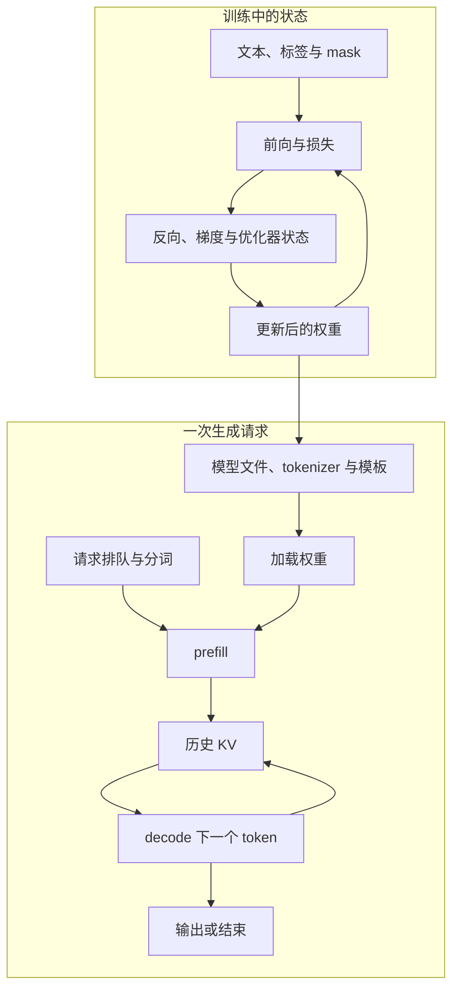

# 从训练计算到推理服务

训练和推理使用同一个模型函数，却围绕它保存不同状态。训练需要根据目标回传梯度并更新参数，推理需要管理请求、历史缓存与输出。把一条训练序列和一条生成请求并排看，就能理解为何相同模型在两端的资源瓶颈不同。

读图时跟踪两种循环。左上训练循环在更新参数；下方生成循环在增加请求的历史 KV。保存权重连接了两个阶段，却不会把优化器状态变成请求缓存。

## 一条序列怎样产生参数更新

原始文本经过tokenizer和模板，变成输入、右移标签与mask。模型一次计算多个位置的logits，损失只对有效目标归约。反向传播从标量损失向参数传梯度，优化器再使用梯度和历史状态更新权重。

[训练入门](../training/beginner-model-training-primer.md)展开完整循环，[输入流水线](../training/input-pipelines-packing-and-throughput-governance.md)说明padding、packing与token分母，[优化目标](../training/objectives-optimizers-and-schedules.md)说明更新规则。分布式训练必须保持这些数学含义，再将计算与状态分到设备上。

## 一条请求怎样产生第一个和后续token

请求先经过排队、分词和调度。Prefill处理已知前缀，建立历史KV并产生下一token分布；decode逐步加入新token，复用已经计算的历史。首token时间同时受到排队与prefill影响，后续间隔还受批次、KV读取和调度影响。

[服务流程](../inference/serving-systems.md)追踪请求状态，[缓存与投机](../inference/caching-routing-and-speculative.md)解释如何复用或提前计算，[成本与SLO](../inference/cost-modeling-and-slo-design.md)把指标连接到负载与容量。

## 同一权重，为什么两端资源不同

训练通常有较大的token批次，需要保存激活、梯度和优化器状态；decode可能每条请求只增加一个token，却需要读取权重与历史KV。较大矩阵能复用数据，小矩阵可能更受带宽、launch和调度限制。

| 观察到的现象 | 先看哪种对象 | 阅读 |
| --- | --- | --- |
| 首次optimizer step才OOM | 优化器状态与主权重 | [分布式状态与checkpoint](../training/distributed-training-and-checkpointing.md) |
| 长序列前向峰值激增 | 激活、attention与有效mask | [显存与反向](../foundations/autograd-activation-checkpointing-and-memory.md) |
| 长请求并发导致OOM | KV、分页与调度预算 | [KV与内存层次](../inference/context-compression-kv-eviction-and-memory-hierarchies.md) |
| 量化后容量改善但速度不变 | 实际kernel、解量化和非权重成本 | [量化部署](../quantization/index.md) |
| 单kernel快但请求不快 | 端到端占比和慢路径 | [性能分析](../operators/profiling-debugging-and-numerical-stability.md) |

## 评价模型与评价服务要接起来

模型质量需固定任务与生成协议，服务效率需固定输入输出长度、负载与硬件。若为了吞吐截短回答、改变采样或降低视觉分辨率，行为已变化，应该同时重新评价质量。

保存训练checkpoint也不意味着保存了全部服务状态；缓存、检索资料、tokenizer与模板同样会改变输出。理解这些边界后，可以沿[训练](../training/index.md)、[推理](../inference/index.md)、[量化](../quantization/index.md)和[算子](../operators/index.md)进入具体机制。
