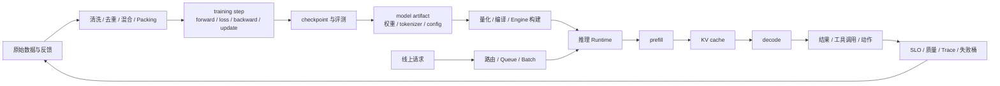

# 训练与推理系统：模型如何被训练、交付并持续运行

模型结构只规定了“可以计算什么”，训练与推理系统决定这些计算能否在真实预算内完成。训练把数据转成参数，推理把参数转成可交付结果；两端共享数值格式、算子、硬件和评测，却面对不同的状态、调度方式与失败模式。

## 训练与推理系统的统一接口

可以把整个系统压缩成六类对象：

| 对象 | 训练侧关注什么 | 推理侧关注什么 |
| --- | --- | --- |
| Workload | token、序列长度、模态、数据混合、batch | prompt 长度、输出长度、并发、到达分布 |
| State | 参数、梯度、optimizer state、激活、RNG | 权重、KV cache、请求状态、prefix cache |
| Execution | forward、backward、optimizer step、collective | prefill、decode、batching、kernel dispatch |
| Artifact | checkpoint、tokenizer、配置、数据 manifest | engine、量化权重、runtime config、容器镜像 |
| Constraint | 显存、通信、稳定性、训练预算 | TTFT、TPOT、吞吐、尾延迟、单请求成本 |
| Evidence | loss、下游评测、恢复一致性、消融 | SLI/SLO、线上质量、trace、回放与降级记录 |

训练产物不是一份孤立权重。可部署的 model artifact 还包括 tokenizer、chat template、位置编码与最大上下文配置、数值格式、并行切分方式、推理所需的自定义算子，以及能够证明质量的评测版本。任何一项在交付时发生偏移，都可能形成 offline-to-online gap：离线 checkpoint 表现正常，进入服务后却出现格式错误、长度退化、数值漂移或延迟失控。

## 一条从数据到请求再回到数据的闭环

这条闭环包含三次必须显式验收的交接。

1. **数据到训练**：样本条数必须换算成真正参与 loss 的有效 token 或有效动作；mask、packing、采样与数据混合共同决定梯度来自哪里
2. **训练到部署**：checkpoint 必须经过固定评测、格式转换、量化或编译验证，并确认 tokenizer、配置和自定义代码与训练时一致
3. **部署到再训练**：线上日志不能直接回灌；需要脱敏、去重、归因、分桶和人工或规则门禁，才能成为下一轮数据

训练与推理的优化目标也不同。训练常追求单位时间内处理更多有效 token，并保持参数更新稳定；推理要在动态请求下同时控制首 token 延迟、逐 token 延迟、吞吐、显存与尾部风险。训练中更大的 batch 往往提高硬件利用率，推理中更大的 batch 却可能增加排队时间。两端都报告 `tokens/s` 时，含义并不相同。

## 训练系统脉络

训练系统可以按“信号、更新、规模、证据”四层理解。

| 层级 | 核心问题 | 主要页面 |
| --- | --- | --- |
| 信号 | 数据分布、目标函数和 mask 在奖励什么 | [训练系统专题](../training/index.md)、[数据质量与治理](../training/data-quality-dedup-and-governance.md)、[目标函数与优化器](../training/objectives-optimizers-and-schedules.md) |
| 更新 | batch、学习率、优化器和数值格式怎样形成参数轨迹 | [模型训练的完整链路](../training/beginner-model-training-primer.md)、[低比特训练与数值格式](../training/low-bit-training-and-numerics.md) |
| 规模 | 数据、张量、流水线、上下文和专家并行怎样切分状态与计算 | [分布式训练与 Checkpoint](../training/distributed-training-and-checkpointing.md)、[Megatron、DeepSpeed 与 FSDP](../training/megatron-lm-deepspeed-and-open-training-stacks.md) |
| 证据 | 训练是否稳定、可恢复、可比较，改动是否真的改善能力 | [稳定性与故障排查](../training/stability-numerics-and-failure-triage.md)、[评测与消融](../training/evaluation-and-ablation-methodology.md) |

这四层不能互相替代。吞吐提高只能证明系统处理数据更快，不能证明数据更好；loss 下降只能证明目标函数被优化，不能证明线上任务改善；checkpoint 能加载也不等于 optimizer、scheduler、sampler 和 RNG 恢复等价。

## 推理系统脉络

推理系统可以按“请求、执行、状态、服务”四层理解。

| 层级 | 核心问题 | 主要页面 |
| --- | --- | --- |
| 请求 | 输入输出长度、并发和到达分布怎样形成负载 | [推理系统专题](../inference/index.md)、[成本与 SLO](../inference/cost-modeling-and-slo-design.md) |
| 执行 | prefill、decode、GEMM、attention 和采样分别受什么限制 | [推理服务系统](../inference/serving-systems.md)、[GPU Kernel、Batching 与显存](../inference/gpu-kernels-batching-and-memory-systems.md) |
| 状态 | KV cache、prefix、长上下文与多轮会话怎样占用内存 | [缓存、路由与投机解码](../inference/caching-routing-and-speculative.md)、[上下文压缩与 KV 管理](../inference/context-compression-kv-eviction-and-memory-hierarchies.md) |
| 服务 | runtime、scheduler、路由、观测和容量怎样满足 SLO | [推理运行时](../inference/serving-runtimes-vllm-sglang-and-tensorrt-llm.md)、[可观测性与在线评测](../inference/observability-and-online-evaluation.md) |

推理优化必须落到具体请求桶。短 prompt、长 prompt、结构化输出、工具调用、长文本生成和多模态请求的瓶颈不同。平均延迟下降可能掩盖 P99 变差，整体 tokens/s 提升也可能来自让短请求挤占长请求。没有请求分布和质量回归，单个 benchmark 很难支持上线结论。

## 量化、算子与编译器怎样贯穿两端

[量化](../quantization/index.md)和[算子与编译器](../operators/index.md)贯穿训练与推理的执行层，不能等到部署末端再补。

| 技术 | 训练侧影响 | 推理侧影响 | 验收重点 |
| --- | --- | --- | --- |
| BF16 / FP8 / 混合精度 | 激活、梯度、累加与 optimizer state | 权重、激活、KV 和 kernel 路径 | 数值稳定、真实加速、质量回归 |
| 量化 | QAT、QLoRA、低显存适配 | PTQ、GPTQ、AWQ、INT4/INT8 | 校准分布、离群值、运行时支持 |
| Attention Kernel | 训练序列吞吐与激活显存 | prefill 延迟、decode 与 KV 访问 | shape、mask、精度、端到端收益 |
| 通信 Kernel | all-reduce、all-gather、all-to-all | tensor/expert parallel serving | 拓扑、重叠率、尾延迟 |
| 图编译与融合 | 减少 launch 与中间张量 | 固定 shape 或动态 batch 的执行效率 | compile time、fallback、shape coverage |

同一个算子在两端的工作负载不同。训练通常有较稳定的大 batch 和完整反向图；服务面对动态 shape、逐步 decode 和不断变化的活跃请求。训练侧最快的 kernel 不一定适合 decode，离线吞吐最优的 engine 也不一定满足在线尾延迟。

## 按问题进入

| 现在的问题 | 建议路径 |
| --- | --- |
| 不清楚模型参数究竟怎样被更新 | [模型训练的完整链路](../training/beginner-model-training-primer.md) → [目标函数、优化器与 LR](../training/objectives-optimizers-and-schedules.md) |
| 训练放不进显存，或多卡后反而变慢 | [分布式训练与 Checkpoint](../training/distributed-training-and-checkpointing.md) → [Megatron、DeepSpeed 与 FSDP](../training/megatron-lm-deepspeed-and-open-training-stacks.md) |
| loss 正常但结果不可信 | [稳定性与故障排查](../training/stability-numerics-and-failure-triage.md) → [评测与消融](../training/evaluation-and-ablation-methodology.md) |
| 不清楚一次请求为何分成 prefill 和 decode | [推理服务系统](../inference/serving-systems.md) → [GPU Kernel、Batching 与显存](../inference/gpu-kernels-batching-and-memory-systems.md) |
| 显存被 KV 占满，长请求拖垮吞吐 | [上下文压缩与 KV 管理](../inference/context-compression-kv-eviction-and-memory-hierarchies.md) → [Prefill 解耦与 KV 服务](../inference/disaggregated-prefill-kv-services-and-capacity-ops.md) |
| 不知道选 vLLM、SGLang 还是 TensorRT-LLM | [推理运行时](../inference/serving-runtimes-vllm-sglang-and-tensorrt-llm.md) → [容量规划](../inference/optimization-checklist-and-capacity-planning.md) |
| 量化后文件变小，但服务没有变快 | [量化专题](../quantization/index.md) → [量化运行时与框架](../quantization/quantization-runtimes-and-frameworks.md) → [Kernel 成本模型](../operators/kernel-cost-models-and-selection-heuristics.md) |
| 离线评测正常，线上质量或延迟持续漂移 | [可观测性与在线评测](../inference/observability-and-online-evaluation.md) → [成本与 SLO](../inference/cost-modeling-and-slo-design.md) |

实现细节可继续对照 [PyTorch FSDP](https://docs.pytorch.org/docs/stable/fsdp.html)、[PyTorch Distributed Checkpoint](https://docs.pytorch.org/tutorials/recipes/distributed_checkpoint_recipe.html)、[Megatron Core](https://docs.nvidia.com/megatron-core/developer-guide/latest/user-guide/index.html)、[DeepSpeed ZeRO](https://www.deepspeed.ai/tutorials/zero/)、[vLLM](https://docs.vllm.ai/)、[SGLang](https://docs.sglang.ai/) 与 [TensorRT-LLM](https://nvidia.github.io/TensorRT-LLM/) 的官方资料。
