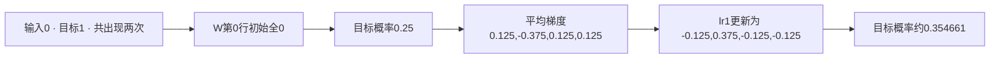
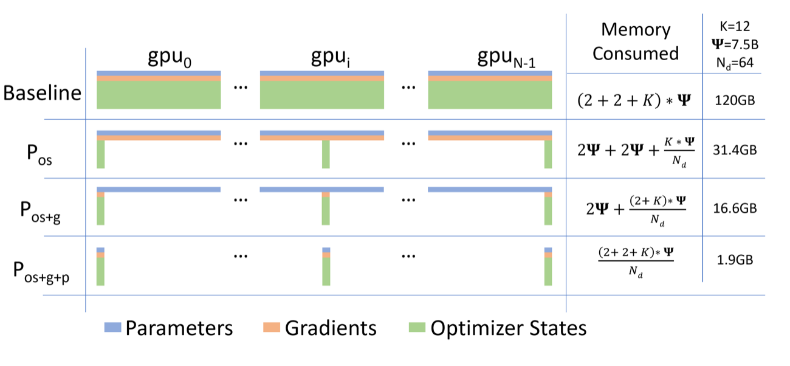
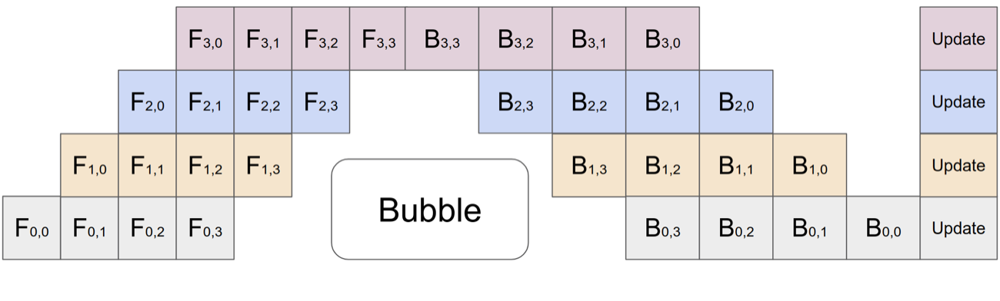
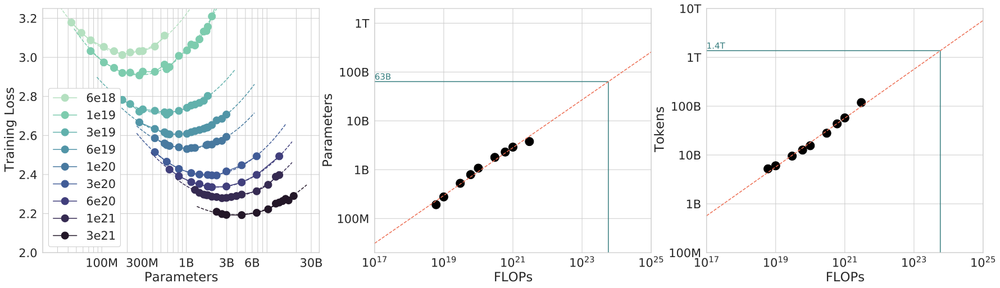

# 一段文本怎样变成一次参数更新

训练代码最重要的几行很短，读取一批数据，前向计算，求 loss，反向传播，更新参数。难的是知道这些行之间传递的张量代表什么，以及哪些操作真正改变了模型。下面沿着同一段 token 走完一次更新，再对照 nanoGPT 的实际训练循环。先让计算完全可检查，再接入更大的模型。

## 输入和答案只错开一个位置

假设分词后的连续文本为 `[0, 1, 2, 0, 1]`，词表有四个 token。取长度为 4 的训练窗口，输入与目标分别是

```text
位置       0  1  2  3
输入 X     0  1  2  0
目标 Y     1  2  0  1
```

每个位置用已经出现的上下文预测下一个 token。位置 0 的目标是 1，位置 1 的目标是 2。训练时整条目标已经知道，因此可以同时计算这四个位置的预测误差；因果 attention 仍需阻止位置 0 看见未来输入。

[nanoGPT 的 get_batch](https://github.com/karpathy/nanoGPT/blob/3adf61e154c3fe3fca428ad6bc3818b27a3b8291/train.py#L116)正是从 token 文件随机选起点，取 `data[i:i+block_size]` 作为 X，再取向后移动一位的窗口作为 Y。这个项目在数据端完成移位，`model.py` 直接比较 logits 与 targets。其他模型接口可能内部移位，移植训练代码前先确认，不能两边各移一次。

一批有 B 条窗口、每条 T 个 token 时，X 与 Y 形状为 `[B,T]`。Token ID 是离散类别编号，不是数值大小有意义的测量值。

## 用一张四乘四的表代替 Transformer

为了看清更新，先用最小 bigram 模型。它只依据当前 token 预测下一个 token，参数是一张 $4\times4$ 的表 W。输入 token 为 0 时，取第 0 行的四个数作为 logits；输入为 1 时取第 1 行。这个模型没有 attention，不能理解更早的上下文，但其 loss 与优化循环和 GPT 使用同一种接口。

令所有 W 初始为 0，则每个位置输出 `[0,0,0,0]`。Softmax 把它变成概率

$$
p_j=\frac{e^{z_j}}{\sum_{k=0}^{3}e^{z_k}}=\frac14.
$$

此时模型对四种下一词完全没有偏好。对第一个目标 token 1，交叉熵是 $-\log p_1=\log4\approx1.386294$。四个位置都一样，取平均后的 loss 仍为 1.386294。

GPT 把这张简单查表替换为 embedding、若干 Transformer block、归一化和词表投影。它输出 `[B,T,V]` 的 logits，V 为词表大小。nanoGPT 的 [forward](https://github.com/karpathy/nanoGPT/blob/3adf61e154c3fe3fca428ad6bc3818b27a3b8291/model.py#L170)随后把 logits 展平为 `[B*T,V]`、targets 展平为 `[B*T]`，对每个位置计算交叉熵。

传给交叉熵的是 logits。若先 softmax 后又调用接受 logits 的 CrossEntropyLoss，函数会把概率当作 logits 再归一化，目标就变了。[PyTorch 官方优化教程](https://github.com/pytorch/tutorials/blob/5672cd98a7671eda4d9122b10f8eec580f74d03e/beginner_source/basics/optimization_tutorial.py)明确使用模型 logits 作为输入。

## 从概率得到梯度

单个位置的交叉熵对 logits 的导数为

$$
\frac{\partial\ell}{\partial z_j}=p_j-\mathbf1[j=y].
$$

目标类别的导数是 $0.25-1=-0.75$，其余三类各为 0.25。做梯度下降时减去导数，所以会提高目标 logit、降低其他 logits。训练没有直接把“目标概率加一点”，它通过改变 logits 及其上游参数，让归一化后的概率随之变化。

同一个 W 被所有位置共享。输入 0 出现两次，而且目标都是 1。对四个位置取平均后，第 0 行梯度是

$$
\nabla W_0=\frac24[0.25,-0.75,0.25,0.25]
=[0.125,-0.375,0.125,0.125].
$$

输入 1 与 2 各出现一次，因此其对应行梯度只占单位置梯度的四分之一。输入 3 没出现，第 3 行这一步没有收到该 loss 的梯度。换成 Transformer，链式法则继续把同样的 logit 梯度传回每层参数，自动微分负责计算这些依赖。

## 更新发生在 optimizer step

使用学习率为 1 的 SGD，更新 $W\leftarrow W-\nabla W$ 后，第 0 行变成 `[-0.125,0.375,-0.125,-0.125]`。目标 token 1 的概率成为

$$
\frac{e^{0.375}}{e^{0.375}+3e^{-0.125}}
=\frac{e^{0.5}}{e^{0.5}+3}\approx0.354661.
$$

另外两条参与更新的行，正确下一词概率约为 0.299724。重新前向，四个位置平均 loss 约为 1.120743，低于更新前的 1.386294。

下面的完整程序只需 Python 标准库。它显式计算 softmax、梯度和更新，便于逐项核对。

```python
import math

x, targets = [0, 1, 2, 0], [1, 2, 0, 1]
w = [[0.0] * 4 for _ in range(4)]

def softmax(row):
    shifted = [math.exp(v - max(row)) for v in row]
    return [v / sum(shifted) for v in shifted]

def mean_loss(weights):
    return -sum(math.log(softmax(weights[a])[b])
                for a, b in zip(x, targets)) / len(x)

before = mean_loss(w)
grad = [[0.0] * 4 for _ in range(4)]
for token, target in zip(x, targets):
    probs = softmax(w[token])
    for j in range(4):
        grad[token][j] += (probs[j] - (j == target)) / len(x)
for i in range(4):
    for j in range(4):
        w[i][j] -= grad[i][j]
print(round(before, 6), round(mean_loss(w), 6))
print(w[0])
```

输出应为 `1.386294 1.120743`，随后是 `[-0.125, 0.375, -0.125, -0.125]`。这是机制验证，尚未测试泛化。一直训练同一条序列，只能说明模型越来越适应这条序列。

<!-- systems-workflow-visual -->


同一参数行被两个位置共享，因此梯度先累加再按四个目标位置平均。

## PyTorch 把手算的哪部分接过去

下面是同一模型的一次更新，需要已安装 PyTorch，使用 CPU 即可。代码没有数据下载。

```python
import torch
from torch import nn

x = torch.tensor([[0, 1, 2, 0]], dtype=torch.long)
y = torch.tensor([[1, 2, 0, 1]], dtype=torch.long)
w = nn.Parameter(torch.zeros(4, 4))
optimizer = torch.optim.SGD([w], lr=1.0)

optimizer.zero_grad(set_to_none=True)
logits = w[x]                         # [1, 4, 4]
loss = nn.functional.cross_entropy(logits.reshape(-1, 4), y.reshape(-1))
loss.backward()                       # writes w.grad, leaves w unchanged
optimizer.step()                      # writes new values to w
with torch.no_grad():
    after = nn.functional.cross_entropy(w[x].reshape(-1, 4), y.reshape(-1))
print(loss.item(), after.item())
```

`backward()` 只计算并累积梯度，`step()` 才写回参数，`zero_grad()` 清理上一轮累计的梯度。清零放在一次更新前，或像官方教程一样放在更新后，都可以，前提是下一次累积前没有不该保留的旧梯度。

`model.train()` 与 `model.eval()` 切换 dropout、BatchNorm 等模块行为，`no_grad()` 控制是否记录自动微分计算；两者功能不同。评测时通常二者配合使用，评测后再回到训练模式。我们的查表模型没有这些模块，因此模式切换不会改变数值。

## 放不下一整个 batch 时，先累积再更新

若把四个位置拆成两个等大小 micro-batch，每份先求均值再除以 2、各调用一次 backward，最后只执行一次 optimizer step，就能恢复完整 batch 的平均梯度。两次前向必须使用同一组参数。

nanoGPT 的 [训练循环](https://github.com/karpathy/nanoGPT/blob/3adf61e154c3fe3fca428ad6bc3818b27a3b8291/train.py#L290)正是在每个 micro-step 把 loss 除以累积次数，完成多次 backward 后再更新。其固定长度、等大小 batch 为这个归一化提供条件。

长度不同时，需要更小心。两个 micro-batch 有效目标 token 分别为 2 和 6，平均 loss 分别为 1 和 3，完整 token 平均应为 $(2\times1+6\times3)/8=2.5$，简单平均却是 2。此时要以整个更新窗口的有效目标数作为分母。本文把直接参与 loss 的位置称为 effective tokens，prompt 虽被 loss mask 排除，仍可作为条件影响预测。

在数据并行中，一次更新的 global batch 样本数为每卡 micro-batch 乘累积次数再乘 DP 副本数。8 卡、每卡 2 条、累积 16 次得到 256 条。序列长度与 mask 不同，256 条并不对应固定目标 token 数。多卡梯度归一化详见 [分布式训练](distributed-training-and-checkpointing.md)。

## 精度、通信和显存都插在这条循环里

nanoGPT 在 autocast 范围内前向，对 FP16 使用 GradScaler；累积完成后先 unscale，再裁剪梯度，之后调用 scaler 的 step/update。这样裁剪阈值作用在未缩放梯度上，异常梯度也有机会阻止不安全更新。具体逻辑见 [低比特训练](low-bit-training-and-numerics.md)。

换 Adam 后，更新不再只依赖当前梯度，还会读取并修改一二阶矩；反向需要的激活也占内存。因此推理能装下权重，不代表训练能装下完整状态。

{ width="860" }

<small>图源：[ZeRO: Memory Optimizations Toward Training Trillion Parameter Models](https://arxiv.org/abs/1910.02054)，Figure 1。这张图说明 optimizer states、gradients、parameters 在普通数据并行里为什么会重复保存，以及 ZeRO 三个阶段分别切走哪部分状态。</small>

普通 data parallel 复制模型并汇总不同数据的梯度；tensor parallel 切分层内计算；pipeline parallel 把不同层放在不同设备。它们仍需实现同一个前向、反向与更新目标，只是张量的位置与通信时刻改变。

{ width="860" }

<small>图源：[GPipe: Efficient Training of Giant Neural Networks using Pipeline Parallelism](https://arxiv.org/abs/1811.06965)，Figure 2(c)。这张图说明 micro-batch 如何填充 pipeline bubble，让不同 accelerator 同时处理不同模型分段。</small>

GPipe 图中的 micro-batch 流过多个模型分段。它与前面的梯度累积共享“小批次最后合成一次更新”的思想，但还要安排不同设备的等待与激活保存。细节可沿 [分布式训练](distributed-training-and-checkpointing.md)继续推导。

## 保存什么，决定恢复到哪一个时刻

一次更新完成后保存模型与 optimizer，描述的是更新后的参数和历史状态。若在 micro-batch 累积中途保存，未提交的梯度与累积计数也属于当前状态。最容易实现的恢复边界是完整 optimizer step 之后。

nanoGPT 的 checkpoint 保存 `model`、`optimizer`、`model_args`、`iter_num`、`best_val_loss` 和配置。这份代码适合读懂基本保存流程，但它未在该字典里保存完整 RNG 与随机窗口采样进度，因此不能仅凭这个示例宣称逐样本精确续训。自己的 checkpoint contract 还要覆盖数据版本、随机状态、sampler、精度状态和进度。

验证时可连续运行六次更新，在第三次后保存，再从保存点运行后三次，比较参数与样本 ID。先保证这条小循环可重放，再讨论跨拓扑和大规模异步保存。

## 训练误差下降后，还缺什么证据

我们的模型记住了 0 后面常出现 1。要知道它是否学到可泛化规律，需要另一组不参与更新的样本；要判断代码、工具或机器人任务能力，还需要对应任务评测。训练 loss、验证 loss 与任务成功率回答不同问题。

增加模型大小或训练 token 时也应延续同一个比较口径。Chinchilla 在固定计算预算下比较参数量与 token 数，图中的谷底依赖所研究的训练设置。

{ width="920" }

<small>图源：[Training Compute-Optimal Large Language Models](https://arxiv.org/abs/2203.15556)，Figure 4。这张图说明固定 FLOP 预算下，不同模型大小会得到不同最终 loss，曲线谷底对应更合适的参数/token 配比。</small>

阅读后续专题时，可以始终回到这段循环，数据页解释 X、Y 与分母怎样形成，优化器页解释梯度怎样变成更新，分布式页解释张量怎样跨设备流动，评测页解释更新后获得了什么证据。

## 本页对照的源码

- [PyTorch optimization_tutorial.py](https://github.com/pytorch/tutorials/blob/5672cd98a7671eda4d9122b10f8eec580f74d03e/beginner_source/basics/optimization_tutorial.py)，固定 commit `5672cd98`，对照训练与评测循环。
- [nanoGPT train.py](https://github.com/karpathy/nanoGPT/blob/3adf61e154c3fe3fca428ad6bc3818b27a3b8291/train.py)，固定 commit `3adf61e1`，对照 `get_batch`、梯度累积、AMP 与 checkpoint。
- [nanoGPT model.py](https://github.com/karpathy/nanoGPT/blob/3adf61e154c3fe3fca428ad6bc3818b27a3b8291/model.py)，同一 commit，对照 `[B,T,V]` 与交叉熵。
- [目标函数与优化器](objectives-optimizers-and-schedules.md)继续计算 Momentum、AdamW 与学习率日程。
