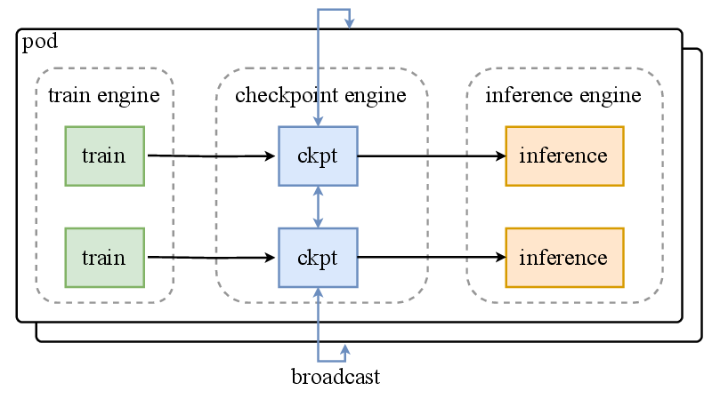

# 一个慢rank怎样拖住整个训练作业

八张卡一起训练时，七张卡已经完成反向传播，最后一张还在等数据。前七张卡不会继续更新，它们会在 collective 里一起等。监控面板上的平均 GPU 利用率可能仍然很高，却没有告诉你是哪一张卡先掉队，以及它是在读数据、算梯度，还是等通信。

这页把一次作业拆成几条可以对齐的时间线。先看最早的迟到事件，再判断 checkpoint 是否真的可恢复，最后才谈保存间隔和成本。这样排查出来的结论能落到日志字段，而不是停在“集群偶尔变慢”。

## 把八个rank放到同一时间线

教学设定中，七个rank在100毫秒完成反向，一个rank因数据读取迟到30毫秒。其他rank可能在collective等待到130毫秒，随后才能完成更新。等待出现在通信段，根因却可能早在loader。

因此同时记录数据就绪、计算结束、collective进入与完成时刻。最早发生的偏离比最后报出的超时更能缩小范围。若每个rank进入时间相近，才进一步调查链路与通信路径。

## 保存间隔决定故障损失

若每隔I秒保存一次，故障在区间内近似均匀发生，平均丢失I/2秒工作。单次保存耗时c，平均故障间隔M，忽略恢复与重叠时，损失比例近似为

$$
f(I)=c/I+I/(2M).
$$

求导得到 $I_*\approx\sqrt{2cM}$。例如c=75秒、M=36000秒，近似最优间隔2324秒，约38.7分钟。这是简化模型，真实故障并非独立均匀、异步保存也会与计算争抢资源，需用实际作业记录修正。

## 写完文件以后还差一次提交

分布式checkpoint由多个分片组成。部分文件写完但其他rank失败，不应被标成可恢复版本。异步保存还要确保读取的是冻结快照，避免优化器更新同时改动待写数据。

保留明确的完整性标记与版本信息，再验证模型、优化器、日程和数据进度能一起恢复。不要仅凭目录存在或文件大小非零判断保存成功。

{ width="760" }

<small>图源：[Kimi K2: Open Agentic Intelligence](https://arxiv.org/abs/2507.20534)，Figure 10。原论文图意：co-located distributed checkpoint engine 在 training engine 与 inference engine 之间管理参数状态，避免通过普通网络文件系统重新切分和广播超大模型参数。</small>

## 恢复要回到哪个状态

在step400保存、step420失败，恢复从400开始就会重做后面一段。日志可能已记录到419，训练状态却没有。为恢复分支记录父运行、checkpoint与起始更新，避免曲线连续造成“没有丢工作”的错觉。

短程故障演练应比较连续运行与恢复路径的输入及更新。若只保存权重用于推理，恢复承诺与完整续训不同，需要明确用途。

## 实验记录围绕一个可复现更新组织

固定代码、环境、模型、数据、tokenizer与并行配置，记录实际token曝光、step时间、显存和失败位置。版本发生变化时先做最小作业，再扩到长跑。

费用可按GPU小时统计，但效率还取决于有效监督token和可用checkpoint进度。设备一直运行却重复失败重做，与稳定推进训练具有不同成本。


## 继续读

继续看[研究闭环](research-loop-from-hypothesis-to-evidence-1123-2351.md)和[W&B 实验追踪与治理](wandb-experiment-tracking-and-governance.md)。

## 对照源码与延伸阅读

- [训练更新、日志与checkpoint的执行边界](https://github.com/karpathy/nanoGPT/blob/3adf61e154c3fe3fca428ad6bc3818b27a3b8291/train.py)

## 把一次作业分成四条时间线

集群实验至少同时存在：

1. **调度线**：排队、分配、启动和释放资源。
2. **训练线**：数据、前向、反向、通信和 optimizer step。
3. **保存线**：checkpoint 写入、校验、提交和上传。
4. **证据线**：W&B step、任务日志、资源曲线和失败状态。

这些线的时间戳不一定相同。W&B 已经记录了 step，但任务可能在 checkpoint 完成前被杀；云平台显示运行中，也可能某个 rank 已经卡在 collective。每个实验应保存 `job_id`、`run_id`、`global_step`、主机、rank、checkpoint 和最终状态的映射。

## 诊断慢 rank 的事件表

| 事件 | 每 rank 记录什么 | 用途 |
| --- | --- | --- |
| batch ready | 数据 ID、有效 token、时间 | 区分数据尾延迟 |
| forward/backward end | 时间、激活峰值 | 区分计算 shape 和频率 |
| collective enter/exit | group、bytes、时间 | 区分通信与等待 |
| optimizer step | step、overflow、更新时间 | 检查 rank 是否同步 |
| checkpoint | 临时/提交状态、校验值 | 判断可恢复边界 |

把这些事件按 rank 对齐后，先找第一个偏离，再看后面所有 rank 如何等待。只有进入 collective 的时间接近而完成时间明显分散，才更有理由调查链路和拓扑。

## 保存间隔还要加入恢复时间

简化的保存间隔公式只考虑保存开销和平均丢失工作。真实决策还要加恢复时间、重算成本、共享存储拥塞和异步保存对训练的干扰。可以把一次故障代价拆成：

```text
lost_compute + reload_time + reshard_time
+ data_replay + queue_delay + validation_time
```

长作业应从历史记录估计这些量，而不是只按“每 30 分钟保存一次”的习惯设置。若 checkpoint 需要数分钟才能被其他节点读取，保存频率和副本位置也会影响可用性。

## 交付前的故障演练

在真实长跑前用小规模作业演练：单 rank 退出、主机断开、共享盘写入失败、checkpoint 写到一半、W&B 暂时不可用。每次都回答三个问题：训练是否安全停止，是否能恢复到哪一个 committed step，证据系统是否明确标注重跑和重复样本。

W&B 记录的曲线可以继续使用，但恢复后应新建或显式关联 run，避免把 step 400 之后的重跑伪装成一条无间断曲线。任务历史和容器日志保留失败原因，结果解释仍以实际 checkpoint 和输入进度为准。

## 来源与改编说明

- [DeepSpeed Checkpointing](https://deepspeed.readthedocs.io/en/latest/model-checkpointing.html)提供分片 checkpoint、保存/加载和恢复边界的工程参考。
- [PyTorch Distributed Checkpoint](https://pytorch.org/docs/stable/distributed.checkpoint.html)用于对照分布式状态与重分片接口。
- `server_monitor` 的任务历史、资源曲线、容器日志和 W&B 关联入口用于把这些事件落到实际个人工作流。

## 自测

1. 一个 rank 在 loader 阶段慢 30 ms，为什么所有 rank 的 collective 时间都会变慢？
2. checkpoint 文件都存在但缺少 committed manifest，能否直接恢复？
3. 训练重跑后 W&B 曲线如何标注，才能避免把重复 step 当成连续证据？
4. 设计一次单 rank 故障演练，列出恢复正确所需的最小状态。
