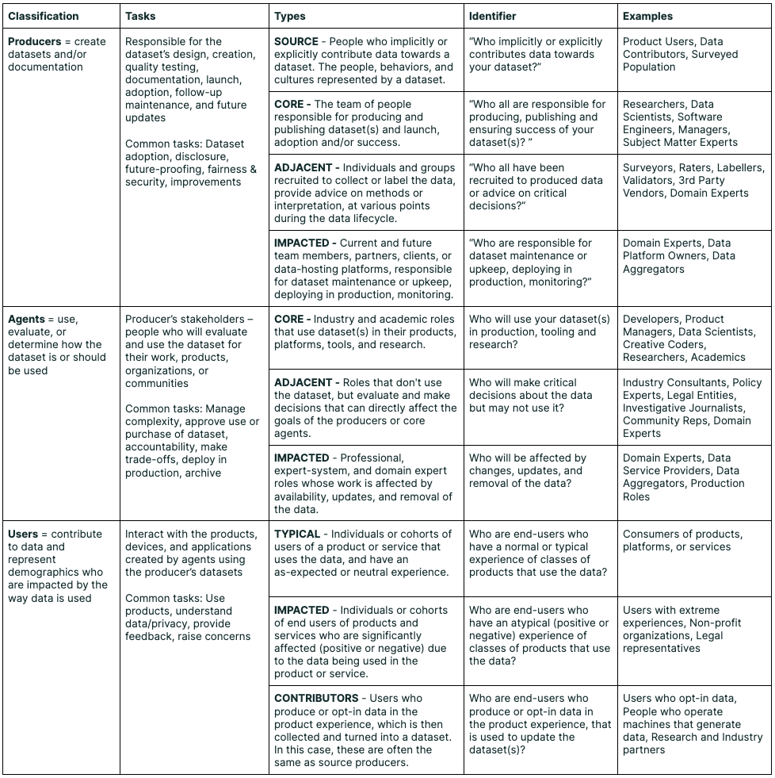

# 去重与过滤怎样改写训练分布

把一条记录复制十次，会增加它被抽到的概率。把相似记录合并，又可能删掉真正有价值的变化。数据质量处理最终改变的是模型看到什么、看到几次，以及测试信息是否已提前进入训练。

## 重复样本相当于增加权重

设数据只有A、B两类记录，A有1份，B有1份，按记录均匀抽样时各占一半。把A复制成9份，抽到A的概率就变为90%。经验目标从 $0.5L_A+0.5L_B$ 变成 $0.9L_A+0.1L_B$。

复制文本仍会贡献训练token和梯度。不能把“重复率20%”直接解释成“计算量自动少20%”，也不能把重复token一律当成毫无学习价值。要区分实际曝光、独立信息和目标分布。

## 精确去重与近重复回答不同问题

完全相同的规范化文本可以用哈希匹配。近重复则需要比较片段、指纹或表征，并接受误合并与漏检之间的取舍。

教学示例中，两个token集合为 `{a,b,c,d}` 与 `{a,b,c,e}`，交集3、并集5，Jaccard相似度为0.6。真实文本通常使用连续n-gram集合或近似指纹，不能因为词集合相同就断言语义相同；否定词或数值变化可能正是任务关键。

先对候选阈值抽样人工检查，统计合并了哪些差异，再看去重后的长度、来源和任务覆盖。一个统一阈值未必适合代码、新闻与数学证明。

## 切分顺序决定是否发生泄漏

同一文档的相邻片段、同一视频的帧或同一任务轨迹，往往共享大量信息。若先随机按片段切训练/测试，再各自去重，近邻仍可能跨集合出现。

应先确定文档、事件、视频或任务等相关组，按组切分，再在允许范围内执行处理。评测输入及其近重复应独立检查。泄漏会让测试分数看起来更好，却不能代表遇到新样本的能力。

## 过滤器也有自己的选择偏差

按语言流畅度过滤，可能保留模板化句子而删掉领域符号；按长度过滤，可能删掉困难长样本；按teacher分数过滤，则会继承teacher偏好。高分不自动等于对当前模型最有价值。

保留过滤前后各来源、长度和关键任务的数量，并抽查被删样本。若目标是减少损坏数据，检查损坏率；若目标是改善任务能力，用独立任务集验证，不能只报告数据变小。

{ width="760" }

<small>图源：[Data Cards](https://arxiv.org/abs/2204.01075)。原图表达数据集文档应覆盖来源、组成、处理、用途和风险；读图重点是把数据治理看成训练能力的一部分，而不只是合规附录。它不能证明某个数据集质量高，只说明应该记录哪些证据。</small>

## 把处理决定追到实际曝光

每条保留记录应能追到来源与处理版本，采样器再记录实际抽取量。两份清单相同但采样权重不同，训练分布仍不同。数据版本、tokenizer和过滤配置需要共同确定训练输入。

许可、隐私与使用范围属于记录来源的一部分，应按实际来源约束处理，不能从“公开可下载”推断所有用途都获许可。技术评估则继续比较去重/过滤前后的目标分布与heldout结果。

## 对照源码与延伸阅读

- [训练循环实际消费的是采样后的token窗口](https://github.com/karpathy/nanoGPT/blob/3adf61e154c3fe3fca428ad6bc3818b27a3b8291/train.py)
