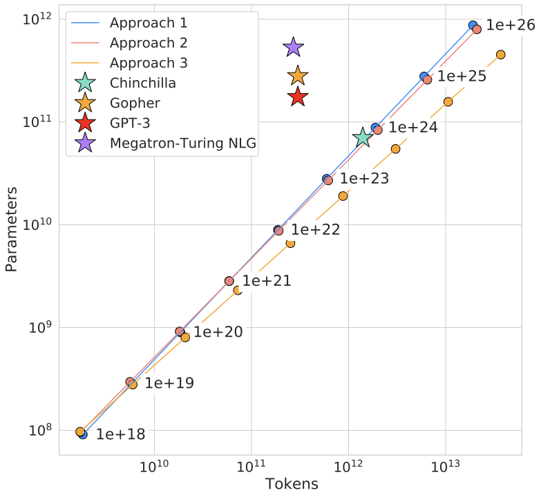

# 每秒多少训练token真正到达GPU

GPU完成一个训练step后，需要下一批已经解码、分词并组装好的张量。数据系统太慢会让设备等待；数据提前准备好，但大部分位置是padding，也会浪费预算。两种情况在“GPU很忙”这一指标里不容易区分。

## 先定义每步处理的量

设一批4条序列，长度分别为100、200、300、400，统一pad到400，总槽位1600，真实token1000，padding占37.5%。若只有回答部分参与loss，有效监督token还会更少。

因此至少区分物理处理槽位、非padding token和参与loss的目标token。比较两个packing方案时，不能一个报告槽位tokens/s，另一个报告监督tokens/s。

训练预算里还要再加两项：独立信息量和重复曝光量。相同的 1B 目标 token，如果其中 30% 来自同一文档的重复窗口，计算量相同，数据覆盖却不同。建议把每个 step 的账本写成

```text
physical_slots: 4096
non_padding_tokens: 3200
loss_tokens: 1100
unique_source_tokens: 900
repeated_exposure_tokens: 200
```

这些数字不应互相简单相减得到“有效 token”。`unique_source_tokens` 需要由文档、episode 或近重复分组定义，`repeated_exposure_tokens` 还可能包含有意的重采样。它们用于解释训练分布，不能替代实际参与矩阵计算的 token 数。

{ width="760" }

<small>图源：[Training Compute-Optimal Large Language Models](https://arxiv.org/abs/2203.15556)。原图表达在固定计算预算下参数量和训练 token 数需要共同选择；读图重点是把数据系统视为训练优化的一部分：有效 token、采样、packing 和吞吐都会改变实际学习预算。它不能证明某个数据配方最优。</small>

## 生产速度怎样变成等待

教学设定中，GPU每批计算100毫秒，loader每批准备150毫秒。若完全串行，一批250毫秒；有足够预取后，稳态仍受较慢的150毫秒限制。把GPU算得更快到50毫秒，对稳态吞吐没有帮助，等待反而更明显。

若loader准备80毫秒、GPU计算100毫秒，预取可把大部分准备时间隐藏在计算里。Buffer能平滑抖动，不能长期弥补生产速度低于消费速度。

## 一条样本经过哪些变化

原始记录先解码、规范化、去重与切分，再分词和采样，最后形成X/Y与mask。每一步都可能改变训练分布。按文档随机采样和按token位置随机采样，长文档得到的权重不同；按来源样本数配比，也不等于按有效token配比。

nanoGPT的 `get_batch` 从预分词memmap中随机取固定窗口，X与Y错开一位。它的输入路径简单，适合看清模型接口，但没有覆盖一般多模态解码、流式分片与复杂packing。完整边界见[输入流水线](input-pipelines-packing-and-throughput-governance.md)。

## 吞吐优化要保持同一个目标

把两条序列拼在一起可以减少padding，但要同时处理attention可见范围、位置编号与目标移位。若原本独立的问答拼接后互相看见，模型目标已经改变，不能只当作无损提速。

改变batch或梯度累积时，也要核对有效token总数与loss分母。只保持张量shape相同，不能保证每步优化同一个经验目标。

## 中断恢复需要已消费进度

预取器可能已经读到下一批，模型却还没完成当前更新。保存最远读取位置会跳过尚未训练的数据；只保存随机种子也无法重建所有buffer顺序。

将已提交optimizer step与已消费样本位置对应起来，再说明如何恢复shuffle、worker和预取状态。具体实现可以选择精确重放或允许有限重复，但需要明确语义，并用短程中断实验验证。

最终把每步耗时拆成数据等待、计算、通信和保存，辅以监督token计数。这样才能判断下一次优化应改存储、预处理、packing还是模型执行。

## 让 server_monitor 看到数据管线的状态

如果 `server_monitor` 只采集 GPU 利用率和显存，无法区分 loader 等待、H2D 阻塞和 padding 浪费。训练进程应定期上报一条轻量状态：

```json
{
  "experiment_id": "exp-2026-0110-017",
  "global_step": 1200,
  "data_wait_ms": 18.4,
  "h2d_ms": 3.1,
  "physical_slots": 4096,
  "loss_tokens": 1100,
  "queue_depth": 3,
  "cache_hit": true,
  "source_bucket": {"code": 0.4, "math": 0.3, "dialogue": 0.3}
}
```

周期状态用于找趋势，详细样本 ID 和处理版本仍应写到本地 manifest 或训练 artifact，避免监控系统承担大对象存储。数据等待出现长尾时，把 `queue_depth`、存储重试、worker 和 source bucket 同时对齐，通常比只盯 GPU utilization 更快定位。

## 吞吐提高以后，先检查学习目标有没有变

有三种常见的“快了”：

| 观察 | 可能原因 | 需要补的证据 |
| --- | --- | --- |
| slot/s 上升 | padding 增加或窗口变长 | non-padding 与 loss token/s |
| loss token/s 上升 | packing 或 batch 改善 | 数据来源、目标分布和梯度累积 |
| GPU step 变短 | 计算 shape 改变或部分工作被跳过 | 实际有效 token、输出和 mask |

如果优化改变了每步的有效监督 token，学习率、梯度累积和 checkpoint 的 `global_step` 解释也要一起更新。单看墙钟速度，无法说明相同训练预算是否更早达到。


## 继续读

继续看[集群运行与实验管理](cluster-operations-and-experiment-management.md)和[FP8 训练与 optimizer kernel](../operators/fp8-training-and-optimizer-kernels.md)。

## 对照源码与延伸阅读

- [memmap读取、get_batch与预取位置](https://github.com/karpathy/nanoGPT/blob/3adf61e154c3fe3fca428ad6bc3818b27a3b8291/train.py)

## 把数据吞吐拆成可观测的四段

一条训练输入通常经历：读取字节、解码/预处理、tokenize 或反序列化、组 batch 与搬到设备。把这四段合成一个 `data_time`，很难判断下一步该换存储、worker 还是 packing。

```text
read_ms -> transform_ms -> batch_wait_ms -> H2D_ms -> compute_ms
```

每个 step 至少记录开始/结束时间、有效 token、物理槽位、worker queue 深度和是否发生 cache miss。若 `read_ms` 长尾而平均值正常，优先看文件大小、对象存储重试和并发读取；若 `batch_wait_ms` 长，可能是动态 padding 或 token budget 造成某些 batch 难以组装。

## 预取只能隐藏，不能创造生产能力

设 GPU 消费速率为 (r_c)，数据管线长期生产速率为 (r_p)。当 (r_p<r_c) 时，预取 buffer 只能在有限时间内提供库存，最终仍会耗尽；当 (r_p>r_c) 时，增加 buffer 主要用于吸收抖动。

因此应做两组实验：固定模型和数据，改变 worker/预取深度；再固定 worker，改变模型计算时间或 batch。若 GPU 等待随 worker 增加而消失，瓶颈在生产端；若等待不变，可能是 H2D、同步或模型本身。

## Packing 改变的不只是 padding 比例

把多条序列放进一个窗口，需要同时保存：样本边界、位置编号、attention mask、目标移位和 loss mask。若 packing 后样本 A 能看到样本 B，虽然槽位利用率提升，训练目标已经变化。

一个 packing 审计至少检查：

- 每个 token 的 `sequence_id` 和 position 是否可回溯。
- 跨序列 attention 是否严格屏蔽。
- 目标 token 数是否与未 packing 的总数一致。
- 长度桶和来源配比是否因剩余槽位被系统性改变。
- 最后一个不满窗口的处理是否在各 rank 一致。

## 数据系统的基准矩阵

| 对照 | 改变 | 固定 | 主要指标 |
| --- | --- | --- | --- |
| storage | 本地 SSD / 网络盘 / 对象存储 | 模型与 batch | read p50/p99、重试率 |
| workers | worker 数、prefetch | 数据版本、模型 | queue depth、data wait |
| packing | fixed padding / length bucket / packing | 有效 token 预算 | slot utilization、监督 token/s |
| transfer | pinned memory、非阻塞 H2D | 输入 shape | H2D、compute overlap |
| restart | 不同 checkpoint 位置 | 数据顺序协议 | 重复/遗漏样本数 |

比较时同时报告有效监督 token/s 和 GPU hours。物理槽位吞吐上升但有效 token/s 下降，可能是 padding 或 mask 改变；单步更快但重复曝光增加，也不代表训练预算更高效。

## 来源与改编说明

- [PyTorch DataLoader 文档](https://pytorch.org/docs/stable/data.html)用于核对 worker、sampler、prefetch 和 pinned memory 的接口边界。
- [NVIDIA DALI](https://docs.nvidia.com/deeplearning/dali/user-guide/docs/)提供更复杂输入管线和 GPU 预处理的工程入口；是否值得引入要由 profiling 结果决定。
- [nanoGPT 训练脚本](https://github.com/karpathy/nanoGPT/blob/3adf61e154c3fe3fca428ad6bc3818b27a3b8291/train.py)用于对照固定窗口、memmap 和最小 `get_batch`，不代表通用数据系统。

## 自测

1. 为什么 GPU 利用率高仍可能说明数据系统浪费了大量 padding？
2. 设计一组实验，区分预取不足和 H2D 拷贝阻塞。
3. packing 后 loss 下降但能力改变，应该先检查哪些 mask 和分母？
4. 恢复训练时，为什么保存随机种子还不够恢复数据顺序？
