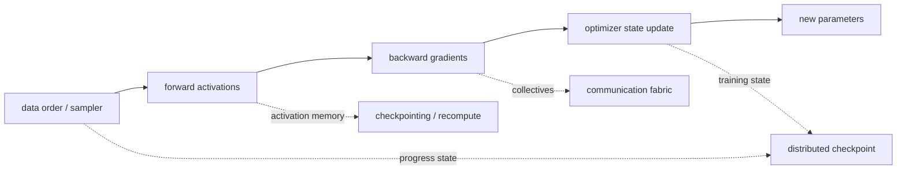

# 分布式训练与 Checkpoint：让长跑能快、能省、能恢复

分布式训练不是“多放几张 GPU”。它要同时满足四件事：模型和激活放得下，GPU 不长期等通信或数据，checkpoint 不把训练主链拖死，中断后还能从同一条训练轨迹继续。前两件决定训练能不能跑快，后两件决定训练能不能跑完。

这页只回答一个问题：**一次大模型训练长跑里，并行拓扑、通信、checkpoint 和恢复状态怎样闭合。**

框架分工放在 [Megatron、DeepSpeed 与 FSDP](megatron-lm-deepspeed-and-open-training-stacks.md)，这里重点看机制和验收。

## 先画五条流，不先背并行名词

把一次训练 step 画成系统路径，会比直接背 DP、TP、PP 更清楚。

数据流决定这一 step 吃到哪些样本和 token；前向/反向流决定 activation 和梯度什么时候出现；优化器流决定 parameters、gradients、optimizer states 如何更新；通信流决定这些状态跨 rank 如何同步；checkpoint 流决定中断后能否恢复同一条训练轨迹。

所以分布式训练的目标不是“打开最多并行开关”，而是让这五条流在硬件拓扑上对齐。一个方案如果只让单步吞吐变快，却让 checkpoint 无法恢复、数据顺序丢失或导出权重不可用，就不是完整训练方案。

## World Size 是一张拓扑账

现代训练通常把总 rank 数拆成多个并行维度：

\[
N_{\text{world}}
=
N_{\text{DP}}
\times
N_{\text{TP}}
\times
N_{\text{PP}}
\times
N_{\text{CP}}
\times
N_{\text{EP}}
\]

这里 \(N_{\text{DP}}\) 表示数据并行副本数，\(N_{\text{TP}}\) 表示张量并行切分数，\(N_{\text{PP}}\) 表示流水线 stage 数，\(N_{\text{CP}}\) 表示上下文并行切分数，\(N_{\text{EP}}\) 表示专家并行切分数。这行式子最重要的不是乘法，而是每个维度都会引入不同通信。

| 维度 | 切了什么 | 通信债 | 最容易踩坑 |
| --- | --- | --- | --- |
| DP | batch 副本 | gradient all-reduce / reduce-scatter | 全局 batch 变大后优化不稳 |
| TP | 单层矩阵、heads、vocab | 层内 all-reduce / all-gather | 跨节点后高频通信拖垮吞吐 |
| PP | layers | stage 间 activation / gradient | micro-batch 太少产生 bubble |
| CP / SP | sequence / context | attention 相关 gather / scatter | 长上下文 kernel 和通信不同步 |
| EP | MoE experts | token dispatch / combine all-to-all | 专家负载不均、热点跨节点 |

越高频的通信，越应该放在越近的拓扑域。TP 往往优先放在单机 NVLink 内；PP 可以跨少量节点，但要管理 bubble；DP 常在更外层扩展；EP 要特别关心专家放置和 all-to-all；CP / SP 则和长上下文 attention kernel 绑定。

## ZeRO / FSDP 省的是常驻状态副本

普通 data parallel 让每张卡都有完整模型副本。梯度同步后，每张卡都更新完整参数。这个做法简单，但会重复保存 parameters、gradients 和 optimizer states。

对 mixed precision Adam，训练态模型状态可以粗略写成：

\[
M_{\text{state}}
\approx
2\Psi_{\text{param}}
+2\Psi_{\text{grad}}
+4\Psi_{\text{master}}
+4\Psi_{\text{momentum}}
+4\Psi_{\text{variance}}
=16\Psi
\]

这里 \(\Psi\) 表示参数量对应的字节基准。一个 1.5B 参数模型的 FP16 权重约 3GB，但训练态参数、梯度、FP32 master weight 和 Adam 两个动量状态合起来约 24GB，还没算 activation、通信 buffer 和 allocator fragmentation。

{ width="860" }

<small>图源：[ZeRO: Memory Optimizations Toward Training Trillion Parameter Models](https://arxiv.org/abs/1910.02054)，Figure 1。本站用这张图说明：普通 data parallel 会复制 optimizer states、gradients 和 parameters，ZeRO 三个阶段分别把这些状态分片；没有用 image2 或其他生成式工具作图。</small>

读这张图时，先看普通 data parallel 为什么浪费：每张卡都有完整参数、梯度和 optimizer state。ZeRO Stage 1 先切 optimizer state，Stage 2 再切 gradient，Stage 3 连 parameter 也切。FSDP full sharding 和 ZeRO-3 的共同直觉也是这件事：状态不再每个 rank 常驻完整副本，而是在需要时 gather、用完后 reshard。

| 方法 | 长期不再完整复制什么 | 代价转移到哪里 |
| --- | --- | --- |
| ZeRO-1 | optimizer states | optimizer partition 和同步 |
| ZeRO-2 | optimizer states + gradients | reduce-scatter 与梯度分片 |
| ZeRO-3 / FSDP full sharding | optimizer states + gradients + parameters | 参数 all-gather、reshard、state dict 与 checkpoint |

这解释了一个常见现象：显存降下来了，训练不一定更快。省掉的是常驻冗余，换来的是通信、调度和 checkpoint 元数据。判断是否值得，要看省下的显存能否换来更大 batch、更长上下文、更少 OOM 或更稳定的训练，而不是只看单卡 allocated memory 下降。

## Pipeline 的核心是 Bubble

Pipeline parallelism 把模型层切成多个 stage，micro-batch 依次流过这些 stage。它解决“层数太深、单卡放不下”的问题，但会引入等待。

若 pipeline stage 数为 \(K\)，micro-batch 数为 \(m\)，一个简单 GPipe 式调度的理想利用率可以近似为：

\[
\text{utilization}\approx \frac{m}{m+K-1}
\]

这里 \(K-1\) 可以理解成流水线填充和排空带来的 bubble。\(m\) 越大，bubble 比例越小；但 micro-batch 越多，activation 生命周期、调度、梯度累积语义和 checkpoint 恢复也越复杂。

{ width="860" }

<small>图源：[GPipe: Efficient Training of Giant Neural Networks using Pipeline Parallelism](https://arxiv.org/abs/1811.06965)，Figure 2(c)。本站用这张图说明：mini-batch 被拆成多个 micro-batch 后，不同 accelerator 可以同时处理不同模型分段，从而减少 stage 等待；没有用 image2 或其他生成式工具作图。</small>

1F1B、interleaved pipeline、DualPipe 等方法都在处理同一件事：让 forward、backward、all-to-all、stage 间通信和 weight-gradient computation 尽量互相重叠。它们不是越复杂越好。更激进的 schedule 可能降低 bubble，也可能增加 activation / parameter 内存、恢复复杂度和 trace 难度。

## 通信预算比并行名字更早出现

分布式训练的实际吞吐常由通信形状决定。启动长跑前，至少要把下面几类通信放到同一张预算里：

| 通信 | 来自哪里 | 重点看什么 |
| --- | --- | --- |
| all-reduce / reduce-scatter | DP 梯度同步、ZeRO / FSDP | bucket、重叠窗口、全局 batch |
| all-gather / reshard | ZeRO-3 / FSDP 参数生命周期 | gather 时机、prefetch、state dict |
| 层内 all-reduce | TP MLP / attention / output projection | 是否跨节点、是否打断 kernel 热路径 |
| p2p activation transfer | PP stage 间传递 | stage 均衡、micro-batch、bubble |
| all-to-all | MoE EP token dispatch / combine | 专家负载、节点内外流量、容量因子 |
| context communication | CP / SP 长上下文 attention | 序列切分、attention mask、kernel 支持 |
| checkpoint I/O | 保存/加载训练状态 | 写入窗口、对象存储、恢复时间目标 |

通信重叠不是免费收益。它会让 trace 更难读，也可能让 checkpoint 和失败恢复更难管。判断 overlap 是否成功，不只看 tokens/s，还要看显存峰值、NCCL wait、pipeline bubble、checkpoint 保存时间和恢复一致性。

## Checkpoint 是恢复合同，不是权重文件

大规模训练 checkpoint 至少包含三层状态。

| 层 | 必须恢复什么 | 丢失后会怎样 |
| --- | --- | --- |
| 模型与优化器 | parameters、optimizer states、scheduler、loss scaler | 权重能 load，但 optimizer 轨迹断掉 |
| 随机与数据 | RNG、sampler、packing、consumed tokens、epoch / step | 样本重复或跳过，训练曲线不可比 |
| 拓扑与元数据 | DP / TP / PP / CP / EP、shard mapping、dtype scale、代码/数据版本 | 不能换 world size，不能导出或审计 |

PyTorch Distributed Checkpoint 的核心能力之一是多 rank 并行保存/加载，并支持 load-time resharding：一个 topology 保存的 checkpoint，可以加载到另一个 topology。Megatron Core distributed checkpointing 也强调同类属性：checkpoint 要能在不同 tensor / pipeline / data parallel 配置之间重分片，才配得上“分布式训练资产”这个名字。

这也是 manifest 重要的原因。manifest 不是附属说明，而是恢复合同：每个 shard 属于哪个参数、哪个 rank、哪个并行维度，保存时 world size 是多少，数据进度到哪里，低精度 scale 如何保存，checkpoint 是否完整提交，能否导出 full / portable weights。

## 异步 Checkpoint 要有提交边界

异步保存听起来只是“后台写盘”，实际上它改变了训练主链和存储系统的关系。PyTorch Distributed Checkpoint 的 async save 路线会先把 state dict staging 到本地或 CPU 侧，再由后台路径写入；这意味着你必须区分 staging 完成和真正上传/落盘完成。

可靠异步 checkpoint 至少要满足：

| 要求 | 为什么重要 |
| --- | --- |
| 先快照，后写入 | 避免训练继续更新同一份状态时后台读到混合版本 |
| 最后提交 manifest | 避免半成品目录被恢复流程误当成可用 checkpoint |
| 后台失败能阻断清理 | 不能因为主训练继续跑，就悄悄丢掉最近可恢复点 |
| 定期恢复演练 | “保存成功”不等于“能按目标拓扑恢复” |

对象存储还会带来 list consistency、生命周期、权限、跨区域带宽和冷热分层问题。把路径从本地盘换成 `s3://` 或 `oss://`，不等于 checkpoint 系统完成。

## 恢复一致性要短跑验证

恢复最常见的问题不是文件读不回来，而是读回来以后状态不一致：数据重复或跳样，learning rate step 错位，梯度累积边界错位，RNG 不同，loss scaler 被重置，world size 改变后 global batch 语义改变，packing 后 token 边界恢复不准。

因此 checkpoint 验收不能只看 `load_state_dict` 是否返回成功。更可靠的方法是做短跑一致性验证：从同一个 checkpoint 启动两条短训练，一条按原拓扑恢复，一条按目标恢复路径恢复，比较若干 step 内的 loss、grad norm、参数 checksum、consumed tokens、LR、loss scaler 和数据样本 id 是否一致或在可解释范围内。

如果暂时不支持任意 world size 恢复，也要明确支持矩阵：哪些 DP / TP / PP / CP / EP 组合可以直接恢复，哪些只能导出 full weights 后重新启动，哪些会改变训练轨迹。这个矩阵应该写进训练系统文档，而不是等故障发生后靠猜。

## 一次分布式配置变更怎样验收

改并行拓扑、ZeRO / FSDP stage、pipeline schedule 或 checkpoint 格式时，最低限度要回答：

| 问题 | 为什么重要 |
| --- | --- |
| 显存省的是 parameters、gradients、optimizer states 还是 activations | 不同账对应不同工具 |
| 通信是否从节点内跑到了节点间 | 拓扑变化可能让高频 collective 变慢 |
| global batch 和 tokens per update 是否改变 | 训练语义可能变了 |
| checkpoint 能否按目标 topology 恢复 | load 成功不等于轨迹一致 |
| data sampler / RNG / LR / scaler 是否恢复 | 决定续训曲线是否可比 |
| 导出 full weights 是否仍可用 | 训练资产最终要进入评测、SFT 或推理 |

成熟训练系统会把 parallel config、data progress、optimizer ownership、checkpoint manifest、export format 和恢复演练写成同一份运行手册。否则训练长跑只是“当前能跑”，不是“工程上可依赖”。

## 最后判断

分布式训练的核心不是并行名词，而是拓扑和状态闭合。DP、TP、PP、CP、EP 分别切不同对象，也带来不同通信；ZeRO / FSDP 改变训练状态的常驻位置，不减少数学计算；pipeline 的核心问题是 bubble；checkpoint 的核心不是保存权重，而是保存足以恢复同一条训练轨迹的状态。

如果只记住一句话：训练长跑能否成功，不取决于某个并行开关，而取决于显存账、通信账、数据进度和 checkpoint 恢复合同能不能同时成立。

## 外部精读

- [GPipe](https://arxiv.org/abs/1811.06965)：理解 micro-batch 如何填满 pipeline stage，以及 bubble 为什么存在。
- [Efficient Large-Scale Language Model Training on GPU Clusters Using Megatron-LM](https://arxiv.org/abs/2104.04473)：理解 tensor、pipeline、data parallelism 如何组合到大规模集群。
- [ZeRO](https://arxiv.org/abs/1910.02054)：理解 parameters、gradients、optimizer states 在 data parallel 中为什么重复占显存。
- [PyTorch Distributed Checkpoint](https://docs.pytorch.org/docs/stable/distributed.checkpoint.html)：查多 rank 保存、load-time resharding、async save、planner 和 state dict 接口。
- [PyTorch async checkpoint recipe](https://docs.pytorch.org/tutorials/recipes/distributed_async_checkpoint_recipe.html)：理解 async save 的 staging、后台写入和训练主链关系。
- [Megatron Core dist_checkpointing package](https://docs.nvidia.com/megatron-core/developer-guide/0.16.1/api-guide/core/dist_checkpointing.html)：理解 Megatron Core 如何处理不同并行配置之间的分布式 checkpoint。
- [PyTorch FSDP documentation](https://docs.pytorch.org/docs/stable/fsdp.html)：补 full sharding、state dict 和参数生命周期语义。
- [DeepSpeed ZeRO documentation](https://deepspeed.readthedocs.io/en/latest/zero3.html)：查 ZeRO-3、offload、参数 gather 和分片状态保存边界。
- [Datawhale：VRAM Calculation and ZeRO](https://datawhalechina.github.io/llm-algo-leetcode/01_Hardware_Math_and_Systems/06_VRAM_Calculation_and_ZeRO.html)：中文显存账入口，用于配合原论文手算参数、梯度和优化器状态。
