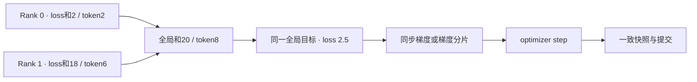

# 一次分布式参数更新怎样保持同一个目标

模型训练状态需要80GB、每卡只有40GB可用时，把完整模型复制到两卡仍然放不下。必须决定切分哪些状态或计算；等到能运行，还要确认各rank同步的是同一目标的梯度，中断时保存的是同一时刻。

## 先把显存按状态列出来

某些混合精度Adam配置可近似按每参数16字节计，包含低精度权重、梯度、高精度主副本与两个矩状态。但梯度dtype、是否存在主副本以及优化器实现都会改变这个数，激活和临时缓冲还没有算入。

数据并行复制模型以分担样本；张量并行切层内矩阵；流水线并行切模型层；状态分片切参数、梯度或优化器持有权。它们节省的是不同部分，并引入不同通信。

{ width="860" }

<small>图源：[ZeRO: Memory Optimizations Toward Training Trillion Parameter Models](https://arxiv.org/abs/1910.02054)，Figure 1。这张图说明：普通 data parallel 会复制 optimizer states、gradients 和 parameters，ZeRO 三个阶段分别把这些状态分片。</small>

## 用8卡说明组如何组合

假设TP=2、PP=2、DP=2，三组互相独立，可得到8个rank。每个DP副本内部有两个stage，每stage用两卡切层内计算。这里world size是三个独立维度的乘积。

EP或CP等配置不一定都是新增独立维度。例如专家并行可能组织在既有DP组内部，不能把所有名字后的数字不加分析地相乘。先画出每个参数分片由哪些rank持有，再核对框架的组定义。

## DDP平均之前，loss分母必须一致

假设两rank的有效token数为2和6，token loss总和为2和18。全局token平均loss为 $(2+18)/(2+6)=2.5$。先各自平均再平均得到 $(1+3)/2=2$，优化的是不同目标。

若DDP按R个rank平均梯度，令每rank局部反向目标为 $R S_r/D$，D为全局有效token数，则平均后得到正确全局token目标梯度。梯度累积时D还应覆盖相应更新包含的全部微批，具体组织要与同步次数匹配。

<!-- systems-workflow-visual -->


这里把统计口径与更新顺序分开画出。局部均值1和3直接平均会变成2，不能替代全局token平均2.5。

## 梯度何时变成新的参数

各rank完成局部backward，必要通信使它们获得所需梯度或梯度分片，优化器随后更新各自负责的状态。参数分片方案还需在下一次计算前按需收集对应参数。

Pipeline以microbatch穿过stage，启动与排空会产生bubble。增大microbatch数量可以摊薄部分bubble，但也改变激活驻留和调度。GPipe等图展示的是特定调度，不能直接代替当前框架实际时间线。

{ width="860" }

<small>图源：[GPipe: Efficient Training of Giant Neural Networks using Pipeline Parallelism](https://arxiv.org/abs/1811.06965)，Figure 2(c)。这张图说明：mini-batch 被拆成多个 micro-batch 后，不同 accelerator 可以同时处理不同模型分段，从而减少 stage 等待。</small>

## Checkpoint要落在一致提交边界

如果rank0保存更新后参数，rank1保存更新前参数，文件都能读取也不是一致快照。异步保存更要区分“内存快照已冻结”“文件写完”“整组提交完成”三件事。

除了参数，还需按恢复目标保存优化器、scheduler/scaler、RNG、数据消费位置与并行配置。nanoGPT示例保存model/optimizer等状态，但没有完整保存所有RNG和数据进度，不能据此声称精确重放。

## 用三步短跑证明恢复语义

连续运行到step3，另一路在step1保存并恢复，再跑到step3。比较两条路径实际消费的输入、loss、参数和优化器状态。改变world size时还要验证分片重组与采样语义。

如果目标只要求统计上继续训练而非逐样本重放，应明确允许哪些重复或随机差异。可加载checkpoint只是起点，恢复后的更新轨迹才验证保存协议。


## 对照源码与延伸阅读

- [DDP同步、优化器更新与示例checkpoint字段](https://github.com/karpathy/nanoGPT/blob/3adf61e154c3fe3fca428ad6bc3818b27a3b8291/train.py)

## Checkpoint 是状态协议，不只是模型文件

一次可恢复的训练提交至少要区分四类状态：

| 状态 | 例子 | 缺失后的表现 |
| --- | --- | --- |
| 模型 | 参数、共享权重、adapter | 输出可能直接改变 |
| 优化器 | Adam 一阶/二阶矩、step、master weight | loss 可能连续但更新轨迹改变 |
| 数值 | GradScaler、overflow 计数、loss scale | 恢复后突然 NaN 或更新过小 |
| 数据与随机性 | sampler epoch、游标、RNG、并行组 | 重复样本、跳过样本或无法复现 |

如果只保存 `model.pt`，它可以用于推理，却不一定可以继续训练。保存协议应在 manifest 中写出 schema 版本、global step、consumed tokens、world size、TP/PP/DP/EP 配置、数据版本和每个 shard 的校验值。

## 一致快照需要提交边界

可以把保存过程看成两阶段提交：

```text
冻结本轮状态
  -> 每个 rank 写临时 shard 与校验值
  -> rank 0 收齐 manifest 和所有校验值
  -> 原子写入 COMMITTED 标记
  -> 更新 latest 指针
```

`latest` 不能在所有 shard 完成前更新。恢复程序先读 manifest 和校验值，再决定是否加载；发现缺 shard、大小不符或提交标记缺失时，应回退到上一份完整快照，而不是拼出一个“看起来能读”的模型。

异步保存可以减少训练停顿，但要先冻结一个不可变的内存视图。否则保存线程可能在 rank 0 读取参数时，optimizer 已经开始下一次写入，产生文件内部自洽但跨状态不一致的快照。

## 改变 world size 时要验证什么

改变 DP 数通常只改变数据分片，改变 TP/PP/参数分片则可能需要重排权重和优化器状态。恢复测试应覆盖：

| 场景 | 必须比较 |
| --- | --- |
| 同 world size 继续 | 输入顺序、loss、参数和 optimizer step |
| DP 改变 | 每个样本是否重复/遗漏，global batch 是否保持 |
| TP/PP 改变 | shard 重组、层边界和激活 shape |
| 只加载模型做推理 | 输出 logits 与原模型的容差 |
| 缺 shard 或中断写入 | 是否安全回退，不污染 latest |

如果目标只是“从相近状态继续优化”，可以允许非确定性；如果目标是逐样本重放，就要把 RNG、sampler 状态、数据版本和非确定性算子一起纳入验收。两种目标不要用同一条“恢复成功”描述。

## 一个最小恢复实验

用固定小数据和小模型做三条路径：

1. 连续运行到 step 6。
2. step 3 保存，停止进程，从 checkpoint 恢复到 step 6。
3. 在写入中途模拟进程终止，再启动并确认回退到 step 3 或上一份 committed 快照。

比较每一步的输入 ID、有效 token、loss、参数校验、optimizer step 和 RNG 派生结果。只有这些字段满足预先定义的容差，才可以说恢复语义成立；长作业“没有再次崩溃”不能替代这个短跑。

## 来源与改编说明

- [ZeRO](https://arxiv.org/abs/1910.02054)用于区分参数、梯度和优化器状态的分片层次。
- [PyTorch Distributed Checkpoint](https://pytorch.org/docs/stable/distributed.checkpoint.html)提供分布式状态保存、加载和重分片的官方接口方向，具体 API 需按安装版本核对。
- [Megatron-LM checkpoint 文档](https://github.com/NVIDIA/Megatron-LM/blob/main/README.md)用于对照并行组与 checkpoint 转换；不同版本的 shard schema 不能互相假定兼容。

## 自测

1. 为什么保存了模型参数仍可能无法逐样本恢复训练？
2. `latest` 指针应该在什么时刻更新？缺少哪个证据时应回退？
3. 改变 DP 和改变 TP 对恢复语义的影响有什么不同？
4. 设计一个三步短跑，能区分“模型加载成功”和“训练轨迹恢复正确”。

若要把状态分片与通信布局放在一起看，可以接[Megatron、DeepSpeed 与开放训练栈](megatron-lm-deepspeed-and-open-training-stacks.md)；实验记录的 question、checkpoint 和失败样本可沿[从假设到证据的研究闭环](research-loop-from-hypothesis-to-evidence-1123-2351.md)回放。
